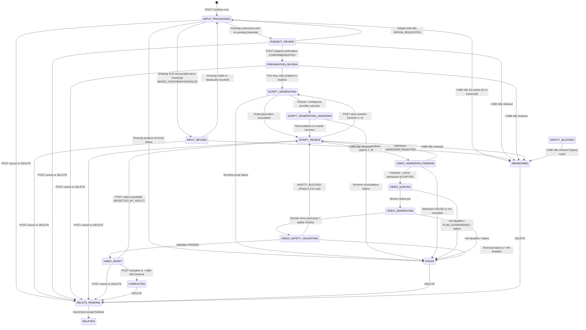
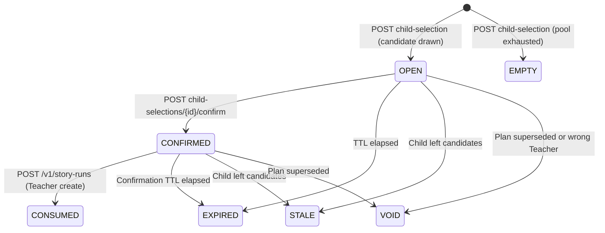
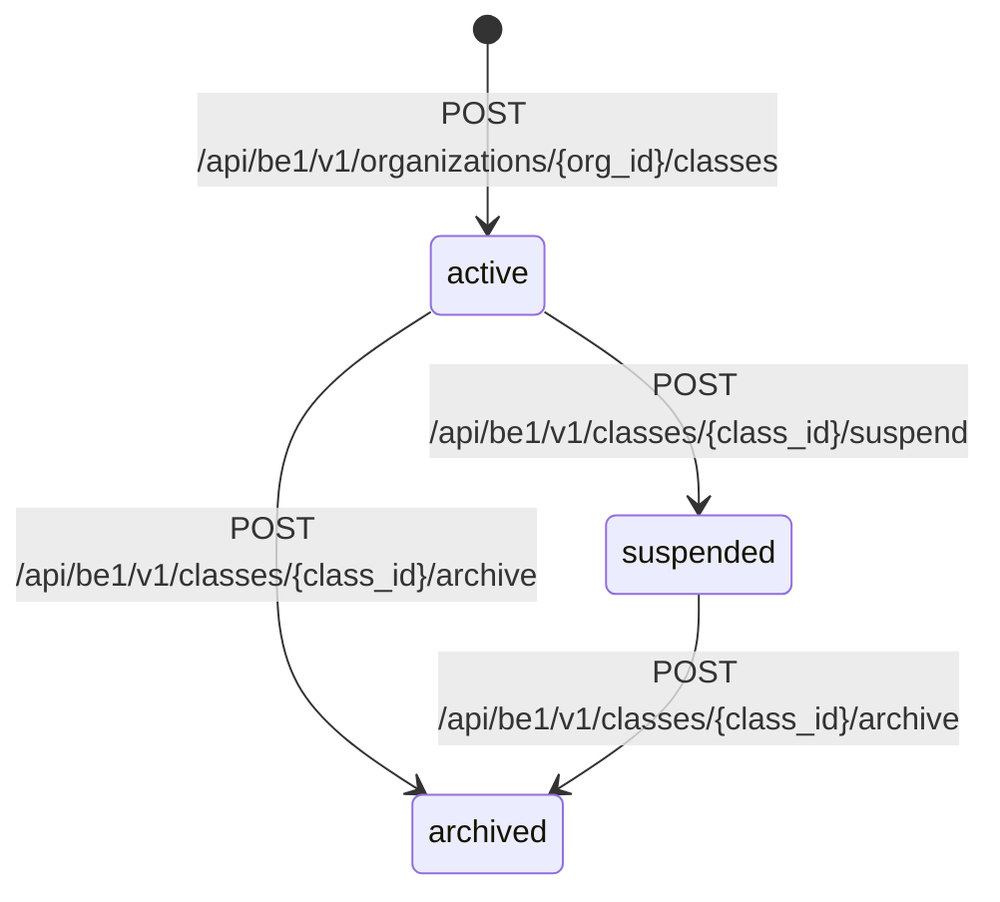
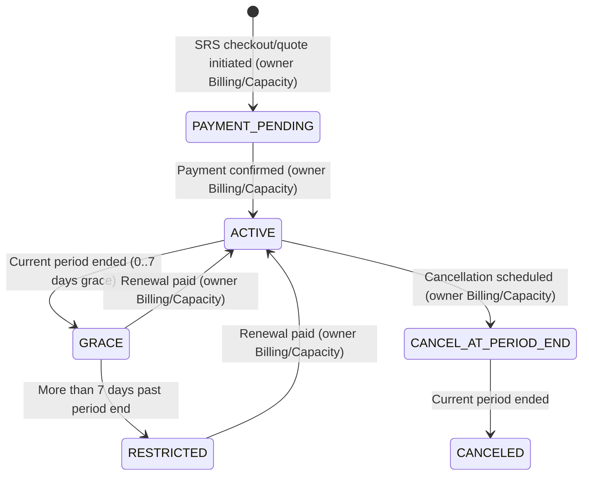

# Backend Architecture and State Machines

- **Date:** 2026-11-25
- **Source tree:** Integration checkout: branch `feature/backend-srs-api-and-fe-integration`, commit `297f2849f9db26bb142123da5e1673dcd58673ae`
- **Canonical SRS authority:** `features/FEAT-063-system-architecture-rearchitecture/artifacts/SKETCH2LIFE_SYSTEM_ARCHITECTURE_SRS.md` (`v2.7-draft`, awaiting formal owner sign-off, per `docs/context/SRS_AUTHORITY.md`)
- **Generated from code by agy and checked by Claude.**
- **Scope note:** Where `v2.7-draft` SRS defines target states/rules not yet written or enforced in code, both SRS references and built code behavior are recorded explicitly. Commercial subscription/quota internals are marked `owner: Billing/Capacity`.

## Table of Contents

1. [Backend Architecture Overview](#1-backend-architecture-overview)
   - [1.1 Layered Structure and Dependency Boundaries](#11-layered-structure-and-dependency-boundaries)
   - [1.2 Core Services and Ports](#12-core-services-and-ports)
   - [1.3 Persistence: PostgreSQL Schemas and Alembic Migrations](#13-persistence-postgresql-schemas-and-alembic-migrations)
   - [1.4 Authentication, Identity, and Role Model](#14-authentication-identity-and-role-model)
2. [State Machines (SRS Checked Against Code)](#2-state-machines-srs-checked-against-code)
   - [2.1 StoryRun, Job, StoryRevision, Review Epoch, and VideoGeneration](#21-storyrun-job-storyrevision-review-epoch-and-videogeneration)
   - [2.2 LessonOccurrence, PlanRevision, ChildSelection, and Sample Slot Projection](#22-lessonoccurrence-planrevision-childselection-and-sample-slot-projection)
   - [2.3 Classroom and Organization Subscription State](#23-classroom-and-organization-subscription-state)

---

## 1. Backend Architecture Overview

### 1.1 Layered Structure and Dependency Boundaries

The backend (`backend/src/sketch2life/`) follows a strict inward-dependency Clean/Hexagonal layout documented in `docs/architecture/OVERVIEW.md` and enforced automatically by `tools/validate_architecture.py:10-35` (verified with zero import cycles across `33,257` nodes in the codebase AST/import scan):

1. **`domain/` (`50` non-`__init__` Python modules):** Framework-free business entities, pure state transition graphs, and invariant validators (e.g., `domain/story_video/model.py`, `domain/story_run_closeout.py`, `domain/story_run_reminder.py`, `domain/story_teacher.py`, `domain/lesson_occurrences/{model,plan,child_selection,projection}.py`, `domain/lesson_library/model.py`, `domain/billing_capacity.py`, `domain/parent_profiles.py`). `tools/validate_architecture.py:10-30` forbids importing `fastapi`, `pydantic`, `sqlalchemy`, `redis`, `rq`, `boto3`, `httpx`, or any outer layer.
2. **`application/` (`195` non-`__init__` Python modules across `ports/`, `services/`, `commands/`, `job_kinds.py`):** Use-case orchestration, policy evaluation, job registry, and abstract `Protocol` ports (`application/ports/*.py`). `tools/validate_architecture.py:31-35` forbids importing `sketch2life.infrastructure` or `sketch2life.interfaces`.
3. **`contracts/` (`schemas/`):** Strictly typed Pydantic v2 request/response schemas (including `extra="forbid"`, normalized validation helpers, and versioned contract models such as `contracts/schemas/parent_profiles.py`, `lesson_occurrences.py`, `lesson_library.py`, `notifications.py`, `be1_capacity.py`, `parent_story.py`, `platform_admin.py`).
4. **`infrastructure/`:** Concrete adapters implementing `application/ports/*`: PostgreSQL/SQLAlchemy repositories (`infrastructure/persistence/*`, `infrastructure/lesson_library/*`, `infrastructure/lesson_occurrences/*`, `infrastructure/story_video/*`, `infrastructure/story_teacher/*`, `infrastructure/notifications/*`, `infrastructure/uploads/*`), S3/object storage, Firebase ID token verifier, Modal/Lightning AI clients, RQ/inline job recorders, and VNPay/MoMo payment adapters.
5. **`interfaces/http/` (`77` non-`__init__` / `79` total Python modules):** FastAPI application factory (`app.py`), router composition (`router_composition.py`), request-ID middleware, bounded image upload middleware (`middleware/bounded_image_upload.py`), error normalization (`error_envelope.py`, `api_conventions.py`), HTTP dependency wiring (`be1_runtime.py`, `parent_runtime.py`, `story_run_actor.py`, `support_needs_runtime.py`), and HTTP routers (`interfaces/http/routers/*.py`).

### 1.2 Core Services and Ports

| Domain area | Application Ports (`application/ports/`) | Application / Infrastructure Implementation |
|---|---|---|
| **Identity & Access** | `identity.py` (`VerifiedPrincipal`), `parent_roles.py`, `story_run_actor.py` | `interfaces/http/be1_runtime.py`, `parent_runtime.py`, `account_scope.py`, `routers/auth_registration.py` |
| **Parent Profiles & Support Needs** | `parent_profiles.py`, `parent_profile_context.py`, `support_needs.py` | `application/services/{parent_profiles,parent_profile_context,support_needs}.py`, `infrastructure/persistence/{parent_profile_repository,support_needs_repository,postgres_support_needs}.py` |
| **StoryRun & Inputs & Teacher Create** | `parent_story_runs.py`, `parent_story_inputs.py`, `parent_activity_catalog.py`, `vision_understanding_v2.py`, `asr.py` | `application/services/{parent_story_runs,parent_activity_selection,story_review_rules,story_run_detail}.py`, `infrastructure/persistence/{parent_story_repository,story_first_start}.py`, `infrastructure/story_teacher/repository.py` |
| **Story Video, Closeout & Playback** | `story_video.py`, `video_playback.py`, `story_run_closeout.py`, `story_run_lifecycle.py`, `story_task_reaper.py` | `application/services/{story_run_video,story_run_playback,story_run_closeout,story_task_reaper}.py`, `infrastructure/story_video/{repository,job_projection}.py` |
| **Lesson Occurrences** | `lesson_documents.py`, `approved_plan_read.py`, `inline_jobs.py` | `infrastructure/lesson_occurrences/{service,documents,plans,child_selection,projection,approved_plan_reader,scope}.py` |
| **Lesson Library & Feedback** | `core_foundation.py` (`CoreFoundation`), repository ports | `infrastructure/lesson_library/{service,platform_publication,feedback}.py` |
| **Uploads & Media** | `upload_sessions.py`, `upload_validation.py`, `object_storage.py`, `image_decoder.py` | `infrastructure/uploads/{service,resolvers}.py`, `infrastructure/documents/lesson_parser.py` |
| **Jobs & Notifications** | `ai_jobs.py`, `notifications.py`, `push_endpoints.py`, `push_delivery.py` | `application/{job_kinds,services/ai_jobs,services/notifications,services/push_endpoints,services/push_delivery,services/story_run_reminder}.py`, `infrastructure/{ai_jobs,notifications/{inbox_repository,push_endpoint_repository,push_delivery_repository,notification_worker},story_video/reminder_store}.py` |
| **Billing & Capacity** | `owner: Billing/Capacity` | `domain/billing_capacity.py`, `infrastructure/billing/quota_commerce.py`, `infrastructure/persistence/billing_models.py`, `infrastructure/platform_admin/{sandbox_billing,sandbox_capacity}.py`, `interfaces/http/routers/{be1_billing,be1_registry}.py` |

### 1.3 Persistence: PostgreSQL Schemas and Alembic Migrations

Runtime persistence targets PostgreSQL using SQLAlchemy Core/ORM models and Alembic migrations (`backend/alembic/versions/`):

- **PostgreSQL Schemas & Core Table Families:**
  - `public` (`47` migration-defined tables plus BE1 ORM models in `be1_models.py`): `be1_organizations`, `be1_classrooms`, `be1_adult_identities`, `be1_organization_assignments`, `be1_managed_profiles`, `be1_profile_revisions`, `be1_profile_support_needs`, `be1_enrollments`, `be1_consent_records`, `be1_sessions`, `be1_session_groups`, `be1_session_memberships`, `be1_child_turns`, `be1_device_grants`, `be1_command_receipts`, `be1_parent_groups`, `be1_parent_group_members`, `core_upload_sessions`, `core_asset_metadata`, `core_audit_entries`, `lesson_library_*`.
  - `notifications` (`3` tables, `infrastructure/notifications/tables.py`, `20261120_nt_0001`–`20261125_nt_0003`): `inbox_items`, `push_endpoints`, `push_deliveries`.
  - `story` (`11` tables, `infrastructure/story_run_lite/tables.py`): `story_runs`, `story_run_inputs`, `drawing_understandings`, `voice_transcripts`, `story_revisions`, `story_scenes`, `story_revision_reviews`, `video_generations`, `video_generation_scenes`, `command_receipts`, `task_audit`.
  - `lesson` (`8` tables, `infrastructure/lesson_occurrences/tables.py`, `20261121_ll_0001`): `lesson_occurrences`, `source_documents`, `document_revisions`, `plan_revisions`, `plan_activities`, `child_selections`, `child_selection_candidates`, `library_version_lineage`.
  - `parent` (`3` tables): `parent_profiles`, `parent_profile_context_entries`, `parent_profile_idempotency_receipts`.
  - `billing` (`11` tables, `owner: Billing/Capacity`, `billing_models.py`): `organization_subscriptions`, `capacity_quotes`, `quota_products`, `invoices`, `payment_attempts`, `quota_allocations`, and related ledgers.
  - Other specialized schemas present in Alembic migrations: `ai_policy` (`25` tables), `learning_content` (`6` tables), `video_review` (`6` tables), `video_failure` (`3` tables), `knowledge_video` (`2` tables).
- **Alembic Graph State (recomputed from `backend/alembic/versions/` at `297f2849`):**
  - **`64` revisions**, **`16` down-only heads**, **`11` dependency-aware heads** (multi-branch graph merged across `depends_on` edges) — includes `20261121_ll_0001_remix_lineage`, `20261121_pg_0001_declined_membership` (chained onto `20261120_sel_0001`), `20261121_nt_0002_push_endpoints`, and `20261125_nt_0003_push_deliveries`.

### 1.4 Authentication, Identity, and Role Model

- **Principal Verification (`VerifiedPrincipal`):** Every adult route validates a Firebase Bearer ID token via the configured identity verifier (`be1_runtime.py:165-230`, `parent_runtime.py:45-100`), producing an immutable `VerifiedPrincipal` carrying external identity `subject`, issuer, and email-verification status.
- **Account & Org Assignment Mapping (`be1_models.py:55-150`):**
  - `AdultIdentityModel` (`be1_adult_identities`): binds the external Firebase identity (`provider`, `subject`) to an internal `account_id`, primary `account_role` (`platform_admin`, `school_admin`, `teacher`, `guide`, `observer`, `parent`), `state` (`active`/`disabled`), and `is_active` flags.
  - `OrganizationAssignmentModel` (`be1_organization_assignments`): binds an adult account to an `organization_id`, `role` (`school_admin`, `teacher`, `guide`, `observer`), optional `class_id`, and `state` (`active`/`revoked`), enforced by `Be1RuntimePolicy.authorize_adult` (`application/services/be1_runtime.py:17-62`).
  - **Authorization separation:** Parent StoryRun ownership uses SHA-256 `(issuer, subject)` owner-scope refs (`story_run_actor.py`, `parent_story_repository.py:4481-4567`); Teacher StoryRun/Occurrence/Selection authority verifies `OrganizationAssignmentModel` against the target organization and class (`lesson_occurrences/scope.py:86-180`, `domain/story_teacher.py:44-49`). Classroom child devices authenticate separately via per-session device grants (`be1_runtime.py:232-458`).

---

## 2. State Machines (SRS Checked Against Code)

### 2.1 StoryRun, Job, StoryRevision, Review Epoch, and VideoGeneration

#### Run State Diagram (`story.story_runs.run_state`)

*SRS comparison notes:*
- SRS §6.1.1 (l.394) lists `DRAFT` and `STORY_GENERATING`; PostgreSQL `ck_story_run_state` (`20261102_story_run_lite.py:300-410`) and code use `INPUT_PROCESSING` (with no attached job as draft-like wait, `domain/story_run_closeout.py:28-29, 43-45`) and `SCRIPT_GENERATING` / `SCRIPT_GENERATION_UNKNOWN`.
- Legacy state `SAFETY_BLOCKED` remains valid in `ck_story_run_state` and closeout/review rules ONLY for pre-Phase-A rows (`domain/story_video/model.py:77-79, 93-95`, `domain/story_run_closeout.py:29-32`). Since Phase A owner decision C11, a safety-blocked `VideoGeneration` transitions `run_state` directly back to `SCRIPT_REVIEW`.
- Owner lock release (`LOCK_FREE_STATES`, `domain/story_teacher.py:44-49`): lock is held in all non-terminal states and released only in `COMPLETED`, `FAILED`, `ABANDONED`, `DELETE_PENDING`, `DELETED`.

#### StoryRun Transition Table

| From | Command or event | To | Guard | Route | Source (SRS id, code file:line) |
|---|---|---|---|---|---|
| `[*] ` | Create run (Parent or Teacher) | `INPUT_PROCESSING` | Active account/role; no active Parent run (`ACTIVE_RUN_EXISTS`); Teacher: approved plan, writable class, free occurrence slot, `CONFIRMED` selection (`CONFIRMED -> CONSUMED`) | `POST /v1/story-runs` | SRS §6.1.1 l.394, l.553, l.1662; `parent_story_repository.py:300, 377`; `story_teacher/repository.py:115, 243` |
| `INPUT_PROCESSING` | Attach artwork / complete upload | `INPUT_PROCESSING` | Not purged; writable class; no understood/locked conflict; queues drawing VLM job | `POST /v1/story-runs/{id}/artwork-upload*`, `.../attachments` | SRS FR-P-12 l.521; `parent_story_repository.py:1550, 1761, 1893, 2020` |
| `INPUT_PROCESSING` | Submit text/voice idea or transcript correction | `INPUT_PROCESSING` / `INPUT_REVIEW` / `SUBJECT_REVIEW` | Input state; `expected_run_revision` matches; settles via `settle_input_state()` (`ASR PENDING -> INPUT_PROCESSING`, `ASR NEEDS_CONFIRMATION/FAILED -> INPUT_REVIEW`) | `POST /v1/story-runs/{id}/idea` | SRS l.982, l.1665; `parent_story_repository.py:3936-4013, 4842-4876` |
| `INPUT_PROCESSING` | Drawing VLM succeeded | `SUBJECT_REVIEW` / `INPUT_REVIEW` | Run still `INPUT_PROCESSING`; `SUBJECT_REVIEW` if no transcript waiting, else `INPUT_REVIEW` | Async VLM worker | SRS l.394; `parent_story_repository.py:2094, 2159, 4865-4876` |
| `INPUT_PROCESSING` | Drawing VLM recoverable fail | `INPUT_REVIEW` | Run `INPUT_PROCESSING`, no understanding yet, retryable failure -> `job_state=FAILED` | Async VLM worker | SRS l.394; `parent_story_repository.py:2049-2085` |
| `INPUT_PROCESSING` | Drawing VLM terminal fail (`outcome_unknown=False`) | `FAILED` | Run `INPUT_PROCESSING` with in-flight analysis; releases lock | Async VLM worker | SRS l.394; `parent_story_repository.py:3462-3505` |
| `INPUT_REVIEW` | Retake artwork / confirm transcript / resubmit idea | `INPUT_PROCESSING` / `SUBJECT_REVIEW` | `transcript_state == NEEDS_CONFIRMATION`, `expected_transcript_revision` & `transcript_sha256` match | `POST /v1/story-runs/{id}/transcript-confirmation`, `.../idea`, `.../attachments` | SRS l.1713; `parent_story_repository.py:1084-1097, 4202-4275, 4842-4876` |
| `SUBJECT_REVIEW` | Confirm subject (`CONFIRMED` / `EDITED` no rerun) | `PREPARATION_REVIEW` (or `SCRIPT_GENERATING` for Teacher) | Run `SUBJECT_REVIEW`; revision & hash match. **Phase A (`OPEN-A`)**: Teacher plain confirm runs `_first_story_probe()` and enters `SCRIPT_GENERATING` implicitly if plan/activity/class ready | `POST /v1/story-runs/{id}/subject-confirmation` | SRS l.394; `parent_story_repository.py:2167-2360` |
| `SUBJECT_REVIEW` | Subject edited with `RERUN_REQUESTED` | `INPUT_PROCESSING` | Queues re-analysis job (`job_state=QUEUED`); never triggers first-story start | `POST /v1/story-runs/{id}/subject-confirmation` | `parent_story_repository.py:2182-2186, 2379-2425` |
| `INPUT_PROCESSING` / `SUBJECT_REVIEW` / `PREPARATION_REVIEW` | Confirm Parent context or select main activity | Same state or `SCRIPT_GENERATING` | **Phase A (`T-2e-a`)**: if run is in `PREPARATION_REVIEW` and last gate (context confirmed + main activity selected + subject confirmed + transcript confirmed) becomes true, `_first_story_starter()` reserves rev 1 -> `SCRIPT_GENERATING` | `POST /v1/story-runs/{id}/context-confirmation`, `POST /v1/story-runs/{id}/activity-selection` | SRS l.1666-1668; `parent_story_repository.py:1140-1230, 1346-1480`; `story_first_start.py` |
| `PREPARATION_REVIEW` | Legacy explicit first story generate | `SCRIPT_GENERATING` | Legacy `POST /api/parent/v1/ai/story-runs/{id}/story-revisions` additionally requires prior activity selection (`409 PARENT_ACTIVITY_SELECTION_REQUIRED`) | `POST /v1/story-runs/{id}/story-revisions`, legacy `/api/parent/v1/ai/...` | `parent_story_repository.py:2547-2735, 2651` |
| `SCRIPT_GENERATING` | Script LLM completes | `SCRIPT_REVIEW` | Run `SCRIPT_GENERATING`; creates `story_revisions` `DRAFT` (valid Vietnamese, `duration_ms` 30s–90s, 1–15 scenes) | Async LLM worker | SRS l.394; `parent_story_repository.py:3061-3155`; `tables.py:676-702` |
| `SCRIPT_GENERATING` | Script failure or ambiguous timeout | `FAILED` or `SCRIPT_GENERATION_UNKNOWN` (or `SCRIPT_REVIEW` if rewrite recoverable) | `outcome_unknown=True` -> `SCRIPT_GENERATION_UNKNOWN`; rewrite failure with retry slots recovers to `SCRIPT_REVIEW` | Worker / reaper | `parent_story_repository.py:3212-3450` |
| `SCRIPT_REVIEW` / `SAFETY_BLOCKED` *(legacy)* | Confirm script revision (epoch 1..3) | `SCRIPT_REVIEW` | Latest revision matches `expected_revision` & `story_sha256`; if `DRAFT` -> epoch 1; if `CONFIRMED` -> latest review must be spent (`review_is_spent`) and `next_review_epoch <= 3` and `accepted_video_count < 3` (**Phase A `T-1b-fix`**) | `POST /v1/story-runs/{id}/script-confirmation` | SRS l.255, l.406, l.1728; `parent_story_repository.py:3587-3715`; `application/services/story_review_rules.py:27-72` |
| `SCRIPT_REVIEW` | Request script rewrite | `SCRIPT_GENERATING` | Latest story `DRAFT` or `FAILED`, or (`CONFIRMED` and `revision_has_spent_video`); `revision_no < 4` (max 3 rewrites) | `POST /v1/story-runs/{id}/story-rewrites` | SRS l.416, l.1668; `parent_story_repository.py:2782-3015` |
| `SCRIPT_REVIEW` | Request video generation | `VIDEO_ADMISSION_PENDING` | Latest revision `CONFIRMED`, latest review epoch unspent, context & subject confirmed, Teacher pinned plan not superseded (`409 STALE_REVISION` if superseded), `accepted < 3` | `POST /v1/story-runs/{id}/video-generations` | SRS l.395, l.1670; `infrastructure/story_video/repository.py:272-602` |
| `VIDEO_ADMISSION_PENDING` | Admission worker result | `VIDEO_QUEUED` or `SCRIPT_REVIEW` or `FAILED` | `ACCEPTED` -> `VIDEO_QUEUED`; `ADMISSION_REJECTED` -> `SCRIPT_REVIEW` (review NOT consumed); run cancelled mid-flight -> `FAILED` (`RUN_CANCELLED`) | Video admission worker | SRS l.395; `domain/story_video/model.py:80-89`; `story_video/repository.py:659-829` |
| `VIDEO_QUEUED` / `VIDEO_GENERATING` / `VIDEO_SAFETY_VALIDATING` | Render & validation pipeline | `VIDEO_GENERATING` -> `VIDEO_SAFETY_VALIDATING` -> `VIDEO_READY` or `SCRIPT_REVIEW` or `FAILED` | **Phase A (`C11`)**: `SAFETY_BLOCKED` generation moves run to `SCRIPT_REVIEW` (with public error `VIDEO_SAFETY_BLOCKED`), NOT run `SAFETY_BLOCKED`. Technical fail, cancelled run, or `+6h` `GENERATION_DEADLINE` moves to `FAILED` (`PLAN_SUPERSEDED` -> `VIDEO_TECHNICAL_FAILURE`) | Video pipeline worker / closeout sweeper (`6h`) | SRS l.395, l.420, l.573, l.2197; `domain/story_video/model.py:61-92`; `story_video/repository.py:1293-1470`; `domain/story_run_closeout.py:18` |
| `VIDEO_READY` | Adult marks video unsuitable | `SCRIPT_REVIEW` | `run_state == VIDEO_READY`, generation `READY`, `expected_revision` matches -> generation becomes `REJECTED_BY_ADULT` (`accepted < 3` else `409 VIDEO_REGENERATION_LIMIT_REACHED`) | `POST /v1/story-runs/{id}/video-unsuitable` | `infrastructure/story_video/repository.py:878-955` |
| `VIDEO_READY` | Adult completes run | `COMPLETED` | `run_state == VIDEO_READY`, `expected_revision` matches; releases lock; playback stays allowed (`allow_completed=True`, **Phase A `O-3`**) | `POST /v1/story-runs/{id}/complete` | SRS l.1672; `story_video/repository.py:958-1005`; `domain/story_video/model.py:209-215` |
| `ADULT_WAIT_STATES` | Closeout idle sweep (`+168h`) | `COMPLETED` (from `VIDEO_READY`) or `ABANDONED` (others) | No active job (`QUEUED`/`RUNNING`/`RETRY_WAIT`/`AWAITING_RECONCILIATION`) and no pending ASR transcript for `168h` since `max(updated_at, adult_wait_started_at, last_meaningful_activity_at)` | Scheduled closeout sweeper | SRS FR-C-11 l.394, l.503; `domain/story_run_closeout.py:17-105`; `application/services/story_run_closeout.py:55-110` |
| Non-deleted run | Cancel or delete | `DELETE_PENDING` -> `DELETED` | Cancel refuses closed/generating conflicts per lifecycle rules; releases lock and schedules/performs content purge | `POST /v1/story-runs/{id}/cancel`, `DELETE /v1/story-runs/{id}` | SRS FR-C-08, l.807; `parent_story_repository.py:757-975` |

#### Sub-Entity State Machines (StoryRevision, VideoGeneration, AiJob)

- **`story.story_revisions.status` (`tables.py:677-681`):** `GENERATING -> DRAFT -> CONFIRMED -> SUPERSEDED` (on rewrite), or `GENERATING -> AWAITING_RECONCILIATION | FAILED` (`rewrite recovery` resets `SCRIPT_GENERATION_UNKNOWN -> SCRIPT_REVIEW` with `FAILED` job).
- **`story.video_generations.state` (`domain/story_video/model.py:16-74`):** `ADMISSION_PENDING -> {ACCEPTED, ADMISSION_REJECTED, FAILED}`; `ACCEPTED -> {QUEUED, FAILED}`; `QUEUED -> {GENERATING, FAILED}`; `GENERATING -> {TECHNICAL_VALIDATING, FAILED}`; `TECHNICAL_VALIDATING -> {SAFETY_VALIDATING, FAILED}`; `SAFETY_VALIDATING -> {READY, SAFETY_BLOCKED, FAILED}`; `READY -> {REJECTED_BY_ADULT, SUPERSEDED}`. Review epoch (`story.story_revision_reviews.review_epoch`, `1..3`, `20261123_rv_0001`) pairs at most once with a non-rejected generation (`uq_vg_review_consumed`). Admission uses `BillingVideoQuotaAdmission` (`T-QC1`) when `story_video_adapters=billing` (refusals store no receipt).
- **AI Job (`domain/ai_jobs/model.py:17-35`, `domain/story_video/model.py:110-131`):** Internal `JobState`: `queued -> running -> {succeeded, failed_retryable, failed_exhausted, blocked_unsafe}` (`queued`/`running`/`failed_retryable` -> `cancelled`). Video generations map onto `AiJobStatusV1` states (`QUEUED`, `RUNNING`, `SUCCEEDED`, `FAILED`) and `job_kinds.py:35-45` (`STORY_RUN`, `VIDEO_GENERATION`, `VIDEO_GENERATION_SCENE`, `LESSON_SOURCE_DOCUMENT`, etc.).
- **Adult-Wait Reminders & Push Delivery (`T-1d2` / `T-NTF1`, `infrastructure/notifications/tables.py`, `notification_worker.py`):** At `+144h` in Parent `ADULT_WAIT_STATES`, the `reminders` CLI sweep writes a `RUN_WAIT_REMINDER` (v1) row into `notifications.inbox_items` without changing `run_state`. The `push-delivery` CLI sweep transitions `notifications.push_deliveries.status` across `PENDING -> {SENT, FAILED, DEAD_ENDPOINT, SKIPPED}` (max 5 attempts; `DEAD_ENDPOINT` revokes the `notifications.push_endpoints` row `ACTIVE -> REVOKED`; local/test only).

---

### 2.2 LessonOccurrence, PlanRevision, ChildSelection, and Sample Slot Projection

#### Occurrence, Plan, Child Selection, and Sample Slot Diagrams

```mermaid
stateDiagram-v2
    [*] --> DRAFT : POST /v1/lesson-occurrences
    DRAFT --> DOCUMENT_REVIEW : SRS target (no separate transition endpoint in v3)
    DOCUMENT_REVIEW --> PLAN_REVIEW : SRS target (no separate transition endpoint in v3)
    DRAFT --> APPROVED : POST plan-revisions/{rev}/confirm
    DOCUMENT_REVIEW --> APPROVED : POST plan-revisions/{rev}/confirm
    PLAN_REVIEW --> APPROVED : POST plan-revisions/{rev}/confirm
    APPROVED --> SAMPLE_AVAILABLE : SRS target (written via sample_slot_state=AVAILABLE)
    APPROVED --> SAMPLE_USED : POST projection-confirmation (slot AVAILABLE -> CLAIMED)
    SAMPLE_AVAILABLE --> SAMPLE_USED : POST projection-confirmation (slot AVAILABLE -> CLAIMED)
    DRAFT --> ARCHIVED : SRS target (guarded in code; archive command unbuilt)
    APPROVED --> ARCHIVED : SRS target (guarded in code; archive command unbuilt)
    SAMPLE_USED --> ARCHIVED : SRS target (guarded in code; archive command unbuilt)
```

*SRS vs. Code note (`lesson_occurrences/model.py:20-30`, `plan.py:37-51`, `documents.py:308-311`):*
- `OCCURRENCE_STATES` defines all 7 SRS §6.1.1 (l.396) values (`DRAFT`, `DOCUMENT_REVIEW`, `PLAN_REVIEW`, `APPROVED`, `SAMPLE_AVAILABLE`, `SAMPLE_USED`, `ARCHIVED`).
- In built code, `create` writes `DRAFT`; attaching documents keeps `DRAFT`; confirming any `DRAFT` plan revision checks `PRE_APPROVAL_STATES = {"DRAFT", "DOCUMENT_REVIEW", "PLAN_REVIEW"}` and jumps directly to `APPROVED` (`plans.py:743`); claiming the sample slot via `projection-confirmation` sets `sample_slot_state = "CLAIMED"` and moves `state` to `SAMPLE_USED` (`projection.py:371-374`). `DOCUMENT_REVIEW`, `PLAN_REVIEW`, `SAMPLE_AVAILABLE`, and `ARCHIVED` transitions are not yet emitted by HTTP commands, though `ARCHIVED` is enforced as a read-only guard everywhere (`documents.py:311`, `plans.py:179`, `child_selection.py:347`, `projection.py:228`).

#### Lesson Occurrence & Related Entity Transition Table

| Entity / From | Command or event | To | Guard | Route | Source (SRS id, code file:line) |
|---|---|---|---|---|---|
| **Occurrence:** `[*]` | Create lesson occurrence | `DRAFT` (`sample_slot_state=AVAILABLE`) | Assigned `teacher` of class (`409 TEACHER_ASSIGNMENT_REQUIRED` for other teacher-family org roles; `404` outside org); valid lesson pin (`APPROVED` version) | `POST /v1/lesson-occurrences` | SRS §6.1.1 l.396, l.1652; `domain/lesson_occurrences/model.py:20-29`; `infrastructure/lesson_occurrences/service.py:215-305` |
| **DocumentRev:** `NEEDS_REVIEW` | Plan confirmed pinning doc rev | `CONFIRMED` | One-way stamp when `confirm_revision` approves a plan referencing `source_document_revision_id` | `POST /v1/lesson-occurrences/{id}/plan-revisions/{rev}/confirm` | SRS UC-04; `lesson_occurrences/plans.py:727-737` |
| **PlanRev:** `DRAFT` / `APPROVED` | Create or edit plan draft | New `DRAFT` (`head + 1`) | Occurrence not `ARCHIVED`; `expected_plan_revision` matches head (`0` if none); valid objectives/activities/checklist | `POST /v1/lesson-occurrences/{id}/plan-revisions` | SRS l.1659, l.1699; `domain/lesson_occurrences/plan.py:37-47`; `lesson_occurrences/plans.py:408` |
| **PlanRev:** `DRAFT` (& prior `APPROVED`) | Confirm plan revision | `APPROVED` (prior -> `SUPERSEDED`); Occurrence (`PRE_APPROVAL_STATES`) -> `APPROVED` | Target plan `DRAFT`, matches `head` & `expected_plan_hash`, passes checklist gate | `POST /v1/lesson-occurrences/{id}/plan-revisions/{rev}/confirm` | SRS l.775, l.1660; `lesson_occurrences/plans.py:620-765`; `domain/lesson_occurrences/plan.py:42-51` |
| **Selection:** `[*]` | Draw child selection | `OPEN` or `EMPTY` | `sample_slot_state == AVAILABLE`, approved plan exists (`422 LESSON_PLAN_NOT_APPROVED`), not `ARCHIVED`, draw cap (`H_STOPPED`) not reached | `POST /v1/lesson-occurrences/{id}/child-selection` | SRS §6.1.1 l.397; `infrastructure/lesson_occurrences/child_selection.py:345-355, 559-665` |
| **Selection:** `OPEN` | Confirm selected child | `CONFIRMED` (or `EXPIRED` / `STALE` / `VOID`) | Assigned Teacher; `If-Match` revision & `expected_selection_sha256` match; within TTL; child still eligible; slot still `AVAILABLE` | `POST /v1/lesson-occurrences/{id}/child-selections/{sel_id}/confirm` | SRS l.397; `infrastructure/lesson_occurrences/child_selection.py:752-882` |
| **Selection:** `CONFIRMED` | Create Teacher sample run | `CONSUMED` | Atomic CAS `WHERE state = 'CONFIRMED'` in Teacher `POST /v1/story-runs` | `POST /v1/story-runs` | SRS l.397; `infrastructure/lesson_occurrences/child_selection.py:205-225`; `infrastructure/story_teacher/repository.py:478` |
| **Selection:** `OPEN` / `CONFIRMED` | Child removed or consent revoked | `STALE` | Enrollment/consent mutation invalidates candidate eligibility | Background / BE1 hook (`stale_child_selection`) | `infrastructure/lesson_occurrences/child_selection.py:191-201` |
| **Sample Slot:** `AVAILABLE` + Occurrence `APPROVED`/`SAMPLE_AVAILABLE`/`SAMPLE_USED` | Confirm sample for classroom projection (**Phase A `C1(a)`**) | `CLAIMED` (`Occurrence.state -> SAMPLE_USED`) | Not `ARCHIVED`; valid Teacher; `If-Match` matches occurrence revision; sample run matches occurrence/plan and is `VIDEO_READY` or **`COMPLETED`** (**C1(a)** `allow_completed=True` while `AVAILABLE`). Slot **never reopens** (subsequent confirms for same run refresh grant only; different run -> `409 SAMPLE_VIDEO_ALREADY_EXISTS`) | `POST /v1/lesson-occurrences/{id}/projection-confirmation` | SRS FR-T-13, §6.1.1 l.396; `domain/lesson_occurrences/projection.py:25-28`; `infrastructure/lesson_occurrences/projection.py:201-410`; `infrastructure/story_video/repository.py:1529` |

---

### 2.3 Classroom and Organization Subscription State

#### Classroom State Diagram (`be1_classrooms.state`)

#### Organization Subscription State Diagram (`billing.organization_subscriptions` — `owner: Billing/Capacity`)

#### Classroom and Subscription Transition Table

| Entity / From | Command or event | To | Guard | Route | Source (SRS id, code file:line) |
|---|---|---|---|---|---|
| **Classroom:** `[*]` | Create classroom | `active` | Active `school_admin` in organization; valid `Idempotency-Key`; effective active class count below organization capacity (`409 CLASS_CAPACITY_REACHED`, settles due downgrade suspensions first) | `POST /api/be1/v1/organizations/{org_id}/classes` | SRS l.1649; `routers/be1_registry.py:936-1010`; `be1_models.py` |
| **Classroom:** `active` | Suspend classroom (manual or due capacity downgrade) | `suspended` | Active `school_admin`; `If-Match` matches `class.revision` (`409 STALE_REVISION`); valid `Idempotency-Key` — or automatic projection when a scheduled capacity downgrade becomes due (`settle_due_class_suspensions` / `project_due_capacity_suspensions`). Suspended classes are read-only for enrollment/occurrence writes (`409 INVALID_STATE_TRANSITION`). | `POST /api/be1/v1/classes/{class_id}/suspend`, `GET`/`PATCH .../capacity`, `GET`/`POST .../classes` | SRS §6.1.1; `routers/be1_registry.py:558, 797, 880, 1000, 1216`; `be1_common.py:205` |
| **Classroom:** `active` / `suspended` | Archive classroom | `archived` *(terminal)* | Active `school_admin`; `If-Match` matches `class.revision`; valid `Idempotency-Key`. Hidden from Teachers (`404 RESOURCE_NOT_FOUND` via `hide_archived_from_teacher`). No unarchive/unsuspend route exists in integration. | `POST /api/be1/v1/classes/{class_id}/archive` | `routers/be1_registry.py:1232`; `be1_common.py` |
| **Subscription:** `ACTIVE` / `GRACE` / `CANCEL_AT_PERIOD_END` | Period boundary / effective-state read or capacity configure (**`owner: Billing/Capacity`**) | `GRACE` (<=7d) -> `RESTRICTED` (>7d); `CANCEL_AT_PERIOD_END` -> `CANCELED`; scheduled downgrade | Evaluated by pure rule `effective_state(stored_state, current_period_end, now)` in `domain/billing_capacity.py:31-42`; Manager reads/configures (`cancel_renewal`, `resume_renewal`, `downgrade`) via `.../capacity` (`PATCH` gated by `billing_sandbox_enabled`) | `GET` / `PATCH /api/be1/v1/organizations/{organization_id}/capacity` & Billing sandbox routes (`/api/platform-admin/v1/...`, `owner: Billing/Capacity`) | SRS §6.1.1 l.398, §23.3; `domain/billing_capacity.py:26-47`; `routers/be1_registry.py:771, 825`; `infrastructure/platform_admin/sandbox_capacity.py` |
| **Subscription:** `PAYMENT_PENDING` / renewal / cancel-at-period-end | Commercial checkout & subscription lifecycle | `ACTIVE` / `CANCEL_AT_PERIOD_END` / `CANCELED` | `owner: Billing/Capacity` — external subscription checkout APIs outside `/capacity` and Billing sandbox remain unmounted (`API_INVENTORY_V4_20261125.md:17`). | `UNVERIFIED / owner: Billing/Capacity` (sandbox routes gated by `BILLING_SANDBOX_DISABLED`) | SRS §23.3; `infrastructure/platform_admin/sandbox_capacity.py:173-318` |
| **ParentGroupMember:** `INVITED` / `ACTIVE` | Decline invitation, accept, expire, or revoke (`T-10c`) | `DECLINED`, `ACTIVE`, `EXPIRED`, `REVOKED` | `INVITED -> DECLINED` (`POST .../decline` with `Idempotency-Key`; `INVITATION_EXPIRED` on past `expires_at`), `INVITED -> ACTIVE` (`POST .../accept`), `ACTIVE -> REVOKED` (`DELETE .../members/{membership_id}` with `Idempotency-Key` + `If-Match`) | `POST /api/lesson-library/v1/me/parent-group-invitations/{id}/{accept,decline}`, `DELETE .../members/{id}` | SRS FR-PL-04, FR-PL-06; `20261121_pg_0001_declined_membership.py`; `routers/lesson_library.py:811, 829, 906` |
