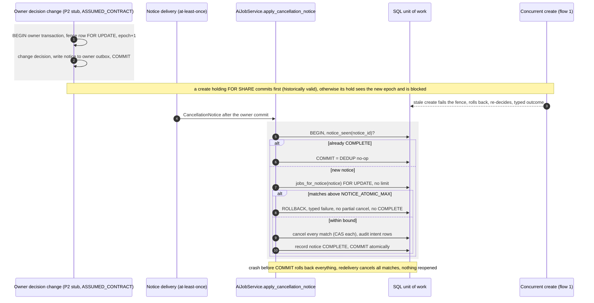

# BE2-01 Phase B — B1 proposed sequences and crash windows

- Label: **COMPONENT_DECISIONS_ACCEPTED / B1_CLOSED_COMPONENT_SCOPE / NOT_RUNTIME_EVIDENCE**. Owner-fence steps are
  **ASSUMED_CONTRACT** (approved component fixture of D7/Q8; actual P2 adapter remains deferred).
- Date: 2026-10-15, Asia/Saigon. Prepared by Claude, docs only, per
  `plan/CLAUDE_PHASE_B_B1_DIAGRAM_PROMPT.md`. Not an approval, adopted ADR, port acceptance or
  sign-off. No role owner was contacted. O-01 selected architecture/profile; actual O-09 now
  accepts component decisions and separately approves code. See current decision record rev9/§14.
- Drawn against the **preferred** design only: D3 Redis/RQ (RQ retries disabled, SQL-owned
  redelivery) and D7 shared-transaction owner fence. No alternative is selected here. If the owner
  picks an alternative, the decision record §3.1 amendment applies, the changed parts are reviewed
  and these diagrams are updated **before B1 exit**.
- Current B1 exit: **CLOSED_COMPONENT_SCOPE** after actual O-09 approval and reconciliation
  in §14. Earlier prepared-draft/review entries below are historical; no runtime proof is claimed.
- Draft revision: **2**, scoped Codex diagram corrections after independent persistence/dispatch
  review. The plan, ADR proposal and port review remain unchanged; the decision record refreshes
  its proposed ADR number after the BE1 merge. The original
  Claude draft is preserved locally; see §12 for review scope and provenance.

| Bound source | sha256 |
|---|---|
| `plan/PHASE_B_PLAN.md` revision 3 | `bb20d5be45dc0552a803f67b5927d4a38dc113cabe10b3a6088644d874ba5848` |
| `plan/PHASE_B_ADR_PROPOSAL.md` revision 3 | `756b6df5ab8e8ec659ffabdc26a0083f035d28d63b86cebc54c6071c9f8ad0ac` |
| `plan/PHASE_B_PORT_REVIEW.md` revision 3 | `3af783a7efca61c5f098f7679b70bbdee4eb6034b9370291c282064ee5579699` |
| `plan/PHASE_B_DECISION_RECORD.md` revision 9 | `71c469a1d494646c1644d4bcd66da067b629b11cfc0f29c57fa024bdb6e74f7f` |
| Accepted architecture `docs/adr/ADR-0018-be2-durable-ai-job-runtime.md` (O-09 addendum) | `bd70f8de397eea2e811c97bba3cfddb8145763643aeff0a19c190b404f4e17d3` |

## Conventions

- Names are the Phase A use cases (`AiJobService.create_job`, `cancel_job`, `dispatch_outbox`,
  `start_attempt`, `accept_completion`, `apply_cancellation_notice`, `expire_overdue_attempts`,
  `run_due_retries`/`retry_job`) and the plan's ports/deltas (Δ1–Δ15). No new module or framework.
- Grey boxes are one database transaction, marked `BEGIN` / `COMMIT` / `ROLLBACK`, always READ
  COMMITTED on the BE2 unit-of-work connection (D4).
- `EFFECT` = external effect outside SQL (enqueue, provider call, sink delivery). It cannot be
  rolled back. `CAS` = conditional update on `job_revision`. `DEDUP` = idempotency boundary.
- P2/P4 adapters, the provider and the sinks are **synthetic stubs/ports**. The owner fence is the
  `ASSUMED_CONTRACT` fixture. Nothing here implies a real implementation.

## 1. Create (Δ1–Δ5, §5.1, §7.2)

```mermaid
sequenceDiagram
    autonumber
    participant C as Caller (create command, test entry)
    participant S as AiJobService.create_job
    participant P as Authorization/Eligibility ports (P2 stub)
    participant U as SQL unit of work (schema ai_jobs)
    participant F as OwnerFencePort.hold (ASSUMED_CONTRACT)
    C->>S: CreateJobCommand (scope key, payload)
    S->>P: current CREATE_JOB authorization (before receipt disclosure)
    S->>U: read-only job/command_receipt lookup, close read transaction
    break existing command receipt (current READ_JOB authorization also required)
        S-->>C: same fingerprint: DEDUP replay; different fingerprint: 409 IDEMPOTENCY_PAYLOAD_MISMATCH
    end
    Note over S: historical replay does not depend on fresh eligibility or artifact availability
    loop while unresolved, at most 2 rounds (§7.2)
        S->>P: fresh authorization and eligibility decisions with OwnerFence (Δ1)
        rect rgba(128,128,128,0.12)
            S->>U: BEGIN candidate transaction
            S->>U: re-read receipt before mutation; a raced-in receipt exits by the authorized replay path
            S->>F: hold authorization and eligibility fences on the same connection (FOR SHARE)
            alt any fence epoch stale
                S->>U: ROLLBACK
                S->>P: one fresh re-decision; retry within the bound or return typed outcome
            else current decision is ineligible or authorization denied
                S->>U: ROLLBACK, return typed eligibility/authorization outcome, no mutation
            else fences current
                S->>U: plain INSERT job, attempt, semantic_request (sha256 PK, Δ4)
                S->>U: plain INSERT command_receipt, outbox dispatch row, outbox audit intent
                alt typed UniqueConflict(kind) (Δ5)
                    S->>U: ROLLBACK whole candidate (nothing survives)
                    Note over S,U: never ON CONFLICT DO NOTHING followed by a partial commit
                    S->>U: BEGIN fresh READ COMMITTED transaction, read winner
                    alt same command key
                        S->>U: close read transaction
                        break same-key result (authorized disclosure)
                            S-->>C: identical replay or 409 IDEMPOTENCY_PAYLOAD_MISMATCH
                        end
                    else same semantic key, other command key
                        S->>U: close winner read transaction before external prechecks
                        S->>P: current READ_JOB for winner and required create decisions
                        S->>U: BEGIN receipt-write transaction, re-read winner and caller receipt for races
                        S->>F: hold authorization and eligibility fences for this new receipt write (A1)
                        S->>U: plain INSERT own command_receipt and audit intent for winner
                        alt receipt conflict or stale fence
                            S->>U: ROLLBACK, re-read/re-decide within remaining bound
                        else success
                            S->>U: COMMIT
                            break semantic dedup completed
                                S-->>C: winner job result, no new job/attempt/dispatch
                            end
                        end
                    else no usable winner
                        S->>U: ROLLBACK, retry within remaining bound
                    end
                else no conflict
                    S->>U: COMMIT
                    break new create completed
                        S-->>C: 202 job_id, revision (new job)
                    end
                end
            end
        end
    end
    opt unresolved after both bounded rounds (no earlier response)
        S-->>C: 409 IDEMPOTENCY_CONFLICT (retryable)
    end
```

## 2. Dispatch, receive and durable start (Δ6–Δ8, Δ14, §7.1)

```mermaid
sequenceDiagram
    autonumber
    participant D as Outbox dispatcher (dispatch_outbox)
    participant U as SQL unit of work
    participant P as Eligibility port (P2 stub)
    participant I as WorkerCapabilityIssuer
    participant Q as DispatchQueuePort (RQ on Redis)
    participant W as Worker loop
    participant S as AiJobService.start_attempt
    participant F as OwnerFencePort.hold (ASSUMED_CONTRACT)
    rect rgba(128,128,128,0.12)
        D->>U: BEGIN, claim_outbox(owner, now, lease, limit)
        U-->>D: rows with lease_owner and lease_generation+1 (Δ6)
        D->>U: COMMIT lease
    end
    D->>P: eligibility recheck, carrying owner fence
    rect rgba(128,128,128,0.12)
        D->>U: BEGIN short pre-publish acceptance transaction
        D->>U: re-read current queued attempt and pending lease owner+generation
        D->>F: hold eligibility fence on this same UoW connection (Δ2, Δ3)
        alt stale fence, settled attempt or stale lease
            D->>U: ROLLBACK; bounded re-decision or skip, no enqueue
        else current decision is ineligible
            D->>U: fenced cancel CAS + audit intent + conditional outbox disposition, COMMIT
        else eligible and current
            D->>U: COMMIT dispatch acceptance; release owner fence
        end
    end
    Note over D: only the eligible/current branch continues to enqueue; no SQL lock held across the external effect
    D->>I: issue(job_id, attempt_id, now), outside any SQL write (Δ14)
    I-->>D: per-publish capability (never persisted)
    D->>Q: EFFECT enqueue WorkerDispatchEnvelope(message, capability)
    Note over D,Q: broker job id = message_id, RQ retries disabled, result_ttl 0, short failure_ttl
    alt enqueue fails (broker down)
        D->>U: release(owner, generation): row stays pending, job stays queued
    else enqueued
        rect rgba(128,128,128,0.12)
            D->>U: BEGIN acknowledgement transaction, conditionally match pending owner+generation
            alt still this pending lease and acknowledgement not already applied
                D->>U: atomically update matching attempt dispatched_at/count and mark_dispatched (A3)
                D->>U: field-level bookkeeping preserves concurrent start/completion state, COMMIT
            else stale holder or repeated acknowledgement
                D->>U: ROLLBACK/no-op for the whole bundle, no timestamp/count mutation
            end
        end
    end
    Q->>W: deliver envelope (at-least-once)
    W->>S: start_attempt(envelope.capability, job_id, attempt_id)
    S->>S: verify token to VerifiedCapability, compare job AND attempt (Δ8)
    S->>P: eligibility precheck with fence
    rect rgba(128,128,128,0.12)
        S->>U: BEGIN
        S->>F: hold_owner_fences (stale: ROLLBACK, one re-decision, else typed)
        S->>U: get job: ATTEMPT_NOT_ACTIVE, DUPLICATE_DELIVERY or JOB_NOT_QUEUED are DEDUP no-ops
        S->>U: CAS start (started_at set), audit intent row
        S->>U: COMMIT = durable start (application boundary)
    end
    W-->>Q: RQ job finishes later = broker boundary only, never an application acknowledgement
    Note over D,W: token absent from SQL rows, receipts, audit intents, formatted logs and structured LogRecord extras (B-05e, B-10c)
```

## 3. Completion and authoritative settlement (Δ8, Δ9, Δ15)

```mermaid
sequenceDiagram
    autonumber
    participant W as Worker (synthetic provider stub result)
    participant S as AiJobService.accept_completion
    participant P as Eligibility and ArtifactPort.describe (P2 stub)
    participant U as SQL unit of work
    participant F as OwnerFencePort.hold (ASSUMED_CONTRACT)
    participant O as Outbox delivery (audit, quarantine)
    participant K as Audit sink and artifact sink (P2 stub)
    W->>S: accept_completion(capability, claim)
    S->>S: malformed identity gives 400, else verify capability for job AND attempt
    S->>U: read-only job/prior completion_receipt lookup, close read transaction
    break prior receipt exists (valid attempt capability required)
        S-->>W: same fingerprint: immutable DEDUP receipt; different: incident path (flow 7)
    end
    Note over S: historical receipt replay does not require fresh eligibility/artifact state; live result exposure remains current-authority checked
    S->>P: current eligibility, artifact lineage, hash, quarantine state and fence per output
    rect rgba(128,128,128,0.12)
        S->>U: BEGIN
        S->>U: re-read job and prior completion_receipt(job_id, attempt_id) for races
        alt prior receipt with same fingerprint
            S->>U: close read transaction, no write/fence or live revalidation needed
            S-->>W: DEDUP identical replay of the stored receipt (valid token for that attempt needed)
        else prior receipt with other fingerprint
            S->>U: close transaction before separate incident path
            Note over S: COMPLETION_CONFLICT goes to the incident path (flow 7), winner untouched
        else decision changes the job (accepted, stale, rejected, unsafe, malformed, eligibility-cancel)
            S->>F: hold eligibility and admitted-output artifact fences (stale: ROLLBACK, one re-decision)
            S->>U: CAS job, INSERT completion_receipt (authoritative)
            S->>U: INSERT audit intent and QuarantineIntent rows with stored event_id (owned-lineage refs only)
            alt UniqueConflict on completion_receipt (concurrent claim)
                S->>U: ROLLBACK, fresh re-read: identical replays, otherwise conflict path
            else
                S->>U: COMMIT authoritative settlement
            end
        else guard leaves the job unchanged
            S->>U: close transaction before separate incident path
            Note over S: non-authoritative, goes to the incident path (flow 7)
        end
    end
    O->>U: claim outbox rows (lease owner + generation)
    O->>K: EFFECT AuditPort.record and ArtifactPort.quarantine(intent) with the exact stored event_id
    K-->>O: DEDUP by event_id at the sink
    O->>U: fenced mark delivered
```

## 4. Retry and recovery (Δ7, Δ11, Δ13, §7.1)

```mermaid
sequenceDiagram
    autonumber
    participant R as Reconciler sweeps
    participant U as SQL unit of work
    participant S as AiJobService
    participant P as Eligibility port (P2 stub)
    participant F as OwnerFencePort.hold (ASSUMED_CONTRACT)
    R->>U: queued_dispatched_not_started(now, DISPATCH_START_TIMEOUT, limit), excluding pending dispatch work
    loop each row (paged until empty)
        alt dispatch_count below DISPATCH_MAX
            rect rgba(128,128,128,0.12)
                R->>U: BEGIN, serialize candidate attempt; re-read queued/unstarted identity, timestamp/count
                alt no longer due, started/settled, or an existing pending dispatch intent
                    R->>U: close/no-op; reuse existing pending intent, do not create another
                else still due and no pending dispatch intent
                    R->>U: INSERT one new outbox row with the SAME attempt_id, COMMIT atomically
                end
            end
            Note over R: the pending intent removes this candidate from the due query; two sweepers cannot fan out pending rows while broker is down
            Note over R: dispatcher (flow 2) publishes again with a fresh capability
        else bound reached
            rect rgba(128,128,128,0.12)
                R->>U: BEGIN, serialize/re-read current attempt, dispatch_count and expected job_revision
                R->>U: record_dispatch_loss (Δ13), CAS against start_attempt
                Note over R,U: started_at stays null, code DISPATCH_LOST, no invented start or progress
                alt CAS lost (start won or job settled)
                    R->>U: ROLLBACK = no-op
                else budget left
                    R->>U: failed_retryable, retry_not_before from existing backoff, COMMIT
                else no budget
                    R->>U: failed_exhausted, completed_at, no schedule, COMMIT
                end
            end
        end
    end
    R->>U: overdue_running(now, limit)
    rect rgba(128,128,128,0.12)
        R->>U: BEGIN, record_failure PROVIDER_TIMEOUT (RUNNING only), CAS, COMMIT
    end
    Note over R: provider returned but completion never committed: no claim is rebuilt, the timeout path applies and a later claim of the old attempt gets ATTEMPT_SUPERSEDED
    R->>S: due_retries(now, limit) then retry_job(job_id, scheduled attempt)
    S->>P: eligibility precheck with fence
    rect rgba(128,128,128,0.12)
        S->>U: BEGIN
        S->>F: hold_owner_fences (ineligible: fenced cancel CAS)
        S->>U: requeue_for_retry NEW attempt (attempt_number+1), CAS, outbox dispatch row, audit intent
        S->>U: COMMIT
    end
```

## 5. Teacher cancel (Δ1–Δ3, existing `cancel_job` semantics)

```mermaid
sequenceDiagram
    autonumber
    participant T as Teacher command (test entry, no live router)
    participant S as AiJobService.cancel_job
    participant A as AuthorizationPort (P2 stub)
    participant U as SQL unit of work
    participant F as OwnerFencePort.hold (ASSUMED_CONTRACT)
    T->>S: CancelJobCommand (scope key, If-Match revision, reason)
    S->>A: decide CANCEL_JOB with grant fence (Δ1)
    rect rgba(128,128,128,0.12)
        S->>U: BEGIN
        S->>F: hold grant fence (stale: ROLLBACK, one re-decision, else typed)
        S->>U: get job: missing or unreadable gives 404 (concealed), not allowed gives 403
        S->>U: command_receipt replay check (DEDUP same key and fingerprint)
        S->>U: If-Match missing 428, revision differs 412, not cancellable 409
        S->>U: cancel, CAS job, INSERT command_receipt, audit intent row (A4)
        alt CAS lost before receipt INSERT, or UniqueConflict on command_receipt
            S->>U: ROLLBACK whole candidate, fresh authorized receipt lookup before state/revision error
            S-->>T: identical key replays winner; mismatch returns mismatch; no receipt uses current precondition outcome
        else
            S->>U: COMMIT
            S-->>T: cancelled, new revision
        end
    end
    Note over S: missing/unreadable, forbidden, replay, and failed preconditions close the transaction and return immediately, before mutation
    Note over S: no ProviderCopyLifecycle adapter (BE2-14 fake stays), pending dispatch rows are skipped by the dispatcher
```

## 6. Owner notice (Δ10, §5.1)



## 7. Incident audit (Δ9, Δ15)

```mermaid
sequenceDiagram
    autonumber
    participant W as Worker or caller
    participant S as AiJobService (guard verdict)
    participant U as SQL unit of work
    participant O as Outbox delivery
    participant K as Audit sink and artifact sink (P2 stub)
    W->>S: claim that ends as MALFORMED_CLAIM without job change, COMPLETION_CONFLICT or another non-authoritative guard
    S->>S: event_id = deterministic sha256(type, job, attempt, fingerprint, reason)
    rect rgba(128,128,128,0.12)
        S->>U: BEGIN audit-only incident transaction
        S->>U: read existing audit/quarantine event_ids; INSERT missing intents only
        S->>U: ensure applicable QuarantineIntent for committed-final verdict, current owned-lineage refs only
        alt storage failure
            S->>U: ROLLBACK
            S-->>W: 503 DEPENDENCY_UNAVAILABLE (retryable), not the 409 or receipt
        else concurrent UniqueConflict on an intent event_id
            S->>U: ROLLBACK; fresh incident transaction re-reads existing intents and ensures missing ones
            S->>U: COMMIT full applicable bundle, or ROLLBACK and return 503 if durability cannot be ensured
            S-->>W: same non-authoritative response only after full bundle is durable
        else
            S->>U: COMMIT before the response
            S-->>W: 409 or non-authoritative receipt (not stored as completion receipt)
        end
    end
    O->>K: EFFECT delivery with the exact stored event_id
    K-->>O: DEDUP at the sink
    Note over S,K: a rolled-back loser or candidate never produced intents, so nothing is delivered for it
    Note over S,U: duplicate audit alone is not proof of a quarantine intent; later-visible owned lineage may require a previously missing intent
```

## 8. Crash-window table (plan §7.1, plus the two transaction-level windows of §7.2/Δ10)

| # | Class | Window | Durable state left | Recovery component | Attempt | Bound / accepted loss | Acceptance |
|---|---|---|---|---|---|---|---|
| 1 | create/commit | Crash before create commit | Nothing | Caller retries the same key | none yet | none | B-01, B-08a |
| 2 | enqueue/mark | Commit done, before publish | job queued, outbox row pending | Dispatcher after restart | same | none | B-01, B-02 |
| 3 | enqueue/mark | Enqueued, crash before fenced mark | outbox row leased, lease expires | New holder (generation+1) republishes; old holder's entire acknowledgement bundle (mark plus dispatch timestamp/count) is a no-op; repeated acknowledgement cannot count twice; worker dedups | same | duplicate delivery absorbed by attempt identity | B-04c, B-06a |
| 4 | enqueue/mark | Broker down | row pending, job queued | Enqueue fails → release; dispatcher retries later | same | none (no job/attempt created by replay) | B-02 |
| 5 | receive/start | Worker received, died before durable start commit | job queued, `dispatched_at` set, `started_at` null | Reconciler serializes/rechecks the due attempt and inserts at most one pending recovery intent; due query excludes pending work. Dispatcher issues fresh capability, bounded by `DISPATCH_MAX`; then Δ13 dispatch-loss CAS vs start → policy backoff/retry or exhaustion | same until bound, then new only via policy retry | two sweepers or broker-down cannot fan out pending rows; expired token denied; no start invented | B-04a, B-04b(i–v), B-06a |
| 6 | provider/completion | Started, died before provider result | job running | Overdue-running sweep → `failed_retryable PROVIDER_TIMEOUT` → policy retry | new | provider work of the old attempt lost | B-06b |
| 7 | provider/completion | Provider returned, died before completion commit | job running, claim not stored, maybe uploaded output | Timeout → policy retry; a late claim of the old attempt gets `ATTEMPT_SUPERSEDED`, owned output quarantined | new | **no same-claim recovery**; provider may have run twice; no fingerprint invented | B-06b |
| 8 | effect/ack | Completion committed, crash before audit/quarantine delivery | settlement + intents in outbox | Outbox delivery after restart, sink dedup by `event_id` | — | none | B-06c, B-01 |
| 9 | effect/ack | Quarantine applied by the sink, crash before delivery mark | intent row still pending | Redelivery with the **same stored `event_id`** → sink no-op | — | none | B-06c |
| 10 | incident/commit | Rejection/conflict, crash before incident commit | nothing (no response returned) | Worker retry recomputes the same `event_id` → incident committed once | — | none | B-06c, B-08b |
| 11 | create/commit (§7.2) | Loser candidate rolled back, crash or restart between rounds | winner rows only | Fresh round re-reads the winner; at most 2 rounds | winner's | typed `409 IDEMPOTENCY_CONFLICT` after 2 rounds | B-03a–f |
| 12 | incident/commit (Δ10) | Crash mid-notice before COMMIT | nothing from BE2; notice undelivered | Redelivery cancels all matches atomically; nothing reopened | — | oversize = typed failure, no partial update | B-09e–g |

Token-free logging (B-05e/B-10c, existing acceptance): the check must force a worker/provider
failure and inspect both formatted output and the full structured `LogRecord` objects, because
installed RQ 2.11.0 exception handling can attach `job.args`/`kwargs` as structured extras
(final review note). `description=message_id` and TTLs alone are not enough.

## 9. Self-check against Δ1–Δ15, §7.1/§7.2 and acceptance

| Delta | Shown in | Delta | Shown in |
|---|---|---|---|
| Δ1 fences on decisions | 1, 2, 3, 5 | Δ9 settlement vs audit-only | 3, 7 |
| Δ2 `OwnerFencePort.hold` | 1–6 | Δ10 atomic notices | 6, row 12 |
| Δ3 precheck then hold, one re-decision | 1, 2, 3, 5 | Δ11 paged sweeps | 4 |
| Δ4 canonical semantic PK | 1 | Δ12 fakes parity | not a runtime flow (fakes keep Phase A suites valid) |
| Δ5 rollback-on-conflict | 1, 3, 5, row 11 | Δ13 `record_dispatch_loss` | 4, row 5 |
| Δ6 lease owner + generation | 2, 3, row 3 | Δ14 envelope + issuer | 2, row 5 |
| Δ7 dispatch fields, same-attempt republish | 2, 4 | Δ15 `QuarantineIntent` + stored `event_id` | 3, 7, rows 8–9 |
| Δ8 typed capability, job + attempt | 2, 3 | — | — |

All ten §7.1 rows appear in §8 (rows 1–10); §7.2 is flow 1 and row 11. Acceptance IDs referenced:
B-01–B-06, B-08, B-09; B-07 (semantic isolation) is the PK in flow 1; B-10/B-11 are the
real-adapter/conformance runs of these same flows; B-12 (real owner integration, live router,
provider, copy deletion) is out of scope and NOT claimed.

## 10. Assumptions and resolved source interpretations (no plan change)

- **A1 — source-consistent:** a new semantic-dedup receipt write holds current authorization and
  eligibility fences; READ_JOB also controls disclosure of the winner. An existing receipt is
  replayed after current authority checks, before fresh new-mutation eligibility/artifact calls.
  Sources: plan §5.1/§7.2 and Phase A create/replay ordering.
- **A2 — corrected to the reviewed plan:** dispatch has its own short pre-publish fenced
  acceptance transaction (§5.1), followed by external enqueue outside SQL. Start independently
  rechecks/holds its fence. An owner change after dispatch acceptance can still precede enqueue;
  start then denies stale work. No lock is held across the broker effect and no exactly-once
  claim is made. The original weaker early-filter-only interpretation is superseded.
- **A3 — required atomicity, not a new revision policy:** current pending owner+generation
  conditions the entire acknowledgement (metadata and mark). Stale/repeated acknowledgements
  change neither timestamp nor count. Field-level dispatch bookkeeping must preserve concurrent
  start/completion fields; aggregate lifecycle writes keep the existing CAS rules. This draft
  does not freeze whether bookkeeping itself bumps job_revision. Verify these existing B-04c/
  B-06a obligations in B4 rather than treating a no-revision assertion as proof of race safety.
- **A4 — source-consistent:** cancel commits its audit intent with CAS + receipt (B-08b, no
  accepted success without durable audit intent). Phase A's post-transaction fake audit does not
  provide durable proof. A cancel CAS loser first re-reads the authorized receipt; the identical
  command replays before applying current state/revision errors.
- **A5**: merged BE1 code (`f220781` via merge `8b2a1ad`) adds a `backend/alembic` environment with
  branch label `be1_core` and its own outbox. That shape matches the D2 proposal (one environment,
  per-module branch labels) but is **not** a D2/Q1/Q7 decision. Plan §4 `backend/migrations/`
  remains “layout per D2/Q7”. No owner-fence or notice-epoch contract was found in it, so the
  fence stays `ASSUMED_CONTRACT`.
  ADR-0016/0017 are now occupied by BE1; decision record revision3 proposes next-free ADR-0018
  (recheck at creation) or a feature-local record, without adopting either location or design.

## 11. Executor documentation checks (original draft; historical)

Run from the worktree root after this file and the record updates were written; receipts and the
24-path hash detail are local in `evidence/local/phase-b-b1-diagrams-20261015/` (ignored):

- `python tools/validate_repository_security.py`: exit 0. `git diff --check`: exit 0.
- `python tools/validate_harness.py --feature features/FEAT-044-be2-ai-job-foundation`:
  **exit 1, HARNESS_INVALID**. Cause: only `features/FEAT-045-be1-core-domain-foundation`,
  `FEAT-046-be1-durable-core-adapters` and `FEAT-047-be1-runtime-backend` lack
  `evidence/screenshots` and `evidence/metrics`. Those folders arrived with BE1 commit `f220781`
  through merge `8b2a1ad`, after the passing Codex B1 review run (01:54 +07:00). No FEAT-044 path is
  reported. They were not changed here because they are outside this task. The harness gate is
  therefore **not PASS** for this draft.
- Phase A 24-path snapshot vs the final review: all match HEAD. The working tree differs only at
  `backend/tests/unit/test_ai_job_q00_followups.py`, which carries the EOF-disposition hash
  `9a1f5ad6…`; there is no other difference (`run1_hash24.json`).
- Runtime tests NOT_RUN (no Phase B implementation).

## 12. Scoped Codex diagram review — 2026-10-15

Draft revision2 corrects only representations of existing behavior/acceptance:

- Receipt/control-flow boundaries: authorized historical replay precedes new-mutation live
  prechecks; completion receipt replay keeps valid attempt capability; a create result terminates
  instead of falling through to another transaction/409. Semantic winner disclosure needs
  READ_JOB. Cancel CAS/receipt losers rollback and re-read the receipt before precondition errors.
- Dispatch: pre-publish owner-fence hold, whole-bundle generation-fenced acknowledgement and
  metadata preservation, plus serialized no-pending-intent recovery using the existing UoW.
  A stale holder cannot change recovery bookkeeping and concurrent sweepers cannot fan out rows.
- Incident dedup: existing audit event_id alone does not prove applicable quarantine intents
  exist; ensure missing intents before response, or return503 if not durable. Current owned
  lineage may become visible on a later retry. No new lifecycle/framework is introduced.

Reviewers: Codex primary, phase_b_dispatch_review, phase_b_persistence_review. Original executor
draft sha256 `fd118c11d353cb2bca2eea8623abb45f6de2f20ca719a6c817a49f7491a252b3` is preserved under
ignored `evidence/local/phase-b-b1-sequence-review-20261015/executor_original_sequences.md`.
Plan/ADR/port rev3 hashes above are unchanged. The original decision-record rev2 snapshot is
preserved locally; rev3 only refreshes the available ADR number and prepared-diagram status.
Proposed/assumed labels,
seven flows, twelve crash windows, six implementation batches and fourteen business cards remain.

Harness has since passed after the separately applied six empty BE1 `.gitkeep` placeholders;
the failed executor run in §11 remains historical evidence. Current checks, source freeze and
review result are recorded in `evidence/metrics/PHASE_B_B1_SEQUENCE_REVIEW_CHECKS_20261015.json`;
repeated receipts stay under ignored `evidence/local/phase-b-b1-sequence-review-20261015/`.
No Mermaid renderer/parser was installed or run by this review; text/block inspection is not
render evidence. Runtime tests remain NOT_RUN. No backend/test/fixture/approval change,
dependency install, service start, commit or push is performed here.

**Next step is actual decisions, not another planning batch.** G1 checkpoint/test disposition,
G3 adopted ADR, G4 explicit contract answers, G5 authorized environment/inventory/profile and G2
separate Phase B approval remain pending. Reconcile this draft with those answers before B1 exit.
Until then ACTIVE Q00; Q01 waits for gates; B2–B6 code is NOT_STARTED/UNAPPROVED.

## 13. Project-owner selection — 2026-10-15

The owner replied **"Ổn đó"** to the preferred D1–D7/fixture-first/test-profile recommendation.
Architecture selection is recorded in ADR-0018 and decision record rev4. The original plan/
ADR proposal/port review remain byte-preserved historical proposals. No sequence behavior changed
from reviewed draft rev2; labels/source bindings reflect the actual selection now.

The owner then replied **"Chưa rõ; cần kiểm kê môi trường hiện có"** about PostgreSQL/Redis.
Read-only inventory is requested, not installation/start/provisioning. Target E1/E2, remaining
contract details, actual Phase A acceptance/test and separate Phase B code approval remain open.
This selection supplies no role concurrence or real adapter/integration proof. B1 exit stays pending.

O-03 environment update: owner selects a new CPU Studio, working name sketch2life-backend-test,
separate from FEAT-018. Creation is requested but not performed in this session; server inventory
and remaining gates are pending. No sequence behavior changes.

O-08 evidence update: user reports matching dependency inventory/authenticated PostgreSQL17.11/
Redis8.10.2 connections and missing live-route1 passed,0 skipped. Component decision packet is
PROPOSED in decision record rev8 §13; no new sequence behavior, owner sign-off or code approval.

## 14. Actual O-09 component adoption and B1 closure —2026-10-15

The user explicitly accepts revision8 §13 and approves planrev3 B1–B6; verbatim source is
approvals/PHASE_B_TASK_APPROVAL.md. Current recordrev9 and ADR-0018 addendum capture Q1–Q8 as
PROJECT_OWNER_DIRECTIVE, never P1/P2/P4 role sign-off.

Reconciliation confirms the seven reviewed flows and twelve crash windows match accepted
component decisions: shared ai_jobs SQL/migration context, same-UoW grant/scope fences, owner
epoch+decision+notice transaction, post-commit idempotent notice delivery, owned artifact lineage
and event_id-dedup audit/quarantine. Per-run ephemeral key sharing across test child processes
is Q6 operational setup; it does not change sequence behavior. A5's pre-decision observation/ADR
number proposal and earlier PENDING entries are historical, superseded by actual O-09 decisions.

No Mermaid body, crash-window guarantee, Δ1–Δ15 acceptance or batch/card count changes.
B1 CLOSED_COMPONENT_SCOPE; ACTIVE Q01/B2 READY_FOR_CLAUDE. ASSUMED_CONTRACT fixture and
NOT_RUNTIME_EVIDENCE remain. Exact reconciliation matrix is in
evidence/notes/PHASE_B_B1_CLOSURE_AND_HANDOFF_20261015.md.
