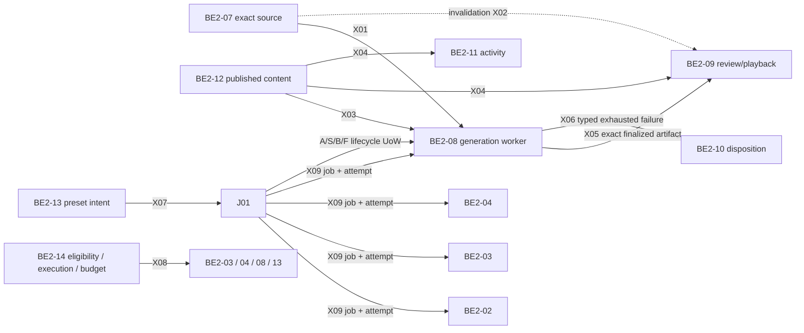

# BE2-01–14 full cross-lane integration frame — draft

- Status: `DRAFT / READY_FOR_PLAN_REVIEW / NOT_IMPLEMENTATION_APPROVAL`.
- Date: 2026-10-21 (Asia/Saigon).
- Candidate worktree: `.worktrees/be2-01-14-integration-linked`.
- Candidate branch/HEAD observed: `feature/be2-backend-ai-integration` / `1649b72978877d82b4d7662040ff3555dee0a3a7`.
- Worktree at planning start: 145 dirty paths, staged 0. This frame does not assume those local edits exist at HEAD or in a remote branch.
- Input manifest: `evidence/metrics/CROSS_LANE_END_TO_END_FRAME_INPUTS_20261021.json` (created after this frame; it pins this frame and the exact planning inputs).

## 1. Goal and authority

Build and verify the complete **behavioral graph** between BE2-01–07 and BE2-08–14 using owner-approved public contracts, producer-created values, and consumer-observed state. The final BE2 handoff should give the BE1 integrator a clean, reviewable snapshot and stable seams to adopt. Git branch ancestry by itself is not integration evidence.

The approved FEAT-057 integration plan revision 2 authorizes offline, FEAT-057-owned composition/adapters/tests, but requires an edge to remain `NOT_IMPLEMENTED` when its card-owned contract or adoption is missing. It excludes editing card-owned contracts/migrations, shared database provisioning, live routes, providers, Lightning, commit/push/merge, and card acceptance changes. This frame organizes the full work; it does not expand that approval. Card-owned changes need reviewed, exact scopes and supplemental approvals in their own feature records. FEAT-057 owns only the cross-lane composition layer and its evidence.

Owner decisions already fixed and not reopened here:

- D1: BE2-01 alone opens/commits/rolls back the paired lifecycle UoW; BE2-08 is a row-limited participant. Retry, timeout, cancel, reconciler and outbox lifecycle changes must not bypass the job/run pair. Use the agreed job → run → complete source-fence lock order.
- D2: `VideoRun.attempt_id` is bound at committed start S and cleared on retry; the video-owned terminal stale state is distinct from budget waiting.
- D3 C1-A: budget deferral is durable BE2-01-owned metadata; job and run both remain `QUEUED`; no new job/video budget state. Wait time is excluded from dispatch-loss and retry recovery. Resume rechecks eligibility and reservation. Numeric bounds and deadline action remain pending.
- D3 C2-A: B-stale writes the authoritative stale outcome, receipt, paired terminal stale run without artifact/ready state, and verified-owned-ref keep-private intent in one commit. BE1 artifact adoption and accepted-reference protection remain required.

The D4 decision for `BUDGET_EXCEEDED` **after provider work has completed** is still pending. Do not infer cancellation, acceptance, quarantine, refund, settlement, retry, or rerun. `X05c/CR09-02` remains open and `X05d` remains blocked. No design review, draft, or offline pass substitutes for implementation approval or per-card acceptance.

## 2. One graph, not one artificial chain

The main generation path is `exact source/publication + explicit intent → BE2-01 submission A → policy/hold → committed start S → BE2-08 execution → one authoritative completion boundary`. It then branches to accepted artifact (`B-accepted`), context-stale output (`B-stale`), failure/retry (`F`), or business rejection (`F-reject`). External generation is between S and completion; no database transaction spans provider work. Publication, invalidation, presets and failure disposition are separate graph edges, not steps every job must traverse.

## 3. Current edge ledger and target proof

Every edge uses the real producer service and the consumer's public, versioned contract. A fixture may replace an unavailable external owner, queue or provider only; it may not manufacture producer output, bypass a fence, write another card's repository, or turn a candidate contract into an adopted one.

| Edge | Current state | Owner-to-owner proof required for the full frame | Primary card owners |
|---|---|---|---|
| X01: BE2-07 source → BE2-08 generation | `PARTIAL` | Resolve exact source pin; preserve version/hash/audience/context; fence invalidation through BE2-08 finalization on the same durable UoW/store. Both invalidation-vs-finalize winner orders must be tested. | BE2-07, BE2-01, BE2-08 |
| X02: BE2-07 invalidation → BE2-09 | `NOT_IMPLEMENTED` | Deliver an authentic invalidation to the exact dependent review/playback target; deduplicate replay; stale source blocks both review and playback under a current-source fence. | BE2-07, BE2-09 |
| X03: BE2-12 publication → BE2-08 | `NOT_IMPLEMENTED` | Resolve producer-created published content by exact id/version/hash/audience; draft/recalled/superseded/unauthorized content is denied before A/S/provider. | BE2-12, BE2-08, BE2-01 |
| X04: BE2-12 publication → BE2-09/11 | `NOT_IMPLEMENTED` | Each consumer independently resolves the exact published version through a public contract; recall/audience/authority changes block the consumer's commit/action. | BE2-12, BE2-09, BE2-11 |
| X05: BE2-08 output → BE2-09 | `NOT_IMPLEMENTED` | B-accepted persists exact artifact/lineage; BE2-08 exposes the adopted read-only artifact/receipt projection; BE2-09 reviews the exact output and permits playback only under current authorization. X05d stays blocked until adopted resolver/fence; X05c/CR09-02 stays open. | BE2-01, BE2-08, BE2-09 |
| X06: BE2-08 failure → BE2-10 | `NOT_IMPLEMENTED` | Authoritative exhausted failure reaches the exact `FailureTarget` through a typed, replayable receipt; Teacher retry/skip/end is explicit and idempotent; late success cannot defeat a terminal decision. | BE2-01, BE2-08, BE2-10 |
| X07: BE2-13 preset → BE2-01 job | `NOT_IMPLEMENTED` | Explicit immutable preset dispatch creates/deduplicates one correctly scoped job after policy and disable-generation checks; BE1 session compare-and-apply ownership is respected. | BE2-13, BE2-01, BE2-14; BE1 session owner |
| X08: BE2-14 policy → BE2-03/04/08/13 | `NOT_IMPLEMENTED` | Each consumer binds an adopted phase-specific eligibility decision; execution authorization and budget reservation are separate; deny/defer stops side effects; missing authority fails closed. | BE2-14 plus each consumer owner |
| X09: BE2-01 job/attempt → BE2-02/03/04/08/13 | `NOT_IMPLEMENTED` as a complete edge family; typed BE2-01→08 route is only route-level partial evidence | Persisted job → run → source/preset pin → registered handler → committed S → completion receipt; preserve job/attempt/subject/idempotency lineage; unsupported type has no fallback side effect. | BE2-01 and each handler owner |

Existing BE2-03→04→05→06 offline chain evidence is a regression baseline, not a substitute for these edges. The current 14 X01 tests, 282 adjacent BE2-07/08 tests and Modal 296/296 selected-package receipt remain bounded evidence only; they do not change the ledger above. A skipped, unapproved, unavailable, or unimplemented edge is never counted as PASS.

## 4. Required lifecycle boundary contract

BE2-01 owns each UoW and its durable receipt/recovery. BE2-08 receives a scoped participant capability and writes only its own rows. Neither FEAT-057 nor BE2-08 may commit a half-pair or claim atomicity across separate commits.

| Boundary | Owner and enlisted rows/effects | Required pair and recovery invariant |
|---|---|---|
| A — submit | BE2-01 opens UoW; foundation job/run, BE2-08 queued row/receipt, dedup identity and required outbox are enlisted. | One intent yields one exact job/run/video lineage. Duplicate or lost acknowledgement resolves from authoritative receipt; no provider call yet. |
| S — start | BE2-01 opens UoW; job/run CAS, BE2-08 start CAS and attempt binding are enlisted after fresh policy/reservation checks. | `QUEUED → RUNNING` is committed as a pair with the exact attempt. Delivery alone is not proof of S. Lost acknowledgement is reconciled from durable winner; no duplicate start. |
| B-accepted — successful finalize | BE2-01 opens UoW; job, run, source-fence union, BE2-08 exact artifact/ready state, authoritative receipt and outbox/audit are enlisted. | One winner commits `SUCCEEDED/ACCEPTED` plus exact artifact and `READY_FOR_REVIEW`; duplicate/late attempt cannot replace it. |
| B-stale — stale finalize | BE2-01 opens UoW; job/result refs, stale receipt, BE2-08 terminal stale/no artifact/no ready, descriptor-proven private-stage intent and required outbox are enlisted. | One same-commit `SUCCEEDED/STALE` result; no artifact/ready. Intent is not physical deletion. Accepted-reference protection must win either race order. |
| F — failure/retry/timeout/cancel | BE2-01 opens UoW for job/run and BE2-08 participant rows; reconciler/outbox dispatchers call this same boundary. | Pair CAS and recovery receipt are atomic. Retry respects attempt cap/backoff; timeout/cancel cannot update only one side. |
| F-reject — business reject | Separate BE2-01 reject UoW; job/run, BE2-08 terminal row, authoritative reject receipt and verified quarantine intent are enlisted. | A rejection is not a rollback side effect. Replay uses immutable operation identity/reason/ref set. |
| I — infrastructure incident | BE2-01 incident/audit path only unless the adopted recovery contract says otherwise. | No fabricated completion or lifecycle winner. Recover from durable operation/stage journal; unknown result stays pending. |

Use one lock order for all paired paths: **job → run → complete canonical source-fence union**. The source-fence owner/key/invalidators and a same-store implementation are still gates. Finalization rollback is for infrastructure failure only and requires recovery. Temporary/no-decision outcomes do not commit lifecycle state; any audit-only incident write is separately classified.

## 5. Budget and policy invariants

1. C1-A holds job and run in `QUEUED` while a durable BE2-01 hold is active; no new `JobState` or video budget state. A retry is requeued at most once under its normal retry policy, with the hold and paired queued state. `VideoRun.attempt_id` remains null until S.
2. `_recover_unstarted` and dispatch-loss logic ignore hold duration. Repeated budget denial does not spend retry/recovery allowance or allocate a new attempt. No provider is called during hold; resume rechecks current eligibility and reservation.
3. `BUDGET_EXCEEDED` in `_dispatch_one`, `start_attempt`, and `retry_job` defers; consent and kill-switch denial retain their cancellation behavior. BE2-14 can deny/defer but cannot choose a budget, issue execution permission, or mutate foundation/video lifecycle.
4. Budget unit/limit, max hold duration, deadline action, reservation expiry/renewal, and a phase mapping for S are explicit pending contract/owner inputs. No number or automatic cancel/fail/refund is invented.
5. D4 must decide completion-time `BUDGET_EXCEEDED` after provider work. Until then `_decide_completion` cannot classify it as pre-execution hold, consent/kill rejection, success, or cleanup. Preserve the generated output privately and operation as pending only if the owner adopts that exact path.

## 6. Work sequence and review gates

| Step | Work and owning records | Exit gate |
|---|---|---|
| G0 — Preserve and pin | Inventory the existing 145 dirty paths by owner/source/test/docs/evidence/local; keep ignored local evidence separate. Pin branch/tree and current card refs. Do not branch from `1649b729` while treating the dirty worktree as published. | Exact, reproducible input snapshot; every dirty path has disposition; no pre-existing work discarded. |
| G1 — Resolve contracts first | Review Rev8 and successor scope/CRs. Decide D4; obtain budget unit/limits/max duration/deadline action and S reservation phase/expiry rules. Obtain BE1 artifact descriptor/accepted-reference adoption. Adopt BE2-07 same-store fence; BE2-08 artifact/read/receipt projection; BE2-09 X05c playback contract; X02 invalidation, X04 publication consumers, X06 failure bridge, X07 preset/session dispatch, X08 phase policy, and X09 handler/persisted mapping. | Each edge has a named public contract, owner, exact version/fields, recovery semantics, tests and matching supplemental card approval. Missing contract keeps only that edge blocked. |
| G2 — BE2-01 lifecycle core | On FEAT-044, review and approve the latest UoW, budget/schema and stale CRs. Implement A/S/B-accepted/B-stale/F/F-reject/I, durable C1 hold, lock order, paired reconciler/outbox behavior and recovery. New schema uses a separate CR/migration; never rewrite published migration history. | Unit/domain/SQL-contract tests prove paired CAS, replay/lost-ack, both stale/finalize races, retry/hold accounting and incident recovery. D4 must be closed before completion handling. |
| G3 — Source and publication producers | On FEAT-056 and BE2-12's owning feature, implement/adopt exact current-source fence and published-content adapter for X01/X03; publish identity/hash/audience/recall semantics. Preserve public contracts and prove both race orders. | Producer-created pins are consumed by BE2-08; same-store durable fence spans finalization. Otherwise X01 remains `PARTIAL`. |
| G4 — BE2-08 participant and worker | On FEAT-050, adopt supplemental lifecycle schema/model/codec/receipt/journal/projection scope. Bind worker registration to persisted job/run/pin, commit S, execute outside UoW, then route typed completion to B/F/reject/stale. Implement artifact read model for X05 only after exact field/access/provenance decisions. | Real service composition proves A/S/B/F pair behavior, stage recovery, idempotency, stale output, exact artifact lineage and read-after-commit. |
| G5 — Review and failure consumers | On FEAT-051 and BE2-10's owning feature, integrate X02/X04/X05/X06. BE2-09 consumes the adopted BE2-08 read model and source/published-content invalidations; BE2-10 consumes authoritative exhausted failure and returns explicit disposition. X05c remains gated until CR09-02 is resolved. | Exact target/version is reviewed; replay/lost-ack/late-result races have one winner; stale/recalled content cannot be reviewed or played. |
| G6 — Other graph consumers and policy | On FEAT-053 and FEAT-054, integrate X04 to BE2-11 and X07 to BE2-13→BE2-01. On FEAT-049, implement only separately approved BE2-14 policy phases used by BE2-03/04/08/13. Complete X09 handler routes for 02/03/04/08/13. | Explicit intent, correct policy phase, disable-generation race and dedup are asserted before side effects; no test-only scheduler/database shortcut. |
| G7 — FEAT-057 composition matrix | Compose real application services with deterministic external adapters. Test each X01–X09 producer-to-consumer edge separately, then the linked generation→review/playback and failure-disposition paths. Include mismatch, revoke/recall, duplicate, lost ACK, late result, retry, timeout, stale, policy deny/defer and accepted-vs-cleanup races. Preserve BE2-03→06 chain regression. | One pinned snapshot produces JUnit/log/hash receipts per suite and an edge matrix with `PASS/FAIL/BLOCKED/NOT_RUN`; no edge is omitted. |
| G8 — Durable conformance and final review | After separate approval, run the database/store conformance needed to prove durable source-fence winner order, transaction rollback/recovery and schema graph. Obtain independent review and each changed card owner's review. Re-pin final source and run affected suites/validators. | Every required edge passes on the same reviewed tree; durable claims have actual durable-store evidence, not just process-local fakes. |
| G9 — BE1 handoff | Split owner commits by card; integrate only reviewed SHAs into the shared BE2 branch. Publish a clean PR/snapshot only after security checks and explicit Git-publication approval. Provide BE1 exact branch/commit, contracts, tests, limitations and adopted artifact seam. | `READY_FOR_BE1_HANDOFF` means BE2 code/contracts are reviewable and all required BE2 edges are evidenced. It does not mean BE1 integration, production, Lightning, or card acceptance is complete. |

Dependencies are intentional: G2 precedes G4; X01/X03 producer contracts precede video submission; X05 depends on B-accepted plus BE2-08 read model; X02/X04/X06 depend on those owner interfaces; X07/X08/X09 require policy and dispatch contracts. Work may be prepared in parallel only on isolated owner branches after exact scopes are approved; merge reviewed SHAs into the shared integration branch sequentially in dependency order.

### Suggested owner-branch sequence (names are proposals, check availability before creation)

| Order | Suggested branch | Main owned increment | Merge prerequisite |
|---:|---|---|---|
| 1 | `feature/be2-01-cross-lane-lifecycle` | UoW A/S/B/F, hold, stale/reject, recovery | D4 and BE2-01 supplemental scope/approval |
| 2 | `feature/be2-08-cross-lane-video-lifecycle` | Participant, S/B state, codec/receipt/read model | BE2-01 API and BE2-08 supplemental approval |
| 3 | `feature/be2-07-source-fence` | Exact source fence and invalidation | BE2-01 lock/fence protocol; BE2-07 revised adoption |
| 4 | `feature/be2-12-publication-bindings` | Published-content exports/invalidation | BE2-12/08/09/11 contracts adopted |
| 5 | `feature/be2-14-execution-policy` | Deny/defer, phase grants and reservation terms | Owner-supplied budget terms and BE2-01/14 CR approval |
| 6 | `feature/be2-09-video-consumers` | X02/X04/X05 review and playback | BE2-08 read model; resolve X05c/X05d gates |
| 7 | `feature/be2-10-failure-bridge` | X06 typed failure/disposition | BE2-01/08 terminal receipt contract |
| 8 | `feature/be2-11-publication-consumer` | X04 exact activity binding | BE2-12 public reference and BE2-11 adoption |
| 9 | `feature/be2-13-preset-dispatch` | X07 plus X08/X09 consumer binding | BE1 session authority, BE2-14, BE2-01 job contract |
| 10 | `feature/be2-cross-lane-composition` | FEAT-057 graph harness/evidence only | All included owner SHAs reviewed and available |

Names are illustrative and no branch/worktree is created by this plan. Before each branch, verify its local/remote name and base; preserve current dirty work. Keep the existing `feature/be2-backend-ai-integration` as the integration candidate unless a separately approved publication plan changes it. A card-owned fix is made in its owning feature worktree, then integrated by its reviewed SHA; do not edit the same card file in FEAT-057.

## 7. Completion criteria and truthful finish states

`BE2_CROSS_LANE_OFFLINE_PASS` requires: all X01–X09 are `PASS`; each test uses producer-created input and a consumer public contract; job/run/pin/attempt/artifact lineage is exact; A/S/B/F/reject/hold/recovery behavior has a single authoritative winner; policy, audience, source and publication revocation fail closed; BE2-09/10/11 consume their intended outputs; review and security/architecture/harness validators pass on the same pinned tree; and every changed owner scope is approved and reviewed.

If any edge is missing, unadopted, skipped, or lacks durable proof required by its contract, the overall outcome is `PARTIAL` or `BLOCKED`, never full PASS. In particular, process-local tests alone cannot upgrade X01 beyond `PARTIAL` where the accepted contract requires a same-store durable fence. A selected Modal CPU run is optional evidence only; environment/Modal stays deferred until a separate resume instruction. Provider/Lightning/runtime and live BE1 integration are outside this frame.

The BE1 code handoff additionally requires a clean, exact, published commit/PR and the BE1-owned artifact adoption in the owning BE1 record. A message, draft packet, or dirty FEAT-057 worktree is not a code handoff. Per-card statuses/acceptance remain owned by their own records and are not changed by the integration PASS.

## 8. Immediate next steps

1. Independently review this full-frame plan against the manifest and the current Rev8/owner decisions.
2. Resolve D4 and the numeric budget inputs/phase-reservation terms; record the decisions in FEAT-044/FEAT-049 owning records.
3. Send the BE1 artifact packet through the owner (outside this plan's execution); record adoption or keep B-stale implementation blocked.
4. Convert each blocked edge into a card-owned scope/CR and exact supplemental approval. Do not start source edits for that edge before its gate is satisfied.
5. Freeze the dirty candidate safely, then execute G2 onward in the order above. Keep runtime, Modal and Lightning deferred absent explicit resume.

## 9. Recordkeeping for this draft

This plan is a planning artifact only. It does not alter the approved FEAT-057 Rev2 scope, per-card scopes/approvals, source, tests, schema/migrations, branch, card status, acceptance, runtime gate, or publication state. The exact planning inputs and this document's SHA are recorded in `evidence/metrics/CROSS_LANE_END_TO_END_FRAME_INPUTS_20261021.json`. Tests and runtime were not run to write the plan.
