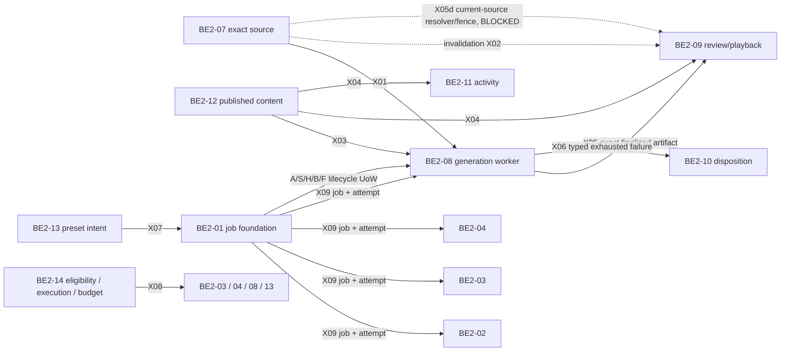

# BE2-01–14 full cross-lane integration frame — revision 2 draft

- Status: `DRAFT / REVIEW1_FINDINGS_ADDRESSED_IN_DRAFT / READY_FOR_RE-REVIEW / NOT_IMPLEMENTATION_APPROVAL`.
- Date: 2026-10-21 (Asia/Saigon).
- Parent (preserved unchanged): `plan/CROSS_LANE_END_TO_END_EXECUTION_FRAME_DRAFT_20261021.md`, SHA256 `1B17056637542C78342076C050E46C55666DE21F2AC562CCCBD2D7F48406C2FD`, 21,759 bytes; its manifest `evidence/metrics/CROSS_LANE_END_TO_END_FRAME_INPUTS_20261021.json`, SHA256 `9B6DECC3D37A9183333A5F7F731D5DE01EBF0BA4B235AF774A8C3E1E9129746A`, is also preserved.
- Review input: independent review 1, verdict `CHANGES_REQUIRED` (0 P1 / 5 P2 / 8 P3), preserved at `evidence/notes/CROSS_LANE_END_TO_END_FRAME_REVIEW1_REPORT_20261021.md`, SHA256 `9127C052A2B37F789B2142CDB0813ACFC1D4134D82B1E0D0F193C5F791798843`. The disposition of every finding is in §9.
- Candidate worktree: `.worktrees/be2-01-14-integration-linked`.
- Candidate branch/HEAD observed: `feature/be2-backend-ai-integration` / `1649b72978877d82b4d7662040ff3555dee0a3a7`.
- Worktree at successor start: 147 dirty paths (the parent's 145 plus the parent plan and manifest), staged 0. This frame does not assume those local edits exist at HEAD or in a remote branch.
- Input manifest: `evidence/metrics/CROSS_LANE_END_TO_END_FRAME_INPUTS_REV2_20261021.json` (created after this frame; it pins this frame and the exact planning and source inputs).

This revision corrects the parent's text only. Addressing a finding in this draft does not close any gate: every owner adoption, decision or approval named below stays pending or blocked until it is recorded in its owning feature record.

## 1. Goal and authority

Build and verify the complete **behavioral graph** between BE2-01–07 and BE2-08–14 using owner-approved public contracts, producer-created values, and consumer-observed state. The final BE2 handoff should give the BE1 integrator a clean, reviewable snapshot and stable seams to adopt. Git branch ancestry by itself is not integration evidence.

The approved FEAT-057 integration plan revision 2 authorizes offline, FEAT-057-owned composition/adapters/tests, but requires an edge to remain `NOT_IMPLEMENTED` when its card-owned contract or adoption is missing. It excludes editing card-owned contracts/migrations, shared database provisioning, live routes, providers, Lightning, commit/push/merge, and card acceptance changes. This frame organizes the full work; it does not expand that approval. Card-owned changes need reviewed, exact scopes and supplemental approvals in their own feature records. FEAT-057 owns only the cross-lane composition layer and its evidence.

### 1.1 Card-to-feature directory map

Several administrative FEAT numbers are shared by two cards (`artifacts/FEATURE_ID_COLLISION_MAP.md`). This frame always names the full directory.

| Card | Owning feature directory |
|---|---|
| BE2-01 job foundation | `FEAT-044-be2-ai-job-foundation` |
| BE2-02 vision correction | `FEAT-048-be2-vision-correction` |
| BE2-03 assistance orchestration | `FEAT-049-be2-assistance-orchestration` |
| BE2-04 sketch generation | `FEAT-050-be2-sketch-generation` |
| BE2-07 knowledge script | `FEAT-056-be2-knowledge-script` |
| BE2-08 knowledge video | `FEAT-050-be2-knowledge-video` |
| BE2-09 video review/playback | `FEAT-051-be2-video-review-playback` |
| BE2-10 video failure disposition | `FEAT-052-be2-video-failure-disposition` |
| BE2-11 activity execution | `FEAT-053-be2-activity-execution` |
| BE2-12 content publication | `FEAT-048-be2-content-publication` |
| BE2-13 preset automation | `FEAT-054-be2-preset-automation` |
| BE2-14 AI policy | `FEAT-049-be2-ai-policy` |
| Integration composition | `FEAT-057-be2-01-14-offline-integration` |

### 1.2 Owner design directions (not implementation approval)

These are recorded owner design directions. They are not reopened here, and none of them is an approval to change code, schema or tests.

- D1: BE2-01 alone opens/commits/rolls back the paired lifecycle UoW; BE2-08 is a row-limited participant. Retry, timeout, cancel, reconciler and outbox lifecycle changes must not bypass the job/run pair. The **selected** lock order is job → run → source fences. D1 itself requires it to be checked against every actual lock path; that review is still pending (§4.3). D1 also states that adding boundaries S and F still needs review and a separate supplemental approval.
- D2: `VideoRun.attempt_id` is bound at committed start S and cleared on retry; the video-owned terminal stale state is distinct from budget waiting.
- D3 C1-A: budget deferral is durable BE2-01-owned metadata; job and run both remain `QUEUED`; no new job/video budget state. Wait time is excluded from dispatch-loss and retry recovery. Resume rechecks eligibility and reservation. Numeric bounds and deadline action remain pending.
- D3 C2-A: B-stale writes the authoritative stale outcome, receipt, paired terminal stale run without artifact/ready state, and verified-owned-ref keep-private intent in one commit. BE1 artifact adoption and accepted-reference protection remain required.
- X01/X05 owner dispositions (`evidence/notes/OWNER_DISPOSITION_X01_X05_20261021.md`) and G0 B1–B7 (`evidence/notes/G0_CARD_OWNER_DECISION_BALLOT_20261021.md`): contract direction only. B6/X05d is `BLOCKED`; OD-X05c is open.

The D4 decision for `BUDGET_EXCEEDED` **after provider work has completed** is still pending. Do not infer cancellation, acceptance, quarantine, refund, settlement, retry, or rerun. `X05c/CR09-02` remains open and `X05d` remains blocked. No design review, draft, or offline pass substitutes for implementation approval or per-card acceptance.

### 1.3 Existing exact-hash card approvals are historical

The owner approved five card scope addenda at exact hashes. Those approvals still govern only their own bytes:

| Card | Approved addendum | SHA256 | Implementation state |
|---|---|---|---|
| BE2-01 | `FEAT-044-be2-ai-job-foundation/plan/CROSS_LANE_BE2_01_SCOPE_DRAFT_20261021.md` | `AD1BA2706655CD040ACBBBF508577F79A41F5D5B3EF57D1437DA4C7F7F185DBD` | Typed-route execution subset implemented in this worktree, uncommitted (§6, G0). |
| BE2-07 | `FEAT-056-be2-knowledge-script/plan/CROSS_LANE_BE2_07_SCOPE_DRAFT_20261021.md` | `CA531682CCB0ABD12BB8B270F0258D9B3EBBCE4DBF917805FBC7A770BBF6EB24` | Not started; no durable fence in the approved boundary. |
| BE2-08 | `FEAT-050-be2-knowledge-video/plan/CROSS_LANE_BE2_08_SCOPE_DRAFT_20261021.md` | `6A195B6F3C9901621D268CF26B34AA217EECAFE66FA5922BD066149E6A9BC0B0` | Not started. |
| BE2-09 | `FEAT-051-be2-video-review-playback/plan/CROSS_LANE_BE2_09_SCOPE_DRAFT_20261021.md` | `121699BE6A3134C65EF16917941FA75F00401EA18462BA929C2E897BCAB46285` | Not started; X05d blocked. |
| BE2-14 | `FEAT-049-be2-ai-policy/plan/CROSS_LANE_BE2_14_SCOPE_DRAFT_20261021.md` | `417A740BA60E624BE2AA78D861E8DAEF80094AAF9992C3E65E782EB7EA78C9D8` | Not started. |

These approvals are historical relative to the later candidate drafts (BE2-01 foundation Rev7, BE2-08 Rev3, BE2-14 Rev3 and the CRs). They do **not** cover the expanded source, schema, codec, receipt or projection paths in those drafts (see slice plan Rev8 §2). Boundaries S and F, the hold, B-stale, F-reject and every new schema need independent review and a separate supplemental approval in their owning records before any edit.

## 2. One graph, not one artificial chain

The main generation path is `exact source/publication + explicit intent → BE2-01 submission A → policy/hold → committed start S → BE2-08 execution → one authoritative completion boundary`. It then branches to accepted artifact (`B-accepted`), context-stale output (`B-stale`), failure/retry (`F`), or business rejection (`F-reject`). External generation is between S and completion; no database transaction spans provider work. Publication, invalidation, presets and failure disposition are separate graph edges, not steps every job must traverse. X02 and X05d are drawn separately on purpose: X02 does not substitute for X05d (§3.1).

## 3. Current edge ledger and target proof

Every edge uses the real producer service and the consumer's public, versioned contract. A fixture may replace an unavailable external owner, queue or provider only; it may not manufacture producer output, bypass a fence, write another card's repository, or turn a candidate contract into an adopted one.

| Edge | Current state | Owner-to-owner proof required for the full frame | Primary card owners |
|---|---|---|---|
| X01: BE2-07 source → BE2-08 generation | `PARTIAL` | Resolve exact source pin; preserve version/hash/audience/context; fence invalidation through BE2-08 finalization on the same durable UoW/store. Both invalidation-vs-finalize winner orders must be tested. | BE2-07, BE2-01, BE2-08 |
| X02: BE2-07 invalidation → BE2-09 | `NOT_IMPLEMENTED` | Deliver an authentic invalidation to the exact dependent review/playback target; deduplicate replay. Needs its own owner decision, card scope and supplemental approval (OD-X05d). It is not a way to satisfy X05d. | BE2-07, BE2-09 |
| X03: BE2-12 publication → BE2-08 | `NOT_IMPLEMENTED` | Resolve producer-created published content by exact id/version/hash/audience; draft/recalled/superseded/unauthorized content is denied before A/S/provider. | BE2-12, BE2-08, BE2-01 |
| X04: BE2-12 publication → BE2-09/11 | `NOT_IMPLEMENTED` | Each consumer independently resolves the exact published version through a public contract; recall/audience/authority changes block the consumer's commit/action. | BE2-12, BE2-09, BE2-11 |
| X05: BE2-08 output → BE2-09 | `NOT_IMPLEMENTED`; X05d `BLOCKED`; X05c/CR09-02 `OPEN` | Sub-edges X05a–X05d in §3.1. All four must pass before X05 can pass. | BE2-01, BE2-08, BE2-09, BE2-07 (X05d) |
| X06: BE2-08 failure → BE2-10 | `NOT_IMPLEMENTED` | Authoritative exhausted failure reaches the exact `FailureTarget` through a typed, replayable receipt; Teacher retry/skip/end is explicit and idempotent; late success cannot defeat a terminal decision. | BE2-01, BE2-08, BE2-10 |
| X07: BE2-13 preset → BE2-01 job | `NOT_IMPLEMENTED` | Explicit immutable preset dispatch creates/deduplicates one correctly scoped job after policy and disable-generation checks; BE1 session compare-and-apply ownership is respected. | BE2-13, BE2-01, BE2-14; BE1 session owner |
| X08: BE2-14 policy → BE2-03/04/08/13 | `NOT_IMPLEMENTED` | Each consumer binds an adopted phase-specific eligibility decision; execution authorization and budget reservation are separate (§5.1); deny/defer stops side effects; missing authority fails closed. | BE2-14 plus each consumer owner |
| X09: BE2-01 job/attempt → BE2-02/03/04/08/13 | `NOT_IMPLEMENTED`; **X09-08 `NOT_IMPLEMENTED`** (§3.2) | Persisted job → run → source/preset pin → registered handler → committed S → completion receipt; preserve job/attempt/subject/idempotency lineage; unsupported type never reaches a provider and has a defined lifecycle outcome. | BE2-01 and each handler owner |

Existing BE2-03→04→05→06 offline chain evidence is a regression baseline, not a substitute for these edges. The current 14 X01 tests, 282 adjacent BE2-07/08 tests and Modal 296/296 selected-package receipt remain bounded evidence only; they do not change the ledger above. A skipped, unapproved, unavailable, or unimplemented edge is never counted as PASS.

### 3.1 X05 sub-edges, X05d and the X02 boundary

| Sub-edge | Meaning | Current state and gate |
|---|---|---|
| X05a | Two separate foundation-owned atomic boundaries: submission A and finalization B. Provider work runs between them. | Owner direction OD-X05a / G0 B2 only. Needs adopted BE2-01 lifecycle scope (Rev7) and BE2-08 participant scope (Rev3) plus supplemental approvals. |
| X05b | BE2-08 publishes a read-only finalized-artifact model. **BE2-09 owns** the canonical review head, immutable review history, idempotency receipt and combined DATA-27 projection, keyed to the exact BE2-08 artifact hash and version (OD-X05b, G0 B5). | BE2-09 must not write BE2-08 rows, schemas or migrations; a shared DATA-27 shape change needs a versioned cross-owner CR. Read-after-commit must be proven against the same authoritative store used by finalization; an eventual projection is not authoritative without a version/consistency contract (BE2-08 read-model draft, `FEAT-050-be2-knowledge-video/plan/CROSS_LANE_BE2_08_ARTIFACT_READ_MODEL_SCOPE_DRAFT_20261021.md`, AR01–AR06). Fields, access, visibility and provenance are not decided. |
| X05c | CR09-02 actual session/access receipt and each-use gateway. | `OPEN`. A playback intent recorded offline does not prove a session start, access grant or playable media. |
| X05d | A current-source resolver/fence **already adopted by its owners (BE2-07 producer, BE2-09 consumer)** that covers both the BE2-09 **review commit** and the **playback intent**. | `BLOCKED` (G0 B6): no adopted resolver/fence has been identified. While blocked, BE2-09 may not record a successful review of a video artifact (BE2-09 scope R05/R07), and X05 cannot pass. |

Rules that follow from OD-X05d and B6:

1. X02 (an invalidation receiver/event delivered to BE2-09) does **not** satisfy X05d. Building X02 does not unblock X05d, and X05d may not be closed by pointing at X02 evidence.
2. Any new receiver, event binding or resolver for BE2-09 needs its own owner decision, card scope and supplemental approval. It is not added through X05 work.
3. The X01 finalization fence (BE2-07 → BE2-08) does not close X05d or X02 (foundation Rev7 §7).
4. If an owner later adopts a resolver/fence, X05d moves only after that adoption is recorded in `FEAT-056-be2-knowledge-script` and `FEAT-051-be2-video-review-playback`, and review-commit plus playback-intent tests pass against it.

### 3.2 X09-08 current state

- State: `NOT_IMPLEMENTED`.
- What exists: the BE2-01 typed router (`backend/src/sketch2life/infrastructure/ai_jobs/typed_dispatch.py:60-67`, wired in `worker.py` `DispatchWorker.handle`) selects a route from `envelope.message.job_type`. It sends the composition-supplied video job type to a registered `VideoDispatchTarget`, keeps `sketch_assistance` on the provider path, and returns `UNSUPPORTED_JOB_TYPE` / `VIDEO_ROUTE_UNAVAILABLE` for anything else. This is uncommitted dirty work under the BE2-01 supplemental approval.
- What is missing: `VideoWorkerAdmission.begin` exists only as a Protocol (`backend/src/sketch2life/application/ports/knowledge_video_worker.py:49-50`); no foundation-backed implementation binds the persisted job → run → pin or commits S. The route is chosen from broker message data, not from a persisted job/route mapping (foundation Rev7 §7 requires `job.job_type`, message type and configured route type to match before S).
- Unknown or unregistered job type: no provider is called and the job is not started, but nothing closes it either. The job stays `QUEUED` with an active unstarted attempt; `_recover_unstarted` (`ai_jobs.py:626-655`) republishes it up to `max_publishes` and then `record_dispatch_loss` moves it to a failure state. "No fallback side effect" therefore holds for the provider only. Whether an unsupported type should instead be rejected explicitly at dispatch is a BE2-01 contract decision; it is not chosen here.

## 4. Required lifecycle boundary contract

BE2-01 owns each UoW and its durable receipt/recovery. BE2-08 receives a scoped participant capability and writes only its own rows. Neither FEAT-057 nor BE2-08 may commit a half-pair or claim atomicity across separate commits. Everything in this section is **candidate contract** from the drafts below; none of it is adopted or implemented.

Governing candidate drafts (exact bytes pinned by the Rev2 manifest):

| Draft | Path | SHA256 |
|---|---|---|
| Foundation UoW scope Rev7 | `FEAT-044-be2-ai-job-foundation/plan/CROSS_LANE_FOUNDATION_UOW_SCOPE_REV7_DRAFT_20261021.md` | `BD119A05F72D311BAC299F3E940927DCE80D67DC1CD38EBE87B7D5ACC1B6EAE9` |
| Budget deferral CR Rev2 | `FEAT-044-be2-ai-job-foundation/plan/CROSS_LANE_BUDGET_DEFERRAL_CR_REV2_DRAFT_20261021.md` | `55CB59BE00C5A2F40AE8D635FA07F44DDA3FEE000B21C2EBD3414C0EB9D93376` |
| Budget deferral schema CR | `FEAT-044-be2-ai-job-foundation/plan/CROSS_LANE_BUDGET_DEFERRAL_SCHEMA_CR_DRAFT_20261021.md` | `92130E78A5C9327B118F5707A6C9D4A5BF826413297332C9B750005F36653EC3` |
| Stale finalization CR Rev2 | `FEAT-044-be2-ai-job-foundation/plan/CROSS_LANE_STALE_FINALIZATION_CR_REV2_DRAFT_20261021.md` | `A4E48C46221C995276F88D678DCD62AC2E3C9B321B1CBA972346293AB63C993B` |
| BE2-08 participant scope Rev3 | `FEAT-050-be2-knowledge-video/plan/CROSS_LANE_BE2_08_SCOPE_REV3_DRAFT_20261021.md` | `66C614FF268E418F27FA4923FB7272A845F7BC7DA8BB225B8CD10032D364F801` |
| BE2-14 deny/defer scope Rev3 | `FEAT-049-be2-ai-policy/plan/CROSS_LANE_BE2_14_SCOPE_REV3_DRAFT_20261021.md` | `02526017042AC56224D2FF63119B0E927EFBC38DE839879632B3831B9ABDABAE` |

Reference drift to fix in the owning records later (not edited here): BE2-14 Rev3 header and the schema CR "contract companion" line still name the superseded `CROSS_LANE_BUDGET_DEFERRAL_CR_DRAFT_20261021.md`, and the BE1 packet names the superseded stale CR draft. This frame uses only the Rev2 CRs above.

### 4.1 Boundary table

| Boundary | Owner and enlisted rows/effects | Required pair and recovery invariant |
|---|---|---|
| A — submit | BE2-01 opens UoW; foundation job/attempt, semantic key, command receipt, outbox and audit, plus BE2-08 queued run and submission receipt. Run `attempt_id` is null. | One intent yields one exact job/run/video lineage. Duplicate or lost acknowledgement resolves from the authoritative receipt; no provider call. **Blocked** until the §4.4 prerequisites are adopted. |
| S — start | BE2-01 opens UoW; job/run CAS, BE2-08 start CAS and attempt binding. Admission requires all three gates for the actual attempt: current-use eligibility, worker/provider execution authorization, and budget/concurrency reservation proof (§5.1). | `QUEUED → RUNNING` committed as a pair with the exact attempt. An unknown, unavailable, missing or false gate fails closed: no S and no provider. A resource-only denial follows H. Delivery alone is not proof of S. Lost acknowledgement is reconciled from the durable winner; no duplicate start. |
| H — budget hold / resume | BE2-01 locks job and run (both stay `QUEUED`) and writes durable hold metadata, generation and recovery epoch; no lifecycle state change (Rev7 §4 "H", Budget CR Rev2 §3–§5). | Waiting never counts as dispatch loss, never spends recovery allowance, never allocates another attempt, never calls a provider. Endpoints: persisted `RESUMED` after fresh checks (pair stays `QUEUED` until S) or persisted `CLOSED` by a legitimate cancellation/terminal winner. Lost ack replays the persisted winner. |
| B-accepted — successful finalize | BE2-01 opens UoW; job, run, complete source-fence union, BE2-08 exact artifact/ready state, authoritative receipt and outbox/audit. | One winner commits `SUCCEEDED/ACCEPTED` plus exact artifact and `READY_FOR_REVIEW`; duplicate/late attempt cannot replace it. |
| B-stale — stale finalize | BE2-01 opens UoW; job `SUCCEEDED/STALE` with result refs, authoritative STALE receipt, BE2-08 terminal stale/no artifact/no ready, and the D3 keep-private intent in one commit (details §4.5). | No artifact/ready. Intent is not physical deletion and never removes an accepted artifact. If refs cannot be mapped, BE1 adoption is missing, or accepted-reference protection is missing, nothing is committed (no partial job/run/intent commit); the operation stays pending/fail-closed. |
| F — failure/retry/timeout/cancel/dispatch loss | BE2-01 opens UoW for job/run and BE2-08 participant rows; reconciler/outbox dispatchers call this same boundary. | Pair CAS and recovery receipt are atomic. Retry respects attempt cap/backoff; timeout/cancel cannot update only one side. Cancel/notice also closes any active hold. |
| F-reject — business reject | Separate BE2-01 reject UoW; job/run, BE2-08 terminal row, authoritative REJECTED receipt and verified owned-ref intent. | A rejection is not a rollback side effect. Replay uses immutable operation identity/reason/ref set. Current source commits rejections inside `accept_completion`; the separate reject boundary is a D1 change, not existing behavior. |
| Guard — intent/audit only | `JOB_CANCELLED`, `JOB_TERMINAL` or `ATTEMPT_SUPERSEDED` precondition. BE2-01 writes durable audit and verified owned-ref quarantine intent; no job/run lifecycle CAS. | Non-authoritative response; does **not** occupy the `(job_id, attempt_id)` completion-receipt slot; preserves the existing winner. A guard STALE never turns an existing run stale. Accepted-reference protection still applies. Source: `_decide_completion` (`ai_jobs.py:966-972`) and the non-authoritative branch of `accept_completion` (`ai_jobs.py:745-768`). |
| I — audit-only incident | `INVALID_STATE`, `INPUT_MISMATCH` (`TEMPORARY_VERDICTS`, `ai_jobs.py:160-161`) or a claim rejected by `_normalise_claim` (`ai_jobs.py:738-740`). | No job/run lifecycle commit and no authoritative completion receipt, but the existing durable audit-only incident **is** persisted (`ai_jobs.py:766-768`); the attempt stays completable. This is not infrastructure recovery from a stage journal. Treating owner "temporary → no commit" as "no lifecycle/authoritative commit, audit kept" is the conservative reading in Rev7 §3; **owner confirmation of that reading (NEW-5) is still pending.** |

Infrastructure failure of a B transaction is separate from I: B rolls back, nothing is committed, and recovery uses a fresh-UoW authoritative lookup (Rev7 §4 commit/recovery matrix). Non-accepted stage recovery needs the durable stage/reject journal, which is still a versioned schema gate.

### 4.2 Completion classification and valid persisted axes

Source of both tables: foundation Rev7 §3 (SHA256 `BD119A05…6EAE9`), aligned with stale CR Rev2 §2–§3 (SHA256 `A4E48C46…3C993B`). Reproduced here as candidate contract; `_decide_completion` is `ai_jobs.py:952-1008` at the manifest-pinned bytes.

**Table 1 — `_decide_completion` / `accept_completion` outcome → boundary**

| Source decision (in source order) | Boundary | Job/run action | Receipt/effects |
|---|---|---|---|
| Prior receipt for `(job_id, attempt_id)` | Replay/conflict lookup | Preserve winner | Same fingerprint returns stored receipt; conflicting claim → conflict audit, fail closed. |
| Claim rejected by `_normalise_claim` | I | None | Audit-only incident. |
| `INVALID_STATE` / `INPUT_MISMATCH` precondition | I | None | Audit-only incident. |
| `JOB_CANCELLED` / `JOB_TERMINAL` / `ATTEMPT_SUPERSEDED` precondition | Guard intent/audit-only | Preserve winner | Non-authoritative; audit + verified owned-ref intent; no slot. |
| Eligibility denied for consent/session/source/kill | F-reject | Paired CANCELLED | Authoritative REJECTED receipt + owned-ref intent. |
| Eligibility denied only for `BUDGET_EXCEEDED` (provider already ran) | **D4 gate — unclassified** | Pending | Not F-reject, not H, not success. No cancel/quarantine/settle/refund/rerun inferred (D4 ballot). |
| `OutcomeKind.FAILURE` | F | Foundation policy → FAILED_RETRYABLE or FAILED_EXHAUSTED; run mirrors | Authoritative receipt ACCEPTED (acknowledges the failure, not a video). |
| Unsafe output | F-reject | Paired BLOCKED_UNSAFE | REJECTED receipt + owned quarantine intent. |
| Malformed output (validation fails) | F-reject | Paired FAILED_EXHAUSTED | REJECTED receipt; intent only for verified owned refs. |
| Valid safe success, context superseded | B-stale | Job SUCCEEDED/STALE; run video-terminal STALE, no artifact/ready | Authoritative STALE receipt + same-commit D3 intent. |
| Valid safe success, current context | B-accepted | Job SUCCEEDED/ACCEPTED; run SUCCEEDED with exact artifact/ready | Authoritative ACCEPTED receipt + audit. |

**Table 2 — valid persisted combinations**

| Job state | `AiJob.result_disposition` | Completion receipt disposition | Video-run state / output |
|---|---|---|---|
| SUCCEEDED | ACCEPTED | ACCEPTED | SUCCEEDED, exact artifact, ready. |
| SUCCEEDED | STALE | STALE | Video terminal STALE, no artifact/no ready, with same-commit D3 intent. |
| FAILED_RETRYABLE / FAILED_EXHAUSTED (failure claim) | None | ACCEPTED | Matching failure state, no accepted artifact. |
| CANCELLED (completion eligibility denial) | None | REJECTED | CANCELLED, no accepted artifact. |
| BLOCKED_UNSAFE | REJECTED | REJECTED | BLOCKED_UNSAFE, no accepted artifact. |
| FAILED_EXHAUSTED (malformed output) | None | REJECTED | FAILED_EXHAUSTED, no accepted artifact. |
| QUEUED (submitted, held or retry-requeued) | Source-defined | None | QUEUED, `attempt_id` null. |
| Dispatch loss / admin cancellation / retry / start / timeout | Source-defined lifecycle | None required | Paired outcome of that boundary; no fabricated completion receipt. |

A non-authoritative guard or I response never replaces these persisted axes. The video stale state, its codec, `TERMINAL_STATES` in `save()`, `_receipt` and the public projection all need the versioned BE2-08 CR (BE2-08 Rev3 §4); current source does not support it.

### 4.3 Lock order (candidate; full lock-path review pending)

Candidate rule, from foundation Rev7 §8 and Budget CR Rev2 §6:

1. Lock **all** required job/run pairs first, in stable ascending job-id order, each job before its run.
2. Then foundation-owned hold/dispatch bookkeeping for those jobs (Budget CR Rev2 §6).
3. Then the **complete** canonical sorted union of source fences, held **once** through commit.
4. Collect every foundation and participant fence need before acquiring fences. If a fence is discovered late, abandon and restart the UoW. Never lock pair 1 → its fences → pair 2, and never append a smaller fence key later.

Recorded exceptions:

- **A (`create_job`)**: holds authorization/eligibility fences before inserting the new job row (`_hold` at `ai_jobs.py:406`, then `insert_job` at `ai_jobs.py:428`). This is an A-only fresh-row exception with reviewed uniqueness/replay; it does not let existing-row writers reverse the order.
- **Invalidators**: an invalidator that commits fence changes first must open a new lifecycle UoW for any later job/run work; it never takes job/run locks while holding fences.
- **Accounting/reservation**: runs in its own transaction outside job/run/fence locks; never nested under a lifecycle lock (Budget CR Rev2 §6, BE2-14 Rev3 §3).
- **Outbox logical lease**: a lease is not a SQL row lock, and no lock or transaction spans broker publish or provider I/O.

Comparison with current source (manifest-pinned bytes; the fence hold is delegated to an owner fence port through `hold_owner_fences`, `repository.py:544-548`, so actual fence locking depends on an owner adapter that is ASSUMED_CONTRACT in the fixture):

| Path | Current lock sequence | Against the candidate rule |
|---|---|---|
| `jobs_for_notice` (`repository.py:881-907`) | Locks every matching job `FOR UPDATE` in job-id order, then rereads each. No run, no fence. | Job order is compatible. Must be revised to lock each paired run after its job and recheck `notice_matches` and run revision after locking, keeping `notice_atomic_max`, one-transaction completion and idempotency (Rev7 §8). Pending. |
| `ack_dispatch` (`repository.py:747-772`) | Non-locking read of the outbox row by lease, then job `FOR UPDATE`, then UPDATE outbox and attempt. | Job before bookkeeping is compatible. Under a hold it must also check the current lease/recovery generation while holding the job (Budget CR Rev2 §5). Pending. |
| `claim_outbox` (`repository.py:694-742`) | Separate transaction; outbox rows `FOR UPDATE SKIP LOCKED`, then UPDATE, with no job lock. | Outbox-before-job exception. SKIP LOCKED means it never waits, but it must exclude held work. Budget CR Rev2 §6 says outbox-claim exceptions need explicit shared-UoW review. **Pending.** |
| `_dispatch_one` (`ai_jobs.py:557-593`) | Non-locking lease check, job `FOR UPDATE`, owner fences, then job CAS and outbox dispose. | Today outbox bookkeeping is written **after** fences; the candidate puts bookkeeping **before** fences. Needs reconciliation in the joint CR review. Pending. |
| `start_attempt`, `retry_job`, `cancel_job` | Job `FOR UPDATE`, owner fences, job CAS (retry also inserts outbox after fences). | No run lock exists yet. Adding run between job and fences follows the rule; retry's outbox insert has the same bookkeeping-order question. Pending. |
| `accept_completion` (`ai_jobs.py:704-787`) | Job `FOR UPDATE`, eligibility + artifact fences in one hold, job CAS, receipt, side effects. | Artifact fences are computed by `_decide_completion` before the hold, in the same transaction. Must become the complete union including source fences, with late-fence restart. Pending. |
| `_recover_unstarted`, `_expire_overdue` | Job `FOR UPDATE`, then outbox insert or job CAS; no fence. | Compatible order; run lock must be added for dispatch loss/timeout (F). Pending. |

Open items that keep the lock order a **candidate**: multi-pair lock protocol and notice revision; outbox-claim exception; bookkeeping-before-fence reordering in `_dispatch_one`/`retry_job`; source-fence owner/key/invalidator inventory; the BE2-08 participant's own lock paths (BE2-08 Rev3 §6); and a same-store implementation. Deadlock freedom is not claimed until that review passes and durable two-session evidence exists (G8).

### 4.4 Boundary A prerequisites and envelope invariant

A is **blocked**. It cannot be implemented or claimed until these are adopted in the owning records:

1. **Retry-policy mapping.** `JobRetryPolicy` has `policy_id`, parameters and `status` but no version or hash (`backend/src/sketch2life/domain/ai_jobs/model.py:103-112`); the foundation supplies it through dependencies (fixture default). `VideoPin.retry_policy` is an exact ref compared by ref/version/hash (`backend/src/sketch2life/application/knowledge_video_create.py:49-50`). A versioned mapping must be adopted jointly by BE2-01 (`FEAT-044-be2-ai-job-foundation`) and BE2-10 (`FEAT-052-be2-video-failure-disposition`) (Rev7 §2/§7, slice plan Rev8 §4). BE2-10's current plan excludes a global retry-policy replacement (`FEAT-052-be2-video-failure-disposition/plan/PLAN.md:31-33`, scope exclusions), so this needs a new joint CR. None exists yet.
2. **Request fields without counterparts.** `request_id`, `request_revision`, `input_hash`, `target_id`, `purpose_code` and `subject_refs` have no proven VideoPin/run counterpart. Each needs an owner-approved mapping or versioned CR; equality to `video_id`, `pin_digest` or an artifact hash may not be assumed (Rev7 §7).
3. **Session.** Foundation `scope.session_id` must equal `VideoPin.session_id`; a null foundation session fails closed.
4. **Job type.** `job.job_type`, the dispatch message type and the configured route type must match through a versioned typed-route mapping before S; there is no job-type field on VideoRun.
5. **Dual semantic indexes.** Foundation command/semantic identity and the BE2-08 receipt/session-pin index must reconcile to one exact winner in the same UoW.

Envelope invariant: `WorkerDispatchEnvelope` stays unchanged. No field (epoch, pin, run id, policy ref) is added to it. Job → run → pin mapping is read only from persisted foundation and BE2-08 data under the BE2-01 UoW. Any envelope change needs a separately reviewed and approved scope (BE2-01 supplemental approval; Rev7 §1; Rev8 §1).

### 4.5 B-stale ownership, order and BE1 dependency

- Owners: BE2-01 changes the authoritative stale branch of `_decide_completion` through the stale CR Rev2. BE2-08 changes its model state, codec, `TERMINAL_STATES` in `save()`, `_receipt`, persistence and projection through BE2-08 Rev3. The BE1 artifacts owner must adopt descriptor/quarantine semantics. The BE1 request is `evidence/notes/CROSS_LANE_BE1_ARTIFACTS_ADOPTION_PACKET_DRAFT_20261021.md`, status `DRAFT / NOT_SENT`; no BE1 response or adoption exists.
- Order: preconditions → eligibility → failure/unsafe → **output validation** → context comparison. Malformed output is F-reject before any stale classification; only validated output can become B-stale (stale CR Rev2, rereview-4 notes).
- Descriptors: the adopted artifacts contract must distinguish FOUND, authoritative ABSENT and UNAVAILABLE. Today `describe()` returns `None` for both of the last two. UNAVAILABLE stays pending/recoverable; ABSENT for a referenced output is unmappable and fails closed. A no-ref intent needs explicit BE1 adoption. Without a mappable, owner-proven descriptor for the exact organization/job/attempt, B-stale commits nothing.
- Effects: intent means keep private / clean the private stage only. It never deletes or hides an accepted artifact; accepted output wins in both race orders. Physical cleanup and storage-side fencing are BE1 responsibilities, and intent durability is not proof of deletion.
- Identity: deterministic operation/event identity and the fixed `STALE_CONTEXT` reason are review candidates (stale CR Rev2 §4, rereview-4), not BE1-approved capabilities.

## 5. Budget and policy invariants

Detailed rules live in Budget CR Rev2 §3 (phase/state transitions), §4 (end of deferral), §5 (delivery, timers, counters, recovery) and §6 (transactions/accounting). This section summarizes them; it does not replace them.

1. C1-A holds job and run in `QUEUED` while a durable BE2-01 hold is active; no new `JobState` or video budget state. A due, otherwise authorized retry is requeued once under its normal retry policy, atomically with the hold, to one new attempt. `VideoRun.attempt_id` remains null until S.
2. Paths the hold must cover (Budget CR Rev2 §5): `claim_outbox` excludes held work and begin-defer parks or invalidates claimed leases; `_dispatch_one` rechecks the hold after lease and job/run locks; `ack_dispatch` cannot raise effective dispatch counts, refresh a start timer or undo a hold; `_recover_unstarted` and `queued_dispatched_not_started` exclude held work in selection and in the locked recheck, so hold time never leads to `record_dispatch_loss`; `run_due_retries`/`retry_job` cannot allocate another attempt for held work; cancel and `apply_cancellation_notice` close the hold and invalidate resume and delivery generations; resume installs one current recovery epoch/dispatch intent (re-dispatch after resume) and replays its persisted winner; `expire_overdue_attempts` applies only after a real S. Query filters are optimizations; every mutator rechecks the hold under the paired lock.
3. `BUDGET_EXCEEDED` in `_dispatch_one`, `start_attempt` and `retry_job` defers; consent and kill-switch denial keep their cancellation behavior. BE2-14 can deny/defer but cannot choose a budget, issue execution permission, or mutate foundation/video lifecycle.
4. No reserve or settle call is made while job/run/fence locks are held. Unknown execution or reservation outcome is not terminal evidence and cannot release, refund or authorize another provider run.
5. Budget unit/limit, max hold duration and what it counts, deadline action, reservation expiry/renewal, and a phase mapping for S are explicit pending contract/owner inputs. No number, TTL, scheduler or automatic cancel/fail/refund is invented.
6. D4 must decide completion-time `BUDGET_EXCEEDED` after provider work. Until then `_decide_completion` cannot classify it as pre-execution hold, consent/kill rejection, success, or cleanup.

### 5.1 Three separate authorities

| Authority | Owner | Meaning | Missing / unknown / unavailable |
|---|---|---|---|
| Current-use eligibility | BE2-14 policy contract, consumed by BE2-01 and each consumer | Consent, session, source, audience, kill switch: may this work or result be used now? | Fail closed. A real denial cancels through F/F-reject. |
| Worker/provider execution authorization | Separately adopted grant (BE2-14 / owner); none exists for BE2-08 today | May this exact attempt call a provider? | Fail closed: no S, no provider. Not inferred from eligibility or from a missing denial. |
| Budget/concurrency reservation and accounting | BE2-14 accounting (own transaction) with the joint BE2-01/14 CR | Is there a reservation for this exact persisted attempt? | Resource-only denial → H (hold). Unknown proof keeps the hold pending; never a grant. |

A typed split between resource denial and current-use denial must come from the versioned BE2-14 contract (Budget CR Rev2 §2: the mapping from BE2-14 vocabulary to BE2-01 `BUDGET_EXCEEDED`/defer must be jointly adopted). Today one `_check()` result (`ai_jobs.py:1239-1242`) carries both.

### 5.2 Eligibility call sites

All current `_check()` / eligibility call sites in `backend/src/sketch2life/application/services/ai_jobs.py` (manifest-pinned bytes):

| Call site | Current behavior on `BUDGET_EXCEEDED` | Target | Status |
|---|---|---|---|
| `create_job` (A), lines 389-393 | Raises `BUDGET_EXCEEDED` (429, retryable); no job is created. | Not covered by D3, Rev7 or the Budget CR. Keep current reject, or create a held pair? | **Owner decision gate (BE2-01/BE2-14).** Not chosen here. |
| `_dispatch_one`, lines 566-583 | Cancels the job and disposes the outbox row. | H: hold, park delivery, no cancel, no publish (D3 C1-A). | Candidate in Budget CR Rev2; not adopted or implemented. |
| `start_attempt` (S), lines 662-683 | Cancels the job. | H: hold with no S and no provider; S also needs execution authorization and reservation (§5.1). | Candidate; S phase mapping pending. |
| `accept_completion` → `_decide_completion`, lines 727, 974-979 | Cancels and quarantines output (generic ineligible branch). | Unclassified until D4. | **D4 owner decision pending.** |
| `retry_job`, lines 901-913 | Cancels the job. | Requeue once to a held `QUEUED` pair (D3 C1-A). | Candidate; not adopted or implemented. |
| `get_job_status` (read), lines 935-940 | `expose_results` requires `_check(job).eligible`, so a `SUCCEEDED/ACCEPTED` result is hidden while budget is exhausted. | Budget exhaustion must not hide an ACCEPTED result or be presented as consent/access revocation; only current-use denial should hide it. | **Owner decision gate (BE2-01 read contract with BE2-14 typed split).** Not covered by any current CR. Not chosen here. |

Until those two gates are decided and a typed split is adopted, no implementation may treat budget exhaustion as consent or access revocation, and no evidence may claim the read path or A is budget-correct.

## 6. Work sequence and review gates

| Step | Work and owning records | Exit gate |
|---|---|---|
| G0 — Preserve and pin | Inventory the existing dirty paths (147 at Rev2 start) by owner/source/test/docs/evidence/local; keep ignored local evidence separate. Pin branch/tree and current card refs. Do not branch from `1649b729` while treating the dirty worktree as published. Record that the BE2-01 typed-route files (`backend/src/sketch2life/infrastructure/ai_jobs/worker.py` modified, `typed_dispatch.py` and `backend/tests/unit/test_ai_job_video_dispatch.py` added) were changed **here** under the `FEAT-044-be2-ai-job-foundation` supplemental approval (§1.3). They stay as pre-existing changes; FEAT-057 does not take ownership of, commit or move them. Where they are committed, and by whom, is a BE2-01 owner decision. | Exact, reproducible input snapshot; every dirty path has a disposition; no pre-existing work discarded. |
| G1 — Resolve contracts first | Review the Rev7/Rev3 scopes and Rev2 CRs; fix their stale cross-references. Decide D4. Decide A-time and `get_job_status` budget behavior (§5.2). Obtain budget unit/limits/max duration/deadline action, S reservation phase/expiry rules and the BE2-14 typed resource/current-use split. Adopt the BE2-01/BE2-10 versioned retry-policy mapping and the request/session/job-type mapping (§4.4). Obtain BE1 descriptor tri-state, quarantine and accepted-reference adoption. Adopt the BE2-07 same-store fence (X01). **Adopt, or keep BLOCKED, the X05d current-source resolver/fence (BE2-07/BE2-09) for review commit and playback intent.** Adopt the BE2-08 read model and BE2-09 X05b projection, the X05c playback/session contract, and separately X02 invalidation, X04 publication consumers, X06 failure bridge, X07 preset/session dispatch, X08 phase policy and X09 handler/persisted mapping. Complete the lock-path review (§4.3). | Each edge has a named public contract, owner, exact version/fields, recovery semantics, tests and matching supplemental card approval. A missing contract keeps that edge blocked; a missing §4.4 prerequisite keeps A and every edge that needs A blocked. |
| G2 — BE2-01 lifecycle core | In `FEAT-044-be2-ai-job-foundation`, independently review the latest UoW, budget, schema and stale CRs and obtain separate supplemental approvals for S, F, H, B-stale and F-reject and for each new schema. **Entry:** those approvals plus the §4.4 prerequisites for A, D4 for completion handling, and the lock-path review. Then implement only the approved boundaries. New schema uses a separate CR/migration; never rewrite published migration history. | Unit/domain/SQL-contract tests prove paired CAS, replay/lost-ack, both stale/finalize races, retry/hold accounting, guard and I behavior, and incident recovery. A stays unimplemented while any §4.4 item is missing. |
| G3 — Source and publication producers | In `FEAT-056-be2-knowledge-script` and `FEAT-048-be2-content-publication`, implement/adopt the exact current-source fence (X01) and published-content adapter (X03); publish identity/hash/audience/recall semantics. Preserve public contracts and prove both race orders. The X05d resolver/fence for BE2-09 is a separate owner adoption, not a by-product of this step. | Producer-created pins are consumed by BE2-08; same-store durable fence spans finalization. Otherwise X01 remains `PARTIAL`. |
| G4 — BE2-08 participant and worker | In `FEAT-050-be2-knowledge-video`, adopt the supplemental lifecycle schema/model/codec/receipt/journal/projection scope. Bind worker admission (`VideoWorkerAdmission.begin`) to persisted job/run/pin under the BE2-01 UoW, commit S, execute outside the UoW, then route typed completion per §4.2. Implement the read-only artifact model for X05b only after field/access/provenance decisions. | Real service composition proves A/S/H/B/F pair behavior, stage recovery, idempotency, stale output, exact artifact lineage and read-after-commit on the finalization store. |
| G5 — Review and failure consumers | In `FEAT-051-be2-video-review-playback`, integrate X05b (BE2-09 review head/DATA-27 projection over the adopted BE2-08 read model) and X04. In `FEAT-052-be2-video-failure-disposition`, integrate X06. X02 proceeds only under its own approved scope. While X05d is blocked, BE2-09 records no successful video review and X05 stays incomplete. X05c stays gated until CR09-02 is resolved. | Exact target/version is reviewed under an adopted X05d gate; replay/lost-ack/late-result races have one winner; stale/recalled content cannot be reviewed or played. Without X05d this exit is not met. |
| G6 — Other graph consumers and policy | In `FEAT-053-be2-activity-execution` and `FEAT-054-be2-preset-automation`, integrate X04 to BE2-11 and X07 to BE2-13→BE2-01. In `FEAT-049-be2-ai-policy`, implement only separately approved BE2-14 policy phases used by BE2-03 (`FEAT-049-be2-assistance-orchestration`), BE2-04 (`FEAT-050-be2-sketch-generation`), BE2-08 and BE2-13. Complete X09 handler routes for BE2-02 (`FEAT-048-be2-vision-correction`), BE2-03, BE2-04, BE2-08 and BE2-13. | Explicit intent, correct policy phase, disable-generation race and dedup are asserted before side effects; no test-only scheduler/database shortcut. |
| G7 — FEAT-057 composition matrix | Compose real application services with deterministic external adapters. Test each X01–X09 producer-to-consumer edge separately (X05 per sub-edge), then the linked generation→review/playback and failure-disposition paths. Include mismatch, revoke/recall, duplicate, lost ACK, late result, retry, timeout, stale, guard, policy deny/defer/hold and accepted-vs-cleanup races. Preserve BE2-03→06 chain regression. | One pinned snapshot produces JUnit/log/hash receipts per suite and an edge matrix with `PASS/FAIL/BLOCKED/NOT_RUN`; no edge or sub-edge is omitted. |
| G8 — Durable conformance and final review | After separate approval, run the database/store conformance needed to prove durable source-fence winner order, lock order/deadlock behavior, transaction rollback/recovery and schema graph. Obtain independent review and each changed card owner's review. Re-pin final source and run affected suites/validators. | Every required edge passes on the same reviewed tree; durable claims have actual durable-store evidence, not just process-local fakes. |
| G9 — BE1 handoff | Split owner commits by card; integrate only reviewed SHAs into the shared BE2 branch. Publish a clean PR/snapshot only after security checks and explicit Git-publication approval. Provide BE1 exact branch/commit, contracts, tests, limitations and adopted artifact seam. | `READY_FOR_BE1_HANDOFF` means BE2 code/contracts are reviewable and all required BE2 edges are evidenced. It does not mean BE1 integration, production, Lightning, or card acceptance is complete. |

Dependencies are intentional: G1 precedes every implementation step; G2 precedes G4; X01/X03 producer contracts precede video submission; X05 depends on B-accepted, the BE2-08 read model, the BE2-09 projection **and** an adopted X05d gate; X02/X04/X06 depend on those owner interfaces; X07/X08/X09 require policy and dispatch contracts. Work may be prepared in parallel only on isolated owner branches after exact scopes are approved; merge reviewed SHAs into the shared integration branch sequentially in dependency order.

### Suggested owner-branch sequence (names are proposals, check availability before creation)

| Order | Suggested branch | Main owned increment | Merge prerequisite |
|---:|---|---|---|
| 1 | `feature/be2-01-cross-lane-lifecycle` | UoW A/S/H/B/F, stale/reject/guard/I, recovery | D4, §4.4 prerequisites, lock-path review, and BE2-01 supplemental scope/approval |
| 2 | `feature/be2-08-cross-lane-video-lifecycle` | Participant, S/B state, codec/receipt/read model | BE2-01 API and BE2-08 supplemental approval |
| 3 | `feature/be2-07-source-fence` | Exact X01 source fence | BE2-01 lock/fence protocol; BE2-07 revised adoption |
| 3a | `feature/be2-07-09-x05d-resolver` (only if owners adopt one) | X05d current-source resolver/fence for BE2-09 review commit and playback intent | Owner adoption recorded in `FEAT-056-be2-knowledge-script` and `FEAT-051-be2-video-review-playback`; otherwise X05d stays BLOCKED and this branch is not created |
| 3b | `feature/be2-07-09-x02-invalidation` | X02 invalidation delivery to BE2-09 | Separate X02 owner decision and approvals; does not satisfy X05d |
| 4 | `feature/be2-12-publication-bindings` | Published-content exports/invalidation | BE2-12/08/09/11 contracts adopted |
| 5 | `feature/be2-14-execution-policy` | Deny/defer, typed split, phase grants and reservation terms | Owner-supplied budget terms and BE2-01/14 CR approval |
| 6 | `feature/be2-09-video-consumers` | X05b review head/projection and X04 consumer | BE2-08 read model; adopted X05d gate before any successful review; X05c stays open |
| 7 | `feature/be2-10-failure-bridge` | X06 typed failure/disposition | BE2-01/08 terminal receipt contract |
| 8 | `feature/be2-11-publication-consumer` | X04 exact activity binding | BE2-12 public reference and BE2-11 adoption |
| 9 | `feature/be2-13-preset-dispatch` | X07 plus X08/X09 consumer binding | BE1 session authority, BE2-14, BE2-01 job contract |
| 10 | `feature/be2-cross-lane-composition` | FEAT-057 graph harness/evidence only | All included owner SHAs reviewed and available |

Names are illustrative and no branch/worktree is created by this plan. Before each branch, verify its local/remote name and base; preserve current dirty work. Keep the existing `feature/be2-backend-ai-integration` as the integration candidate unless a separately approved publication plan changes it. New card-owned changes are made in their owning feature worktree, then integrated by reviewed SHA; FEAT-057 does not edit card files. The one existing exception is the pre-existing BE2-01 typed-route work in this worktree (G0), which stays as is pending a BE2-01 owner decision.

## 7. Completion criteria and truthful finish states

`BE2_CROSS_LANE_OFFLINE_PASS` requires: all X01–X09 are `PASS`, including X05a–X05d; each test uses producer-created input and a consumer public contract; job/run/pin/attempt/artifact lineage is exact; A/S/H/B/F/reject/guard/recovery behavior has a single authoritative winner; policy, audience, source and publication revocation fail closed, and budget exhaustion is never treated as revocation; BE2-09/10/11 consume their intended outputs; review and security/architecture/harness validators pass on the same pinned tree; and every changed owner scope is approved and reviewed.

If any edge or sub-edge is missing, unadopted, skipped, or lacks durable proof required by its contract, the overall outcome is `PARTIAL` or `BLOCKED`, never full PASS. In particular, process-local tests alone cannot upgrade X01 beyond `PARTIAL` where the accepted contract requires a same-store durable fence, and X05 cannot pass while X05d is `BLOCKED` or X05c is open. A selected Modal CPU run is optional evidence only; environment/Modal stays deferred until a separate resume instruction. Provider/Lightning/runtime and live BE1 integration are outside this frame.

The BE1 code handoff additionally requires a clean, exact, published commit/PR and the BE1-owned artifact adoption in the owning BE1 record. A message, draft packet, or dirty FEAT-057 worktree is not a code handoff. Per-card statuses/acceptance remain owned by their own records and are not changed by the integration PASS.

## 8. Immediate next steps

1. Independently re-review this revision against its Rev2 manifest, the review-1 report and the current Rev7/Rev8/CR set.
2. Resolve D4, the A-time and read-path budget gates, and the numeric budget inputs/phase-reservation terms; record the decisions in the `FEAT-044-be2-ai-job-foundation` and `FEAT-049-be2-ai-policy` owning records.
3. Obtain the BE2-01/BE2-10 retry-policy and request-field mapping decisions (§4.4).
4. Send the BE1 artifact packet through the owner (outside this plan's execution); record adoption or keep B-stale implementation blocked.
5. Convert each blocked edge into a card-owned scope/CR and exact supplemental approval. Do not start source edits for that edge before its gate is satisfied.
6. Freeze the dirty candidate safely, then execute G2 onward in the order above. Keep runtime, Modal and Lightning deferred absent explicit resume.

## 9. Review 1 disposition

Each item is addressed **in this draft's text**. A disposition never closes an owner gate; remaining gates are listed in the last column.

| Finding | Where addressed | Gate that remains |
|---|---|---|
| P2-1 lock order | §1.2 D1 wording ("selected", review pending); §4.3 candidate rule, exceptions, current-source comparison, open items | Lock-path review; multi-pair/notice revision; outbox-claim exception; bookkeeping order; same-store fence; G8 durable evidence. |
| P2-2 boundary/completion tables | §4.1 adds H, Guard and corrected I; §4.2 reproduces Rev7 §3 Table 1 and Table 2 with SHA | NEW-5 owner confirmation; D4; BE2-08 versioned stale CR; journal schema. |
| P2-3 budget vs eligibility | §4.1 S row (three gates, fail closed); §5.1 authorities; §5.2 six call sites | A-time and `get_job_status` owner decisions; BE2-14 typed split; D4; numeric terms. |
| P2-4 X05d/X02 | §2 graph; §3 X02/X05 rows; §3.1 definitions and rules; G1, G3, G5, branches 3a/3b/6; §7 | X05d stays `BLOCKED`; X02 needs its own approval; X05c/CR09-02 `OPEN`. |
| P2-5 A prerequisites/envelope | §4.4; §4.1 A row; G1; G2 entry; branch 1 | Retry-policy mapping (BE2-01/BE2-10); request-field and session mapping; job-type mapping; semantic-index reconciliation. |
| P3-1 X09-08 | §3 X09 row; §3.2 | X09-08 stays `NOT_IMPLEMENTED`; unsupported-type lifecycle outcome is a BE2-01 decision. |
| P3-2 FEAT ids | §1.1 map; full directory names in §4, §5, §6 | None. |
| P3-3 manifest coverage | Rev2 manifest adds owner dispositions, G0 ballot/review, card approvals, BE2-03/04 records, schema CR, source files; §4 notes stale cross-references in BE2-14 Rev3, schema CR and BE1 packet | Owning records must fix their own references (not edited here). |
| P3-4 dirty BE2-01 source | G0; §1.3; branch-table note | BE2-01 owner decides commit location/ownership. |
| P3-5 historical approvals; S/F approval | §1.2; §1.3 | Supplemental S/F/H/B-stale/F-reject/schema approvals. |
| P3-6 budget paths | §5 items 2 and 4 with Budget CR Rev2 §3–§6 | Joint CR review/adoption. |
| P3-7 B-stale | §4.1 B-stale row; §4.5 | BE1 adoption (packet `NOT_SENT`); descriptor tri-state; identity/journal CR. |
| P3-8 X05b | §3.1 X05b row; G4, G5 | BE2-08 read-model and BE2-09 projection adoption; read-after-commit proof. |

## 10. Recordkeeping for this draft

This plan is a planning artifact only. It does not alter the approved FEAT-057 Rev2 scope, per-card scopes/approvals, source, tests, schema/migrations, branch, card status, acceptance, runtime gate, or publication state, and it does not edit the parent frame or its manifest. The exact planning inputs and this document's SHA are recorded in `evidence/metrics/CROSS_LANE_END_TO_END_FRAME_INPUTS_REV2_20261021.json`. Source line numbers refer to the manifest-pinned bytes. Tests and runtime were not run to write the plan. X01 `PARTIAL`; X05 `NOT_IMPLEMENTED`; X05d `BLOCKED`; X05c/CR09-02 `OPEN`; X09-08 `NOT_IMPLEMENTED`; D4 and budget values pending; Modal/Lightning/provider/database/runtime deferred.
