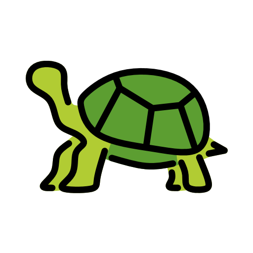
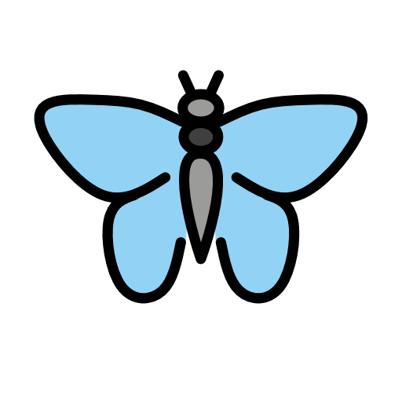
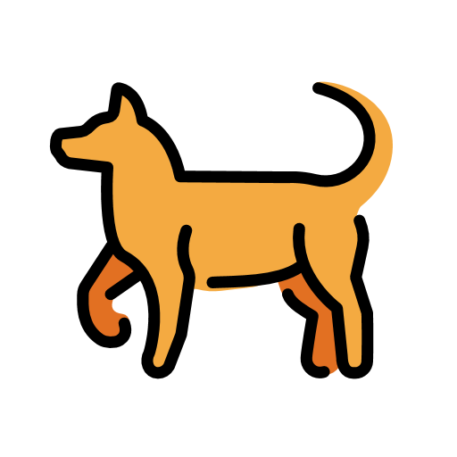

# EV-063-108 — Parent multi-dataset SVG guides and color reveal

**Date:** 2026-11-14 
**Feature:** FEAT-063 
**Scope:** curate compact child-friendly SVG sources, connect the source-derived guide path to Parent UI, and show the exact color source beside the completed guide.

## Result

The runtime pack now keeps the existing Arcadia chicken source and adds three pinned OpenMoji paired black/color SVGs: turtle, butterfly and dog. Noto candidates were inspected and rejected because converting the filled illustrations into outlines created cluttered internal contours. Noto is not included in the runtime pack or Docker image.

The Parent guide route resolves these pinned topics locally before Arcadia/Modal fallback, using only the selected topic. The Parent screen presents cumulative guide stages and, on the last stage, displays the completed line guide beside the corresponding original color illustration. The attribution identifies the guide as converted from OpenMoji and links the source and CC BY-SA 4.0 license. The ordinary capture step remains after the optional guide.

## Dataset decision

| Topic | OpenMoji asset | Source drawing elements | Guide stages | Curation note |
|---|---|---:|---:|---|
| Turtle | `U+1F422` | 12 | 5 | Clear shell, head, tail and legs; enough distinct parts for a gradual reveal |
| Butterfly | `U+1F98B` | 9 | 4 | Symmetric wings and a distinct body; simple silhouette |
| Dog | `U+1F415` | 6 | 4 | Familiar side silhouette with head, body, legs and tail |

The full dataset was not copied. Runtime only contains the three black/color pairs, manifest, attribution and official license text. Source revision is OpenMoji 17.0.0 at commit `f9fc506a3f913be9897ab0181d611d4c910a4104`.

## Provenance and integrity

License: **CC BY-SA 4.0**. The original color SVG is displayed as supplied. Black SVG primitives are normalized to SVG paths without altering source geometry; line geometry and order must match the paired color SVG. Adapted guide documents are labeled CC BY-SA 4.0.

| Asset | SHA-256 |
|---|---|
| `black-1F422.svg` | `4c617d364f6451249a06ed42e5b97344a1ccd5e19d8bf4d323f3e7cb111cfc22` |
| `color-1F422.svg` | `c3054c9394a9710c47d7057eebd48b31fe7292a555eacadb6eb47ed5a8b5d829` |
| `black-1F98B.svg` | `a089d7e39aed63ebb945aee24dfd64949dd5b855615909f7438a76a7d47cb65c` |
| `color-1F98B.svg` | `47b4971766ec7d4d913142eac844bb33c526b72839209c8acb531483a2f4072d` |
| `black-1F415.svg` | `1883bc9a8eec88065425e2cb4b801696f1d9a0734b00d83e43652739f02a6e22` |
| `color-1F415.svg` | `a01131556b1f472f2be150b5e61bb77e4ffed96bbdbc9b60ac4a36b62ffac2a3` |
| `parent-guide-manifest.json` | `086957a6a66c87a523edef5296d71517411a1a5c6d30b1b11626cd3d0af98ede` |
| `CC-BY-SA-4.0-legalcode.txt` | `28a9529c7d0bb4dc51f4bf5c116a3d16ef247a052f7591466768ddf563fd1cf5` |

Runtime source files and attribution: `deployment/modal/srs_v23/data/openmoji/`. The manifest records source URLs, aliases, stage assignments, upstream commit and per-file hashes.

## Manual visual curation

These previews were rendered from the pinned source pack and manifest for source selection using the included [PowerShell renderer](render_openmoji_stage_previews.ps1). The turtle stages were manually reordered after visual inspection so the head, legs and tail labels match the source elements. They are not screenshots from the Expo app, API responses, or proof of device rendering.

### Turtle

### Butterfly

### Dog

All cumulative stage previews are also stored in this directory. Earlier `noto-emoji-*` images are rejected-candidate evidence only.

## Code locations

- Source resolver and source/manifest/license validation: `backend/src/sketch2life/infrastructure/svg/openmoji_guide.py`
- Parent route source selection and response provenance: `backend/src/sketch2life/interfaces/http/routers/parent_ai.py`
- Versioned derivation contract: `backend/src/sketch2life/contracts/schemas/svg_engine.py`
- Parent progressive guide/color display: `apps/ui-mobile/src/parent/presentation/screens/SketchGuideScreen.tsx`, `apps/ui-mobile/src/parent/presentation/components/ProgressiveSvgGuide.tsx`
- Docker source packaging: `backend/Dockerfile`, `.dockerignore`

## Verification boundary

- **Completed:** static source/code review and manual inspection of selected SVG source/stage previews; provenance/hash values are recorded in the manifest and this report.
- **Not run:** automated tests, typecheck, app build, API call, Android emulator, Firebase end-to-end, Modal deploy/inference, or full Parent workflow. No runtime pass is claimed.
- Draft source guides remain subject to adult/educator review before any publication or classroom use. Product SRS §§1–31 remain unchanged; §32.28 is as-built evidence only.

## Sources

- [OpenMoji source repository](https://github.com/hfg-gmuend/openmoji)
- [OpenMoji 17.0.0 release](https://github.com/hfg-gmuend/openmoji/releases/tag/17.0.0)
- [OpenMoji style guide](https://openmoji.org/styleguide)
- [CC BY-SA 4.0 legal code](https://creativecommons.org/licenses/by-sa/4.0/legalcode)
- Existing Arcadia chicken source: [Zenodo record](https://zenodo.org/records/17203578)
