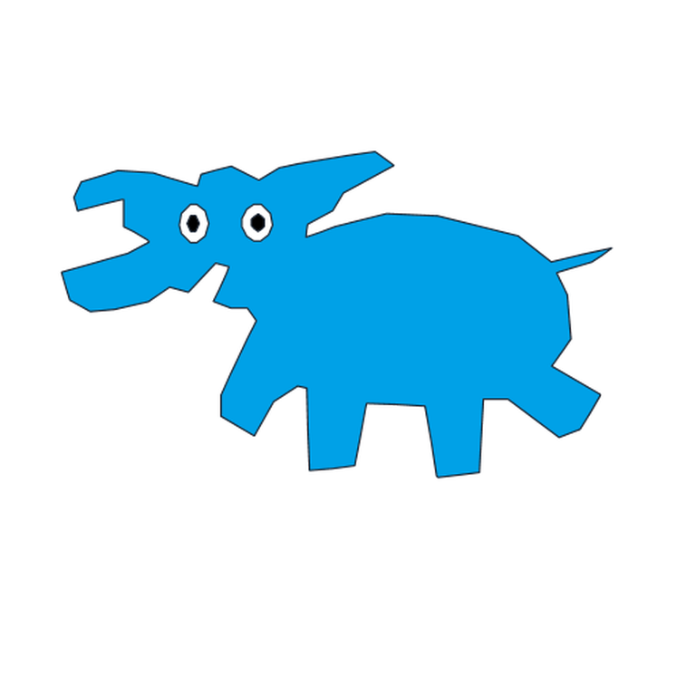
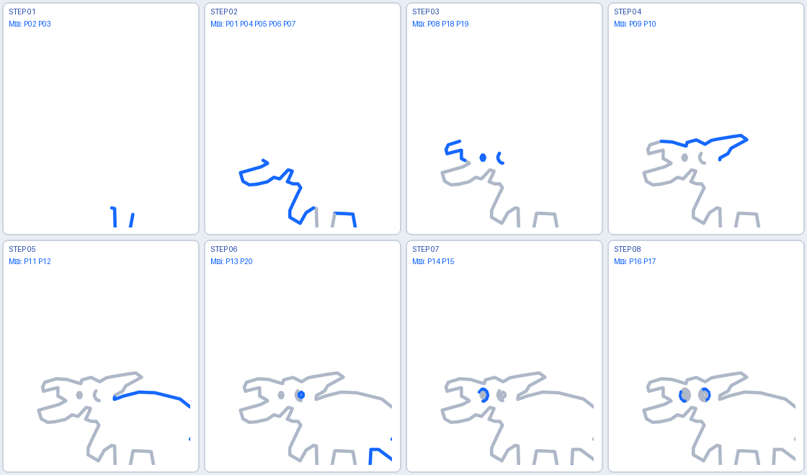
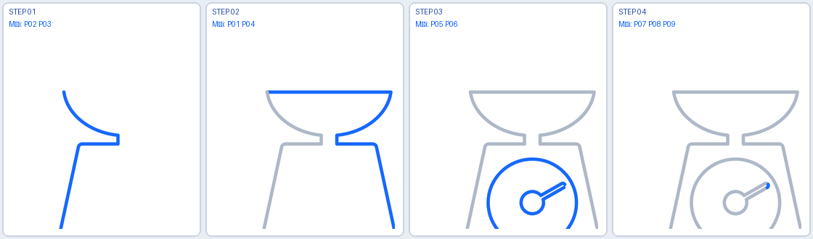

# EV-063-123 — Parent non-kitten catalog guide verification

**Date:** 2026-11-15
**Plan:** `plan/PLAN_REV87_29_PARENT_NON_KITTEN_MODAL_SMOKE_20261115.md`
**Result:** generic Parent catalog guide is not visually/relevantly reliable yet. Two real Modal route calls returned HTTP 200, but manual review rejected both guides; the butterfly route failed before Modal dispatch.

## Scope and runtime

- One pre-dispatch route attempt for `con bướm`, then one real Modal route call each for `con voi` and `con cá`; no retries or additional topics.
- Backend route used the synthetic Parent principal in the test harness, which bypasses the HTTP auth guard. No child profile, child drawing, voice, consent, Firebase identity, database write, video, or fixture was used. This is not authenticated or Android E2E.
- Modal app: `sketch2life-srs23-language-audio-dev`, environment `dev`, app ID `ap-pTMHfQi0SqTySkbzua5RSj`.
- CPU health preflight returned HTTP 200 with `Qwen/Qwen3.5-9B` revision `c202236235762e1c871ad0ccb60c8ee5ba337b9a` ready and Openclipart catalog Volume v2 ready. Preflight reported `gpu_allocated=false` and `inference_executed=false`.
- The two subsequent route calls exercised the deployed Qwen/catalog worker. No quality gate was weakened.

## Results

| Topic | API result | Selected source | Output | Manual review |
|---|---|---|---|---|
| Butterfly | HTTP 503 in 0.078 s; no Modal call | Local bundled guide; no catalog search | `SVG_OPENCLIPART_SOURCE_GUIDE_DOCUMENT_INVALID`, request `512747bd-e59b-433e-b05d-eb09e7e15e79` | Pre-dispatch defect. Butterfly source declares 39 paths while API canonicalization caps at 32. The bundled turtle guide declares 35 paths and has the same cap mismatch; turtle was not called. |
| Elephant | HTTP 200 in 147.959 s; request `77ac114c-1894-43cb-a45e-c5423b544493`; Modal call `fc-01M7FD9XR38FFY05529HM9MW5H` | `openclipart-elephant-refixed`, Openclipart CC0-1.0, source SHA-256 `74ea03f837ef1293ae17ae5ab97c50daf94002047ba4141cea0031a7674afefb` | 20 paths, 8 stages, genuine SVG and color reference | Not pedagogically acceptable. The source is recognizable as an elephant but is a crude cyan polygon. The first stage adds only two tiny disconnected marks. Captions repeatedly append alternating “rear-right/rear-left ridge” directions unrelated to the depicted stage; trunk/body/legs/tail/eyes/ears are not introduced in a clear construction order. |
| Fish | HTTP 200 in 131.538 s; request `f9adda5a-548f-46cf-b192-7fa67176a708`; Modal call `fc-01M7FDKVJK528NPKS7V5QY4S8P` | **Wrong topic:** `openclipart-kitchen-icon-scale`, Openclipart CC0-1.0, source SHA-256 `62490751fad8df44ac504c29b01905a3dfc1f4998a0faa699a7c0e78da60a0b0` | 9 paths, 4 stages, genuine SVG and color reference | Rejected. The source render depicts a kitchen scale, not a fish. Instructions repeat sentences, include truncated text, and contain Chinese characters. The worker reached parse and hard-gate validation and the route returned 200 despite this semantic mismatch. |

### Timing from worker logs

- **Elephant:** worker 129.720 s; model load 17.410 s; catalog query expansion 38.231 s; catalog search 2.675 s; draft inference 38.506 s; visual-review inference 30.793 s. Worker emitted a successful terminal event.
- **Fish:** worker 130.587 s; model load 18.101 s; catalog query expansion 37.827 s; catalog search 6.509 s; draft inference 24.820 s; visual-review inference 16.864 s. The API completion log reports success, but the captured worker wait diagnostic says `worker_started_without_terminal_event` at `visual_review_parse_and_hard_gate_validation`; this is an observability inconsistency to investigate separately.

## Visual evidence

### Elephant

Stage SVG/PNG files and per-stage copy are listed in `attempt_elephant/rendered/render_manifest.json`.

### Fish

Stage SVG/PNG files and per-stage copy are listed in `attempt_fish/rendered/render_manifest.json`.

## Logs and raw response evidence

- `health_preflight.json`
- `attempt_butterfly/request.json`, `response.json`, `request_summary.json`, and `modal_route_call.log`
- `attempt_elephant/request.json`, `response.json`, `request_summary.json`, `modal_route_call.log`, and `rendered/`
- `attempt_fish/request.json`, `response.json`, `request_summary.json`, `modal_route_call.log`, and `rendered/`

The fish mismatch shows the current visual-review/hard gates are insufficient to enforce source-topic agreement and clean Vietnamese instructions. The exact catalog-query candidates/scores were not retained in the sanitized route logs, so the retrieval-selection subcause cannot be narrowed from this run alone.

## Modal shutdown

The deployed app was stopped at 17:59:27 +07. `modal app info --json` reports lifecycle state `stopped` and `servers: {}`. `modal app list` also reports state `stopped`; its `tasks: 1` field is retained as reported and is not treated here as a live-task count. No Modal server remains active for the tested app.

## Conclusion and follow-up

The generic route is **not ready for non-pinned Parent topics**. Preserve the hard gates. A separately approved fix should address: (1) catalog candidate/topic relevance before draft generation; (2) a semantic check that compares the selected source subject with the requested topic and rejects/reselects safely; (3) Vietnamese-only, non-repetitive instruction validation and caption-to-new-stroke alignment; (4) butterfly/turtle local-pack path-count compatibility; and (5) worker terminal-event logging consistency. Do not infer that HTTP 200 alone means a usable guide.

The exact pinned kitten guide and its paired-eye correction are separate, source-specific results; this run does not invalidate or generalize those results. No product target in SRS §§1–31 changed.
