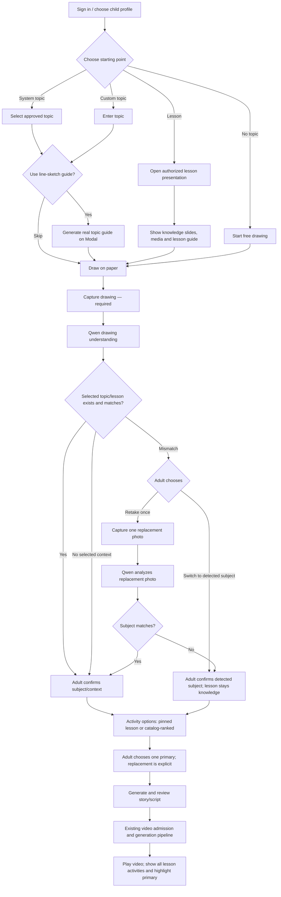
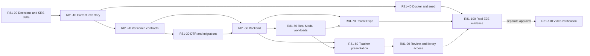

# Plan Rev81 — Consolidated Parent, Teacher Presentation, AI and Docker Flow

**Date:** 2026-11-12 (Asia/Saigon)

**Status:** IMPLEMENTATION APPROVED — in progress, based on the owner's explicit instruction on 2026-11-12: “implement plan, make sure no fixture”.

**Canonical product baseline:** FEAT-063 SRS v2.7-draft Rev60, unsigned; §§1–31.

**Purpose:** One execution plan consolidating the existing Rev79 local Docker baseline, the Rev80 Parent/Teacher verification work, and the owner's new Parent-flow and Teacher-presentation requirements.
**Approval boundary:** The later owner instruction “implement plan, make sure no fixture” supersedes the earlier “khoan code” pause for this consolidated scope. Source implementation and bounded non-video Modal verification are approved under this plan. Video inference, production publication, destructive data operations, secret changes, commit, push and merge remain outside this approval.

## 1. Goal

Deliver one real, connected Sketch2Life workflow across Parent Android and Teacher web, with the backend and development infrastructure started from one project-root `.env`. Parent may use a topic or an approved lesson presentation before drawing; drawing capture remains required. Teacher lessons become editable, media-bearing presentations with a progressive line-sketch guide and a classroom occurrence flow that uses the selected child's drawing. Parent account/settings, profiles, lesson library/history, notifications, quota and consent screens remain part of the product shell. AI requests use the real Modal workers only after an explicit user action. The existing Parent/Teacher story and video pipeline remains part of the product and is not replaced by fixtures or a mock flow.

This plan does not change the canonical SRS. Rev60 is still the working requirement baseline and remains unsigned. Owner clarifications below are recorded as this plan's direction only. Any SRS, API, data-model or permission change must be reviewed and recorded before implementation.

## 2. Consolidated baseline and known state

- **Rev79 Docker/local baseline:** source changes exist in the current worktree and the feature status reports the isolated Compose stack, migrations, idempotent synthetic seed and Modal health sidecar runtime-verified with findings. It has not had a live Parent AI inference or Android UI E2E in the recorded Rev79 evidence. Do not recreate this work blindly; carry it forward and re-verify it as the foundation.
- **Rev80:** a bounded Parent emulator run and a Teacher progressive-guide fix were approved previously. The owner has now paused coding and asked for one combined plan. Rev80's requirements are carried into this plan; it is superseded as the active implementation plan before any persistent Rev80 source change.
- **Existing Parent API surface:** authenticated profile/consent and StoryRun routes; Parent AI routes for optional sketch guide, artwork understanding, activity suggestions, and story revisions; Lesson Library routes for accessible lessons. Reuse these versioned routes where their contracts fit. Add or change routes only through a documented API contract and migration review.
- **Existing Teacher AI surface:** structured lesson-plan suggestion, reviewed-plan Sketch Deck, and lesson-visual candidate routes. Current Sketch Deck text changes per step while a single FLUX raster remains static; that does not demonstrate cumulative construction strokes.
- **SRS Rev60 conflicts to resolve:** Parent guide currently takes a catalog topic only, is not lesson-bound, and runs while drawing; Parent activities are specified after video and are not selected as a video/story input. The new owner direction adds custom topics, a lesson-presentation preset, adult subject mismatch resolution, and activity choice before story review. The SRS also describes Teacher Sketch Deck rather than a general-purpose slide editor with uploaded images/video links and optional AI images. These are changes to the target requirements, not implementation details to silently infer.
- **Repository boundary:** existing Rev79 edits and the ignored project-root `.env` are user work/runtime state. This plan does not reset, restore, reseed destructively, or alter them.

## 3. Owner-confirmed direction for this plan

The following points came directly from the owner in the 2026-11-12 conversation. They guide this plan but do not sign or amend the canonical SRS.

1. Parent may start with (a) a system topic, (b) a custom topic, (c) no topic, or (d) a published/shared lesson presentation that the Parent is authorized to use.
2. Topic and lesson selection are optional. Capturing a drawing is mandatory. If a topic is selected, its optional AI line-sketch guide appears before the drawing. With a lesson preset, the lesson's knowledge presentation and drawing guide precede the drawing.
3. After capture, image understanding runs against the confirmed topic/lesson context. If the detected subject conflicts, retain the lesson as a knowledge reference and show a warning. The adult can switch the topic to the detected subject or retake the photo once. If the second image still conflicts, use the AI-detected subject after adult confirmation and keep the lesson as knowledge.
4. Select one primary activity before script generation; the child does it after video playback. When a lesson is pinned, use its approved activities by default and show the full lesson activity list after the video. AI alternatives require an explicit adult request. Regenerated choices must exclude the activity being replaced and other rejected/selected activities so the result is not a duplicate.
5. Parent's general activity flow uses the accessible published/shared lesson catalog as the candidate source, with the confirmed profile context, drawing, topic and adult-confirmed narration context. If no catalog candidate is suitable, the existing owner direction is exactly three temporary AI drafts behind the current quality/safety gate. AI does not edit canonical catalog activities.
6. Teacher lesson is intended to be a complete presentation: reviewed lesson content, optional teacher-uploaded images, video URLs, optional AI-generated illustrative images, and a line-sketch guide. Teacher can edit slide content, place media on a chosen slide, and reorder presentation content. AI image generation is off unless the Teacher explicitly enables it.
7. Teacher reviews the lesson before submission. A School Manager reviews and controls visibility within the school; the Platform Admin reviews and controls PUBLIC publication to the platform-wide library. Either may request revisions or reject publication within that scope. The lesson/version and its media need the same review, revision and access lifecycle.
8. AI work must be real. Product paths must call the connected API and real Modal worker; fixture responses or hardcoded output cannot stand in for Parent/Teacher workflows. Synthetic test accounts and a generated, non-personal drawing are acceptable test inputs.
9. The progressive drawing guide uses an adaptive 4–8 stages. Rev60 still states 3–5 stages; this is a task-scoped owner direction and an explicit SRS conflict, not a silent SRS edit. Keep the implementation versioned and fail closed if the actual worker cannot produce validated cumulative stages.
10. If an authorized lesson version has no drawing guide, the adult may explicitly request guide generation from the pinned lesson subject. Skipping or a provider failure must still allow drawing to continue.
11. Teacher video embeds are limited to YouTube and Vimeo URLs. Accept HTTPS URLs from those exact providers, render through their supported embed form, and never fetch the submitted URL from the backend or follow redirects. Reject unsupported hosts and malformed provider URLs.
12. Docker startup must operate the existing deployed Modal AI apps (drawing VLM, language/audio and FLUX image) rather than deploy a separate health-only app or redeploy the shared apps on every local restart. It performs a non-inference warmup for configured product workers, then probes each deployed app's `/health`. Warmup loads the model into the actual worker without generating output; do not set a permanent minimum GPU container. Workers may scale to zero after their existing idle window. Video and the disabled optional SAM2 candidate remain excluded.

## 4. Target workflow

### 4.1 Parent mobile

**Flow rules:**

- The free-draw path may omit topic and line sketch. If no topic is chosen, do not invent a topic before image understanding.
- A lesson path is pinned to the exact authorized lesson version. It shows knowledge and media in lesson order, then the guide if the approved version has one. When the guide is absent, the adult may explicitly request one from the pinned lesson subject; on failure or skip, continue to drawing.
- A Parent topic guide receives only the chosen generic topic, difficulty and guide contract. It does not receive profile, image, audio or child artwork. It is optional; skipping it creates no AI job.
- Capture is mandatory. When understanding detects a mismatch, keep the lesson as a knowledge reference and ask the adult to switch the topic to the detected subject or retake the photo once. If the retake still mismatches, use the AI-detected subject after adult confirmation; keep the lesson as knowledge. Confirmation is required before story generation. The app retains the original image and its lineage.
- Parent chooses one primary activity before story generation; the selected activity is performed after video. With a lesson, use lesson activities by default and show the full list after playback. Do not call activity AI automatically. If the adult requests a replacement, exclude the replaced/rejected activity and all already selected items from candidates/output.
- The generated script uses the confirmed subject, authorized profile/context snapshot, optional pinned lesson direction and confirmed activity direction. The existing 5–15-scene structured script review and bounded rewrite rules remain; no direct scene editing is introduced by this plan.
- Video remains a new per-child generation using the existing SRS-target LTX-2.5 pipeline, safety gate, quota admission and private playback. This plan does not substitute WAN or reuse another child's video.

```mermaid
flowchart TD
  subgraph Authoring[Lesson authoring and publication]
    A[Structured form or filtered upload] --> B[Teacher reviews extracted fields]
    B --> C[Edit lesson slides, images, video links, activities]
    C --> D{Any AI asset requested?}
    D -->|Yes| E[Generate each enabled image and/or guide as a private draft]
    D -->|No| G[Preview exact lesson revision]
    E --> G
    G --> H[Teacher submits immutable revision]
    H --> I[Manager school-scope review]
    I -->|Changes or reject| C
    I -->|School approved| J[School-visible version]
    J --> K{Teacher requests platform PUBLIC?}
    K -->|Yes| L[Platform Admin review]
    K -->|No| M[Keep school scope]
    L -->|Approve| N[PUBLIC version]
    L -->|Changes or reject| C
  end
  subgraph Occurrence[Single-child classroom occurrence]
    O[Create occurrence, pin lesson/version] --> P[System selects eligible child]
    P --> Q[Teacher confirms child/context]
    Q --> R[Present knowledge and approved media]
    R --> S{Teacher enabled guide?}
    S -->|Yes| T[Present progressive guide]
    S -->|No| U[Capture this child's drawing]
    T --> U
    U --> V[Qwen understands image]
    V --> W[Teacher confirms subject/context]
    W --> X[Pin approved activity and story direction]
    X --> Y[Generate story, review and confirm]
    Y --> Z[Existing per-child video pipeline]
    Z --> AA[Automated safety gate]
    AA --> AB[Teacher confirms classroom playback]
    AB --> AC[Present activities and close occurrence]
  end
```

### 4.2 Teacher authoring, classroom occurrence and publication

1. Teacher uses the existing filtered structured lesson workflow. Unfiltered source documents/raw text do not go directly to a model.
2. Teacher creates or edits a draft presentation for a lesson revision. The proposed editable block types are title/text, uploaded image, video link, progressive drawing guide, subject-knowledge block and approved activity. Final slide/block types are an implementation design decision after API/data review.
3. Teacher can add/remove/reorder slides and blocks, edit text, choose the slide for each image/video, and preview the complete presentation. Image assets retain source, owner, content hash, moderation state and lesson revision lineage.
4. Teacher-uploaded images and video URLs are associated with the draft version. FLUX image generation appears only after the Teacher enables it and each generated image remains a draft candidate until reviewed. AI output never replaces uploaded originals.
5. The progressive guide is a real model result with several construction stages: basic forms, main structure, major parts, recognizable features and finishing detail. Each selected stage accumulates prior strokes; the on-screen tracing marks are dashed. The last stage must visibly depict the requested subject. A one-shot composite image cannot be presented as step-by-step proof.
6. Teacher reviews the full presentation and sends a specific version for review. School Manager can approve, request changes or reject visibility inside that school. Platform Admin separately reviews PUBLIC promotion to the platform-wide library and can request changes or reject it. Edits create a new immutable revision and invalidate prior approvals. Existing occurrences keep their pinned version.
7. Parent can view only a public/shared/invited version allowed by its grant. Revocation blocks new reads; already pinned historical lesson metadata follows existing SRS retention rules. No cross-organization disclosure is allowed.
8. For a class occurrence, the system selects one child who passes the approved eligibility/consent policy; the Teacher reviews and confirms the selected child/context. The Teacher cannot manually choose a different child unless the canonical SRS decision is changed.
9. Teacher presents the exact occurrence-pinned lesson revision in slide order, optionally presents its Teacher-enabled cumulative sketch guide, and asks that child to draw on paper. Teacher captures/uploads that child's drawing through the occurrence-bound capture step.
10. Qwen3.5-VL analyzes the drawing against the pinned lesson/plan and permitted child context. Teacher reviews and confirms the subject before story generation. Optional narration goes through the authorized Whisper/transcript review path only when the current consent/flow allows it.
11. Teacher pins one approved occurrence activity and story direction, reviews the structured story, requests only the allowed AI rewrites, and confirms the final revision. The existing per-child video pipeline then creates a new video from that child's drawing.
12. Automated safety must pass before playback. The current Teacher confirms the classroom projection separately and receives the short-lived playback authorization required by SRS; this is not a second human video-content approval. Teacher then presents the lesson activities and closes the occurrence under its existing one-sample/claim rules. No roster batch generation is introduced.

### 4.3 Local Docker and runtime

- One `.env` at the CAPSTONE project root is the only local environment file. `.env.example` contains placeholders; no service-specific tracked `.env` files. Root `.env` stays ignored and is never committed or copied into evidence.
- A single Compose command starts backend and infrastructure: PostgreSQL, Redis, MinIO, ClamAV, Firebase Authentication Emulator, migrations, insert-only synthetic seed, API and the Modal lifecycle controller. Expo Parent and Teacher web remain separate UI processes as previously directed.
- Startup deploys the existing drawing-VLM, language/audio and FLUX apps, invokes only their explicitly defined non-inference worker warmup paths, and probes each app's `/health`. A warmup may allocate a GPU and load checkpoint/model weights but must not generate, transcribe, segment, or return product output. Do not set `min_containers`; rely on the existing idle scaledown window. Video and disabled optional SAM2 are not deployed or warmed by this path.
- Seed only missing local demo entities required by both roles (Parent, Teacher, Manager, local Admin where supported; school organization/class/assignment; synthetic child/profile authorization; approved lesson/version/activities and media metadata; local quota/sample records). Use stable keys, verify existing rows, skip exact matches, and stop on conflicting rows. No truncation, duplicate inserts, legal-consent fabrication, real child data, production Firebase writes or cross-environment synthetic bypass.
- Firebase is Authentication-only. Local run uses Auth Emulator; production credentials remain backend-only. Firebase Storage, Firestore and Realtime Database stay unused. MinIO is the local S3-compatible adapter; AWS S3 can replace it later behind the storage port.
- Preserve PostgreSQL/MinIO/Auth volumes and existing containers. Use isolated Compose project names for verification. Do not run `down -v` or destructive migrations against existing data.

## 5. AI and API plan

### 5.1 Modal workload direction

| Capability | Direction in SRS/current owner choice | Planned use |
|---|---|---|
| Drawing understanding, subject/mismatch and story | Qwen3.5-VL on Modal | Analyze captured drawing and create the structured story from confirmed context. |
| Parent topic guide and lesson illustrations | FLUX.3 on Modal | Real optional visual generation; progressive guide quality must be demonstrated across stages. |
| Activity choice/replacement | Qwen3.5-VL on Modal | Rank only Parent-accessible published/shared activity candidates; exclude rejected choices; exactly three gated temporary drafts only on catalog no-match. |
| Speech-to-text | Whisper on Modal | Optional narration transcription, adult reviews transcript before use. |
| Segmentation | SAM 2.1 optional | Not a blocker for the Parent flow; use only if current deployment/quality gate passes. |
| Video | LTX-2.5 on Modal | Existing per-child pipeline remains; no WAN substitution. Runtime test is gated on the approved worker being available. |

No Qwen2.5, Lightning, WAN or mock response is introduced as a fallback for a missing SRS target. Keep Modal credentials and provider URLs on backend only.

### 5.2 API contract work

Reuse and review these existing API families before adding routes:

| API family | Current use | Contract work in this plan |
|---|---|---|
| Parent profiles/consent | Profile CRUD, policy read, grant/revoke, archive | Preserve authorization, immutable revisions and synthetic-vs-legal consent gates. |
| Parent StoryRuns | Create/read/resume run; subject and story confirmations | Add the selected topic/lesson revision and mismatch choice only through an explicit versioned request contract and schema review. |
| Parent AI | `POST /api/parent/v1/ai/sketch-guides`; drawing understanding; activity suggestions; story revision | Extend guide input for custom generic topic only; ensure artwork-understanding response carries confidence and topic comparison; support explicit activity replacement with rejected refs; keep story schema and current quality gates. |
| Lesson Library | Accessible lessons, detail/version, invitations/grants and moderation | Return presentation slide order and authorized media metadata; enforce visibility, version pin and revoke on every read. |
| Teacher AI | Lesson-plan suggestions, Sketch Deck, lesson visuals | Version the progressive guide output. Keep plan review as input gate. Separate slide-image candidates from drawing-guide geometry. |
| Teacher lesson CRUD/upload | Structured lesson draft and filtered import | Add versioned slide/block and image/media-link commands only after ownership, DTR and authorization review. |
| Manager/Admin review | Existing library moderation surface/API where available | Add version review/request-changes/reject decisions and audit receipt; School Manager scope is school-only, Platform Admin scope includes platform-wide PUBLIC; no direct edits by reviewer to Teacher's content. |

Every added/changed endpoint must have a canonical path/name, request/response schema, auth scope, error codes, idempotency/revision behavior, storage owner, AI workload and OpenAPI example. Do not derive route names from UI labels. Existing API inventory remains the starting point; this plan does not claim any additional endpoint exists today.

### 5.3 Progressive line-sketch technical proof

The current defect is that Teacher step text advances while the same FLUX image stays visible; the attached butterfly image jumps to a nearly complete outline in step 2 and spends later panels on decoration. The plan requires a short live-Modal proof before selecting implementation:

1. Compare two real Modal-compatible approaches on one synthetic, detail-rich topic such as a deer: (a) generate a distinct FLUX visual for each cumulative stage, with the prior stage as a reference; (b) generate bounded structured strokes with the model and render them as SVG. Do not insert pre-drawn templates/fixture art into the product path.
2. Represent a guide with a versioned subject and ordered stages. Each stage has a short instruction, its newly introduced stroke IDs/asset and the cumulative rendered result. Later stages must preserve every accepted earlier construction stroke; dashed styling is applied consistently by the renderer. Do not let a model silently replace the earlier drawing with a finished image.
3. Check stage count (owner decision pending), anatomy/proportions, cumulative visibility, dashed trace style, age 3–10 readability, inter-stage consistency, latency, GPU queue/startup cost and image/license/safety review. The sequence should progress from simple guide geometry to main body/parts, recognizable subject features and finishing detail; details may never replace missing subject structure.
4. Choose the approach only after visual review. Store intermediate outputs and provenance; the guide remains a DRAFT for Teacher review. Parent guide assets remain session-scoped, private and expire per SRS.
5. Fail closed on bad/incomplete output. Do not show a static composite as a valid progressive guide. The Teacher can continue with adult textual guidance if visual generation fails.

### 5.4 Screen-by-screen workflow specification

#### 5.4.1 Parent mobile screens

| Screen / state | Entry and required data | Primary action and next state | Failure, retry and persistence rules |
|---|---|---|---|
| P-00 Sign-in / sign-up | Firebase Auth identity; local development points to Auth Emulator; email/password and Google sign-in only when the provider is enabled | Sign in/create Parent account; backend resolves Parent role and then loads app data | Auth error remains on sign-in; Parent Android never creates a Teacher/Admin role. Password recovery/change uses Firebase Auth flows; no Firebase Storage/Firestore/RTDB. |
| P-01 Home | Active child/run summary, quota summary, unread notification count, shortcuts to topics and lesson library | Choose profile, continue active run, browse lessons, or start a run | Home is a navigation hub, not a combined workflow form. Empty states link to profile creation, lesson browse and account setup. |
| P-01a Child profile list | Parent-scoped profile cards and one active-run status | Select a profile or open profile CRUD | All reads/writes are scoped to authenticated Parent. Age uses SRS age bands and exact months only where authorized. Synthetic development authorization is labeled as dev-only and is not legal consent. |
| P-02 Start source | Optional system topic, custom topic, no topic, or Parent-accessible lesson version | Save an explicit source choice and start the run; if lesson is selected, pin its exact version/hash | No implicit default topic or “latest” lesson version. A source change after run creation is a versioned command and may require re-confirmation. Resolve whether topic and lesson can coexist in Phase 0; until then UI offers one explicit source mode at a time. |
| P-03 Lesson presentation (lesson path only) | Authorized lesson revision, ordered slides/blocks, authorized media references and activity list | Parent/child navigate the lesson, then continue to its drawing guide/capture | Recheck grants and publication status for each media read. Missing, revoked or blocked media shows a safe unavailable card; it never silently substitutes another revision. Video links are validated against the approved host policy before embedding/opening. |
| P-04 Optional topic line guide | Generic selected topic and guide contract only; lesson guide uses the pinned lesson's reviewed guide when present | Explicitly request guide, inspect progressive stages, or skip to capture | No guide request when skipped. Generation failure, timeout, rejection or limit does not block drawing. Do not send child profile, age, image, voice or artwork to the generic Parent guide workload. |
| P-05 Drawing capture | Camera permission or gallery selection, run/source context, upload capability | Capture/select image, review crop/orientation, upload original and continue to analysis | Capture is mandatory. Preserve original bytes and provenance; reject unsupported/oversized files before AI. Network retry is idempotent and must not create a second asset/run. Permission denial offers gallery or platform settings. |
| P-06 Artwork understanding | Stored drawing asset, selected topic/lesson context, authorized profile snapshot | Run Qwen3.5-VL understanding and show detected subject/confidence; adult confirms or resolves mismatch | Do not generate story/activity before confirmation. Distinguish model uncertainty, unsupported image and provider failure. Keep raw prompt/provider diagnostics out of user-visible errors and logs. |
| P-07 Subject mismatch resolution | Detected subject, optional chosen topic and pinned lesson | Adult switches topic to detected subject, or takes one replacement photo; after a second mismatch adult confirms the detected subject | Preserve the pinned lesson as knowledge even if it no longer matches the drawing. The retake count is server-owned, limited to one. After it, the confirmed subject is the AI-detected subject only after explicit adult confirmation. |
| P-08 Primary activity | Exact lesson-version activities when lesson is pinned; otherwise Parent-accessible published/shared catalog and eligible activity metadata | Select exactly one activity before script generation. Request an alternative only through an explicit “đổi hoạt động” action | Lesson activity list is the default candidate set. For an explicit replacement, send excluded/rejected/selected refs and validate output has no duplicates. If no catalog item passes, create exactly three temporary AI drafts behind safety/quality validation; do not publish them into the canonical catalog. |
| P-09 Optional narration | Audio capture/import only if enabled by the approved consent and product flow; SRS limit is 2 minutes / 20 MB; Whisper transcript | Adult reviews/corrects transcript and explicitly attaches it to the run | No transcription request when skipped. Consent/access gate, audio size/duration limits, retention and deletion follow SRS. Do not assume child speech is authorized merely because a profile exists. |
| P-10 Script review | Confirmed subject, source/lesson pin, chosen activity, authorized context snapshot, optional adult-confirmed narration | Review structured 5–15-scene script, request bounded AI rewrite, then confirm final script | No direct scene editing if prohibited by current SRS. Enforce rewrite count, schema, age appropriateness and safety server-side. Each revision is immutable and identifies its parent revision. |
| P-11 Video admission / progress | Confirmed script, current consent/context revisions, quota and policy admission | Submit a video request, view durable progress, cancel if allowed, leave and resume | Keep admission-pending separate from accepted generation. Do not spend quota on rejected admission; follow current SRS for accepted request failures. No fabricated percent complete. Unknown provider outcome is reconciled before retry. |
| P-12 Playback / post-video activities | Safety-cleared per-child video, caption/audio state, pinned activity/lesson snapshot | Play with captions, complete or request allowed regeneration; show all activities from the pinned lesson after video | No human video approval gate. A blocked/failed video has a distinct state and safe retry/closeout path. Activity cards show materials, steps and notes. Revoke/unpublish affects new reads per approved policy and does not rewrite historical pins. |
| P-13 Child profile create/edit/detail | Display name, age/date inputs permitted by SRS, exact age band and consent/authorization status | Create, edit, archive or inspect one Parent-owned profile | Revisions are server-owned; archive/delete follows retention lifecycle; do not show a Teacher-linked profile in this Parent scope unless a separate grant is active. |
| P-14 Account and settings | Account details, connected auth providers, language (Vietnamese), privacy/security and password recovery/change entry points | Update supported account settings; start Firebase password reset/change or Google provider flow | Do not store raw password or Firebase credential in app backend tables/logs. Provider state and backend role are displayed separately. |
| P-15 Notifications | Parent-scoped lesson/share/review/feedback and run lifecycle notifications supported by current SRS/API | Open a notification and navigate to its authorized resource | Inventory existing notification routes and configured retention window first. No direct Parent↔Teacher chat or unapproved cross-scope content. |
| P-16 Quota and billing | Current Parent package/quota, consumed/remaining video units, usage history and clear unavailable state | View usage; purchase/top-up only if the approved Billing API/package policy is implemented | Never show a fake balance or trigger a purchase from display-only local quota. Parent purchase/top-up actor, prices and packages remain subject to the SRS open decision. |
| P-17 Run and lesson history | Recent story runs and lessons taught/shared for this child, each with version/date/source | Reopen allowed historical view or start a new run from an accessible lesson | Apply the SRS-configured history window; 30/60-day choice remains open until resolved. Do not imply that an old private/revoked lesson is currently accessible. |
| P-18 Profile sharing and access grants | Pending/accepted invitations, granted field scope, recipient school/Teacher, expiry/status and audit history | Accept/decline an invitation where allowed; Parent can create/revoke a scoped grant and review its status | Parent and Teacher accounts remain separate. Grant is least-privilege, revocable and audited; pending/revoked grants authorize no new reads, tokens, cache entries or not-yet-accepted AI jobs. |

Each screen must be a separate route/state in Expo navigation. Domain policies and use cases own transitions; React components only render state and dispatch commands. A screen may not skip a required server transition by navigating locally. Loading, empty, offline, permission-denied, conflict, retryable and terminal states are specified for each API-backed screen before UI acceptance.

#### 5.4.2 Teacher, School Manager and Platform Admin screens

| Screen / role | Main content and commands | Data/state contract |
|---|---|---|
| T-00 Teacher sign-in and home | Firebase-authenticated Teacher identity, assigned school/classes, drafts awaiting continuation, occurrences and recent lesson revisions | Backend resolves role and current organization/class assignment; no role is inferred from client route. Unauthorized app/role gets access-denied screen. |
| T-01 Class and lesson library | Assigned classes/roster within scope; owned drafts, school lessons, public/shared lessons allowed for reuse | No cross-organization discovery; lesson card shows owner, audience, revision and review status. |
| T-02 Create lesson / structured form | Topic, child age band, learning objective, observation prompts, drawing subject/steps, knowledge points, activities/materials/instructions/safety notes, optional story direction | Teacher-owned draft; required fields and parser allowlist validated server-side. AI suggestion route is available only to roles permitted by canonical SRS. |
| T-03 Upload and filter | Accept PDF/PPTX/DOCX up to 25 MB and 100 pages/slides; malware scan; parse/extract into reviewable field candidates; retain original and provenance | Reject encrypted/unsupported input and return `OCR_NOT_SUPPORTED` for scanned pages as SRS requires; raw upload and unfiltered document are not sent to AI. Teacher explicitly reviews and corrects extracted fields before approval. |
| T-04 Presentation editor | Add/edit/reorder slides and blocks on the SRS 16:9 child-facing canvas; place uploaded images or validated video links; optionally request FLUX illustration; include the drawing guide and activity context; preview as a real presentation | Save creates a new immutable lesson revision. Original upload is preserved. Generated media is draft/provenance-linked. Every media block belongs to one revision and position. |
| T-05 Sketch construction editor/preview | Show progressive guide stages and short child-facing instructions; inspect anatomy, sequence and dashed tracing appearance; retry or omit a failed optional guide | The approved plan/revision is the input. Guide deck binds to plan and activity coverage; changed plan marks prior deck STALE. No static composite can masquerade as cumulative steps. |
| T-06 Submit and review status | Teacher reviews full slide order, fields, media and sharing scope, then submits an exact revision; sees Manager/Admin feedback and requested changes | Submission freezes the submitted revision. Edits fork a revision and invalidate old decisions. Teacher cannot set platform PUBLIC directly. |
| T-07 Occurrence planner | Assigned class, one class occurrence, reviewed plan and exact lesson-version/hash pin; all approved lesson activities | Create/open an occurrence and prepare the single-child sample | Follow current SRS occurrence, capacity, assignment and version-pin rules. No batch run for a roster. |
| T-08 Eligible child confirmation | System-selected child from the eligible roster and minimum permitted context | Teacher confirms the selected child/context before story/run creation | Keep system-random selection and eligibility/consent decision table from SRS; Teacher cannot freely pick a child. No eligible child or unresolved consent blocks the run safely. |
| T-09 Classroom presentation | Child-facing slide order, approved lesson text/images/video links, teacher-controlled Back/Next and activity/topic context | Present knowledge first, then proceed to the drawing step | Presentation reads the exact occurrence-pinned lesson revision. Only approved media is shown; unsupported or revoked media fails closed. |
| T-10 Optional progressive guide | Teacher explicitly enables the Sketch Deck for the approved plan/occurrence; shared deck revision covering lesson activities | Present cumulative dashed construction steps or skip the guide | Disabled means no AI job. Deck is not built from roster/profile/artwork; plan change makes it STALE; regeneration creates an immutable replacement revision. |
| T-11 Child drawing capture | Current occurrence, selected child/run, browser camera or authorized image upload | Capture/upload one child's drawing and continue to understanding | Keep original image/provenance; bind to the exact occurrence and child. Do not start video from a teacher illustration or another child's image. |
| T-12 Drawing understanding and confirmation | Stored drawing, pinned lesson/plan and authorized profile/context snapshot | Run Qwen understanding; Teacher reviews detected subject/confidence and confirms or corrects through supported revision flow | Mismatch never silently changes the pinned lesson. Honor profile permission, current Teacher assignment, current SRS revision/confirmation policy and safety gates. |
| T-13 Story context and optional narration | Exact lesson direction, approved activity pinned for the occurrence, confirmed subject/context and optional adult-authorized narration | Teacher sets the story direction; optional Whisper transcript is reviewed before use | Teacher uses only assigned occurrence data. Do not send raw lesson upload or unrelated roster/profile data to AI. |
| T-14 Story review | Structured story and storyboard for the selected child/occurrence | Review, request bounded AI rewrite, then confirm the exact current revision | Enforce SRS story rewrite limit and schema; no direct scene editing. Every video request requires fresh confirmation of its script revision. |
| T-15 Video progress and classroom playback | Existing per-child LTX pipeline result, automated safety status and Teacher ownership | View status; only after safety-cleared playback, current Teacher may confirm presentation to class and receive short-lived playback authorization | Respect one successful sample claim per occurrence and current quota. No human video-approval state. Keep video live inference outside Rev81 test absent separate approval. |
| T-16 Occurrence closeout | Video outcome, occurrence sample claim and selected activity | Present the activity list and materials/instructions; Teacher completes or follows the SRS retry/closeout path | No second child or batch generation in the same occurrence. Preserve occurrence and run history; a failed/blocked result is not represented as a success. |
| M-00 School Manager review queue | Only lessons and revisions belonging to Manager's organization; preview/diff, media safety status, review notes, school-scope approve, request changes or reject | No media outside review authorization; decision records exact revision and reason. A school approval cannot imply PUBLIC approval. |
| A-00 Platform Admin public review | Queue only for explicit platform-publication requests; inspect exact revision, provenance, safety/moderation status; approve PUBLIC, request changes, reject, hide or unpublish within platform authority | Distinct from Manager school review. Default deny. Hide/unpublish revokes new catalog reads while preserving pinned history per approved lifecycle. |
| M-01 School organization controls | Organization's classes/assignments, assigned Teachers, class-slot capacity and school quota status | Manage only the Manager's organization within existing permissions; request capacity/quota change only through implemented Billing contract | Current 10 included slots and purchase/capacity rules stay as SRS-defined/open. Do not invent a local bypass or allow Manager to change Platform roles. |
| A-01 Platform accounts and roles | Platform Admin account/role operations and audit history | Create account, assign/update/revoke supported roles/scopes, or deactivate account through backend authorization workflow | Firebase Auth remains identity/authentication only. Role changes must be server-authorized, audited and effective on next request/token refresh. Never place a service-account credential in UI. Preserve a last-admin safeguard if current authorization policy defines one; otherwise keep it an open design item. |
| Parent lesson gallery/detail | Search/browse accessible PUBLIC or explicitly SHARED/INVITED versions, inspect detail/presentation and accept/decline invitations if applicable | Server filters by effective grants and exact version. Client never receives private/pending items to filter locally. |

Before UI assignment, confirm whether a separate School Manager web shell exists and where permission-scoped review belongs. Reuse existing Admin content moderation UI only if its role checks and data scope are proven; otherwise plan a scoped Manager screen in the appropriate web app after IA review.

#### 5.4.3 Clean-architecture boundaries for both clients

| Layer | Parent Expo | Teacher/Manager web |
|---|---|---|
| Domain | Profile, source choice, guide, drawing, understanding, mismatch, activity, script and run state; business rules and value types | Lesson draft/revision, slide/block order, media placement, review scope and presentation state |
| Application | Use cases such as `StartParentRun`, `LoadAccessibleLessons`, `CaptureDrawing`, `ConfirmSubject`, `ChoosePrimaryActivity`, `RequestStoryRevision` | Use cases such as `CreateLessonDraft`, `ImportAndReviewFields`, `EditPresentation`, `GenerateGuide`, `SubmitRevision`, `DecideReview` |
| Ports | Auth, Parent API, camera/gallery, upload, local secure session, telemetry/redaction | Auth, Teacher/Lesson API, upload, AI command, media preview and review API |
| Infrastructure | Firebase Auth adapter; generated/validated HTTP client; native camera/gallery/upload adapters; no direct Modal or S3 access | Firebase Auth adapter; API client; upload/media URL adapters; provider-neutral presentation model |
| Presentation | Navigation, screen state, reusable controls; no business policy in components | Role-aware route guards and reusable editor/review components; no authorization decision only in client |

Generate or maintain API types from the approved OpenAPI contract. Keep provider names out of domain entities where a capability/result contract suffices. Components may not write DB, construct storage credentials, call Modal directly, or reimplement server authorization.

### 5.5 API contract delta and endpoint inventory

The paths below marked **EXISTS** were verified in the current router source. They are implementation evidence, not a declaration that every business rule already matches Rev81. **PROPOSED** entries are logical contracts only; final route names must follow the API naming standard and current OpenAPI inventory in Phase 0.

| Workflow command | Current route / status | Required contract or gap for Rev81 |
|---|---|---|
| Read Parent consent policy | **EXISTS** `GET /api/parent/v1/consent-policy` | Return policy identifier, version and required authorization purpose; production must fail closed when no approved policy is configured. |
| Sign-in, sign-up, Google and password recovery/change | **EXISTS/VERIFY** Firebase Auth client + backend identity/role routes; exact routes and provider state need inventory | Verify Parent auto-role, Teacher web role gate, Admin role provisioning, Firebase Auth Emulator behavior, Google provider enablement, reset/change flows and backend account/profile synchronization. Firebase is Auth-only. |
| List/create/read/update/archive child profiles and authorize data | **EXISTS** `GET/POST /api/parent/v1/child-profiles`, `GET/PATCH/DELETE /api/parent/v1/child-profiles/{parent_profile_id}`, `POST/DELETE /api/parent/v1/child-profiles/{parent_profile_id}/data-authorizations` | Confirm exact policy/version binding, revision checks, synthetic development behavior, deletion/lifecycle response, and role/scope errors. No consent fabrication. |
| Create/read/resume Parent run | **EXISTS** `POST /api/parent/v1/story-runs`, `GET /api/parent/v1/story-runs/{run_id}`, `GET /api/parent/v1/story-runs/active/current` | Version the source choice, exact lesson version/hash, profile/context snapshot reference, idempotency key and allowed initial state. Add fields only after compatibility review. |
| Confirm detected subject / final story | **EXISTS** `POST /api/parent/v1/story-runs/{run_id}/subject-confirmations`, `POST /api/parent/v1/story-runs/{run_id}/story-revision-confirmations` | Define allowed transition, current revision, actor, mismatch outcome and idempotency. Enforce the single retake rule server-side. |
| Generate Parent topic guide | **EXISTS** `POST /api/parent/v1/ai/sketch-guides` | Extend/version input for a custom topic only if current schema and SRS amendment permit it. Keep generic guide independent of child/profile/artwork. Add lesson guide by exact approved revision if selected. |
| Upload/analyze drawing | **EXISTS** `POST /api/parent/v1/ai/drawing-understandings` | Verify upload storage, asset ownership, image limits, confidence semantics, topic/lesson comparison, request correlation, and no story-before-confirmation transition. |
| Rank or replace Parent activity | **EXISTS** `POST /api/parent/v1/ai/story-runs/{run_id}/activity-suggestions` | Rework contract so candidate source is authorized published/shared lesson activities; input carries exact run context and optional exclusion refs; output distinguishes selected catalog refs from temporary drafts and includes quality-gate result. It must not mutate catalog. |
| Generate/rewrite story | **EXISTS** `POST /api/parent/v1/ai/story-runs/{run_id}/story-revisions` | Include confirmed subject, activity direction and exact lesson revision in server-constructed context; enforce schema, scene and revision limits and persist an immutable revision. |
| Browse authorized Parent lessons | **EXISTS** `GET /api/lesson-library/v1/me/lessons`, `GET /api/lesson-library/v1/me/lessons/{lesson_id}`, `GET /api/lesson-library/v1/me/lessons/{lesson_id}/download` | Detail must resolve the authorized exact revision, ordered presentation blocks, activity versions and media authorization. Revoke/unpublish and stale revision behavior must be explicit. |
| Parent↔Teacher profile share/invitation/revoke | **GAP/VERIFY** no profile-share invitation/revoke route was verified in the inspected Parent profile router | Inventory all mounted routers/OpenAPI, then add only if absent. Contract must cover invitation, acceptance, field-level scope, profile owner control, revoke effect on reads/tokens/jobs and cross-organization denial. |
| Teacher lesson draft, upload, revision and review submission | **EXISTS, partial** under `/api/lesson-library/v1/organizations/{organization_id}/lessons...` plus upload-session/version routes | Inventory all exact operations from OpenAPI before changing. Add presentation/slide/media revision commands only if no current command can represent them; keep raw upload filtering and Teacher review gate. |
| Teacher occurrence, eligible-child choice, capture, story, video and classroom presentation | **INVENTORY REQUIRED** current mounted occurrence/StoryRun/video/session paths have not been enumerated in this plan review | Trace each screen to current OpenAPI and SRS state machine; keep random eligible-child selection, Teacher confirmation, one sample claim, assigned-Teacher ownership and one-child asset lineage. Add no duplicate route until gaps are proven. |
| Teacher lesson-plan, deck and visual AI | **EXISTS** `POST /api/teacher/v1/organizations/{organization_id}/ai/lesson-plan-suggestions`, `/sketch-decks`, `/lesson-visuals` | Preserve reviewed-plan precondition; separate cumulative guide stages from illustrative image candidates; persist model/schema/provenance and keep AI output as editable draft. |
| Manager school-scope decision | **GAP/VERIFY** only the Platform Admin moderation route was verified in current source; a Manager review route was not | Add explicit review decision contract with target organization, exact lesson revision, action, reason, decision idempotency and audit receipt. Manager cannot approve PUBLIC scope. |
| Platform Admin PUBLIC decision | **EXISTS, VERIFY** `PATCH /api/lesson-library/v1/platform/lessons/{lesson_id}/moderation` | Confirm exact role/permission and platform-publication transitions. Admin decision must not be conflated with school visibility. |
| Topic browse and Parent run source catalog | **GAP/VERIFY** no verified topic catalog route in this review | Inventory existing catalog service first. If absent, propose a read-only topic API with stable IDs, age/topic tags, locale `vi`, visibility and revision; do not hardcode the catalog in Expo. |
| Parent video admission/progress/playback | **EXISTS/LEGACY REVIEW REQUIRED** current video/session API family | Reconcile with StoryRun state machine and current OpenAPI; preserve SRS quota, safety, retry, private playback and lifecycle. Do not add a duplicate video API because a UI screen is missing. |
| Parent notifications, quota and history | **VERIFY** exact current routes and owner modules | Reuse current Notification/Billing/Story/Lesson Library contracts. Distinguish video quota from AI compute; do not expose display-only demo quota as billing ledger or add purchase routes before Q193/open billing policy is resolved. |
| School organization/class management and account-role administration | **VERIFY** exact current routes and authorization matrix | Compare Manager/Admin APIs and existing UI. Reuse role/organization and class owners; define create/update/revoke audit and effective authorization. Do not add overlapping role endpoints. |

Every contract delta must specify: HTTP method/path; auth principal and scope; request/response schema version; revision/ETag or expected revision; idempotency; allowed state transitions; error envelope and status; quota/AI workload; asset owner and lifecycle; audit event; OpenAPI example; and backward-compatibility/deprecation behavior. At minimum evaluate `401`, scope-safe `403/404`, stale/state `409`, validation `422`, size `413`, rate/quota `429`, provider unavailable `503`, and timeout/unknown-outcome semantics. Do not expose whether another tenant's resource exists.

### 5.6 Data ownership and migration plan

This is a logical mapping, not permission to add tables. Reuse approved FEAT-063 Data Table Register owners first. If a required fact has no approved owner/entity, stop at the design gate and amend the DTR before DDL.

| Fact | Single write owner | Candidate stored references | Required invariant |
|---|---|---|---|
| Parent child/profile, consent and revision | Parent profile domain | Profile ID/revision, authorization policy/version and status | Parent-only scope; consent version immutable; synthetic development does not satisfy legal consent. |
| Lesson and immutable lesson version | Lesson Library | Lesson ID, version ID/hash, owner organization, visibility and review state | A Parent run pins exact authorized version; `latest` is never used to reconstruct historical run context. |
| Presentation structure | Lesson Library | Ordered slide IDs and typed content blocks within a lesson version; schema version | Ordering is deterministic; edits produce a new revision; published revision is immutable. Final physical mapping awaits DTR review. |
| Uploaded/generated media | Core Asset metadata + storage port | Asset ID, content hash, MIME, owner, source, moderation/scan state, revision and access scope | Original upload remains preserved; derived AI image/guide references its source and model; object bytes are private by default. |
| Video link | Lesson Library metadata, no remote-fetch worker | Canonical provider URL/asset metadata, allowlist decision and placement | Validate scheme/host and embed policy; backend must not fetch arbitrary URL. Resolve redirect/embed policy before production. |
| Parent run context | StoryRun owner | Profile/context revision, source mode, topic ref or custom-topic snapshot, lesson version/hash, drawing asset, confirmed subject and activity ref/version | Context is immutable per accepted generation request; a change creates an explicit revision/confirmation. No cross-profile or cross-tenant joins. |
| Activity catalog item | Existing learning-content/catalog owner per SRS | Published version/hash, age/safety tags and source lesson | Only approved published/shared versions are candidates. AI temporary drafts remain attached to the run and cannot become canonical without a separate review flow. |
| Parent activity suggestion and primary selection | StoryRun owner | Suggestion request/revision, exact candidate list/hash, selected activity snapshot/hash, source lesson/version/activity index or run-scoped AI draft | Store the server-produced suggestion before selection; accept only a candidate from the current understanding/input revision; exactly one primary is pinned into each generated story revision. Rejected/replaced refs are excluded from replacement requests. |
| AI job/output/provenance | AI orchestration/job owner | Workload, request/correlation ID, pinned model/revision, schema version, attempt/status/timing and output asset refs | One accepted logical request has one idempotent outcome; unknown provider result is reconciled before retry; logs omit raw child payload. |
| Review decision | Lesson Library moderation owner | Exact lesson version, reviewer principal/scope, decision, reason, timestamp and revision | A new revision invalidates prior approval; Manager affects school scope, Admin affects platform PUBLIC only. |

Migration sequence: (1) snapshot current Alembic heads and the DTR; (2) review the additive StoryRun snapshot storage needed for suggestion revisions, selected activity and story-revision provenance against DTR ownership; (3) add nullable columns/tables only; (4) backfill only from authoritative existing rows, never infer consent, activity choice or lesson approval; (5) add size/hash/revision constraints and indexes; (6) deploy compatibility readers/writers; (7) verify old and new API contract behavior; (8) provide forward-only rollback/restore guidance that preserves user data. Test upgrade from the current Rev79 schema and a second upgrade on already-current data. Do not reset shared volumes or present a development seed as a production backfill.

### 5.7 State machine and business-rule gates

| State boundary | Server-owned precondition | Allowed next states | Reject/rollback behavior |
|---|---|---|---|
| No run → source selected | Authenticated Parent; selected profile if workflow requires it; source is accessible | Drawing guide or lesson presentation, then capture | Invalid/revoked lesson returns a scope-safe error; no run with guessed topic. |
| Source → capture pending | Explicit topic/lesson/no-topic choice; optional guide either skipped or completed/failed safely | `DRAWING_REQUIRED` (proposed state label only) | Guide timeout never blocks capture; camera/gallery capture cannot be bypassed. |
| Capture → understanding | Original image accepted, scanned and stored; current context revision known | `UNDERSTANDING_PENDING` then `SUBJECT_REVIEW` | Unsupported/unsafe file stops before inference; retry uses same upload/idempotency receipt. |
| Subject review → activity selection | Real understanding result and adult confirmation; mismatch branch complete | `ACTIVITY_SELECTION` | A mismatch cannot silently rewrite the pinned lesson or topic. One retake max. |
| Activity selection → script draft | Exactly one primary activity and current context/source pins | `SCRIPT_REVIEW` | Activity ref must be published/authorized or a run-scoped gated draft; stale/revoked item requires reselection. |
| Script review → video admission | Adult confirms current script revision; context and consent revisions still valid; quota/policy admit | `VIDEO_ADMISSION_PENDING` → `VIDEO_QUEUED` or denial back to script review per SRS | No generation or quota charge if admission is denied; use current SRS behavior after request acceptance. |
| Video execution → playback | All required stages succeed and automated safety passes | `VIDEO_READY` | Safety unknown/fail closes playback; separate `SAFETY_BLOCKED`/failed result, never human-review wait. |
| Lesson authoring → school/public access | Teacher reviewed exact presentation revision; manager/admin authority matches requested scope | Draft/submitted/changes-requested/school-approved/public-pending/public/rejected/archived (final enum from contract review) | Any content edit creates new revision and clears approvals; no media leaks while pending/private/revoked. |

These labels are planning language where the current SRS or API does not already define a state. Before implementation, map them to the canonical SRS state machines and avoid introducing parallel run/lesson state vocabularies. Parent activity-before-script and Teacher expanded publication states are owner-requested deltas that require a traced Rev61 amendment proposal before implementation.

### 5.8 AI workload contracts and quality gates

| Workload | Input boundary | Output boundary | Minimum quality/safety gate | Planned live verification |
|---|---|---|---|---|
| Parent generic line guide (FLUX.3 or approved real Modal workload) | Topic and guide schema only; no child profile/artwork | Ordered cumulative stages with stage ID, concise instruction, rendered guide asset and provenance | Schema/count; clear basic-to-complete construction; cumulative monotonicity; dashed trace readability; requested subject recognizable; image safety. Reject incomplete or decorative-only progression. | One non-butterfly synthetic topic through UI/API; record each stage and timing. |
| Lesson/Teacher progressive guide | Teacher-reviewed structured plan and exact lesson revision | Stage assets/geometry tied to selected slide/activity and revision | Same stage gate plus Teacher preview/approval; regenerate a failed stage without silently replacing prior accepted stages; stale when source revision changes. | One Teacher draft through real Modal worker; inspect progression visually. |
| Drawing understanding (Qwen3.5-VL) | Authorized captured drawing, selected topic/lesson context and minimal approved profile facts | Strict JSON subject, confidence, visible evidence, mismatch classification and adult-confirmation requirement | Schema validation; confidence range; output subject/context consistency; no unsupported certainty; safety and image bounds. Low confidence triggers adult choice, not automatic story. | One synthetic drawing, real capture/API/worker path; record raw response only in secured local diagnostics, sanitized evidence stores fields needed for review. |
| Catalog activity ranking/replacement (Qwen3.5-VL) | Server-filtered published/shared catalog candidates; only authorized profile facts/age-band and interests, drawing-understanding/image context, confirmed topic, exact lesson pin and adult-reviewed narration allowed by consent; excluded/rejected refs | Ordered recommendations with short reasons; Parent explicitly chooses one primary. Only when no candidate is suitable or all fail the quality gate, return exactly three run-local draft alternatives for the adult to choose; each draft carries purpose, materials, ordered steps, safety/adult-supervision note and observation prompt | Every catalog ref must belong to the server candidate set and remain authorized; validate age/safety/material/steps/notes, no duplicates or exclusions, and no catalog write. Never pin an AI choice without the adult selecting it. | One catalog-backed recommendation and, if needed, one explicit replacement scenario; no repeated paid retries. |
| Story/script generation (Qwen3.5-VL) | Server-built confirmed subject, context revision, optional lesson direction, selected activity, adult-confirmed narration | Schema-conforming 5–15 scene draft and immutable revision provenance | Scene count, required fields, age suitability, lesson/activity consistency, unsafe-content scan, retry/rewrite ceiling; adult confirmation before video admission. | One full script call via Parent UI; verify no mock path and log model/version/correlation/timing. |
| Teacher illustration generation (FLUX.3, explicit toggle only) | Teacher-reviewed lesson fields and specific slide placement request | Candidate asset attached as draft to selected slide | Opt-in audit; output private and editable; provenance/model pin; malware/media scan; no overwrite of uploaded original; Manager review before wider visibility. | One opt-in real generation in Teacher draft; verify it is absent when toggle is off. |
| Narration transcription (Whisper) | Adult-authorized audio within configured duration/size | Timestamped transcript and language/confidence metadata | Audio authorization, schema, transcript sanitization, adult confirmation, retention/deletion. Unknown language/low confidence asks for review. | One bounded synthetic audio sample if the flow is exposed. |
| Segmentation (SAM 2.1, optional) | Only supported image and explicit feature need | Mask/region asset with source lineage | Feature remains non-blocking; validate mask dimensions/coverage and cleanup; do not mark feature complete solely because `/health` works. | Test only if UI/API consumes it in Rev81; otherwise record as not in workflow. |
| Video generation (LTX-2.5) | Confirmed script + child's specific drawing + character/context per existing SRS | New per-child video, captions/audio and safety receipt | Existing end-to-end video quality, safety, quota and playback gates remain unchanged. | Product flow retained; live GPU inference excluded from this Rev81 verification unless separately approved. |

For every real Modal invocation record workload, pinned model/revision, queue/cold-start/model time where exposed, request ID, HTTP/result status, output schema validation, elapsed time and sanitized failure category. Do not log API keys, raw child images/audio, full prompts or consent text. A worker `/health` response is not evidence that model weights are loaded or inference works.

### 5.9 Docker, local seed and environment acceptance

| Service group | Startup responsibility | Health/readiness rule | Data/secret boundary |
|---|---|---|---|
| PostgreSQL, Redis | Persistent local app state and queue/cache services | Native readiness probe before migrations/API | Named volumes preserved; local-only published ports bound to loopback. |
| MinIO + bucket initialization | Local private S3-compatible object storage | Bucket init is idempotent and runs after MinIO starts | Root `.env` only; private bucket; no client-side storage keys. |
| ClamAV | Scan uploaded images/documents | Service health and scanner version captured; uploads remain quarantined until accepted | No malware signature DB or upload bytes in git/evidence. |
| Firebase Auth Emulator | Local authentication-only path | Emulator health before account seed | Auth only; do not configure Firestore, RTDB or Firebase Storage. |
| Alembic migration | Upgrade isolated local DB to all approved heads | One-shot exits zero; API waits for success | Never run destructive reset/`down -v`; report current head IDs. |
| Demo seed | Create only missing synthetic local identities, roles, organization/class, profile authorization, approved lesson/version/activities, media refs and quota/display records needed by flows | Second run yields same key/count summary; conflicting identity/ownership stops with clear message | Stable IDs, local Auth Emulator only, no real email delivery, no production credentials or legal-consent fabrication. |
| Backend API/worker | Serve actual API and non-video AI orchestration | Readiness reports DB/storage/auth dependencies and optional Modal health separately | Modal credentials backend-only; no child payload in access logs. |
| Modal startup lifecycle | Reuse the existing deployed non-video product AI apps, warm each configured real worker without inference, and probe per-app `/health` | Logs identify app/function, model/revision, worker readiness, whether a GPU was allocated, warmup duration and `inference_executed=false`; failures do not block local API startup | No app deployment/update on each Docker restart, generated output or video/SAM2 work; no permanent minimum GPU containers. Warmup GPU/model-load time is billable until the function's idle scaledown; Compose shutdown never stops shared Modal apps. |
| Expo Parent / Teacher web | Run as separate development processes after infrastructure | Their UI points to API/emulator via documented root `.env` values | No separate `.env` per app; no backend provider secrets in browser/mobile bundles. |

Seed matrix must be listed by stable key and owner before code: Parent auth account + identity/role; one synthetic Parent profile and development-only authorization; one Teacher account/role; one School Manager and organization; class/assignment; one reviewed lesson with immutable version, presentation blocks/media metadata and at least one activity; one public/shared grant for Parent; local quota-display/ledger data only where the existing owner supports it. Platform Admin is seeded only if its local role bootstrap is already supported and remains local. Seed does not create a live video, consume quota, or claim a legal consent was given. Re-run and restart tests compare aggregate counts and per-key ownership without exposing credentials.

The only environment file is the CAPSTONE-root `.env`; setup docs list required variable names, safe local defaults, which values are secrets, and which Modal/Firebase values can be blank when the corresponding integration is not exercised. `.env.example` has placeholders only. Never copy the root `.env` into app packages, Docker build context, screenshots, logs or evidence.

### 5.10 SRS trace and required amendment set

| Rev81 plan item | Current canonical SRS trace | Planned disposition before code |
|---|---|---|
| Parent profile/auth/capture/story foundation | FR-P-01–04, FR-P-06–10; BR-01–03 and existing StoryRun/video state requirements | Preserve existing requirements. Verify current implementation and API; do not relax consent, scope, upload, safety, script confirmation or video lifecycle. |
| Parent account/profile sharing/settings/quota/history | FR-C-01/04, FR-PL-01/07/08/21/24; consent, grant and billing ownership | Reuse Firebase Auth-only account flows and existing profile/grant/Billing/Notification/History owners. Close field-scope, retention-window and purchase-policy OPEN decisions before treating those pages as complete. |
| Optional generic Parent line guide | FR-P-11; BR-42; FR-PL-15; current 3–5-step and no-child-data boundaries | Owner-requested adaptation may need custom topic and adaptive stages. Keep skip/fail non-blocking, generic path data-minimized and no video quota; record exact approved step maximum in Rev61 proposal. |
| Parent lesson preset and presentation before capture | FR-PL-03/04/05/13/14/16/17; UC-18; lesson version pin requirements | Extend Parent read/display to ordered media-bearing presentation, exact version and drawing guide. No silent substitution of latest or private lesson. |
| Mismatch and one retake | FR-P-04, FR-PL-19; subject confirmation and server-owned run revision | Add bounded one-retake rule and post-retake adult confirmation as explicit owner amendment; keep lesson as knowledge reference. Confirm legal/context guards remain in force. |
| Parent chooses primary activity before script | FR-P-05, BR-08/09/15, FR-PL-16 currently place activity after video and leave non-preset catalog behavior OPEN | This is an intentional owner-directed conflict. Rev61 must specify catalog source, one primary activity, activity pin in script context, post-video full lesson list, exclusion refs and no-match behavior of exactly three run-local gated drafts. Do not implement against Rev60 wording alone. |
| Story generation and review | FR-P-03/06/07/08; BR-11/13/14/36; AC-06/08 | Preserve 5–15 scene/schema requirements and 1 initial + up to 3 story rewrites. Adult confirms final revision before video. Transcript is adult-reviewed. |
| Teacher authoring and upload | FR-T-06–09, FR-T-12; FR-PL-09–14; BR-36 | Preserve filtered structured import, raw source/provenance, Teacher review gate and draft-only AI. Add slides/media blocks as versioned presentation representation. |
| Teacher classroom occurrence | FR-T-08–20; FR-PL-20; BR-10/17/37; UC-05/17 | Preserve random eligible-child selection, Teacher confirmation, pinned lesson/activity/context, one child's own drawing, script confirmation, one-sample claim and explicit class projection authorization. Live video remains outside this plan's test unless separately approved. |
| Teacher progressive Sketch Deck | FR-T-18–20; BR-42/43; FR-AI-14/15 | Current SRS says optional toggle and 3–5 steps; user requests a complete presentation and more meaningful cumulative drawing construction. Preserve toggle/stale/revision/cost boundaries unless Rev61 explicitly changes them. |
| School Manager and Platform Admin review | FR-PL-01/02/05; BR-49/51; current moderation contract and OPEN permission resolver | Separate school-scope Manager decision from Admin PUBLIC moderation. Add permission matrix, reviewer scope and audit contract; no cross-tenant content access. |
| Modal and local Docker | §6.3/§9.3 model direction; NFR-07/08/11/12/27; AC-12/13 | Use Docker as local integration setup, not a production claim. Docker reuses existing deployed Apps, runs no-output warmups and probes `/health`; real product inference is explicit; local data synthetic only. |
| Video pipeline | §6; FR-P-08/09; FR-T-13/15/16; FR-AI-13; BR-11/14–16/25/36/37 | Keep existing LTX-2.5 per-child generation and safety rules intact. Rev81 verification excludes live video request pending a separate approval/readiness gate. |

Rev61 proposal is a prerequisite for implementation of any row marked as a conflict/change. It must update the trace matrix and, where needed, the matching Data Table Register and decision register. The canonical Rev60 SRS remains unchanged and unsigned while this proposal is being reviewed.

## 6. Implementation phases after approval

### Phase 0 — Resolve product and technical decisions

- Answer the open questions in §9.
- Map approved clarifications to current SRS sections (Parent flow §5.1, AI §§6.2.1–6.2.2, lesson/presentation §31.2/31.4, activity timing §31.5 and open questions §31.10).
- Prepare a Rev61 SRS amendment proposal and matching Data Table Register changes; keep the canonical SRS unsigned until formal sign-off.
- Review current DB/API ownership, Manager authority, asset lifecycle, slide revision pinning and versioned contracts. Create/update ADR if the architecture choice changes the current stack.
- Produce a final exact file allowlist and task approval. No implementation before this phase is accepted.

### Phase 1 — Consolidate Docker/local demo foundation

- Re-verify current Rev79 Compose state from a clean, isolated project without replacing existing volumes.
- Confirm root `.env` is the only configuration source; complete `.env.example` placeholders and setup instructions.
- Confirm service health, migrations and full idempotent seed for the parent/teacher/manager/local-admin lesson workflows.
- Confirm repeated seed has no duplicates, conflicting records fail clearly, and no legal consent is fabricated.
- Confirm existing-app warmup-only startup and controller shutdown lifecycle; no product inference/output is made by Compose and shared Modal Apps are not stopped or redeployed.

### Phase 2 — Backend data, contracts and permissions

- Design lesson presentation revision, ordered slide/block content and media references, following inward ports and immutable version semantics.
- Design authorized Parent lesson reads, selected lesson/topic context on StoryRun, mismatch-confirmation and explicit activity-replacement contracts.
- Pin access scopes, Manager review actions, school/public/shared visibility, revocation and audit metadata.
- Add additive migration(s) only after the Data Table Register, ownership map and rollback/backfill plan are reviewed.
- Add route/service/repository contracts, OpenAPI examples and API inventory update.

### Phase 3 — Modal AI and quality gates

- Prove real progressive guide output with the §5.3 comparison; make the quality gate stage-aware and fail closed.
- Align Qwen3.5-VL drawing analysis, confidence/mismatch contract, catalog-first activity choice and nonduplicate regeneration with backend schemas.
- Keep child profile/context minimized and send only approved structured lesson fields; no raw lesson uploads or unreviewed media to model.
- Add FLUX generated-image path only when Teacher enables it; store as draft asset with model/revision and source lineage.
- Preserve Whisper adult transcript confirmation and optional SAM2 status. Video worker is not substituted.

### Phase 4 — Parent Expo clean architecture/UI

- Implement navigation as separate screens, not one long page: starting point (topic/lesson/free draw), lesson presentation, optional guide, mandatory capture, understanding/mismatch choice, activity selection/replacement, story review and post-video activity list.
- Keep domain, use cases, ports, API adapters and presentation components separated. Add no direct provider calls in mobile.
- Bind selected lesson version and activity refs to the run; display safe failure/retry states without duplicate paid inference.
- Cover profile/settings/consent and navigation only where current UI/API requires; avoid unrelated redesign.

### Phase 5 — Teacher presentation editor and Manager review

- Add an editor for slide text, image uploads, video URLs, optional FLUX images and progressive drawing guides; allow changing slide placement and ordering.
- Keep preview and save as DRAFT until Teacher submits the exact version for review.
- Add Manager queue with version diff/preview, approve selected visibility, request changes or reject with reason. Ensure revisions invalidate old approval; keep the old lesson version and occurrence pins immutable.
- Reuse shared components and clean architecture; do not add export-to-PPTX/PDF unless separately approved.

### Phase 6 — Real end-to-end verification and evidence

- Start local backend/infrastructure from the project-root `.env`; start Expo on Android emulator and Teacher/Manager web separately.
- Use seeded local accounts and one generated synthetic childlike drawing that is not a butterfly. Never use a real child's drawing/profile.
- Drive workflows through the UI with backend API calls visible in sanitized logs. Execute each non-video AI workload at most once per planned scenario; one explicit activity replacement is allowed to verify de-duplication. No automatic retries after an unknown provider outcome.
- Capture all Parent, Teacher and Manager screens, every returned AI asset/text/result, API request IDs, Modal call IDs, pinned model/revision, elapsed times, state transitions and safe failure codes under the Rev81 evidence folder.
- Do not dispatch video unless the owner separately approves a live test and the deployed target LTX-2.5 worker/API is confirmed ready. Do not call a WAN candidate. Mark video as not exercised in the evidence.
- Stop only services/apps started for this test; preserve shared Modal apps, existing unrelated containers and named volumes.

### 6.1 Work packages, dependencies and exit gates

| ID | Work package | Depends on | Deliverable | Exit gate |
|---|---|---|---|---|
| R81-00 | Requirements and decision closure | None | Answer §9; requirement trace from owner clarifications to Rev60 clauses; Rev61 amendment proposal where required; unresolved-question register | Product owner confirms intended flow and implementation boundary. SRS remains unsigned unless separately signed. |
| R81-10 | As-built inventory | R81-00 | Snapshot current OpenAPI paths, router auth scopes, Alembic heads, DTR owner mapping, Compose services, Modal app/function/model pins and current UI routes | Each item is tagged target, implemented, runtime-verified, failed or unknown; no old SRS is used as target authority. |
| R81-20 | Contract and domain design | R81-10 | Versioned Parent source/activity/understanding/story contracts; Teacher presentation/media/review contracts; error/state/idempotency matrix; exact route allowlist | Contract review passes API naming, tenant scope, state-transition, privacy and backward-compatibility checks. |
| R81-30 | DTR and persistence design | R81-20 | Logical-to-approved-entity mapping, additive migration plan, constraints/indexes, revision pinning and rollback/restore notes | Every persisted fact has one owner and DTR mapping; any missing entity is approved in DTR before migration. |
| R81-40 | Local Docker/seed hardening | R81-10, R81-30 | One-root-`.env` setup, service health ordering, Auth Emulator, MinIO, migrations, idempotent role/profile/lesson/activity/quota seed, reuse of existing deployed Modal Apps + non-inference warmup + `/health` | Isolated Compose startup, migration, seed twice, restart and preservation checks pass; warmup logs confirm no inference; workers later scale to zero without `min_containers`. |
| R81-50 | Backend implementation | R81-20, R81-30 | Use cases, ports/adapters, repositories, route/schema changes, Parent/Teacher auth and role checks, profile grants, lesson/activity/story/occurrence, notifications/quota/history integrations, audit, AI job correlation and updated OpenAPI | Contract, domain and integration checks pass; no direct provider/storage/UI dependency enters domain. |
| R81-60 | AI worker and quality gates | R81-20, R81-50 | Real Modal schema alignment for line guide, Qwen understanding, catalog ranking, story, optional Whisper/SAM2 and Teacher image; worker logs and sanitized timings | One real non-video request per required workload passes the corresponding quality gate via API; failed calls have actionable stage/error evidence. |
| R81-70 | Parent Expo workflow | R81-20, R81-50, R81-60 | Clean-architecture routes/screens for sign-in/Google-if-enabled, home, child profiles/consent, source/lesson library, guide/capture/understanding/mismatch/activity/story, playback, account/settings, notifications, quota, sharing and history | Android emulator completes every supported non-video screen transition using real APIs; mandatory capture and server state transitions are enforced; unresolved billing/history policies are visibly gated. |
| R81-80 | Teacher presentation and occurrence | R81-20, R81-30, R81-50, R81-60 | Structured editor, ordered slides/blocks, image upload, validated video URL, opt-in AI image, cumulative sketch stages, preview/revision, occurrence presentation, eligible-child confirmation, drawing capture and script review | Teacher saves/reloads exact revision and follows current occurrence rules; media order matches Parent read; AI image toggle defaults off; child selection follows SRS. |
| R81-90 | Manager/Admin review and organization/account controls | R81-20, R81-30, R81-50, R81-80 | Role-scoped school/public review, organization/class controls, permitted account/role operations, version diff/preview, approve/request-changes/reject, audit receipt and Parent library visibility | Manager cannot publish platform-wide or change Platform roles; Platform Admin cannot bypass child-media deny; pending/private/revoked versions are inaccessible to Parent. |
| R81-100 | Real E2E and evidence | R81-40 through R81-90 | Synthetic Parent and Teacher flows, non-butterfly generated drawing, AI output/screenshots, API+Modal timing/result matrix, known-failure report and cleanup record | Evidence proves real UI→API→worker path and records any incomplete path as FAIL/BLOCKED; no fixture output counts. |
| R81-110 | Video path verification | R81-100 plus separate owner approval and target-worker readiness | Existing LTX-2.5 full-flow acceptance evidence | Separate live-inference gate is explicitly approved; until then video is documented but marked NOT TESTED. |

**Review checkpoints:** (G0) product decisions and SRS delta accepted; (G1) API/DTR/permission design reviewed; (G2) additive migration and Docker seed accepted; (G3) one AI workload per family proves output contract/quality; (G4) Parent and Teacher UI use only the approved API contracts; (G5) real E2E evidence is complete and security review passes. A failed gate blocks dependent packages; it does not authorize silently weakening the acceptance criterion.

## 7. Acceptance criteria

### Docker, seed and runtime

1. A developer needs only the project-root `.env` plus documented dependencies; Compose builds/starts backend and infrastructure in one documented command. Expo and web clients have separate documented start commands.
2. Migrations reach all intended heads on an isolated development database. Seed run twice produces identical aggregate counts and no duplicate identities, profiles, authorizations, org/class/assignment, lesson/version/activity, media references or quota rows.
3. Existing DB data and volumes survive restart. A seed conflict stops safely and reports the conflicting entity; it never auto-deletes/reset data.
4. Firebase Authentication works locally through Auth Emulator. The app ID is wired from the root environment. No production service-account or Modal token is present in the mobile bundle, tracked files, screenshots or logs.
5. Docker starts the existing non-video Modal apps, runs one no-output warmup per configured product worker and calls each app's `/health`. Warmup must report `inference_executed=false`; no product AI output, video or SAM2 is requested. No GPU `min_containers` is configured, and workers scale to zero after the existing idle window. The backend API remains usable when Modal health/warmup is unavailable.

### Parent flow and AI

6. Topic catalog, custom topic, free drawing and authorized lesson presentation can each start a run. Choosing no topic does not fabricate one; skipping a guide does not dispatch guide inference. Parent can browse and open authorized public/shared lessons from a separate library screen.
7. With a selected topic, a real generated line guide appears before drawing; camera/gallery capture is required before advancing.
8. Real Qwen3.5-VL analysis uses the captured image, reports a subject and confidence, and presents an adult choice when it disagrees with the selected topic/lesson. No story is generated before confirmation.
9. Lesson activity defaults are shown without automatic activity inference. Parent chooses one primary activity before story generation; the complete lesson list remains available after video. A requested replacement uses authorized catalog context, excludes replaced/rejected refs, passes age/safety/quality checks and remains temporary. No catalog match produces exactly three gated drafts.
10. The primary activity is pinned as story direction before script generation, then presented after video. Story/script review follows the existing schema, scene count, rewrite limit and adult confirmation rules.
11. Every tested AI response is from the real Modal worker through the real UI/API path. Fixture-only and mock-only runs do not count as E2E evidence.
12. Parent signup/sign-in, Firebase Auth reset/change-password and Google sign-in (when enabled in the target Firebase project) resolve the correct backend Parent role. Child profile CRUD and authorization follow the current policy; local synthetic consent is never represented as legal consent.
13. Home, account/settings, notifications, quota and recent lesson/run history have distinct screens or routes. Quota shows a real Billing-owned balance or an explicit unavailable state; no mock balance or purchase is shown as completed. History obeys the approved retention window; unresolved 30/60-day policy remains blocked from final acceptance.

### Teacher presentation and review

14. Teacher can create/revise a complete presentation, edit content, upload images, add video URLs, move media between slides, reorder slides, and preview the same order used by Parent.
15. AI image generation is opt-in; output is marked draft, traceable to model/revision/source plan, and editable/rejectable by Teacher.
16. Progressive line guide shows cumulative dashed marks; earlier steps contain only basic forms, later steps add major parts and details, and final silhouette is recognizable. It cannot repeat the screenshot's “near-complete in step 2, decoration in remaining steps” failure.
17. School Manager can review exact revision and decide school visibility; Platform Admin separately decides platform-wide PUBLIC publication. Reviewers can request changes with a reason or reject within their scope. Parent never receives unapproved/private media. Revoke/unpublish blocks future access without corrupting already pinned lesson-version history.
18. School Manager organization/class/assignment actions and Platform Admin account/role actions are exposed only where backed by current APIs and permission checks; all create/update/revoke decisions are audited and tenant-scoped.
19. Teacher can complete the classroom occurrence flow through the confirmed script using the system-selected eligible child, exact pinned presentation, optional guide and that child's captured drawing. No arbitrary child selection, batch run or cross-occurrence media reuse occurs. Video is not dispatched during this Rev81 evidence run unless a separate approval is recorded.

### Evidence and security

20. Evidence includes screen-by-screen Parent/Teacher/Manager/Admin captures, sanitized API/Modal timing table, model/revision, AI output quality review, seed/migration/health results and known failures.
21. No raw credentials, service-account JSON, real child data, unredacted consent, raw prompt or sensitive image bytes appear in tracked logs/evidence.
22. Run focused contract/quality tests plus real E2E checks, `docker compose config`, relevant app/backend builds and the repository security validator before any future commit/push. No commit/push is part of this plan.

### 7.4 Verification matrix

| Test ID | Layer / action | Expected result | Evidence |
|---|---|---|---|
| V-01 | Parse root `.env` usage and run Compose config validation in isolated project | All required services resolve; no nested app `.env`; no secrets printed | Sanitized Compose config status and variable-name checklist (never values) |
| V-02 | Start infrastructure, wait for health, run migrations twice | Healthy dependencies; migration reaches approved heads; second migration is a no-op | Service health table, Alembic heads, timestamps |
| V-03 | Run full seed twice and restart stack | Stable entity counts/IDs; no duplicate auth identity, profile, grant, lesson, activity or quota; existing volumes preserved | Before/after aggregate count and stable-key report |
| V-04 | Start Modal lifecycle via Compose | Existing app `/health` endpoints return; configured worker warmups report `model_ready` and `inference_executed=false`; no video/SAM2 | Sanitized Modal app/function, model/revision, warmup duration, health response, temporary GPU status and later scale-to-zero check |
| V-05 | Auth/profile/consent through Parent UI | Firebase Auth Emulator account resolves to backend Parent role; profile CRUD and consent gate follow environment; unauthorized scope fails closed | Android captures and sanitized request/status/correlation IDs |
| V-05a | Sign-in providers, password recovery/change and account role | Parent signup/sign-in/reset/change-password resolve Firebase identity to Parent; Google flow works when enabled; Teacher web and Admin management resolve their distinct roles; role mutation is server-authorized | UI captures, emulator identity/role references, provider outcomes and negative role-scope requests |
| V-06 | Source selection variants | Public topic, custom topic, free drawing and authorized lesson source are represented distinctly; no inferred default; exact lesson revision is pinned | UI captures, run source snapshot and API response |
| V-07 | Topic/lesson line guide | Optional call only after explicit action; output displays truly cumulative stages and passes visual/schema gate; skip/fail can still capture | All stage outputs, model pin, quality checklist and elapsed times |
| V-08 | Capture and drawing understanding | Camera or gallery upload is mandatory; real Qwen request analyzes stored image; confidence and mismatch are surfaced | Android capture/analyze screens, asset ref/hash, worker request ID and sanitized result |
| V-09 | Mismatch paths | Adult can switch topic or retake once; a second mismatch requires explicit confirmation of detected subject; lesson knowledge remains pinned | State transition trace for both branches; assert no third retake/story call before confirmation |
| V-10 | Catalog activity selection | Only authorized published/shared catalog items are sent; exactly one primary is pinned before story; result refs are a subset of candidates | Candidate IDs/versions, selected ID/version and activity snapshot |
| V-11 | Activity replacement/no-match | Replacement only after explicit request; excluded refs never return; no-match yields exactly three gated run-local drafts, never catalog writes | Exclusion list/result check, quality gate fields, catalog row counts unchanged |
| V-12 | Story generation and revision | Real Qwen output validates required schema and 5–15 scenes; context/lesson/activity pins are correct; adult confirms exact revision; rewrite limit enforced | Script revision IDs, model pin, schema result, UI review and confirmation receipts |
| V-13 | Teacher presentation editing | Add/reorder/edit slides, upload image, validate video URL, change media placement, opt-in AI image, preview and save new version | Before/after revision IDs and ordered block/media refs; scan/moderation results |
| V-14 | Teacher progressive drawing guide | Each stage adds construction marks and remains cumulative; final subject recognizable; no near-complete first stage followed only by decoration | Full-stage screenshot set and stage-by-stage reviewer rubric |
| V-15 | Manager/Admin approval matrix | Manager decision affects only own organization; Admin PUBLIC decision is distinct; edited revision loses old approval; Parent cannot read pending/revoked media | Role-action matrix, decision audit IDs and negative authorization responses |
| V-16 | Optional language/segmentation AI | Whisper requires adult confirmation; SAM2 is tested only if a product workflow consumes it; all outputs have schema/provenance | Per-workload real call report or explicit `NOT IN REV81 FLOW` disposition |
| V-17 | Video boundary | Without separate approval no LTX request is sent; if separately approved later, full existing SRS video gates are used | Explicit `NOT TESTED` statement and zero video request IDs for this plan |
| V-18 | Stop/cleanup and evidence scan | Stop only task-started processes; preserve shared services/volumes; evidence/logs contain no credentials or real child data | Cleanup record and repository security scan result |
| V-19 | Parent account grants, notifications, quota and history | Profile shares are least-privilege/revocable; notifications/history stay in allowed scope; Billing is authoritative for quota; unresolved history and purchase policy do not receive invented defaults | Sanitized API contracts, grant-revocation checks, notifications/history UI captures and quota-owner reference |
| V-20 | Teacher occurrence presentation workflow | Approved presentation precedes drawing; selected eligible child is confirmed; the child's own drawing is analyzed; lesson activity/story direction stays pinned; Teacher playback confirmation is separate from safety review | Browser screenshots and state/API trace through script confirmation; video request IDs remain zero unless separately approved |

This verification matrix is an acceptance suite, not a test execution report. Rev81 implementation and focused verification are now authorized by the approval amendment; execution results must be recorded separately in EV-063-90. Video inference remains excluded.

## 8. Approved implementation allowlist

The owner approved implementation of this plan on 2026-11-12 with the explicit constraint that no fixture may stand in for a real product workflow. The following path families are the frozen allowlist; every changed file must be within one of them. New paths outside these families require a plan/approval amendment first. Existing uncommitted Rev79 changes are preserved as the baseline and are not attributed to this implementation turn unless deliberately modified here.

- **Local runtime:** `.env.example`, `compose.yaml`, `.dockerignore`, `backend/Dockerfile`, `deployment/minio/`, `deployment/firebase-auth/`, `deployment/modal/srs_v23/Dockerfile.health`, `docker_health_lifecycle.py`, and `docs/local-development/parent-docker-setup.md`.
- **Parent API/domain:** `backend/src/sketch2life/interfaces/http/routers/parent_ai.py`, `parent_profiles.py`, `parent_story_runs.py`, `lesson_library.py`, relevant auth/notification/billing routes to be inventoried, `backend/src/sketch2life/application/services/parent_activity_suggestions.py`, parent profile/story services and ports, `backend/src/sketch2life/contracts/schemas/modal_ai.py`, `parent_story_runs.py`, `parent_profiles.py`, persistence parent/lesson-library modules, router composition and additive Alembic migrations.
- **Teacher/Manager API/data:** teacher AI, lesson library, occurrence/story/video/session and organization/class routers to be inventoried; lesson-library persistence/tables; Parent↔Teacher profile-grant work; Manager review/moderation API and UI. Existing admin pages include `apps/admin-ui/src/pages/ContentPage.tsx` and `apps/admin-ui/src/services/contentService.ts`; confirm the correct Manager shell/permission boundary before assigning the UI.
- **Modal:** `deployment/modal/srs_v23/{contracts.py,language_audio_app.py,flux_image_app.py,drawing_vlm_app.py,workloads.json,tests/**}` plus the listed lifecycle files. Keep developer-selected Qwen3.5/FLUX.3/Whisper direction and LTX-2.5 video target.
- **Parent Expo:** `apps/ui-mobile/src/parent/domain/`, `application/`, `infrastructure/`, navigation/controller, `ParentExpoApp.tsx`, and the auth/home/profile/consent, topic/lesson library, Capture, Understanding, Activity, Story, playback, sharing, settings, notification, quota and history screens.
- **Teacher/Manager UI:** `apps/teacher-ui/src/components/TeacherDeckPresentation.tsx`, `components/authoring/LessonTemplateEditor.tsx`, `components/modals/LessonPreviewModal.tsx`, `pages/ModalAiLessonFlowPage.tsx`, relevant service/auth modules; Admin content review as selected by role/IA review.
- **Feature records/evidence:** `features/FEAT-063-system-architecture-rearchitecture/{plan/PLAN_REV81_*,approvals/TASK_APPROVAL.md,CONTEXT.md,DECISIONS.md,SOURCE_REGISTER.md,status/STATUS.md,evidence/README.md,evidence/EV-063-90_CONSOLIDATED_PARENT_TEACHER_DOCKER_AI_20261112/**}`.

### 8.1 Frozen path families

- **Local runtime:** `.env.example`, `compose.yaml`, `.dockerignore`, `backend/Dockerfile`, `deployment/minio/**`, `deployment/firebase-auth/**`, `deployment/modal/srs_v23/{Dockerfile.health,docker_health_lifecycle.py,contracts.py,language_audio_app.py,flux_image_app.py,drawing_vlm_app.py,workloads.json,tests/**}`, `docs/local-development/**`.
- **Backend Parent, Teacher, lesson, organization and moderation contracts:** `backend/src/sketch2life/{application/**,contracts/**,domain/**,infrastructure/**,interfaces/http/**}` but only modules reachable from Parent/Teacher workflows in §§4–5; additive migrations under `backend/alembic/versions/**`; corresponding tests under `backend/tests/**`. Unrelated BE1/BE2, video and legacy modules remain out of scope.
- **Parent Android:** `apps/ui-mobile/src/parent/**`, its direct app configuration in `apps/ui-mobile/app.config.js`, and tests in `apps/ui-mobile/tests/**`. Do not use fixture/demo data as the default route or as workflow output.
- **Teacher and moderation web:** `apps/teacher-ui/src/{App.tsx,components/TeacherDeckPresentation.tsx,components/authoring/**,components/modals/LessonPreviewModal.tsx,pages/ModalAiLessonFlowPage.tsx,services/**}` and corresponding `apps/teacher-ui/tests/**`; `apps/admin-ui/src/pages/ContentPage.tsx`, `apps/admin-ui/src/services/contentService.ts`, and corresponding tests only where needed for Manager/Admin review scope.
- **Generated evidence:** only under `features/FEAT-063-system-architecture-rearchitecture/evidence/EV-063-90_CONSOLIDATED_PARENT_TEACHER_DOCKER_AI_20261112/**`; synthetic media only, scrubbed of credentials and child personal data.

The canonical SRS and Data Table Register are deliberately not in the implementation allowlist. Owner clarifications are task-scoped and must be recorded as conflicts/open amendments; implementation may not silently rewrite or claim formal approval of either document. `.env`, credentials, service-account files, tokens, model outputs containing personal data and production data are never allowed paths.

No source change outside a later, frozen allowlist is allowed. If the design requires a new module/migration/API path, amend the plan and approval first.

## 9. Open decisions and safe implementation dispositions

These dispositions record the owner's answers for Rev81 implementation. They do not amend or sign the canonical SRS. Keep the conflict and remaining open requirements explicit; do not convert them into SRS decisions.

1. **Guide step range — owner answered:** implement an adaptive 4–8-stage progressive guide. Rev60's 3–5 range remains a documented SRS conflict pending a separately reviewed SRS amendment. The server must validate cumulative stages and return unavailable on failure; never fabricate stages from one finished image.
2. **Lesson without a line guide — owner answered:** offer one explicit on-demand generation action from the pinned lesson subject; on failure or skip, continue to drawing without blocking. Do not automatically dispatch AI when entering the lesson.
3. **Video URL policy — owner answered:** accept only valid HTTPS YouTube or Vimeo URLs and render with the provider's embed URL. Do not fetch the submitted URL server-side, follow redirects, or permit alternate hosts/subdomains outside the exact allowlist. Reject malformed URLs with a clear validation error.
4. **Real AI verification scope:** retain the established exclusion of LTX-2.5 video inference. Bounded non-video Modal calls are approved only for each workload's first end-to-end proof; do not repeat a passing call without a defect requiring it.
5. **Consent and local data:** production real-child tests still need the approved Vietnamese consent text/version and applicable policy evidence. Local Compose remains synthetic-only and fail-closed for legal consent; do not use a made-up policy or real child data.
6. **Initial topic/lesson combination:** use one starting mode; a lesson supplies its own topic. After mismatch, allow an adult-confirmed effective subject change while preserving the lesson as knowledge.
7. **Parent history window:** show only records returned by the existing authorized API; do not add or imply a 30/60-day retention policy.
8. **Teacher sample eligibility and reselection:** resolve SRS Q-01 cases for consent/eligibility, no eligible child, selection evidence and any allowed reselection. Keep random eligible-child selection and Teacher confirmation; do not use real child data until consent evidence is approved.
9. **Public-review sequence:** follow the owner's prior clarification: Manager review controls school scope; Platform Admin review separately controls PUBLIC platform scope. Keep the two decisions and audit records separate.
10. **Profile-share scope:** use only existing versioned grant fields and endpoints; default deny and retain Parent ownership. Do not invent expiry or broaden fields. Hide Teacher access if no compatible grant contract exists.
11. **Quota purchase policy:** Parent package/top-up, school purchase/allocation, actor permissions, offers and prices remain open under SRS Q193. Display Billing-owned data only; do not add checkout, fabricated balance or purchase claims.

## 10. Risks and controls

| Risk | Control |
|---|---|
| New flow silently contradicts Rev60 | Keep SRS unchanged during planning; resolve owner choices, then propose a traced Rev61 draft before implementation. |
| Activity choice changes story timing and inputs | Pin chosen activity refs/version before script; show activities only after video; version request/response and stage transitions. |
| AI repeats an activity the Parent rejected | Carry bounded exclusion refs in the replacement request; validate no selected/rejected ref appears; log only refs/counts, not child text. |
| Single FLUX composite looks progressive in text but is not | Require real per-stage proof or structured cumulative output, stage-aware quality gate and visual human review. |
| Flexible media becomes unsafe or leaks | Allowlisted video hosts; upload validation, private storage, authorization at every read, revision lineage, moderation and Manager gate. |
| Modal cold start consumes excessive time/credits | One explicit warmup-only call per selected worker on startup; no generated output, no permanent min containers, no retries on unknown warmup outcomes; record queue/model-load/idle timing and let workers scale to zero. |
| Seed duplicates or corrupts developer data | Stable IDs, insert-only idempotency, conflict fail, isolated Compose project, preserve volumes and existing services. |
| Child data enters prompt/log/evidence | Synthetic-only tests, minimized approved snapshots, no prompt/raw payload logging, private media and redacted screenshots. |

## 11. Plan/approval lifecycle

- Rev79 remains the recorded local Docker implementation and runtime evidence baseline; its source files remain untouched by this consolidation.
- Rev80 is superseded as the active execution plan by Rev81 because the owner requested a broader consolidated plan before further code.
- Rev81 implementation was explicitly authorized by the owner on 2026-11-12. The three clarifications in §3 and §9 were received during implementation and must be recorded in the approval, decision, context, source register, status and evidence records. The current approval record must bind to the resulting plan SHA-256.
- The canonical SRS and Data Table Register remain unchanged and unsigned until a separately reviewed amendment is prepared and signed.
- No commit, push, merge, `.env` update, container cleanup, production Firebase change or video inference is authorized by this plan. Do not use fixture-backed product behavior or fixture results as acceptance evidence.
