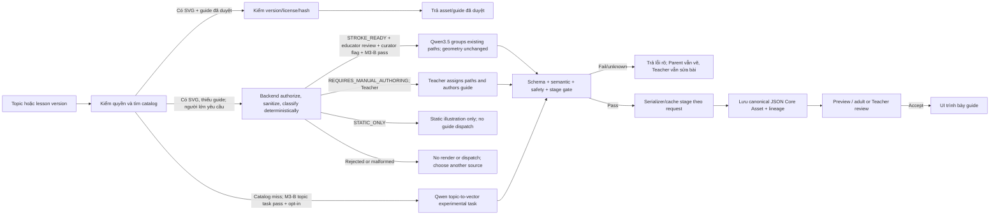
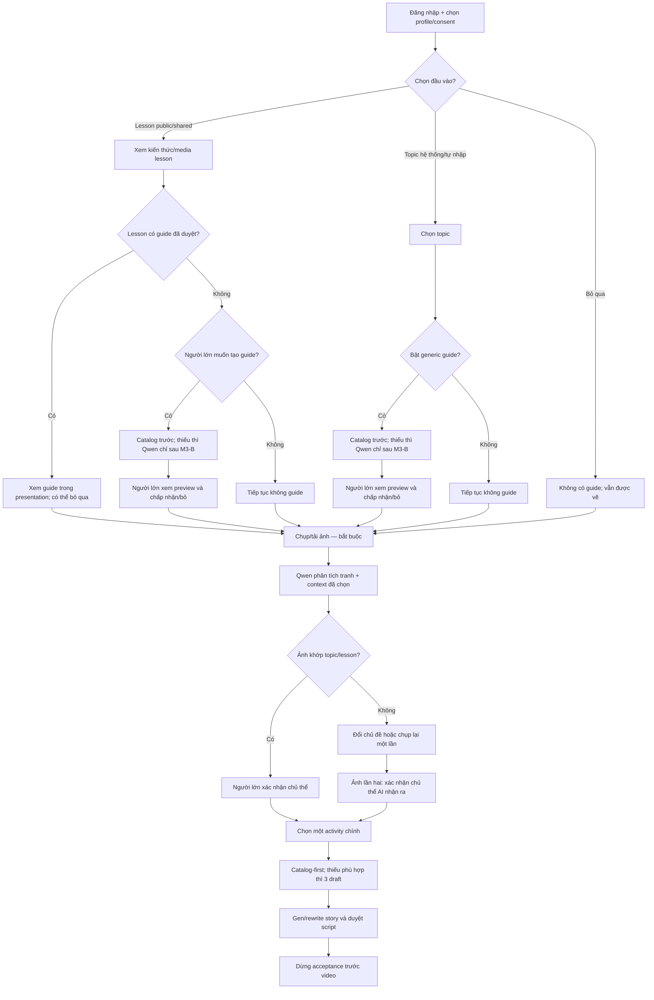
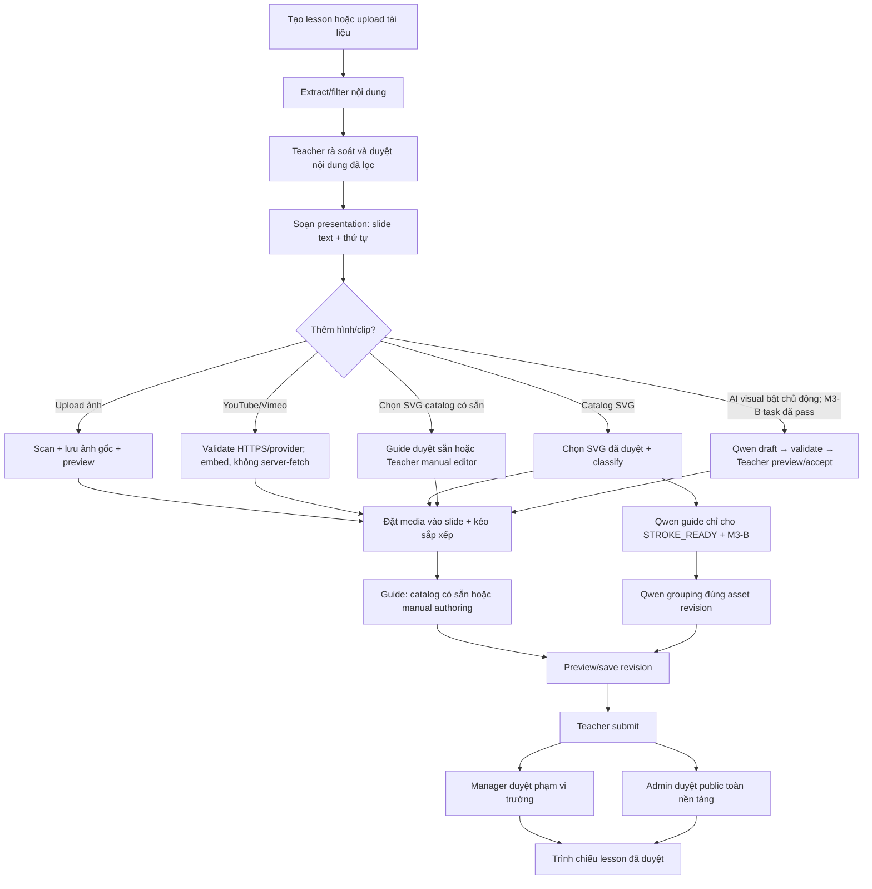

# Plan Rev83 — Shared SVG engine and Parent/Teacher workflow completion

**Review revision:** Rev83.3 — small amendment after a third independent plan review on 2026-11-13; this is still a proposal, not implementation approval.

**Date:** 2026-11-12 (Asia/Saigon)<br>
**Status:** DRAFT — planning only; awaits explicit approval for implementation.<br>
**Owner direction:** Remove FLUX from active Sketch2Life workloads. Use a shared, safe SVG illustration and progressive-stroke engine for Parent drawing guides and Teacher Presentation visuals.<br>
**Scope relationship:** Supersedes only the remaining implementation scope of approved Plans Rev81/Rev82 where this plan explicitly changes the design. Their completed work, existing approvals, source changes, test results and evidence remain preserved. This plan does not retroactively amend either approval.<br>
**SRS state:** The current task instructions identify the FEAT-063 SRS path and describe local amendments through Rev64; the SRS file and this worktree's authority pointer identify Rev60, while a Rev65 pointer was observed in another checkout. Keep the FEAT-063 SRS as the only product-requirement source; reconcile the exact revision/hash and its change history with the owner before contract freeze or implementation. Do not import requirements from the other checkout. The SRS remains unsigned.

## Đọc nhanh — quyết định và luồng thật

Phần này giải thích sản phẩm sẽ hoạt động thế nào sau khi kế hoạch được duyệt. Các thay đổi sản phẩm vẫn là đề xuất cho tới khi chốt SRS, API/DTR và approval.

### Thay gì, giữ gì

| Thay khỏi active path | Giữ nguyên | Thêm mới |
|---|---|---|
| FLUX khỏi kiến trúc đích; worker/deploy chỉ được gỡ sau M3-B + M4/M5 AI acceptance và client cutover | Qwen drawing understanding, activity/story; Firebase Auth; Parent/Teacher role boundary; Teacher image upload; validated YouTube/Vimeo embeds; Whisper where current SRS requires it; LTX video and current quota | Curated SVG catalog; shared deterministic vector engine; distinct APIs/tasks for parsing/grouping existing SVG paths, experimental topic-to-vector synthesis, and static illustration; editable Teacher Presentation; guide review before Parent display |

FLUX là công nghệ được lên kế hoạch retire, nhưng việc gỡ deployment/worker là **mốc M6**, chỉ sau M3-B quality POC và các tích hợp Teacher/Parent đạt baseline cùng AI acceptance cần thiết. Không dùng FLUX làm fallback âm thầm cho SVG. Các plan/log/evidence FLUX cũ giữ nguyên để truy vết. Video, Whisper và các luồng AI khác không bị bỏ trong kế hoạch này.

### “SVG engine” nghĩa là gì

Engine là phần xử lý dữ liệu vector có kiểm soát, không phải model tạo ảnh:

1. Catalog item/approved guide được chọn trước. SVG có sẵn được parse an toàn và phân loại bằng backend rules xác định; Qwen không quyết định source có đủ điều kiện hay không. Không suy ra cách dạy chỉ từ XML path order.
2. Backend phân loại SVG đã qua sanitizer theo rules xác định trước. Qwen semantic grouping chỉ nhận `STROKE_READY` source đã được educator review và curator bật flag; nó sắp xếp path/part hiện có, viết instruction/dependency, không tự quyết readiness và không tạo hình học trong tác vụ này.
3. Topic-to-vector và AI static illustration là các nhánh thử nghiệm riêng; chỉ bật sau POC chất lượng tương ứng. Model trả JSON có version, không trả HTML/SVG/JavaScript tự do.
4. Backend kiểm tra schema, tọa độ, part/stroke dependency, stage, provenance và quyền; serializer xác định dựng SVG từ canonical JSON.
5. Lưu canonical guide/vector JSON một lần. SVG của từng stage/mode được dựng hoặc cache theo yêu cầu bằng hash của guide revision, stage, render mode và renderer version; không tạo Core Asset riêng cho từng panel mặc định.
6. Parent Android và Teacher Web dùng cùng guide revision. `draw_on`, `highlight` và `static` là cách trình bày; chúng không đổi canonical stroke order. Nét cũ liền, nét mới nét đứt/nổi bật, nét tương lai ẩn. Thời lượng, pause/resume, replay và tua bước là playback state riêng, không sửa guide JSON.
7. Teacher có Guide Authoring Tool tối thiểu cho SVG có đủ path độc lập: đổi thứ tự bước, sửa hướng dẫn/nhãn, gán hoặc chuyển path có sẵn giữa step/part, gộp/tách part ngữ nghĩa và preview. Tool không vẽ/sửa geometry; mọi chỉnh sửa tạo revision nháp mới.

Với ảnh tĩnh trong slide Teacher: catalog SVG hoặc upload ảnh gốc là đường mặc định; prompt-to-SVG từ Qwen là thử nghiệm riêng, không được bật chỉ vì stroke-guide POC thành công. Nội dung chữ trên slide vẫn chỉnh sửa được. Ảnh upload không bị đổi giả thành SVG.

### Luồng chạy của AI và catalog



Catalog là đường mặc định để tránh chờ model. Dataset được curate vào Core Asset/catalog; Modal chỉ giữ model weights/cache, không chứa catalog sản phẩm. Quick, Draw! chỉ tham khảo hình dạng/thứ tự nét, không phải trình tự dạy Montessori. Guide sinh ra không nhận profile/ảnh/giọng nói của trẻ. Ảnh trẻ chỉ đi vào API phân tích tranh sau capture theo luồng Parent hiện hành.

### Parent: thứ tự màn và quyết định ở từng điểm



Quy tắc dễ nhớ: **lesson/topic đều tùy chọn; ảnh bắt buộc.** Chọn lesson thì presentation hiển thị kiến thức và guide đã duyệt của lesson; người lớn có thể bỏ qua guide. Nếu lesson chưa có guide, UI đề nghị tạo guide theo yêu cầu hoặc tiếp tục không guide. Chọn topic riêng thì guide là tùy chọn. Không chọn topic/lesson thì không gọi guide nhưng vẫn được chụp. Activity chính được chọn trước script; activity sau video dùng danh sách của đúng lesson version được pin theo SRS đã chốt. Không thêm fallback post-video cho run không pin lesson nếu SRS hiện hành không cho phép.

### Teacher: thứ tự soạn và trình chiếu



Teacher có thể sửa nội dung từng slide, đổi media/slide, thêm/xóa/sắp xếp slide, xem trước, chấp nhận hoặc bỏ bản AI draft. Từ SVG catalog Teacher có thể yêu cầu riêng một stroke guide cho chính asset/version đó; API này không bị gộp vào API tạo ảnh tĩnh hay Sketch Deck. Sửa lesson tạo revision mới; chỉ asset phụ thuộc vào các field đã đổi mới thành STALE. Manager quyết định phạm vi trường; Admin quyết định public toàn nền tảng.

### AI có chạy ở đâu?

| Tác vụ | Nguồn | Khi nào gọi AI | Dữ liệu không được gửi |
|---|---|---|---|
| Parent line-sketch | Guide catalog đã duyệt | Chỉ khi người lớn bật và thiếu guide; topic synthesis chờ POC M3-B | Profile, tên, tuổi chính xác, ảnh/tranh, giọng nói |
| Teacher SVG stroke guide | Guide catalog đã duyệt hoặc Teacher-selected SVG | Manual authoring works without AI; Qwen grouping is shown only for structurally `STROKE_READY`, educator-reviewed and curator-authorized source after its M3-B pass | Roster, hồ sơ trẻ, tranh trẻ, raw lesson file |
| Teacher static slide illustration | Catalog/upload trước | Prompt-to-vector opt-in riêng, chỉ sau POC static-visual gate | Roster, hồ sơ trẻ, tranh trẻ, toàn bộ file giáo án thô |
| Parent AI guide draft | Catalog before Qwen | Adult sees preview and accepts/discards before child sees it | Dữ liệu nhận dạng/tranh trẻ |
| Parent drawing understanding | Ảnh tranh bắt buộc sau capture | Sau upload, theo contract phân tích tranh hiện hành | Không mở rộng sang line-guide generation |
| Activity/story | Lesson catalog/context + Qwen theo luồng hiện hành | Sau chủ thể được người lớn xác nhận | Không gửi thêm dữ liệu vượt contract/SRS |
| Video | LTX pipeline hiện tại | Chỉ theo luồng video hiện hành sau gate riêng | Không gọi trong Rev83 E2E |

Docker startup chỉ kiểm app/function và có thể nạp model weights bằng warmup riêng; **không** gọi drawing/activity/story/illustration generation để “test health”. Warmup GPU vẫn có chi phí và cần budget/TTL được duyệt.

## 1. Purpose and outcome

Replace active FLUX image generation with one reusable vector pipeline that:

1. Finds an approved SVG asset and, when available, its reviewed progressive drawing sequence.
2. Uses distinct Qwen3.5 Modal tasks only when explicitly requested: semantic grouping/instruction for an existing SVG, experimental topic-to-vector synthesis, and experimental static illustration. Passing one task's POC does not enable the others.
3. Validates and serializes approved vector data through a deterministic SVG engine shared by Parent Android and Teacher Web.
4. Makes Teacher lessons editable, media-bearing presentations. Teachers can upload images, add supported video links, place and reorder media, select catalog SVGs, request a guide from a selected SVG, and optionally request AI-generated static SVG only after its own quality gate.
5. Completes real Parent and Teacher non-video workflows through their UI, backend, storage and Modal services, without fixture output being counted as success.

The plan retains the existing story/video architecture and all of its current policy boundaries. This work stops before video inference. It does not replace LTX-2.5, change video quota rules, or claim video acceptance.

## 2. Baseline and evidence to carry forward

### 2.1 Product requirements

- Use only the current FEAT-063 SRS after its exact content/hash is reconciled. The visible SRS says FLUX.3 and 3–5 guide steps; Rev81 records the owner's later request for adaptive 4–8. Keep guide count as a hard M0 blocker; do not treat 4–8 as a frozen implementation target before the SRS amendment.
- Preserve the Parent/Teacher separation, child privacy, adult confirmation, lesson publication scopes, asset provenance, activity catalog rules and existing story/video pipeline.
- Keep the SRS unsigned until formal owner sign-off. A code result or this plan does not sign it.

### 2.2 Rev81/Rev82 implementation and test results

Carry forward, do not recreate:

- Rev79 local Docker/Auth Emulator/MinIO/PostgreSQL/Redis/ClamAV baseline, root `.env` convention and idempotent synthetic seeds. The Rev79 evidence says its services and seeds worked, but no live AI inference or Android UI acceptance was done in that slice.
- Parent Expo workflow and Teacher presentation source work, including the existing role gates, profile/consent, gallery, story run and presentation screens. Preserve any unrelated user changes in this worktree.
- Rev82 real Modal evidence: Teacher Qwen lesson suggestion completed in 240.981 seconds and a five-slide Sketch Deck completed in 90.303 seconds. The Teacher FLUX visual call failed its progressive-panel gate after 398.967 seconds at the API (91.883 seconds logged by the worker); the generated candidate was rejected. Do not count the failed visual as a usable output.
- The prior Parent guide result may be retained as historical evidence; it does not prove the proposed SVG contract. The fresh Parent drawing-analysis outcome was unknown/non-retryable, so activity and story were not called in that run. Do not retry that request.
- Rev82 logs report no GPU containers after its bounded call and the shared Modal Apps were not stopped. Existing app deployment state must be inspected at execution time; this plan makes no live Modal change.
- Rev82 offline test results and diagnostic logs remain evidence for their exact source revisions only. Re-run focused checks after implementing changed contracts; never relabel old results as acceptance of SVG.

### 2.3 Current surfaces observed in source

- Parent v1 currently exposes `POST /api/parent/v1/ai/sketch-guides`; its response represents a raster asset and carries FLUX provenance. Drawing understanding, activity suggestions and story operations are separate Parent AI/StoryRun operations.
- Teacher v1 currently exposes organization-scoped `lesson-plan-suggestions`, `sketch-decks` and `lesson-visuals`. The lesson-visual flow returns a raster candidate; the presentation UI displays it as one image, so advancing the step text does not reveal cumulative vector strokes.
- The OpenAPI projection, Docker health sidecar, local seeds and client calls were changed under Rev81/Rev82. Their contract and runtime state must be checked before migration; do not assume every approved path is already green.

## 3. Decisions and constraints for this plan

These are plan directions, not a silent SRS or ADR update:

1. **FLUX:** FLUX is retired from the target architecture, but do not remove its active deployment/worker/package until M3-B Qwen quality POC and M4/M5 baseline plus AI acceptance pass. Never use it as a fallback for new SVG requests. Keep old plans, logs and evidence intact as historical records; annotate them as superseded for the target rather than deleting provenance.
2. **One shared engine:** Parent guides, Teacher Sketch Deck strokes and Teacher static SVG illustrations use shared domain contracts, validation, catalog/provenance and rendering primitives. Parent and Teacher remain separate authorization/workflow clients.
3. **Catalog first:** Prefer reviewed catalog SVGs. Generate a Qwen draft only for a catalog miss or an explicit Teacher request. Cache reusable, approved generic results by versioned topic/style/age-band contract where policy allows. Do not make every session wait on inference.
4. **Qwen output is three separate capabilities:** (a) semantic grouping/instructions over existing, sanitized SVG geometry; (b) topic-to-vector geometry synthesis; (c) static slide illustration synthesis. Keep the existing Qwen3.5-9B/VL development pin on Modal as a candidate. Each task has its own schema, quality rubric, cost cap and POC result; a successful smoke call or another task's pass does not promote it.
5. **No child data for guides:** Parent generic guide input contains only a selected generic topic or authorized lesson subject, style/complexity contract and locale. Do not send the child's profile, exact age, name, voice, photo or artwork to the guide generator. Teacher deck inputs contain reviewed lesson fields, never roster, child profile or child artwork.
6. **Adaptive guide:** The owner previously requested 4–8 progressive stages, with retained strokes stable and new strokes dashed. Current SRS says 3–5. Do not freeze a contract or generate production guides until the exact SRS revision and an owner-approved SRS delta resolve this conflict. Current age scope is 36–120 months (3–10 years); exact internal age bands remain open in the SRS and must not be invented in this plan.
7. **Teacher Presentation:** Treat the lesson as a real presentation, not a static Sketch Deck image. Keep text as editable, accessible presentation content; SVG is the illustration/stroke format. Do not turn all slide text into SVG paths.
8. **Media:** Preserve teacher image upload and YouTube/Vimeo HTTPS embeds. Restrict embeds to the validated provider host and safe embed URL; the backend must not fetch user-supplied URLs. AI SVG generation remains an explicit Teacher opt-in and all generated media stays draft until teacher review and applicable manager/admin publication review.
9. **Storage and ownership:** Store canonical structured guide/vector JSON once in Core Asset with immutable source/version/hash lineage. Render a stage on demand and cache the derived bytes by `(guide_revision, stage_index, render_mode, renderer_version)`; do not persist one near-duplicate Core Asset per stage by default. Reuse Core asset metadata/lineage and lesson-version references where they satisfy the canonical DTR. Reconcile ownership and migrations first.
10. **Runtime boundary:** Docker may contact the already registered dev Modal Apps for readiness and an explicit no-inference model-load warmup. `/health` alone must not be reported as model warm. Do not run product generation at startup, deploy shared Apps on every Compose restart, configure permanent GPU minimums, or start video/SAM2 workers in this slice.
11. **No fixtures as workflow evidence:** Synthetic identities, reviewed synthetic lessons and generated non-personal drawings are allowed. Mock/hardcoded AI responses cannot drive the Parent/Teacher workflow or count as AI acceptance. Unit tests may use isolated contract vectors but must not be reported as a live AI pass.
12. **Costs and cleanup:** Existing default live smoke budget is one request per changed workload, with no retry for unknown outcomes. A quality POC requires a separately approved request count/cost cap before any multi-case Modal run. Report warmup GPU time separately. Stop only task-owned containers and preserve shared Apps, volumes and user data.
13. **AI-guide review:** Catalog-approved guides can be shown under the product's normal lesson review. A newly generated Parent guide is a private draft; an adult must preview and accept it before the child sees it. Teacher-generated guides/illustrations require Teacher review before attachment/publication.

## 4. Proposed reusable SVG architecture

### 4.1 Contracts

Define versioned provider-neutral contracts in the domain/contracts layer. Exact field names are finalized in the API contract review in Phase 0.

**`SvgIllustrationV1`**

- Illustration ID/version, locale, topic taxonomy, accessible Vietnamese alt text, `viewBox`, bounded vector elements, style tokens and provenance.
- Explicit source type: curated catalog, teacher upload converted/attached as media, or AI draft. A raster upload remains a raster asset; it is not silently represented as vector.
- Static artwork is assembled from an allowlisted set of path/shape primitives. Slide text and layout remain normal presentation fields.

**`SketchStrokeGuideV3` (proposed; do not reinterpret existing V2 records)**

- Topic/subject, version, source/provenance, review state and ordered stages. Stage count remains an SRS blocker: current SRS says 3–5 while the prior owner clarification asks 4–8.
- Each stroke has immutable `stroke_id`, `part_id`, `stroke_kind` (for example `outline`, `detail`, `construction`), geometry and style token. The referenced part record carries `part_label_vi` and a proposed `difficulty` value. Labels are content, not model-generated SVG text.
- Each stage has `part_ids`, `new_stroke_ids`, `depends_on` part IDs, `animation_order` for strokes introduced in that stage, and a short `instruction_vi`. The dependency graph must be acyclic; `animation_order` must contain every new stroke exactly once and no earlier/future stroke.
- A later stage includes all prior stroke IDs plus its new IDs. Earlier IDs and geometry remain immutable. This makes cumulative progression deterministic rather than asking the model to redraw the whole subject in each panel.
- Stage order teaches a drawable construction: large simple forms first, then dependent body parts/relationships, then defining details. Path order, geometry sorting or animation timing cannot decide pedagogy.
- Proposed display modes: `draw_on` reveals the active path over time; `highlight` emphasizes the current stroke/part while the rest remain visible; `static` shows the completed selected stage without motion. The existing construction treatment (prior strokes solid, current strokes dashed, future strokes hidden) is a style within the guide view, not an alternative canonical sequence. Respect reduced-motion settings.

**`SvgSourceReadinessV1` (proposed deterministic backend result)**

- `classification`: `STATIC_ONLY`, `STROKE_READY`, or `REQUIRES_MANUAL_AUTHORING`; include source hash, parser/sanitizer version, stable path IDs, measurable structural facts and bounded reason codes. Structural facts include `drawable_stroke_count`, `drawable_stroke_ratio` and `filled_shape_count`. They describe parsed geometry; they are evidence for human review, not a pedagogical score or an automatic rule that a guide is teachable. This classifier runs only after security parsing succeeds; malformed/unsafe SVG is `REJECTED` before source-readiness classification.
- Classification is computed by the backend after sanitization/canonicalization, never by Qwen. It is a capability result, not a claim that the subject or teaching order is pedagogically correct.
- Count an independent path as one safely canonicalized drawable element that can be shown/hidden without changing another element and has a stable ID; a multi-subpath `<path>` counts as one element. Sanitizer must normalize supported primitive shapes to the canonical path representation. Unsupported clip/mask/reference structures are rejected before classification, not guessed through.
- `STROKE_READY`: safe canonical SVG; independent path count is at least the minimum stage count resolved at M0; every counted path is separately addressable/stable; parser reports no unsupported structural feature; and an educator has reviewed the exact asset revision for progressive drawing suitability before a curator sets `grouping_allowed`. The educator decision and reviewer/version are recorded separately from the structural classifier. Qwen can receive only structurally eligible, educator-reviewed, curator-authorized sources, and Teacher still reviews each generated guide. Counts, ratios and filled-shape facts support this decision but do not replace educator judgment or establish teachability by formula.
- `REQUIRES_MANUAL_AUTHORING`: safe and renderable, with enough independent path elements, but missing educator approval, curator authorization for automatic grouping, or eligible grouping metadata. Teacher may arrange the existing paths in the authoring tool and review the result. This classification never dispatches Qwen.
- `STATIC_ONLY`: safe and renderable as static artwork, but it lacks enough independently drawable paths for the minimum guide length or is a single/compound silhouette. It can be used as a presentation illustration but cannot enter guide generation or the path authoring tool. Return `GUIDE_SOURCE_NOT_STROKE_READY` plus the classification and a safe reason.
- Stable reason-code examples: `PATH_COUNT_BELOW_MIN` or `COMPOUND_SILHOUETTE` → `STATIC_ONLY`; `EDUCATOR_REVIEW_REQUIRED`, `CURATOR_GROUPING_NOT_ENABLED` or `GROUPING_METADATA_MISSING` with enough independent paths → `REQUIRES_MANUAL_AUTHORING`; malformed/unsafe/unsupported structure → `REJECTED` before classification. Do not expose parser internals in the public message.
- The route may not silently split geometry, invent strokes, or ask Qwen to decide eligibility. If no usable source exists, the caller selects another asset or requests the separate topic-to-guide task only when that exact POC passed.

**`GuidePlaybackProfileV1` (proposed renderer policy; not part of canonical guide JSON)**

- `draw_on` returns the construction guide's dashed line as an underlay plus a separate solid progress overlay over the same immutable path. The shared stage response contains both layers; Web/Android animate only the overlay's reveal locally from 0 to 1, with no per-frame API calls. Never reuse or mutate the underlay's `stroke-dasharray` to encode animation progress.
- At normal speed, proposed active-path duration is `clamp(700 ms × path_length / median_eligible_path_length, 300 ms, 1400 ms)`; `median_eligible_path_length` is computed once from nonzero canonical strokes in that guide revision. User speed choices are `0.75×`, `1.0×` (default), and `1.25×`. M0/M2 must verify the profile on the actual Web and Android renderers and may adjust these proposed constants before acceptance.
- When a stroke animation completes, remove/fade the progress overlay so the current construction stroke remains in its dashed guide style; only earlier completed stages use the solid retained style.
- Pause freezes the current progress; resume continues it; replay restarts animation for the selected stage; Previous/Next and direct step selection navigate the cumulative guide. Selecting a new stage resets playback to that stage's newly introduced strokes. When the app goes to background, pause automatically.
- `highlight` emphasizes the active strokes without motion; `static` renders the selected cumulative stage immediately. Reduced-motion preference completes reveal immediately while preserving stage navigation and labels.
- Playback controls/state and speed preference are presentation state only. They do not alter canonical strokes, stage order, source hashes, guide revisions or stored AI output.

Qwen returns only JSON matching a task-specific contract. It does not return inline HTML, unrestricted SVG markup, JavaScript, CSS or remote URLs. For semantic grouping, the worker may assign part/stage/instruction metadata to existing validated geometry but may not modify coordinates. Topic-to-vector and static illustration use separate experimental schemas. A deterministic serializer emits SVG from validated records. Keep contract versions independent from the Modal model revision; V3 is a new candidate and V2 records remain unchanged/readable.

### 4.2 Engine modules and ports

Keep clean architecture boundaries:

- **Domain:** illustration, semantic parts, stroke IDs/stages, dependency DAG, immutable revisions, review state, topic/complexity rules, source/license/provenance and cumulative-stroke invariants.
- **Application:** catalog-first lookup, deterministic source-readiness classification, distinct path-grouping/topic-synthesis/static-illustration requests, Teacher guide-from-asset and manual-authoring operations, lesson revision pinning, adult/Teacher review, publish actions, derived-render cache policy, job idempotency and lifecycle.
- **Ports:** SVG catalog, structured-vector generator, asset/lineage repository, private object storage, safety/moderation, AI Job status and lesson authorization.
- **Infrastructure:** source-dataset importer, XML/SVG parser and sanitizer, deterministic serializer/renderer, Core asset adapter, MinIO/S3 object adapter, task-specific Qwen3.5 Modal adapters, bounded content-addressed render cache and telemetry. Core Asset, not Modal Volume, owns curated catalog metadata and product SVG bytes.
- **Clients:** React Native SVG renderer for Parent; web SVG/presentation renderer for Teacher. Both consume the same versioned vector contract and never receive storage/provider credentials.

Avoid a second backend or a second vector asset store. Do not use automatic centerline extraction on filled clipart as if it were a teaching sequence. Geometry tools may simplify paths only if they preserve stroke identity and pedagogical order.

### 4.3 Security and quality gates

For imported SVG and any legacy conversion, parse then canonicalize against an allowlist. Reject XML DTD/entities, `<script>`, event-handler attributes, `<foreignObject>`, external `href`/resources, CSS `url()`, unknown namespaces, embedded files and unbounded geometry. Bound file size, element/path count, coordinate range, nesting, render dimensions and parser time. Never inject untrusted SVG through `innerHTML`; use the safe renderer path in each client and restrictive CSP on Web.

Hard gates:

- Contract/version, coordinate bounds, schema, safe primitives, renderability and output size.
- Deterministic source-readiness classification must precede AI dispatch; only `STROKE_READY` sources with recorded educator approval and curator authorization may enter `SVG_PATH_SEMANTIC_GROUPING`. `REQUIRES_MANUAL_AUTHORING` remains a Teacher-only manual path, and `STATIC_ONLY` cannot be used as a guide source. Structural counts/ratios are evidence, never an automatic pedagogical gate.
- Exactly one stable subject; nonempty final form; each stage adds at least one meaningful new stroke; previous stage stroke IDs and geometry remain unchanged; no duplicate/reordered strokes that erase prior work.
- Stage count follows the reconciled SRS; the visible SRS says 3–5 while the later owner request says 4–8. Clear construction from basic forms to recognizable subject; age scope is 36–120 months with internal bands unresolved; no excessive detail, unsafe cues or unreviewed external media.
- Catalog/license/provenance and asset hash present; the exact source has an educator review for progressive-drawing suitability before automatic grouping is enabled. AI draft is private and visibly marked draft until reviewed. Parent-generated guide is not displayed to the child until an adult accepts the preview.
- Semantic part labels and dependencies match the geometry; every step's animation order is deterministic; the `draw_on`, `highlight` and `static` modes render the same canonical stroke set.
- Playback must implement and visibly verify pause/resume, replay, previous/next/direct step selection, speed presets, background pause and reduced-motion behavior. Dashed guide styling and draw-on progress are independent render layers.

Use a moderate gate: reject structural, unsafe, non-cumulative, semantically contradictory or clearly unrelated output; do not reject safe Vietnamese instruction fragments solely for punctuation or stylistic preferences. A Parent generation failure/timeout/rejection leaves the child able to draw and capture. Teacher may edit/reorder or discard a draft; invalid content never enters a published lesson. Technical validity is not a proxy for recognizability or teachability; those are measured by the M3 human-review POC.

## 5. Dataset and skill research disposition

One dataset cannot provide both polished illustrations and valid teaching stroke order. Use complementary sources with explicit provenance:

| Source | Proposed role | Limitation / gate |
|---|---|---|
| [SVG Animal Illustrations](https://huggingface.co/datasets/yoavf/svg-animal-illustrations) | Small CC0 animal SVG seed/reference set; useful to prototype catalog lookup and static illustration rendering. | Dataset card reports CC0, but examples are prompt-generated vector art and do not encode pedagogical stroke order. Pin the exact revision and retain per-item source/hash. |
| [OpenClipart SVG dataset](https://huggingface.co/datasets/kawwaaa/openclipart) | Candidate large source for curated static objects/animals after topic, safety and source-license review. | Do not bulk ingest on the dataset-card claim alone. Confirm source URL and license per item; deduplicate, sanitize, curate and retain attribution/provenance. |
| [Google Quick, Draw!](https://github.com/googlecreativelab/quickdraw-dataset) | Research/reference for stroke sequence, point and timing patterns; CC BY 4.0 attribution required. | Fast doodle order is not a child-teaching sequence or polished SVG. Moderate content and do not turn raw samples into canonical guides without human review. |
| [Drawing Explorer / KidDraw](https://github.com/vislearnlab/drawing-explorer) | Research only if needed to understand recognizability and children's drawing structure. | Source drawings/data are CC BY-NC-SA 4.0 and involve children's drawings; exclude from product catalog and Modal input. |
| [Whiteboard Animation skill](https://github.com/iart-ai/explainer-video-skills/tree/main/skills/whiteboard-animation) | Reference for path reveal order, draw-on timing and renderer interaction. | It teaches animation mechanics, not Montessori correctness, subject decomposition or SVG safety. Audit repository license before copying code. Do not embed its inline script pattern in SVG assets. |

Import is a curated subset with a manifest (source URL, source revision, item license, attribution, SHA-256, import timestamp, reviewer and sanitizer version). Do not download/redistribute source datasets until the implementation approval, storage/size review and license gate. AI-created fallback assets record model, prompt/config hash, source topic and review actor. No personal/child drawing corpus is sent to Modal.

The product catalog is stored and permissioned through Core Asset/object storage plus its catalog metadata owner, not copied wholesale to a Modal Volume. Modal Volume is reserved for model weights/cache or an explicitly approved, non-product reference cache. For a Qwen reference request, the backend resolves the exact authorized asset version, checks its license/input policy, parses and sanitizes it, then creates a bounded preview/feature payload. Modal receives only that request payload; it never receives a catalog bucket credential, arbitrary object key, public/signed storage URL, or direct storage read capability.

## 6. Target user workflows

### 6.1 Parent Android

1. Sign in, choose an authorized child profile and confirm current consent/context under existing rules.
2. Optionally choose a public/shared lesson presentation, a system topic, or a custom topic; may skip both.
3. If a lesson is selected, show its knowledge slides/media and approved drawing guide. If its guide is missing, offer an explicit generate-guide action. If a topic is selected, offer the generic guide toggle. Catalog-approved guides can be opened directly. A newly generated Parent guide is first shown to the adult as a preview with Accept/Discard; only an accepted draft is shown to the child. A guide can be skipped and never blocks capture. If no topic/lesson supplies a subject, require the adult to choose a topic before enabling the guide.
4. Capture/upload a drawing is mandatory. Use Qwen3.5 drawing-understanding with the selected lesson/topic context under the current SRS privacy envelope.
5. If the image conflicts with the selected topic, preserve the lesson as knowledge context and show an adult choice: switch to the recognized subject or retake once. After the one retake, adult confirms the recognized subject; do not loop. Retain the pinned lesson as a knowledge reference.
6. Before the story script, choose one primary activity. For a pinned lesson, select from its exact approved version by default. For no-pin, retrieve authorized published/shared lesson candidates first, pass only eligible metadata/context to Qwen for ranking, then hydrate canonical activity text from source. If no candidate is suitable, create exactly three temporary gated suggestions. A replacement request must exclude the replaced activity and all rejected IDs.
7. Generate/review/rewrite the story and require adult script confirmation. Preserve story schema and existing child safety rules.
8. Continue into the existing video pipeline only when the separate video implementation is available. This plan's E2E stops before dispatching video. After playback, retain current exact-pinned-lesson activity behavior; do not add a no-pin post-video catalog fallback unless the current SRS is amended.

### 6.2 Teacher authoring and presentation

1. Teacher authors structured lesson fields or uploads a supported document; extract/filter content and require Teacher review before it becomes a lesson revision. Do not submit a raw entire lesson directly to AI without the established filtering/review gate.
2. Build an editable, ordered presentation from the reviewed lesson: editable text, teacher-uploaded image assets, validated YouTube/Vimeo embeds, approved catalog SVGs, and a progressive guide selected from the catalog or requested for one selected SVG. Optional Qwen static illustration is a separate capability and stays disabled unless its own M3-B quality POC passes.
3. Teacher can add/remove/reorder slides, edit slide text, select the slide for each media item, adjust presentation placement/size within safe layout bounds, preview and save a new lesson revision. AI visual generation is explicitly initiated, creates a draft asset, and never overwrites the uploaded original or an already approved asset.
4. Keep the guide progressive and visual: each stage reveals the next construction strokes; Teacher can preview `draw_on`, `highlight` and `static` modes. Do not display a static full illustration while only changing the instructional text. A catalog SVG selected by Teacher must be passed as the exact revision to the dedicated guide operation.
5. Teacher reviews and submits the lesson. School Manager can review school visibility and request revision/reject; Platform Admin controls platform-wide PUBLIC review. No other organization gains visibility unless the lesson is explicitly shared/published under current permission rules.
6. For class use, pin the approved lesson/deck revision to the occurrence and follow the existing one-child representative drawing/story path. This plan validates through script confirmation, not video generation.

## 7. Backend/API and data contract work

### 7.1 API versioning

The raster-to-vector response is incompatible with the current v1 asset shape. Add versioned contracts rather than silently changing v1 JSON. Proposed path shape, to be finalized with the source register and OpenAPI before implementation:

| Operation | Proposed route | Purpose |
|---|---|---|
| Request Parent guide | `POST /api/parent/v2/ai/sketch-guides` | Catalog-first guide lookup or enqueue one optional Qwen vector draft; returns a versioned job/resource reference. Catalog lookup remains available when AI is disabled; if synthesis is needed while `TOPIC_TO_STROKE_GUIDE` is off, return `CAPABILITY_DISABLED` with no dispatch/fallback. |
| Read Parent guide/job | `GET /api/parent/v2/ai/sketch-guides/{guide_id}` | Read authorized private result/status, expiry and safe error. |
| Request Teacher lesson visual | `POST /api/teacher/v2/organizations/{organization_id}/ai/lesson-visuals` | Request one static SVG illustration draft for a reviewed lesson revision; independent from stroke-guide generation. Catalog/upload media remain available when off; a disabled `TOPIC_TO_STATIC_ILLUSTRATION` returns `CAPABILITY_DISABLED`, with no other task/model/FLUX fallback. |
| Request Teacher guide from selected asset | `POST /api/teacher/v2/organizations/{organization_id}/lessons/{lesson_id}/ai/stroke-guides` | Create a guide for one exact approved SVG asset/revision; initial mode groups existing paths and writes instructions without changing geometry. Requires educator-reviewed exact source revision plus curator authorization; a disabled `SVG_PATH_SEMANTIC_GROUPING` returns `CAPABILITY_DISABLED`, with no fallback. |
| Read Teacher SVG source readiness | Existing authorized SVG catalog/asset-list operation | Return `SvgSourceReadinessV1` for the exact asset revision/hash so the UI can show approved guide, manual authoring, static-only, or rejected behavior before requesting work. |
| Create Teacher manual guide draft | `POST /api/teacher/v2/organizations/{organization_id}/lessons/{lesson_id}/stroke-guides` | Create a draft from an exact safe `STROKE_READY`/`REQUIRES_MANUAL_AUTHORING` source, or copy a Qwen draft for editing; no inference and no geometry edits. |
| Edit Teacher guide draft | `PATCH /api/teacher/v2/organizations/{organization_id}/lessons/{lesson_id}/stroke-guides/{guide_id}` | Apply bounded reorder/instruction/label/path-assignment operations against `expected_guide_revision`; create a new draft revision and preserve source geometry/hash. Stale revisions return `409`; UI preserves local edits and offers explicit resolution. |
| Review Teacher guide draft | `POST /api/teacher/v2/organizations/{organization_id}/lessons/{lesson_id}/stroke-guides/{guide_id}/review` | Teacher accepts or discards the exact guide revision; published lesson/Manager/Admin scope gates remain separate. |
| Read Parent rendered stage | `GET /api/parent/v2/ai/sketch-guides/{guide_id}/stages/{step_index}?mode={draw_on|highlight|static}` | Render/cache one deterministic stage derivative from canonical guide JSON; no separate Core Asset per step by default. |
| Read Teacher rendered stage | `GET /api/teacher/v2/organizations/{organization_id}/ai/sketch-guides/{guide_id}/stages/{step_index}?mode={draw_on|highlight|static}` | Render/cache one deterministic stage derivative under organization and lesson authorization. |
| Request Teacher Sketch Deck | `POST /api/teacher/v2/organizations/{organization_id}/ai/sketch-decks` | Create a structured, versioned vector deck tied to approved lesson hash/revision. |
| Read AI job | `GET /api/teacher/v2/organizations/{organization_id}/ai/jobs/{job_id}` | Poll stage/status and retrieve only authorized result metadata. |
| Read/edit presentation | `GET/PATCH /api/teacher/v2/organizations/{organization_id}/lessons/{lesson_id}/presentation` | Read versioned ordered slides and create a new draft revision when fields/order/media placement change. |
| Upload/finalize media | Existing authenticated bounded upload protocol or its documented v2 contract | Preserve ClamAV/media checks and Core asset lineage; never accept an arbitrary remote URL for server-side fetch. |

All generated results are asynchronous/durable where current AI Job patterns require it, idempotent, scoped to the authenticated role/organization/lesson revision, stale-checked and auditable. Errors distinguish unavailable model, timeout/unknown outcome, schema rejection, quality rejection, unauthorized/stale revision and quota/rate cap. OpenAPI must expose exact request/response schemas and role requirements.

The Teacher guide operation must take `reference_asset_id` plus immutable asset revision/hash and `lesson_version_id`/content hash. It cannot implicitly use “latest” or fetch an arbitrary URL. A static illustration request never doubles as a guide request.

Keep v1 available during client migration only if it is safe and unambiguous. Mark FLUX-only raster behavior deprecated; remove it after all supported clients use v2. Do not return SVG strings from a route that still claims the v1 raster response schema.

### 7.2 Data and asset ownership

- Core owns private object bytes, asset metadata, hashes, MIME, size, scope, expiry and lineage. Lesson owns lesson revision, ordered slide composition and references to approved media. AI Job owns execution state/attempt telemetry, not media bytes. Parent guide output has private, expiring ownership and is not attached to the child profile or StoryRun.
- Preserve each uploaded/catalog source separately with source hash and sanitizer provenance. Store the canonical guide/vector JSON once. A sanitized base SVG may be stored when needed for static illustration or source fidelity; per-stage guide renders are on-demand/cache derivatives, not one asset per step.
- Reconcile against the canonical Data Table Register and migrations before adding columns/tables. Prefer additive fields/relations for license, source, guide stages and slide placement; no physical migration is authorized by this plan until owner approves the plan and the DTR is aligned.
- Object keys and read authorization remain server-controlled. Mobile/Web receive short-lived authorized references or backend-rendered content, never S3/MinIO/Modal credentials.

## 8. Modal and single-root Docker lifecycle

### 8.1 Active Modal workloads

- Mark FLUX for retirement and freeze any new FLUX calls for the proposed SVG flows. Keep the existing deployment/route available only for supported legacy clients until M6; do not use it as an SVG fallback. Remove its worker/package/config/deploy references only at M6 after replacement acceptance.
- Add separate Qwen3.5 Modal task contracts for `SVG_PATH_SEMANTIC_GROUPING`, `TOPIC_TO_STROKE_GUIDE` and `TOPIC_TO_STATIC_ILLUSTRATION`. Share model loading only if request isolation remains clear. Existing drawing understanding/activity/story and Teacher lesson/deck workloads retain their own contracts and do not count as vector POC evidence.
- Give each SVG AI capability an independent operator kill switch: `SVG_PATH_SEMANTIC_GROUPING`, `TOPIC_TO_STROKE_GUIDE` and `TOPIC_TO_STATIC_ILLUSTRATION`. Disabling one must not disable catalog lookup, curated/manual guides, Teacher manual authoring, or the other two capabilities. A disabled capability returns the stable `CAPABILITY_DISABLED` error with zero Modal dispatches and no fallback to another model/task or FLUX. Exact flag storage/naming and HTTP mapping are finalized in M0.
- Preserve the existing Qwen drawing understanding, activity, story and Teacher lesson/deck workloads; Whisper remains only where current SRS calls it; do not add SAM2 or video to Docker warmup.
- Catalog data stays in Core Asset/PostgreSQL plus MinIO/S3. Modal Volume contains model weights/cache only; workers receive bounded request-scoped sanitized preview/feature payloads from the backend, never arbitrary storage URLs/keys or bucket credentials.
- Health reports app/function registration, readiness and model-loaded state separately. A no-inference warmup may load model weights on GPU but must not generate a completion or artifact. Apply a strict startup budget, at most one startup attempt per app, no retry/deploy loop and bounded scaledown. No permanent `min_containers` by default.
- If an app is absent or a function returns NotFound, mark the local sidecar `DEGRADED` with app/function/build identity and stop. Do not silently deploy/replace shared Modal Apps on every Docker start.

### 8.2 Docker behavior

- Keep one project-root `.env`; `.env.example` contains placeholders only. Compose passes Modal credentials only to the local backend/health sidecar, not to mobile/web.
- `docker compose up` starts backend/infrastructure and the Modal health lifecycle as already designed. It checks registered existing Apps; optional explicit model warmup loads weights only and then checks `/health`. It sends no user/story/image request.
- Report warmup and inference time/cost separately. No live generation from `healthcheck`, entrypoint, readiness probe or seed service.
- `docker compose down` must not delete persistent volumes or stop unrelated/shared Modal apps. Stop only containers proven to be task-owned. Existing one-shot/idempotent Parent/Teacher seed behavior remains; do not duplicate identities, roles, lessons, grants or quota. Do not fabricate legal consent.

## 9. Delivery milestones and independent acceptance gates

Rev83 is the master roadmap, not a single all-at-once implementation batch. A plan approval does not automatically authorize every milestone: record the exact milestone/path scope in `TASK_APPROVAL.md`; each live Modal probe/quality POC also requires its own explicit request-count and cost cap. Work-package IDs in §19 describe responsibilities; the dependency order below controls execution. The Parent/Teacher catalog-and-manual workflows must be demonstrated before the full Qwen quality POC is considered. Qwen actions stay disabled in those workflows until their exact capability passes M3-B.

### E2E evidence types

- **`BASELINE_E2E`:** actual Parent Android or Teacher Web UI → authenticated API → persisted storage/asset references → renderer/presentation. It proves the catalog/manual product path and does not require new SVG inference. Parent may additionally exercise existing drawing-understanding, activity or story Modal workloads; record each such call as a separately identified `EXISTING_AI_E2E` subcase with its own workload, request, result and status. Do not count it as SVG AI evidence.
- **`AI_E2E`:** actual UI → API → the specific SVG capability's Modal function → schema/safety/quality validation → persistence → rendered UI. Run only after that exact task's M3-B gate and flag are approved. Report each capability independently; a task's pass does not promote another.
- Every evidence record states `e2e_type`, exact workload/capability, flag state, whether inference was dispatched, request/result IDs and hashes, and pass/partial/fail/blocked. A catalog/manual `BASELINE_E2E` is never labeled vector-AI PASS; `/health`, warmup, fixture, direct backend call, or a different AI workload is not an `AI_E2E` pass.

| Milestone | Scope | Independent exit gate |
|---|---|---|
| M0 — Authority and contracts | Reconcile the current SRS file/hash and Rev60/64/65 metadata conflict; review SRS/DTR; draft SRS delta and ADR; freeze candidate `SketchStrokeGuideV3`, deterministic `SvgSourceReadinessV1`, educator review and curator ownership, authoring/API/data ownership, privacy, step-count policy, animation/performance profile, autosave/conflict UX, independent capability flags and POC budget proposal. Confirm age scope (36–120 months); keep internal bands open unless required. No source implementation. | Owner confirms authoritative content/hash; SRS delta and contracts are reviewed; step policy, structural thresholds, educator review rubric, playback/performance targets, editor save behavior, flag policy and exact milestone scope are approved. Until then all code work is blocked. |
| M1 — SVG catalog and deterministic renderer | Curated catalog subset with item-level source/license/hash; Core Asset metadata; sanitizer/parser; deterministic readiness classifier with `drawable_stroke_count`, `drawable_stroke_ratio` and `filled_shape_count`; serializer and Web/Android render parity. No Modal inference. | Approved sources receive correct structural class/reasons and review metadata; metrics are recorded as evidence, not a pedagogy score; SVGs render safely and preserve equivalent paths on both clients; no dataset is copied wholesale to Modal. |
| M2 — Progressive guide + manual authoring | Curated `SketchStrokeGuideV3` guides, cumulative-stage renderer/cache and Teacher MVP authoring tool. Support path/part assignment, reorder, instruction/label edits, merge/split semantic parts, preview, local Undo/Redo, autosave and copy-on-write draft revisions without geometry editing. No AI-generated geometry required. | Teacher can manually author/revise a guide; educators review catalog sources for teachability; geometry lineage and previous stroke IDs remain stable; `409` preserves local edits; Android/Web playback and approved performance gates pass. |
| M3-A — Small feasibility gate | Offline classifier/parser corpus spans multiple-path animals/objects, compound/monolithic silhouettes, clip/mask structures, ambiguous groups and malformed SVG. Only after offline gates pass, at most one explicitly approved wiring probe per in-scope Qwen task (maximum three calls total). This is not quality evidence and enables no AI feature. | Source classes and no-dispatch cases are correct; each probe has a terminal schema/render result and measured cost. If offline readiness fails, no Modal call is made; keep catalog/manual functionality. |
| M4 — Teacher Presentation baseline | Editable text/media slides, upload and safe video embeds, catalog SVG selection, manual authoring of stroke guides, revision-aware dependencies, Teacher review and Manager/Admin publication. Qwen controls remain hidden/disabled until the corresponding M3-B track passes. | Real Teacher flow persists and presents selected/manual SVG guides and media; exact asset revision is pinned; only dependent assets become STALE; publication scope is correct. |
| M5 — Parent workflow baseline | Optional lesson/topic/no preselection, approved catalog/manual guides, required capture, drawing understanding and mismatch rule, activity-before-script and story confirmation. No Parent AI guide synthesis before its M3-B task passes; approved guides remain usable. | Real Android flow reaches adult-confirmed script with correct business order; guide skip/unavailability never blocks drawing/capture. No video dispatch. |
| M3-B — Full Qwen quality POC | After M4/M5 baseline flows are stable, run three distinct tracks: semantic grouping from structurally eligible, educator-reviewed and curator-approved SVG; topic-to-vector guide synthesis; and static SVG illustration. Use approved bounded sets and educator review; lower-bound first, expand only if inconclusive and separately approved. | Each in-scope task meets its independent technical, human quality, latency/cost and safety gates. Failed tasks stay disabled; no task inherits another's pass. Each capability's kill switch and no-fallback behavior are verified. AI activation in M4/M5 is a separately reviewed subgate. |
| M6 — FLUX retirement and integrated E2E | After required M3-B capabilities and M4/M5 baseline plus AI activation gates pass, cut clients over and remove FLUX active dispatch/deployment/warmup/config; run actual Teacher and Parent UI-to-API workflows and capture result/log/cost evidence. | Required evidence is reviewed; no required replacement capability is failed/disabled; no supported client dispatches FLUX; real outputs/presentation persist; failures are classified; video was not dispatched. Any scope removal requires an SRS/plan amendment before FLUX retirement. |

**Cross-cutting work:** Backend API/storage/lineage and Docker/seed/health are delivered at the milestone that consumes them, not as one large prerequisite. M1/M2 use deterministic vectors only for isolated parser/renderer checks; no fixture may drive product UI acceptance. Docker `/health` and model warmup remain no-inference operations. Execute the product baseline in order M0→M1→M2→M3-A→M4→M5; run M3-B only after both user-facing baseline workflows are stable. A failed or deferred Qwen task does not block catalog/manual M4/M5 paths; it blocks only that AI capability. Do not remove FLUX before M6, and never use it as a fallback for a new SVG request.

## 10. Acceptance criteria

1. The owner-approved SRS revision replaces FLUX as the current image/guide direction with catalog-first SVG plus task-specific structured-vector capabilities, resolves 3–5 versus 4–8 steps, confirms age scope (current SRS: 36–120 months; internal bands remain open), identifies no-child-input rules and preserves the LTX video target. It remains unsigned pending formal sign-off.
2. Historical FLUX plans/evidence remain intact; all active route/config/deployment paths use the SVG/Qwen approach. No Modal FLUX function is called after rollout.
3. Curated catalog entries have item-level license/source/hash and sanitizer provenance. No child-derived dataset is used for production assets or sent to Modal.
4. Both static Teacher illustrations and progressive guides use the same versioned SVG engine and authorized Core asset lifecycle.
5. Each guide carries semantic parts and labels, stroke kind, dependencies and animation order; previous stroke IDs/geometries remain stable; every step adds meaningful new strokes; final view is recognizable and teachable for the approved age policy.
6. Parent topic/lesson choice is optional; line guide is optional; capture remains required. Topic mismatch offers switch or one retake, followed by adult confirmation. Parent profile/photo/voice do not enter generic guide generation.
7. Parent selects one primary activity before script. Catalog source, exact lesson version, selected/rejected IDs and Qwen rationale are traceable. Catalog is searched first; fallback creates exactly three temporary drafts only when no eligible candidate is suitable. Replacements exclude rejected/selected activities.
8. Teacher can review/edit slide content, choose media placement and order, use uploaded images/validated video links, select catalog SVGs and request a guide for an exact selected SVG revision through a dedicated operation. Manager and Platform Admin review scopes remain separate; no unapproved asset becomes public.
9. Real Parent and Teacher UIs call the API and persist/render real catalog/manual content for `BASELINE_E2E`; no SVG inference is required for that baseline. Existing Parent drawing/activity/story Modal calls are separately labeled `EXISTING_AI_E2E`. New SVG Modal work is `AI_E2E` only when the matching task-specific gate passes. Fixtures, canned model outputs, direct backend-only calls or `/health` alone do not count as E2E acceptance.
10. Docker starts one-root infrastructure and checks the existing Modal app/function readiness. Optional GPU warmup performs model load only; no generation occurs at startup; startup is bounded, no crash/deploy loop and no permanent GPU minimum is configured.
11. Evidence includes API/workload result table, per-stage timings, structured worker terminal logs, gate diagnostics, actual generated SVG outputs and the full Teacher presentation. It contains no credentials or real-child content.
12. A newly generated Parent guide is previewed and accepted/discarded by an adult before it is shown to the child; approved catalog guides follow the existing approved-content path.
13. M3-A smoke calls are labeled connectivity/contract smokes only. A vector Qwen capability is not enabled until its own M3-B quality POC passes with technical validation, educator scoring, latency and cost recorded.
14. Canonical guide JSON is stored once; per-stage/mode SVG output is rendered or cached on demand, with cache key and renderer version. It is not modeled as a required set of near-duplicate Core Assets.
15. Do not call video generation or change its code path under this plan. Stop after Parent/Teacher script confirmation; explicitly label video as untested.
16. Backend classifies every candidate SVG as `STROKE_READY`, `REQUIRES_MANUAL_AUTHORING`, or `STATIC_ONLY` using versioned deterministic rules and emits `drawable_stroke_count`, `drawable_stroke_ratio` and `filled_shape_count`. These are structural evidence, not a pedagogical formula. Automatic grouping requires a recorded educator review of the exact source revision plus curator authorization; Qwen cannot alter the class or review state. Noneligible sources produce zero Modal dispatches.
17. Teacher Guide Authoring Tool supports bounded reorder, labels/instructions, existing-path assignment and semantic part merge/split with preview. It cannot draw/split path geometry; edits create immutable draft revisions and preserve source hash.
18. Product baseline order is catalog + manual Teacher and Parent flows first; the full Qwen quality POC follows. Qwen actions remain disabled until their own M3-B track passes.
19. On the Android emulator, verify actual draw-on progress separately from dashed guidance, all speed choices, pause/resume/replay, previous/next/direct step selection, background pause and reduced motion; retain frame/timing evidence.
20. Label product evidence as `BASELINE_E2E`, `EXISTING_AI_E2E` or task-specific `AI_E2E` using §9. A baseline may pass with catalog/manual guides and no new SVG inference; existing Parent AI calls are separately reported and never stand in for SVG AI. Each SVG AI E2E traverses the actual UI, API, matching Modal task, validation, persistence and renderer after its own M3-B approval.
21. Teacher guide editing supports local Undo/Redo, a visible unsaved-change state, debounced autosave (1.5 seconds is a proposal, not an approved constant), and a navigation warning while edits are pending. On `409 Conflict`, preserve the local edit buffer and offer reload latest, resolve against latest, or create a separate draft; never silently overwrite or discard either revision.
22. Measure renderer FPS, first visible guide render, memory growth and step-transition latency on the M0-selected low-end Android emulator and supported Teacher Web browser, using the maximum pilot SVG complexity and continuous playback. Initial candidate SLOs are sustained ≥30 FPS, p95 first visible render ≤500 ms after decoded guide data is available (network excluded), p95 step transition ≤150 ms, and renderer memory growth ≤64 MiB. These are proposals only; M0 must select the target device, measurement method and approved thresholds before they become acceptance gates.
23. Each SVG AI capability has an independent kill switch. A disabled capability returns `CAPABILITY_DISABLED`, performs zero Modal calls and has no cross-task/model/FLUX fallback; catalog/manual workflows and unrelated AI capabilities remain available.

## 11. Verification and bounded resource policy

- Offline: schema/version, serialization, sanitizer/XSS/XML, path/element limits, cumulative-stroke invariants, source-license manifest, endpoint/OpenAPI, idempotency/stale revision, role/privacy/asset lineage and seed idempotency.
- Client: React Native SVG render on Android emulator and Teacher browser presentation; verify frame-by-frame progressive reveal, dashed-guide/progress separation, speed timing, pause/resume/replay, previous/next/direct stage seeking, auto-pause on background, reduced motion, accessibility text, no external SVG resources and no layout overflow. Use a controllable clock for deterministic UI tests and at least one on-emulator timed run for actual renderer evidence.
- Renderer performance: on the M0-selected low-end Android emulator and supported Teacher Web browser, measure sustained FPS during continuous playback, p95 first visible guide render from decoded data (exclude network), p95 step transition and renderer memory growth for the largest pilot SVG. Record device/browser, SVG path/element counts, animation mode, run duration and raw measurements. Candidate SLOs are ≥30 FPS, ≤500 ms, ≤150 ms and ≤64 MiB respectively; they remain unapproved until M0.
- Live Modal smoke: inspect app/function registry and `/health` first. One no-inference model-load warmup per configured app, then at most one request per changed workload under the existing smoke budget and at most three M3-A vector probes total. A smoke call proves connectivity/schema handling only; it is not a vector-quality pass. Never repeat a passing call or redispatch an unknown outcome.
- M3-B quality POC is a separate, explicitly approved run after M3-A and stable product baselines: proposed sets are 10–20 topic-to-guide prompts, 20–30 licensed/approved, structurally `STROKE_READY`, educator-reviewed and curator-authorized SVGs for semantic grouping, and 10–20 static-illustration prompts. One inference per case, no automatic retries. The full proposed range is 40–70 calls; approve exact count and GPU cost cap before dispatch or keep vector AI disabled.
- For each POC result record JSON/schema/render acceptance, subject recognizability, part grouping/order, instruction clarity/age fit, latency and Modal cost. At least two educator reviewers independently score the guide cases on a 1–5 rubric. Proposed M3 threshold: 100% of outputs promoted to preview pass safety/schema/render; at least 80% of cases score 4/5 or higher for both recognizability and teachability; all rejected/failed cases remain unavailable and are counted in the denominator. Owner/reviewer must approve this threshold before the POC.
- Real E2E: generated synthetic animal/object image, synthetic profile/consent and seeded Teacher/org/class/lesson. Use Firebase Auth Emulator and local MinIO only. No production Firebase identity or actual child content.
- Cost: record cold start, model load, inference, worker/API overhead and idle scaledown separately; shut down only task-owned local processes/containers. Preserve pre-existing services and all user volumes. Do not issue video, SAM2 or FLUX calls.

## 12. Risks and controls

| Risk | Control |
|---|---|
| Qwen3.5 understands the subject but creates poor geometry or unteachable order | Keep semantic grouping, topic synthesis and static illustration as separate tasks; catalog/manual guide remains default; measure visual/teaching quality with a separately approved multi-case POC and educator review. Disable only the failed task. |
| SVG path order is not teaching order or semantic parts are wrong | Store part IDs/labels, stroke kinds, dependencies and deterministic animation order; no geometry-path order becomes pedagogy without review. |
| SVG source is structurally unsuitable or Qwen grouping is wrong | Run deterministic readiness classification, block noneligible sources before dispatch, and provide manual Teacher path assignment for safe but uncurated SVGs. Keep static-only art separate from progressive guide sources. |
| Qwen grouping needs small human correction | Teacher Guide Authoring Tool edits only existing path assignments/order/text in a new immutable draft; it cannot mutate source geometry. |
| Dataset license/provenance is unclear | Per-item license audit and immutable source manifest; quarantine unclear items rather than importing them. |
| Malicious or pathological SVG | Parse/canonicalize allowlist, resource bounds, no scripts/foreign content/external references, security tests and safe client renderers. |
| Removing FLUX breaks an undocumented client/worker | Inventory all routes, env keys, Modal app functions and deployment references; deploy v2 clients before retiring active v1 dispatch; keep historical artifacts. |
| SVG on Android/Web renders differently or animation modes change semantics | Shared canonical contract and render service/cache key by renderer version; parity tests verify exact stroke set/order for `draw_on`, `highlight` and `static`. |
| AI still cold-starts or times out | Catalog/cache-first paths, model-load warmup without inference, bounded idle window and stage-specific telemetry. Do not promise zero cold start or zero cost. |
| SRS and branch copies disagree | Phase 0 is a hard gate. No implementation or SRS edit until authority is reconciled and the plan is explicitly approved. |

## 13. Intended change families

Final allowlist is frozen only after Phase 0. Expected families:

- `features/FEAT-063-system-architecture-rearchitecture/`: this plan, approval after owner decision, ADR/SRS amendment after authority reconciliation, context/decision/source/status updates, and new feature-local evidence.
- `backend/src/sketch2life/domain/`, `application/`, `contracts/`, `infrastructure/`, and `interfaces/http/`: vector contracts, catalog/asset/lineage ports, Modal Qwen adapter, v2 API and presentation revision operations.
- `backend/alembic/versions/` only if the reconciled DTR proves additive persistence is required.
- `apps/ui-mobile/src/parent/`: shared SVG renderer and Parent guide/workflow integration.
- `apps/teacher-ui/src/`: slide/media editor, vector preview and presentation renderer.
- `deployment/modal/srs_v23/`: Qwen workload contracts/registry/health lifecycle and removal of active FLUX worker packaging; focused worker tests.
- `compose.yaml`, `backend/src/.../local_demo/`, `docs/local-development/`, root `.env.example` placeholders and focused Docker/seed tests.

No `.env`, credentials, Firebase service account, child data, unrelated legacy feature, persistent volume or historical evidence is in the allowlist for deletion.

## 14. Approval gate and open items

This artifact is a proposal only. **No implementation is authorized by this plan request.** Before implementation:

1. Reconcile the canonical FEAT-063 SRS content/hash: task-level AGENTS describes local amendments through Rev64; the current SRS file/header and worktree authority pointer say Rev60; a Rev65 pointer was observed in another checkout and is not imported as authority. Owner/maintainer confirms which content is current.
2. Review and approve the SRS delta: FLUX retirement target; distinct SVG catalog, semantic path grouping, topic synthesis and static illustration capabilities; 3–5 vs 4–8 stages; current 36–120-month scope and unresolved internal bands; Parent adult-preview gate; editable Teacher presentation/media; existing Parent/Teacher/video rules.
3. Review the API v2 contract paths and exact job/result/error schema, including the dedicated Teacher guide-from-selected-SVG operation and stage-render endpoint; review DTR asset/license/guide ownership, dependency fingerprint and any additive migration.
4. Confirm catalog-license intake policy and whether OpenClipart may be used beyond a small manually checked subset.
5. Approve the one-call/M3-A smoke budget separately from M3-B quality sample counts, reviewer rubric and total GPU cost cap. Warmup loads weights without generating output but still consumes GPU time; health-only CPU checks do not warm the model.
6. Approve milestone-by-milestone exact path/hash scope in `approvals/TASK_APPROVAL.md`; M3 live inference requires its own explicit cost/count approval. Until then, keep code, SRS, DTR, Modal, Docker, database and `.env` unchanged.

## 15. Research references

- Qwen3.5 multimodal model documentation: [Hugging Face Transformers Qwen3.5](https://huggingface.co/docs/transformers/main/model_doc/qwen3_5) and [Qwen3.5-9B model card](https://huggingface.co/Qwen/Qwen3.5-9B). These support the candidate's text/vision modality, not SVG quality or Modal latency.
- SVG source candidates: [SVG Animal Illustrations](https://huggingface.co/datasets/yoavf/svg-animal-illustrations), [OpenClipart dataset card](https://huggingface.co/datasets/kawwaaa/openclipart).
- Stroke references: [Google Quick, Draw! dataset and CC BY 4.0 notice](https://github.com/googlecreativelab/quickdraw-dataset); [Drawing Explorer source-data license notice](https://github.com/vislearnlab/drawing-explorer).
- Safe SVG use: [MDN SVG as an image](https://developer.mozilla.org/en-US/docs/Web/SVG/Guides/SVG_as_an_image), [MDN SVG scripting](https://developer.mozilla.org/en-US/docs/Web/SVG/Guides/Scripting), [MDN SVG linking](https://developer.mozilla.org/en-US/docs/Web/SVG/Guides/Linking).
- Animation mechanics: [Whiteboard Animation skill](https://github.com/iart-ai/explainer-video-skills/tree/main/skills/whiteboard-animation); use as a renderer reference, not as a stroke pedagogy generator.
- Modal warm containers and cost: [Modal cold-start guide](https://modal.com/docs/guide/cold-start), [Modal scaling guide](https://modal.com/docs/guide/scale), [Modal web functions](https://modal.com/docs/guide/webhooks).

## 16. Detailed vector contracts and processing pipeline

The following is the proposed contract shape for review. Field names and enum values are not final until Phase 0 freezes the API contract and the SRS/DTR are aligned.

### 16.1 Canonical vector data

The canonical record is structured JSON, not an arbitrary SVG document:

```json
{
  "contract_version": "sketch_stroke_guide.v3",
  "subject": {"topic_id": "animal.deer", "label_vi": "Con hươu"},
  "view_box": {"width": 1000, "height": 1000},
  "parts": [
    {"part_id": "body", "part_label_vi": "Thân", "difficulty": "introductory", "depends_on": []},
    {"part_id": "head", "part_label_vi": "Đầu", "difficulty": "introductory", "depends_on": ["body"]},
    {"part_id": "antlers", "part_label_vi": "Sừng", "difficulty": "intermediate", "depends_on": ["head"]},
    {"part_id": "face_details", "part_label_vi": "Mắt và mũi", "difficulty": "detail", "depends_on": ["head"]}
  ],
  "strokes": [
    {
      "stroke_id": "body_outline",
      "part_id": "body",
      "stroke_kind": "outline",
      "segments": [
        {"command": "M", "x": 180, "y": 420},
        {"command": "C", "x1": 260, "y1": 280, "x2": 520, "y2": 280, "x": 650, "y": 430}
      ],
      "style_token": "outline_primary"
    },
    {"stroke_id": "head_outline", "part_id": "head", "stroke_kind": "outline", "segments": [{"command": "M", "x": 600, "y": 300}, {"command": "Q", "x1": 720, "y1": 350, "x": 660, "y": 440}], "style_token": "outline_primary"},
    {"stroke_id": "antlers_outline", "part_id": "antlers", "stroke_kind": "outline", "segments": [{"command": "M", "x": 650, "y": 300}, {"command": "L", "x": 620, "y": 240}], "style_token": "outline_primary"},
    {"stroke_id": "eyes", "part_id": "face_details", "stroke_kind": "detail", "segments": [{"command": "M", "x": 640, "y": 340}, {"command": "L", "x": 642, "y": 340}], "style_token": "outline_secondary"},
    {"stroke_id": "nose", "part_id": "face_details", "stroke_kind": "detail", "segments": [{"command": "M", "x": 680, "y": 390}, {"command": "L", "x": 684, "y": 390}], "style_token": "outline_secondary"}
  ],
  "steps": [
    {"step_index": 1, "part_ids": ["body"], "depends_on": [], "new_stroke_ids": ["body_outline"], "animation_order": ["body_outline"], "instruction_vi": "Vẽ phần thân bằng nét cong lớn"}
  ],
  "provenance": {"source_kind": "catalog", "source_ref": "...", "sha256": "...", "review_state": "approved"}
}
```

Proposed rules:

- Use a fixed normalized coordinate system (initial proposal: 0–1000 in both axes) with a bounded viewBox. The renderer maps coordinates to screen size and preserves aspect ratio.
- Allow only a small reviewed path-command vocabulary (`M`, `L`, `Q`, `C`, and `Z` where closure is needed). No transforms, filters, masks, animation elements, text nodes, external references, CSS, embedded raster, scripts or unknown tags are accepted from a model.
- Style comes from named tokens (`outline_primary`, `outline_secondary`, `fill_soft`, `guide_current`) resolved by the app theme; generated code cannot choose arbitrary external fonts or URLs.
- Each stroke ID is immutable within a guide revision and belongs to exactly one semantic part. `new_stroke_ids` identifies only what appears in a step. The visible set for step N is deterministically calculated as the ordered union of new strokes in steps 1…N; the model does not regenerate earlier geometry.
- `part_id` references exactly one part; `depends_on` references known part IDs and forms an acyclic graph. `animation_order` is a permutation of that step's `new_stroke_ids`, with no omissions/duplicates. A step introducing dependent parts cannot precede their dependencies.
- Earlier stages retain the same geometry and render solid; new construction strokes can render dashed/highlighted; future strokes remain hidden. `draw_on` reveals the active path, `highlight` emphasizes its part/strokes, and `static` shows the selected completed stage. These modes cannot change the canonical stroke sequence and honor reduced motion.
- For a static illustration, the same geometry layer may include allowlisted closed paths and primitives, while slide text and captions stay outside the SVG as editable text.
- Canonical JSON is the source of truth. Stage SVG is a derived render created on request and cached by canonical revision/hash, step, mode and renderer version. Its cache entry/ETag is not a separate logical Core Asset by default; explicit export/persistent use creates an immutable derived asset with lineage to the JSON and source item.

### 16.2 Generation and catalog sequence

**Catalog guide hit:** authorize request → normalize topic → select approved exact asset/guide version → validate manifest/hash → return without Modal inference.

**Selected SVG has paths but no guide:** backend authorizes the exact asset/license and sanitizes/canonicalizes it, then assigns deterministic `SvgSourceReadinessV1` and records structural facts including drawable stroke count/ratio and filled-shape count. These metrics support review; they do not automatically establish pedagogical suitability. `STROKE_READY` requires the M0-approved minimum independent path count, stable path IDs, supported geometry, educator approval for the exact asset revision and curator authorization for semantic grouping; only this class may reach Qwen. `REQUIRES_MANUAL_AUTHORING` is safe and has enough separately addressable paths, but lacks educator approval, curator/grouping metadata or both; it goes only to Teacher's manual tool. `STATIC_ONLY` is safe to display but lacks enough independent drawable paths or is a single/compound silhouette; return `GUIDE_SOURCE_NOT_STROKE_READY` plus its class/reason and do not call Modal or offer path-level authoring. Unsupported/malformed structures are rejected before classification. Qwen never determines readiness. For eligible `STROKE_READY`, the backend creates a bounded preview/feature payload and sends immutable path IDs; Qwen may assign parts, dependencies, order and Vietnamese instructions, but geometry remains unchanged. Validate all references/DAG/order, render preview and require Teacher review.

**Topic has no catalog art/guide:** only after the topic-to-vector M3-B task passes its own POC and explicit caller opt-in, Qwen may synthesize geometry plus semantic guide JSON. This is a distinct workload from path grouping. Validate schema/geometry, render and run technical and human quality checks. A failed or unknown result remains unavailable; no FLUX fallback.

**Static Teacher illustration:** catalog/upload is default. Topic-to-static-vector generation is a third, separately evaluated task; it is not enabled because either guide task passed. Every prompt/reference comes from Teacher-reviewed fields. If any task is not POC-approved, the UI omits/disables that action while catalog/upload remains usable.

Qwen must not receive an entire uploaded lesson, raw profile, exact child age, child name, drawing image, voice or free-text private notes for generic SVG generation. Teacher input must come from the reviewed lesson fields and explicit illustration brief only. Any future exception requires a separately approved SRS change and data-flow review.

### 16.3 Generation limits and gate behavior

Initial limits to validate in the POC (final values set after small synthetic benchmark):

- Stage count follows the reconciled SRS; the current SRS says 3–5 and the previous owner clarification says 4–8. One subject per guide; bounded parts/strokes/path commands/JSON bytes/viewBox/tokens/deadline.
- A new Parent AI guide stays in `ADULT_PREVIEW` until the adult accepts it; discard/skip must remove access and must not affect capture. Catalog-approved guides follow their approved lesson visibility.
- One first-attempt request per unique idempotency key. Transport retry is allowed only when the client can prove no worker accepted the job; an `OUTCOME_UNKNOWN` result is not retried automatically.
- At most one schema-constrained repair request only when the worker has a known terminal parse/contract error and the configured request budget explicitly permits it. Visual/semantic failure is not repaired by an unbounded prompt loop.
- Parent output remains optional and ephemeral. It is displayed only after contract, safety and rendering checks; it does not block paper drawing, capture or later AI steps.
- Teacher-generated SVG is always a DRAFT until Teacher review. Manager/Admin scope approvals remain separate from Teacher's content edit/review.
- A catalog item failing sanitization is quarantined; never fall back to rendering its raw bytes.

### 16.4 Feasibility first, then quality POC (proposal; requires separate approval)

The earlier one-call-per-workload policy is a smoke-test budget only. A quality claim needs diverse examples and human scoring. Split M3 so the project can stop cheaply when the data or path structure is unsuitable:

**M3-A feasibility (before product AI is enabled):**

- Offline, no-inference corpus of six reviewed synthetic/licensed SVG shapes spanning: multi-path animal, multi-path object, single/compound silhouette, clipped/masked artwork, ambiguous groups, and malformed/unsafe input. Verify deterministic readiness class, parser time/limits and the zero-dispatch rule for non-eligible inputs.
- If and only if the offline corpus passes, a separately approved wiring probe may run once per in-scope Qwen task (maximum three Modal inference calls total, no retries). These calls prove only wiring/schema/render handling, never quality. Exact task list, GPU cap and cost ceiling must be approved before dispatch.
- Build and stabilize catalog/manual Teacher and Parent flows before any full quality batch. If M3-A fails, stop paid inference and keep the product paths catalog/manual only.

**M3-B quality POC (only after M3-A and product baselines pass):** proposed sample sets are:

| Capability | Proposed cases | What is evaluated |
|---|---:|---|
| Semantic grouping of existing SVG | 20–30 licensed/approved catalog SVGs that are structurally `STROKE_READY`, educator-reviewed for the exact revision and curator-authorized | Part labeling, dependency/order correctness, instruction-to-geometry match; model may not alter geometry. Ineligible or unreviewed SVGs are not inference cases and must be excluded from this denominator. |
| Topic-to-guide vector synthesis | 10–20 non-personal animal/object topics | Valid vector JSON, recognizability, construction order and instruction clarity. |
| Static SVG illustration synthesis | 10–20 non-personal prompts, separately scored | Recognizable static subject, simplicity/style consistency and safe rendering; does not inherit either guide task's pass. |

The three tracks require separate result tables, prompt/schema pins, and feature enablement decisions. Proposed human review: at least two educators independently score each guide output from 1–5 for (a) subject recognizability, (b) step order/teachability and (c) Vietnamese instruction clarity/age fit. Proposed pass threshold: 100% of any output shown in preview passes schema, safety and render checks; at least 80% of test cases score ≥4/5 on both recognizability and teachability; all failed/invalid cases remain in the denominator and are unavailable to users. Static illustrations use their own recognizability/style rubric. Owner and reviewer must approve or revise these thresholds before inference.

One inference per case; no automatic repair/retry. The lower-bound quality wave remains 10 topic-to-guide + 20 SVG-grouping + 10 static-illustration cases (40 calls), before optional warmup. Expand toward 20 + 30 + 20 only if the first wave is inconclusive and the owner approves the added budget. The 40–70-call range is not authorized by an M3-A wiring approval. Before M3-B, record exact case list/count, Modal GPU type, maximum GPU seconds and dollar/credit cap; if the cap or reviewer panel is unavailable, leave AI disabled. Measure cold start, model load, inference, validation, total latency and Modal usage separately. A POC pass supports a bounded feature pilot, not production reliability. For static illustration, the proposed threshold is at least 80% of cases scored ≥4/5 on recognizability and style/simplicity by the same independent reviewers, while 100% of previewed outputs pass technical/safety gates.

## 17. Detailed API contract proposal

These routes are a design candidate to make the vector response a proper versioned resource. Phase 0 must compare them with the repository API naming convention, OpenAPI, current `AiJob` lifecycle and Parent/Teacher authorization before coding.

### 17.1 Parent line-sketch resource

`POST /api/parent/v2/ai/sketch-guides`

Headers: Firebase bearer token, `Idempotency-Key`, request/correlation ID. Proposed request fields:

- Exactly one guide source: `topic_id` or `custom_topic`, or `lesson_version_id` with current Parent access.
- `complexity` from an allowlisted contract; `locale` fixed to `vi-VN` for this release; `guide_contract_version` is the proposed V3 schema after M0 resolves the stage-count policy.
- No `child_id`, `profile_id`, `story_run_id`, `drawing_asset_id`, age, name or audio field. Reject unknown fields rather than silently persisting them.

Accepted response returns `202`, job/resource ID, current job state, polling URL, contract version and a short expiry policy. It does not return inline executable SVG or an unreviewed asset URL. A catalog hit may return an immediate `200` only if the chosen API contract explicitly supports both immediate and asynchronous outcomes; otherwise use the same resource envelope for both.

`GET /api/parent/v2/ai/sketch-guides/{guide_id}` returns the authorized job/result. An AI-generated result completes to `ADULT_PREVIEW`, not child-visible `READY`; it exposes the validated canonical guide JSON/preview, provenance and expiry. Catalog-approved guides can be `READY` under their publication scope. `POST /api/parent/v2/ai/sketch-guides/{guide_id}/accept` records adult acceptance; `DELETE /api/parent/v2/ai/sketch-guides/{guide_id}` discards the private draft. Neither path exposes logs/prompts. Discarded/expired guides become unreadable and are cleaned under retention policy.

Per-step rendering is a separate read: `GET /api/parent/v2/ai/sketch-guides/{guide_id}/stages/{step_index}?mode=draw_on` (also `highlight`/`static`). It returns server-generated SVG bytes or an authorized short-lived render reference plus ETag. In `draw_on`, bytes contain the dashed guide underlay and separate progress overlay; the client animates the overlay locally, with no frame polling. It never returns storage credentials and does not create a persistent Core Asset for every stage.

### 17.2 Teacher illustration, deck and presentation resources

- `POST /api/teacher/v2/organizations/{organization_id}/ai/lesson-visuals`: reviewed lesson revision/hash, target slide or placement intent, short reviewed subject/brief, style token and contract version. Return job resource and draft asset reference. If `TOPIC_TO_STATIC_ILLUSTRATION` is disabled, return `CAPABILITY_DISABLED`; do not call another workload or FLUX.
- `POST /api/teacher/v2/organizations/{organization_id}/lessons/{lesson_id}/ai/stroke-guides`: requires exact `lesson_version_id`/hash, `slide_id`, `reference_asset_id`/revision/hash, `generation_mode=group_existing_paths`, guide contract version and locale. Require structural eligibility, exact-revision educator approval and curator authorization. The first capability may group existing paths and write instructions; it may not change source geometry. If `SVG_PATH_SEMANTIC_GROUPING` is disabled, return `CAPABILITY_DISABLED`; do not call another workload or FLUX. This is separate from static lesson visuals and Sketch Deck assembly.
- `POST /api/teacher/v2/organizations/{organization_id}/lessons/{lesson_id}/stroke-guides`: creates a manual draft from an exact safe `STROKE_READY`/`REQUIRES_MANUAL_AUTHORING` source, or a copy of an AI draft. `STATIC_ONLY` and rejected sources are denied. No worker call is made.
- `PATCH /api/teacher/v2/organizations/{organization_id}/lessons/{lesson_id}/stroke-guides/{guide_id}`: accepts `expected_guide_revision` and a bounded operation list: reorder stages; edit `instruction_vi`/part labels; assign existing immutable path IDs to stages/parts; merge or split semantic parts by reassigning existing paths. No operation creates, deletes, splits or modifies geometric paths. A successful edit creates a new immutable draft revision; stale revisions return `409 Conflict` without overwriting. The client retains its local buffer and lets Teacher reload latest, resolve edits against latest, or save a separate draft.
- `POST /api/teacher/v2/organizations/{organization_id}/lessons/{lesson_id}/stroke-guides/{guide_id}/review`: accepts/discards the exact draft revision. Only accepted revisions can attach to an editable lesson draft; later publication still requires existing Teacher/Manager/Admin gates.
- `GET /api/teacher/v2/organizations/{organization_id}/ai/sketch-guides/{guide_id}/stages/{step_index}?mode=draw_on` (also `highlight`/`static`): read a stage render under organization/lesson authorization; the stage is generated/cached from canonical JSON.
- `POST /api/teacher/v2/organizations/{organization_id}/ai/sketch-decks`: exact approved lesson/plan revision and content hash, selected occurrence/lesson context allowed by policy, locale and guide contract. No roster/profile/drawing fields.
- `GET /api/teacher/v2/organizations/{organization_id}/ai/jobs/{job_id}`: role- and organization-scoped state, safe error, terminal worker code and validated result reference.
- `GET /api/teacher/v2/organizations/{organization_id}/lessons/{lesson_id}/presentation`: current editable draft or exact authorized revision with slide order and asset refs.
- `POST .../presentation/slides`, `PATCH .../presentation/slides/{slide_id}`, `DELETE .../presentation/slides/{slide_id}`, and `PUT .../presentation/slide-order`: create/update/remove/reorder within a draft revision, using optimistic concurrency on lesson revision/hash.
- `POST .../media-assets` and `POST .../media-assets/{asset_id}/finalize` (or the existing upload contract if it already meets requirements): bounded image upload, AV scan, metadata/hash validation and Core asset lineage.
- Video embeds store a validated provider enum and provider video ID extracted from an HTTPS YouTube/Vimeo URL. The server never fetches the submitted URL, follows redirects or renders arbitrary host content.

### 17.3 Common response and error requirements

- Use the repository's canonical API error envelope and status conventions, with documented safe codes for invalid request, missing/denied resource, stale revision, idempotency conflict, unsupported media, parser/AV rejection, AI unavailable, timeout/outcome unknown, schema failure and quality rejection.
- A job response includes `job_id`, `target_type`, `target_revision`, `state`, `created_at`, `updated_at`, `deadline_at`, `retryable`, `human_action_required` and an optional safe error. Do not expose internal prompts, credentials, child content or stack traces.
- Every mutation is authenticated, organization/owner-scoped, permission-checked, idempotent where retryable and stale-checked. Revoke immediately invalidates access to the result and its media URL.
- Update runtime OpenAPI and the API contract inventory in the same change as each route. Document request/response examples with synthetic, non-sensitive data only.

## 18. Detailed persistence, lifecycle and authorization model

### 18.1 Ownership map

| Data | Owner | Persistence rule |
|---|---|---|
| Original uploaded image/video metadata and object bytes | Core Asset | Preserve original hash, MIME, size, scan result and owner scope. Do not overwrite with a sanitized/transcoded derivative. |
| Canonical vector/guide JSON | Core Asset + lineage; Lesson references approved version | Store one immutable canonical contract per guide/illustration revision with source refs and schema/renderer versions. Parent temporary guide has expiry/private owner only. |
| Stage render output | Derived renderer cache keyed by canonical revision, stage index, display mode and renderer version | Generate on demand; cache disposable derived bytes/ETag. Persist a separate Core Asset only for a specific export/use case, with lineage to canonical JSON. |
| Lesson presentation structure and order | Lesson aggregate/version | Stores slide IDs, order, text/layout fields and asset refs; no binary bytes. A change creates a new draft/revision or uses the existing revision mechanism, never mutates a published version silently. |
| AI request/attempt/result state | Existing AI Job owner | Stores target kind/ref/revision, request schema version, worker/build/model identifiers, safe stage timings and terminal code; does not own media bytes or child identity. |
| Dataset license and source manifest | Catalog owner (to be reconciled with DTR) | Immutable item-level source/license/hash/import record; publication is blocked when provenance is unknown. |
| Source readiness result | Core Asset/catalog classification | Recomputed from exact source hash + parser/sanitizer version; stores deterministic class, structural metrics, curator grouping authorization and reason codes. It does not store an AI opinion. |
| Manual Teacher guide revisions | Lesson guide aggregate (exact source asset revision) | Immutable drafts with author/reviewer, expected/base revision, path assignment/order/instruction edits and validation result; source geometry/hash is never overwritten. |
| Visibility/review decision | Lesson publication workflow | Teacher review, school Manager decision and Platform Admin public decision are distinct actor/scope events with audit metadata. |

### 18.2 Proposed lifecycle transitions

- **Catalog item:** `IMPORTED → SANITIZED → REVIEW_PENDING → APPROVED → ACTIVE`; any parser/license/safety failure becomes `QUARANTINED`. Only an authorized curator/Admin can activate or retire a catalog record.
- **Teacher guide authoring:** manual create/edit begins as a copy-on-write `DRAFT_EDITING` revision; each patch uses `expected_guide_revision`, validates only existing path IDs and creates a new immutable revision; Teacher accept moves that exact version to `ATTACHED_TO_DRAFT`, while discard retires that draft. AI-created drafts can enter the same editor after M3-B passes. Source geometry and source hash remain immutable.
- **Teacher generated asset/guide:** `REQUESTED → GENERATING → VALIDATING → DRAFT_REVIEW → ATTACHED_TO_DRAFT → LESSON_REVIEW → SCHOOL_APPROVED` and, separately, `PLATFORM_REVIEW → PUBLIC` when requested. Failures are terminal/retry-classified. A dependency fingerprint identifies the exact lesson fields, source asset hash, prompt/config and contract. Changing those dependencies marks only the affected derivative `STALE`; slide reorder or unrelated text edits do not regenerate it.
- **Parent guide:** catalog-approved guide may become `READY_PRIVATE`; a new AI guide moves `REQUESTED → GENERATING → VALIDATING → ADULT_PREVIEW → ADULT_ACCEPTED → READY_PRIVATE`, or `DISCARDED/EXPIRED/FAILED/REJECTED`. It is never public or attached to the child profile/StoryRun. State names must map to existing AiJob/asset enums after source review.
- **Presentation revision:** edit operations create/advance a draft under optimistic concurrency; submitted revisions are immutable; Manager/Admin approvals refer to exact revision/hash. A new edit after approval creates a new draft and requires review again before widening visibility.

The above are proposed product lifecycle labels. Phase 0 must map them to existing versioned domain states before any schema or route change; do not add a new state machine if the current lesson/AI lifecycle already expresses the invariant.

### 18.3 Migration strategy

1. Inventory existing SQLAlchemy/Alembic models, DTR mapping, storage metadata and lesson-version relations.
2. Produce a field/table crosswalk: existing column → proposed contract field → owning aggregate → migration/default/backfill/security behavior.
3. Prefer additive nullable fields/association rows with no behavior change for existing assets. Avoid backfilling old raster assets as fake SVG records.
4. Apply to a disposable local DB first; verify empty-database migration and upgrade from the current head. Test rollback only where migration operations are safely reversible; otherwise document forward repair.
5. Derive stale state from the dependency fingerprint, not a broad “lesson revision changed” rule. A changed selected SVG/content subject invalidates its guide; unrelated slide reorder or media placement change does not.
6. Run idempotent seed before/after migration and compare aggregate counts and checksums. Do not use `down -v`, wipe user data, or migrate production.

## 19. Work breakdown with dependencies and deliverables

No calendar estimates or team allocation are implied. Implementation can be split only after the SRS/API/data contracts are frozen; project sprint allocation remains a separate approved decision.

### WP0 — Baseline reconciliation and product delta

**Tasks:**

1. Treat the FEAT-063 SRS path named by the task-level instructions as the only product SRS. Reconcile its content/hash metadata: task-level instructions say amendments through Rev64, the current worktree authority/file header say Rev60, and a Rev65 pointer was seen in another checkout. Do not import another SRS; ask the owner/maintainer to confirm the current content.
2. Re-read current SRS §§1–31 and DTR against Rev81/Rev82 owner clarifications. Mark every inherited statement as unchanged, changed or unresolved.
3. Draft the next unsigned SRS amendment for: FLUX retirement target; SVG catalog/engine; deterministic source classes and curator grouping flag; manual Teacher Guide Authoring Tool; separate Qwen path-grouping/topic-synthesis/static-illustration roles; 3–5 vs 4–8 steps; playback profile; Parent adult-preview; Teacher editable presentation/media; current 36–120-month age scope and open internal bands; privacy boundaries; warmup; video pipeline unchanged.
4. Define a traceability matrix from requirement → use case/screen → API → entity/asset → AI job → acceptance test.
5. Draft an ADR for why catalog-first structured SVG replaces image diffusion, including latency/cost assumptions as hypotheses and criteria to reverse the choice.

**Deliverables:** reconciled authority pointer, SRS draft delta, ADR draft, route inventory, requirement trace matrix, exact approved file allowlist.<br>
**Gate:** Owner confirms SRS content/hash and approves the SRS delta, API contracts and the next exact milestone scope. No implementation before this gate.

### WP1 — Source catalog and provenance

**Tasks:**

1. Obtain the exact repository/dataset revisions; inspect license text and metadata at the item level before downloads.
2. Select a small pilot set covering at least one animal and one object, with multiple visual styles and a complete origin/license record per item.
3. Run duplicate detection, safe XML parsing, path-count/size bounds, unsupported-tag rejection, viewBox normalization and thumbnail rendering.
4. Compute `SvgSourceReadinessV1` from the sanitized structure; record path count, independent-path count, compound/clipping features, curator `grouping_allowed` and bounded reason codes. Do not ask Qwen to classify readiness.
5. Create Vietnamese topic labels/synonyms and accessibility text; do not treat English dataset tags as a finished taxonomy.
6. Curator reviews shape recognizability and age suitability. Add stroke-order metadata separately; SVG XML order is not automatically pedagogy.
7. Exclude unclear licenses and child-origin drawings from production or Modal. Record why an item was rejected without copying restricted source material.

**Deliverables:** source manifest, pilot catalog package, import report, license/safety decisions, curator checklist.<br>
**Gate:** All imported items are traceable, safe to render and approved; no model call is needed for catalog-only acceptance.

### WP2 — Domain contract, SVG engine, Guide Authoring Tool and renderers

**Tasks:**

1. Implement strict parsers and typed domain records for source readiness, static illustration, semantic parts, strokes, guide stages, provenance and review status; retain existing V2 records without reinterpretation and add proposed `SketchStrokeGuideV3` only after M0 freezes the step policy.
2. Implement deterministic source classification: `STROKE_READY`, `REQUIRES_MANUAL_AUTHORING` or `STATIC_ONLY`, with explicit rules and reason codes. Ensure non-eligible classes cannot dispatch Modal.
3. Implement canonical serializer from allowlisted JSON to SVG and a renderer that selects visible strokes by stage.
4. Implement stable stroke/part IDs, dependency DAG, per-step `animation_order`, cumulative-stage composition and the minimal Teacher Guide Authoring Tool: reorder stages; edit Vietnamese instructions/part labels; assign existing path IDs; merge/split semantic parts; preview every stage. Geometry remains immutable; every edit creates a new draft revision.
5. Implement `draw_on`/`highlight`/`static`, separate dashed-guideline and progress-overlay layers, proposed playback timing/speed profile, pause/resume/replay, previous/next/direct step navigation, app-background pause and reduced-motion behavior.
6. Add sanitizer/importer for third-party SVG, with secure parser configuration and limits; preserve original bytes only in quarantine or source archive policy, never as the renderer input.
7. Implement browser and React Native render adapters over the same semantic contract; text and captions remain app text.
8. Add a small reviewed golden set of vector contracts (not live AI outputs) solely for deterministic parser/render contract tests. Label it test data, never AI evidence.
9. Test unsupported commands/tags, XML entities, script, event handlers, `<foreignObject>`, remote/data references, deeply nested/oversized paths, blank/too-dense images, single/compound silhouettes, modified source geometry, stale edits and inconsistent step references.

**Deliverables:** versioned schema package, deterministic renderer, secure import path, web/Expo renderer, visual parity record.<br>
**Gate:** Security/contract tests pass; manual guide edits preserve source geometry and revision lineage; Android emulator verifies actual playback controls/timing and Web/Android yield the same visible stroke IDs/order for all modes. Catalog/manual guide playback is independent of Qwen.

### WP3 — Qwen3.5 Modal feasibility and quality POCs

**Tasks:**

1. Inspect existing Modal app registration, source/build hash, worker contract, model pin, health and prior NotFound/logging evidence before changes.
2. Define and test separate tasks for `SVG_PATH_SEMANTIC_GROUPING`, `TOPIC_TO_STROKE_GUIDE`, and `TOPIC_TO_STATIC_ILLUSTRATION`. Keep existing `LESSON_SKETCH_DECK` distinct; do not assume its success predicts SVG geometry quality.
3. For path grouping, pass only an authorized sanitized preview/feature payload and immutable path IDs; Qwen may return semantic grouping/order/instructions but may not alter geometry. For topic synthesis/static art, use separate strict JSON schemas and bounded output.
4. Use model EOS IDs, bounded tokens/time, schema parser and terminal failure classification already established in Rev82. No schema-repair retry during the POC.
5. Put deterministic rendering and safe file verification after model output; never let Qwen return executable SVG/HTML or arbitrary filesystem paths.
6. Emit structured lifecycle logs: request/correlation ID, task/model/build/schema versions, queue/model-load/inference/parse/render/human-review durations, case outcome and safe terminal code. Exclude secrets, child data, raw private lesson files and unnecessary prompt text.
7. **M3-A:** first run the six-shape deterministic offline classifier corpus with zero inference. If that passes, an explicit cap may permit at most one smoke per in-scope task, no retries, maximum three calls total. Smoke confirms wiring/schema/render only and enables no user-facing AI.
8. Complete and stabilize catalog/manual Teacher and Parent baseline flows before M3-B. Keep all Qwen actions hidden/disabled until a task-specific quality result passes.
9. **M3-B:** run the §16.4 quality sample matrix only after a separate request-count/cost approval, product-baseline evidence and educator panel are ready. One inference per case, no retries; keep each task's scores and feature flag independent. Do not retire FLUX in this work package.

**Deliverables:** M3-A classifier corpus/report, optional bounded smoke logs, task-specific Modal contracts, M3-B quality manifest, educator scoring sheets, health/readiness report, worker logs, latency/cost report and per-task go/no-go.<br>
**Gate:** M3-A may authorize only proceeding to product-baseline work or to M3-B planning. Each M3-B task either passes its approved technical + human rubric or remains disabled with a classified reason. A smoke pass is never recorded as quality acceptance.

### WP4 — Backend API, Asset, Lesson and AI Job integration

**Tasks:**

1. Finalize v2 request/result schemas, error codes, idempotency behavior, authorization matrix, expiry, stale rules and OpenAPI examples.
2. Add application ports for catalog lookup, vector generation, persistence, renderer, safety and private asset read; keep domain independent of FastAPI, Modal and MinIO.
3. Route all provider calls through application use cases; routes do not construct prompts, SQL, S3 keys or Modal function names.
4. Link AI job targets to exact lesson version/hash or private Parent guide ID. Store result bytes through Core asset ports and lineage.
4a. Persist one canonical guide/vector contract and exact source dependencies. Render individual stages on demand; stage cache is keyed by guide revision/hash, stage index, mode and renderer version. Do not allocate one database/Core Asset row per visible step by default.
5. Add role checks for Parent owner, Teacher assigned organization/lesson, School Manager organization review and Admin platform-public review.
6. Add idempotency and stale-revision checks to generation, save, slide reorder and upload-finalize operations.
6a. Compute stale state from an explicit dependency fingerprint. Changes to the selected illustration, subject, prompt input or relevant guide fields stale that derivative; reorder, layout/placement changes or unrelated slide text do not force regeneration.
6b. Add versioned Teacher manual create/edit/review operations. Editing accepts only existing path IDs and bounded semantic operations, uses expected revision, writes immutable draft revisions, and returns stale conflicts without overwriting another editor.
7. Align DTR before writing an Alembic migration. Add only the fields/relations required for SVG source/readiness, license, vector JSON/ref, manual guide revision, slide order/media placement and review version; do not duplicate Core metadata or job storage.
8. Regenerate/verify OpenAPI path/schema list and ensure old v1 raster route behavior is either temporarily compatible or explicitly deprecated before removal.

**Deliverables:** route/API contract table, application/domain services, repository/asset adapters, OpenAPI update, migration/crosswalk if required.<br>
**Gate:** API contract suite proves role boundary, idempotency, stale rejection, private asset access, status/error mapping and no video route changes.

### WP5 — Teacher presentation authoring and runtime

**Tasks:**

1. Convert the reviewed lesson version into ordered presentation slide records. Keep educational text independently editable.
2. Support add/edit/remove/reorder slide operations with unsaved-change protection, revision conflict handling and preview.
3. Support image upload through bounded backend upload/AV pipeline and show source/alt text; retain original upload and create derived preview separately.
4. Support only normalized HTTPS YouTube/Vimeo embeds; render in an allowlisted embedded player. Test malformed hosts, URL tricks, redirect assumptions and empty/private videos without server fetch.
5. Provide SVG catalog picker; after Teacher selects an exact asset revision, expose a separate `Generate stroke guide` action wired to `POST .../ai/stroke-guides`. Its first mode groups existing paths and writes instructions; it must not regenerate the selected geometry. Keep static `Generate illustration` as a distinct action enabled only if that POC passes.
6. Build the Teacher Guide Authoring Tool before Qwen activation. Teacher can manually create/edit guides from safe `STROKE_READY` or `REQUIRES_MANUAL_AUTHORING` sources and correct a Qwen draft: reorder steps, edit labels/instructions, move existing paths between parts/steps, merge/split semantic parts and preview. Include local Undo/Redo, visible dirty state, debounced autosave (1.5 seconds is a candidate), and unsaved-navigation warning. On `409 Conflict`, preserve local edits and offer reload/resolve/separate-draft choices. No freehand/vector geometry editor in MVP.
7. Preview and accept/discard each generated visual/guide. Present line guide step-by-step using prior/current/future strokes, timing/speed, pause/resume/replay and step navigation; keep dashed guide style separate from draw-on progress. Never show a static complete illustration while changing only instructional text.
8. On lesson edit, recompute dependency fingerprints. Only assets whose source fields/hash changed become stale; unaffected media, guides and illustrations remain attached. A slide reorder updates placement/order without a new AI call.
9. Implement Teacher submit/review and separate Manager school visibility and Admin public status, with revision diffs and audit if supported by current contracts.
10. Verify full presentation navigation, 16:9 projector layout, media not overflowing, keyboard/playback controls, browser refresh/resume and read-only published revision.

**Deliverables:** connected Teacher authoring/editor, full presentation, media/asset review states and screenshots of actual AI generated assets.<br>
**Gate:** real authenticated Teacher flow renders persisted versioned catalog/upload/manual-guide output; guide editor creates auditable immutable revisions without changing source geometry; dedicated Qwen operation uses the selected asset revision but stays disabled until M3-B; playback acceptance passes on Web and Android; dependency changes stale only affected assets; approved lesson remains source of truth.

### WP6 — Parent Expo flow completion

**Tasks:**

1. Review all Parent screens/use cases and map each to a real API operation; remove fixture state from the production workflow path.
2. Keep home/profile/account/settings/quota/history/consent and lesson library as separate screens already planned; preserve Firebase Auth and server-resolved Parent role.
3. Add optional topic and optional lesson/presentation entry. Lesson shows knowledge/media and pinned guide. Topic can use the generic sketch-guide catalog. Guide generation remains opt-in and skippable. Before M3-B passes, only published/catalog-approved guides are available; after the matching Parent guide task passes, AI guide remains in adult preview until accepted/discarded.
4. Keep camera/gallery capture mandatory; render SVG guides without replacing the paper drawing/photo step.
5. Connect drawing upload and Qwen understanding using existing privacy contract; show candidate subject and confidence only if the response schema supports it; require adult confirmation/correction.
6. Implement selected-topic mismatch UI: offer switch to detected subject or one retake. After the retake, require adult confirmation of detected subject and preserve the lesson as knowledge; do not create an infinite retake loop.
7. Show catalog-first activity suggestions from exact accessible published/shared lesson versions. Allow one primary selection before script and a bounded explicit replacement request with selected/rejected ID exclusions.
8. Connect story creation/rewrite/review/confirmation to real backend and Qwen. Enforce adult script confirmation and preserve max rewrite limits from the authoritative SRS.
9. Connect history and resume to owner-scoped APIs, verify pagination and no cross-profile data.
10. Stop before video dispatch; do not mark final Parent/video completion PASS. Preserve downstream button/status only as existing product contract permits.

**Deliverables:** Android emulator flow map, API wiring, real Parent output display and non-video E2E evidence.<br>
**Gate:** synthetic authenticated user completes the catalog/manual baseline through adult-confirmed script with real services; guide skip/unavailability does not block capture; no fixture response drives screens. Parent AI guide UI remains disabled until its exact M3-B task passes, then any generated guide requires adult acceptance.

### WP7 — Docker, seeds and Modal startup lifecycle

**Tasks:**

1. Keep the single CAPSTONE-root `.env`; confirm `.env.example` placeholders and Compose variable forwarding. Never add app-level `.env` files or mobile provider secrets.
2. Review current service/port/health definitions and isolate project/container names so test startup does not alter pre-existing services or volumes.
3. Make Parent/Teacher local seed one-shot and idempotent: reuse matching synthetic identity, roles, profile, consent test state, org, class, lesson version, activities, quota and grants; conflicting owner state fails closed.
4. Health sidecar checks existing Modal app/function registration without redeploying shared apps. `/health` does not report GPU/model warm based on CPU endpoint success alone.
5. Optional startup warmup loads weights only, makes zero model completions and records `model_loaded`, start/end, failure and cost. It runs once per compose start with bounded deadline and no crash loop.
6. App model can scale to zero after bounded idle; no permanent `min_containers` by default. Compose down preserves shared Modal app and persistent local volumes.
7. Prove startup with no inference by inspecting worker counters/logs and product request counts; test unavailable app and missing function become `DEGRADED`, not repeated deploy/restart.

**Deliverables:** single-root Compose config, seed contract, startup lifecycle logs, service ownership/cleanup instructions.<br>
**Gate:** clean startup and second seed produce no duplicate data; health distinguishes reachable, model loaded and inference; no product inference on startup.

### WP8 — Integrated verification and handoff

**Tasks:**

1. Reconcile acceptance matrix with approved SRS and plan; select one distinct synthetic animal/object image and synthetic Parent/Teacher identities.
2. Start isolated Docker services; verify migrations, health, Firebase Auth Emulator, object storage/AV and seed before any Modal request.
3. Verify Parent and Teacher login/role/org gates through actual UI. No direct API-only pass substitutes for an end-to-end pass.
4. Run Parent operations sequentially: optional catalog/SVG guide, capture, drawing understanding, adult subject confirmation, catalog-first activity, story generation/review. Do not invoke video.
5. Run Teacher operations sequentially: lesson upload or structured draft, extract/filter/review, presentation media edit, optional SVG visual, progressive guide, save/review, full presentation navigation and exact role-scoped publication checks. Do not invoke video.
6. For the smoke-only phase use at most one inference per changed workload and at most three M3-A vector probes total. M3-B quality cases run only under their separately approved cap; if prerequisites fail, do not issue dependent paid requests. Unknown outcome is terminal for that attempt; collect worker logs and stop.
7. Save only actual AI outputs and full Teacher presentation slides as image evidence, plus sanitized logs/timing/API result table. Do not capture unrelated UI screens unless needed to diagnose a failure.
8. Stop task-started local services after evidence; ensure Modal task-owned containers reach zero; do not stop shared Apps or remove persistent volumes.
9. Update status, source register, decisions, evidence index and plan lifecycle with actual results; report remaining issues by API, endpoint, stage, safe error, elapsed time, request ID and business-rule impact.

**Deliverables:** Parent/Teacher workflow report, generated SVG files/slide evidence, API failure matrix, worker logs, cost/cleanup record.<br>
**Gate:** Report each acceptance item PASS/FAIL/BLOCKED with evidence path; no partial result is described as full workflow success.

## 20. Acceptance test matrix

| ID | Area | Scenario | Expected evidence / pass condition |
|---|---|---|---|
| SVG-01 | Parser | Minimal valid catalog SVG | Canonical JSON and SVG render; stable hash/lineage recorded. |
| SVG-02 | Security | Script, event attribute, `foreignObject`, DTD/entity, remote URL, CSS URL, oversized/deep path | Rejected/quarantined before any client render. |
| SVG-03 | Guide sequence | Exercise every stage through the maximum allowed by the SRS policy resolved at M0 | Earlier stroke IDs/geometry remain stable; each step adds meaningful strokes; final output is recognizable. |
| SVG-04 | Regression | Full redraw, empty middle step, duplicate path, wrong subject | Gate rejects with specific safe reason. |
| SVG-05 | Renderer parity | Same contract on Web and Android | Same visible stroke set/order and equivalent aspect/placement. |
| SVG-06 | Semantic contract | Unknown `part_id`, dependency cycle, invalid `animation_order`, duplicate part labels | Rejected before persistence/render; safe validation code identifies the field class. |
| SVG-07 | Display modes | Same guide stage in `draw_on`, `highlight`, `static` and reduced-motion | Modes alter presentation only; canonical stroke set/order/hash are unchanged and Android/Web parity holds. |
| SVG-08 | Render cache | Request same stage/mode/revision repeatedly, then change renderer version | Same content returns same ETag/cache key; renderer-version change invalidates derived cache only, not canonical guide. |
| SVG-09 | Source readiness and teachability review | Exercise curated multi-path, educator-unreviewed/rejected/approved assets, safe single/compound silhouette, filled-heavy SVG, unsupported clip/mask and malformed/unsafe inputs | Structural facts include stroke count/ratio and filled-shape count but do not auto-approve pedagogy. `STROKE_READY` dispatches only with sufficient paths, exact-revision educator approval and curator flag; missing review/flag yields `REQUIRES_MANUAL_AUTHORING` and zero dispatch; `STATIC_ONLY` is display-only; unsafe inputs are rejected. Record reviewer/version/decision and safe reason codes. |
| SVG-10 | Real playback | Run progressive guide on Android emulator and Teacher Web with a controllable clock, then one real timed emulator playback | Dashed guide underlay is visually distinct from progress overlay; proposed 300–1400 ms path duration and 0.75×/1×/1.25× speed, pause/resume/replay, step navigation, background pause and reduced motion behave as specified without changing canonical JSON/hash. Record frame/timing evidence. |
| SVG-11 | Renderer performance | Maximum pilot SVG and continuous playback on M0-selected low-end Android emulator and supported Teacher Web browser | Record sustained FPS, p95 first visible render after decoded data (network excluded), p95 step transition and renderer memory growth. Compare to M0-approved SLOs; initial candidates are ≥30 FPS, ≤500 ms, ≤150 ms and ≤64 MiB. |
| CAT-01 | Provenance | Import one item from each approved source | Item-level license/source/hash/reviewer available; unknown license blocks activation. |
| API-01 | Parent privacy | Include forbidden profile/photo fields in guide payload | Request rejected; no fields reach worker or logs. |
| API-02 | Authorization | Parent requests another parent's guide; Teacher crosses org | Denied and no asset metadata/bytes leaked. |
| API-03 | Idempotency | Repeat same request key after known acceptance | Same job/result reference returned; no duplicate inference. Unknown outcome does not cause redispatch. |
| API-04 | Revision control | Edit lesson after job starts | Result is stale/rejected for presentation; current approved revision unaffected. |
| API-05 | Asset lifecycle | Revoke access/expire Parent guide | Result and media read deny; cleanup is auditable and safe. |
| API-06 | Teacher guide source | Teacher selects catalog SVG and requests guide | Exact asset revision/hash is pinned; worker cannot fetch storage; geometry hash is unchanged in `group_existing_paths`. |
| API-07 | Render endpoint | Read stage with allowed and denied role/scope | Only scoped stage bytes/ref returned; no persistent per-stage Core Asset row is created by default. |
| API-08 | Independent capability kill switch | Disable each SVG task separately; call its route and unaffected catalog/manual/other-task routes | Disabled route returns `CAPABILITY_DISABLED` and has zero Modal dispatch/fallback; other two AI flags and catalog/manual flows retain their independent state. |
| PARENT-01 | Start choice | Start with topic, lesson, or neither | Choices are optional; guide enabled only if a subject is known; capture remains required. |
| PARENT-02 | Guide behavior | Catalog hit, AI miss, skip, timeout, rejected SVG and non-stroke-ready source | Catalog hit avoids inference; failure/skip still permits capture; an ineligible source is rejected before Modal dispatch. |
| PARENT-06 | AI guide consent | Generate guide, preview, accept/discard | AI draft stays adult-only until accept; discard revokes read/render access; capture remains available either way. |
| PARENT-03 | Mismatch | Topic conflicts with actual image | User may switch or retake once; second result requires adult confirmation. |
| PARENT-04 | Activity | Catalog candidates; no suitable candidates; replace one | Exact source version logged; fallback exactly three; replacement excludes rejected IDs. |
| PARENT-05 | Story | Generate, one rewrite, review and confirm | Real Modal result displayed; schema/safety and adult-confirmation gates hold. |
| TEACHER-01 | Upload gate | Valid/unsupported/oversized/scanned file | Only filtered content reaches AI after Teacher review; original is preserved. |
| TEACHER-02 | Slide editor | Edit text, insert media, reorder slides, reload | New version persists with correct order and asset refs. |
| TEACHER-03 | Video URL | YouTube/Vimeo and hostile/unsupported URL cases | Only exact supported HTTPS URLs embed; backend performs no fetch. |
| TEACHER-04 | AI SVG | Explicit generate, review, accept/discard | Draft is real Qwen output; cannot publish before Teacher review and applicable approvals. |
| TEACHER-05 | Presentation | Navigate all slides/strokes in full screen | Correct slide, actual SVG artwork, stroke progression and lesson activity content visible. |
| TEACHER-06 | AI guide from selected SVG | Choose curator-authorized `STROKE_READY` SVG after its M3-B pass, generate guide, reload lesson | Guide references exact source revision/hash; Teacher can accept/discard; geometry is preserved; noneligible classes cannot dispatch. |
| TEACHER-07 | Dependency stale scope | Reorder slides, edit unrelated text, then change guide source | Reorder/unrelated edit causes no regeneration; changing referenced SVG/subject marks only the dependent guide stale. |
| TEACHER-08 | Manual guide authoring | Create guide from `REQUIRES_MANUAL_AUTHORING`; reorder stages, edit labels/instructions, move path IDs, merge/split parts, reload and race an old revision | New immutable draft revisions persist; only existing path IDs are used; geometry/source hash is unchanged; stale edit conflicts; accept/discard applies to the exact draft. |
| TEACHER-09 | Editor recovery and save UX | Undo/Redo, wait through autosave debounce, navigate with pending edits, and create a concurrent revision to force `409` | Undo/Redo restores the exact local draft; dirty state and warning are visible; pending edits are retained after conflict; Teacher can reload, resolve or create a separate draft without silent loss/overwrite. Autosave delay is the M0-approved value (1.5 seconds is only a candidate). |
| TENANT-01 | Publication | Manager school review/Admin public review | Decision and visibility scope remain distinct; other org cannot read private draft. |
| MODAL-01 | Worker output | Real Qwen structured-vector call | Valid contract or precise terminal error; model/build/timing/output hash recorded. |
| MODAL-02 | Health/warmup | Startup health and no-inference model load | Correct app/function/model state; no completion/output generation recorded. |
| MODAL-03 | Unknown failure | Simulate/observe delayed terminal event | API identifies unknown vs known terminal; no automatic duplicate generation. |
| POC-01 | M3-A feasibility | Classify the six-shape offline corpus; if approved, one smoke per in-scope AI task | Classifier outcome is deterministic; noneligible sources cause zero dispatch; at most three smoke calls, no retry; smoke enables no feature. |
| POC-02 | M3-B Qwen quality | Run each full task set only after M3-A and Parent/Teacher baseline, under a separate approved cap | Per-task metrics and educator scores include failures; no other task's pass promotes a capability; absent reviewer/budget leaves AI disabled. |
| DOCKER-01 | Seed | First and second local seed | Synthetic entities created once; second run has stable aggregate counts. |
| DOCKER-02 | Lifecycle | Compose up/down with pre-existing services | Only task services are changed/stopped; persistent volumes and shared Modal Apps stay intact. |
| E2E-01 | Parent `BASELINE_E2E` | Actual Android UI → authenticated API → persisted catalog/manual guide (or no guide) → renderer; stop before video | Demonstrates baseline without new SVG inference. Existing Parent drawing/activity/story calls, if included, are separate `EXISTING_AI_E2E` subcases and do not count as vector AI. |
| E2E-02 | Teacher `BASELINE_E2E` | Actual Teacher Web → authenticated API → persisted catalog/manual presentation → renderer | Full presentation reloads under role scope; new SVG Qwen controls remain disabled until their matching M3-B pass. |
| E2E-03 | Evidence classification | Review generated outputs/logs and manifest | Every case declares E2E type, workload/capability, flag, inference-dispatch state, IDs/hashes and outcome. No fixture, credential, real-child media, `/health` or unrelated UI dump is presented as success. |
| E2E-04 | SVG `AI_E2E` activation | Actual Parent/Teacher UI → API → exact task-specific Modal → validation → persistence → rendered UI | Run only after that capability individually passes M3-B and is enabled; preserve request/result/source lineage and adult/Teacher review gate. |
| E2E-05 | Existing Parent AI subcase | Actual Parent UI → API → existing drawing-understanding/activity/story Modal workload → validated/persisted/displayed result | Label the exact existing workload and its status separately; never use this result as evidence that any SVG vector capability passed. |

## 21. Observability and evidence format

For every AI operation, evidence records:

- Feature plan revision, API operation/version, role (synthetic test actor), `e2e_type` (`BASELINE_E2E`, `EXISTING_AI_E2E`, `AI_E2E`), workload/capability, independent flag state, whether inference was dispatched, request/correlation ID, idempotency-key digest, target revision/hash, provider App/function/build/model ID and contract version.
- Timestamped stage list: API validation, queue/admission, worker pickup, model load/cold start, inference, parse, sanitize/render, quality gate, storage write, response delivery. Record elapsed milliseconds and terminal event for each.
- For M3-A, record six source structures/classes, deterministic reason codes, zero-dispatch evidence and any separately authorized smoke count/cost. For M3-B, record each case/task/schema/model pin, sample-set revision/license, output accepted/rejected, educator scores per rubric dimension, adjudication notes, denominator, cold-start/inference/total latency and actual Modal GPU usage. Do not include real child data or unredacted prompts.
- Outcome: HTTP status, safe API error code, worker terminal code, retryability, human action, result hash, asset ID/reference and gate diagnostics. Redact payloads, authorization headers, emails, child names and raw model prompts.
- Generated output files: store in the plan's EV-063 evidence folder under separate Parent/Teacher subdirectories, with a manifest connecting screenshot → API request → result hash. Parent evidence focuses on generated guide/activity/story results; Teacher evidence includes all presentation slides that contain AI-generated SVG and the full presentation order.
- Failure matrix columns: API, workflow stage, expected contract/business rule, observed result, elapsed time, request ID, worker terminal event, likely cause (evidence-backed only), retry status, user impact, next action.
- Cost note: GPU type/seconds if exposed, model download/load time, inference time, idle scaledown period and app/container final state. Never infer cost from wall-clock alone; use Modal usage evidence when available.
- Renderer evidence: selected device/browser, maximum-pilot SVG path/element counts, playback duration/mode, FPS samples, p95 render/step latencies and memory delta, measured against the M0-approved performance targets. Keep performance findings separate from AI inference quality.

Keep actual source/reference assets and generated derivatives with provenance. Do not publish external dataset files or place untraceable artifacts in a shared evidence dump.

## 22. Rollout, compatibility and recovery

1. Ship the new contracts, server renderer and v2 APIs behind explicit feature capability/config flags while clients can still render current v1 states.
2. Deploy catalog and manual-guide paths first; verify Teacher can author/review from eligible existing paths and Parent can display approved catalog guides without Modal.
3. Run M3-A feasibility before product AI. Smoke is capped separately and never enables a task. Keep Qwen generation disabled while Teacher/Parent catalog/manual baselines are built.
4. Stabilize Teacher and Parent v2 baseline workflows; only then run the separately approved M3-B quality sets. Reveal each AI action only when its matching M3-B task passes and its independent kill switch is enabled.
5. Retire FLUX only at M6 after M3-B and M4/M5 baseline plus required AI gates pass and source/UI checks show no supported client depends on FLUX. Leave old external Modal artifacts untouched until ownership is inspected; stopping/deleting an external app requires separate approval.
6. Keep legacy raster lesson visuals readable if their existing asset metadata is valid; do not falsely label raster files as SVG. They may remain in old lesson revisions until replaced by a new reviewed revision.
7. Roll back each SVG capability independently. Disabling one returns `CAPABILITY_DISABLED`, makes zero Modal calls and never falls back to another model/task or FLUX. Catalog, manual guides, uploaded media and unrelated AI capabilities remain usable; report only the disabled AI action unavailable.
8. After acceptance, remove obsolete FLUX environment keys and active code references in an additive reviewed cleanup. Keep historical documents/evidence and mark their references historical.

## 23. Expanded open decisions and implementation blockers

| ID | Open item | Proposed handling | Blocks |
|---|---|---|---|
| O-83-01 | Exact SRS content/hash: task-level instructions describe amendments through Rev64; the visible file/worktree pointer says Rev60; a Rev65 pointer was observed in another checkout | Owner/maintainer confirms the content/hash at the single FEAT-063 canonical path. Do not import the other checkout as authority. | Any SRS delta, contract freeze and implementation. |
| O-83-02 | Adaptive 4–8 requested by owner vs current SRS 3–5 | Carry both facts into the unsigned amendment; owner resolves the target range before freezing the schema. | Guide contract and all guide acceptance. |
| O-83-03 | Catalog license intake | Start with a small CC0 source subset; verify each item, attribution and original source before expanding OpenClipart. | Import/public distribution. |
| O-83-04 | AI generation if Qwen fails vector quality | Keep catalog and teacher upload available; do not add another image model in this plan. Revisit model choice only through measured POC and separate approval. | Enabling AI image generation publicly. |
| O-83-05 | Parent guide when no topic or lesson selected | Proposed UI hides/enforces guide source selection; capture may still proceed without guide. | Parent screen/API contract. |
| O-83-06 | Exact Svg/lesson asset persistence fields and owner | Reconcile DTR and source schema; prefer current Core asset/lineage and Lesson references; add migration only for demonstrated gap. | Migration and persistence. |
| O-83-07 | AI job sync vs async response shape | Prefer durable asynchronous job resource for bounded UI waiting, but align to actual current AI Job/application contract in Phase 0. | v2 API schema. |
| O-83-08 | Warmup budget/idle window | Use one opt-in model-load-only warmup and measured bounded scale-down; record GPU cost, no permanent minimum. | Docker readiness policy. |
| O-83-09 | Teacher revision/publication state machine | Reuse current lesson review states; add separate school/public approval events only if the existing model cannot express them. | Teacher CRUD and migration. |
| O-83-10 | Exact semantic guide V3 fields/enum values and source compatibility | Freeze `part_id`, Vietnamese labels, stroke kind/difficulty, dependency DAG and per-step animation order in M0; keep V2 records unchanged. | API/domain contract and renderer. |
| O-83-11 | Safe catalog-reference handoff to Modal | Backend must authorize exact asset version/license, sanitize/normalize and send bounded request bytes/features; worker receives no URL, bucket credential or arbitrary object key. Final size caps are set in M0. | SVG semantic-grouping workload. |
| O-83-12 | M3 reviewer rubric and compute budget | Owner/reviewers approve sample counts, pass thresholds, reviewer availability and maximum GPU cost before any multi-case inference. | Enabling each Qwen vector capability. |
| O-83-13 | Parent adult preview lifecycle for AI-generated guide | Confirm UI/API event labels and retention/deletion mapping; no AI draft is child-visible before adult acceptance. | Parent guide API and UI. |
| O-83-14 | Exact cache/persistence implementation for rendered stages | Prefer deterministic on-demand rendering and disposable cache; persist separate Core Assets only for explicit export/use cases. Confirm against DTR and storage policy. | Asset API and physical schema. |
| O-83-15 | Deterministic SVG readiness thresholds and curator flag lifecycle | In M0, define the minimum independent-path count from the approved stage policy, compound/path feature rules, `grouping_allowed` ownership/revocation, reason codes and client choices. Qwen cannot override classification. | Classifier, catalog import, AI dispatch and Teacher source picker. |
| O-83-16 | Teacher Guide Authoring Tool exact MVP/API operations | Approve which existing-path assignment, stage reorder, instruction/label edit, semantic merge/split and review operations are in v1; preserve immutable geometry and versioned drafts. | Teacher APIs, editor UI, DTR and acceptance. |
| O-83-17 | Playback profile and renderer implementation | Verify the proposed length-based 300–1400 ms timing and 0.75×/1×/1.25× presets on target SVG libraries; confirm background pause, pause/replay/seek and dashed/progress layering on Android and Web. | SVG renderer/API/UI acceptance. |
| O-83-18 | M3 feasibility/quality budget staging | Approve the six-shape zero-inference corpus, optional maximum three wiring calls, reviewer readiness and later M3-B 40–70-case budget as separate gates. | Any Modal call and AI feature activation. |
| O-83-19 | SVG teachability evidence and approval | Define reproducible parser meanings for `drawable_stroke_count`, `drawable_stroke_ratio` and `filled_shape_count`; these are diagnostic evidence only. Define who performs educator review, the per-asset revision decision/rubric, reviewer/version provenance, and how the curator grants/revokes `grouping_allowed`. No numeric metric alone approves pedagogical suitability. | `STROKE_READY`, Qwen grouping admission and publication of catalog guides. |
| O-83-20 | Teacher editor recovery behavior | Approve Undo/Redo scope, autosave timing (1.5 seconds is only a candidate), dirty-state/navigation warning, and the `409` reload/resolve/separate-draft interactions; local edits must survive conflicts. | Manual guide authoring UI/API acceptance. |
| O-83-21 | Renderer target device and performance SLO | Select the low-end Android emulator/browser and workload; approve measurement method and thresholds. Initial candidates: ≥30 FPS, p95 first render ≤500 ms after decode, p95 step change ≤150 ms, memory growth ≤64 MiB. | M2 renderer performance acceptance and supported-device claims. |
| O-83-22 | SVG capability flag contract | Finalize independently controlled flag ownership/configuration and safe `CAPABILITY_DISABLED` HTTP/error mapping for path grouping, topic-to-guide and static illustration; verify no cross-task or FLUX fallback. | API, rollout, operations and independent AI activation. |

## 24. Definition of done

Plan Rev83 implementation is complete only when all of the following are true:

- SRS authority conflict is resolved, the exact SRS amendment/API/DTR/ADR scope is approved, and the resulting SRS remains visibly unsigned until formal sign-off.
- Shared V3 vector contract carries semantic parts, dependencies and animation order; a single canonical JSON revision drives deterministic stage renders on Parent Android and Teacher Web, with source/license/asset lineage and tested security bounds.
- Catalog-first path avoids model calls for reviewed matching assets. Semantic grouping, topic-to-guide geometry and static illustration are separate Qwen tasks, each enabled only after its own M3-B technical + human POC.
- Parent AI guide drafts are adult-previewed before child display; Teacher drafts are reviewed before lesson attachment/publication.
- Teacher can complete and revise a guide manually from supported existing SVG paths before Qwen is enabled; no vector geometry editor is included in this MVP.
- Source readiness is deterministic and audited; `STATIC_ONLY` and `REQUIRES_MANUAL_AUTHORING` do not dispatch AI grouping. The Qwen quality POC follows stable catalog/manual Parent and Teacher workflows.
- Android emulator and Teacher Web verify actual animation progression and controls, including the distinction between dashed guide paths and draw-on progress.
- Every M3-B capability required by approved scope passes review after the M4/M5 baseline and before M6 removes active FLUX route/worker/deployment/config; a failed required capability blocks retirement. No silent FLUX fallback; historical evidence remains untouched.
- Parent and Teacher non-video workflows run through real authenticated UIs, backend, storage and Modal with synthetic data, no fixture-generated API results, and all required adult/review gates respected.
- Docker/seed/warmup is idempotent and does not issue an inference request at startup or disturb existing shared services/data.
- Evidence is complete, sanitized and feature-local; all failures are stated with an evidence-backed cause or explicitly marked unknown.
- Video pipeline remains unchanged and is reported as untested in this plan.

## 25. Requirement trace and candidate file map

The requirement IDs below are provisional references from the worktree's Rev60 SRS only. Phase 0 must rebase them on the reconciled canonical SRS before implementation; they are not a claim that Rev60 is authoritative over a later SRS.

| SRS / owner direction | Work package | Principal acceptance |
|---|---|---|
| Parent optional generic guide, privacy and non-blocking capture (Rev60 FR-P-11, FR-AI-15, BR-44/46) | WP0–WP4, WP6 | PARENT-01/02, API-01, SVG-03/05 |
| Teacher Sketch Deck, approved lesson hash, stale/revision behavior (Rev60 FR-T-18/20, FR-AI-14) | WP0–WP5 | SVG-03/04, API-04, TEACHER-05 |
| SVG source readiness, Teacher manual guide authoring and playback behavior (Rev83.2 proposed delta; SRS trace to be added only after M0) | WP0–WP5 | SVG-09/10, API-06, TEACHER-08 |
| Parent image understanding, confirmation, activity/catalog selection and story review (current SRS Parent workflow; exact IDs re-confirm in Phase 0) | WP0, WP4, WP6 | PARENT-03/04/05, E2E-01 |
| Editable lesson/presentation media and publication scopes (owner direction recorded in Rev81; reconcile against current SRS) | WP0, WP4, WP5 | TEACHER-01–05, TENANT-01, E2E-02 |
| Core asset, lineage, authorization and AI job ownership (SRS + DTR after reconciliation) | WP0, WP4, WP7 | API-02/03/05, MODAL-01, migration crosswalk |
| Existing video pipeline and quota remain unchanged (current SRS video sections) | WP0, WP6, WP8 | No video dispatch; E2E stops at script confirmation |
| Single-root Docker, synthetic seed, Modal health/model-load warmup (Rev79–82 approved local direction) | WP0, WP7, WP8 | DOCKER-01/02, MODAL-02/03 |

### Candidate path map for the later exact allowlist

This map identifies likely source touchpoints, not approval to edit them. Existing user changes in this worktree must be preserved and each file rechecked against the approved plan hash before implementation.

| Layer | Existing candidate paths | Expected new paths / scope |
|---|---|---|
| Backend HTTP/API | `backend/src/sketch2life/interfaces/http/routers/parent_ai.py`, `teacher_ai.py`, `lesson_library.py`; `router_composition.py`; `openapi_srs_v22.py` | Versioned vector schemas/routes or compatible router modules; OpenAPI/API contract records. Keep unrelated routes unchanged. |
| Backend contracts/domain | `backend/src/sketch2life/contracts/schemas/modal_ai.py`, `parent_story_runs.py`, `lesson_library.py`; `backend/src/sketch2life/domain/` | Typed SVG illustration, source readiness, stroke, stage, manual guide revision, slide/media reference and provenance contracts. Prefer dedicated schema modules over adding unrelated fields to story schemas. |
| Backend application | `backend/src/sketch2life/application/ports/`, `application/services/parent_activity_suggestions.py`, `parent_story_runs.py` | Catalog lookup, vector generation, SVG asset lifecycle and presentation revision use cases/ports; keep provider details outside domain. |
| Backend infrastructure | `backend/src/sketch2life/infrastructure/ai/modal_function_client.py`, `infrastructure/lesson_library/`, `infrastructure/persistence/core_models.py`, lesson/asset adapters | Qwen vector adapter, sanitizer/serializer, catalog source manifest, Core asset/lineage and lesson persistence adapters. Alembic migration only if Phase 0 crosswalk proves a schema gap. |
| Parent Expo | `apps/ui-mobile/src/parent/domain/`, `application/`, `infrastructure/http/ParentApi.ts`, `presentation/ParentExpoApp.tsx`, `presentation/screens/` | Shared SVG step renderer, guide selection/result screens and real route wiring. Keep Firebase config sourced from root `.env` as currently designed. |
| Teacher Web | `apps/teacher-ui/src/components/TeacherDeckPresentation.tsx`, `pages/ModalAiLessonFlowPage.tsx`, `services/aiWorkflowService.ts` | Slide editor, minimal Guide Authoring Tool, catalog/readiness picker, asset placement/reorder controls, SVG playback renderer and safe video embed component. Existing login/layout remain unless tests show a required defect. |
| Modal deployment | `deployment/modal/srs_v23/contracts.py`, `language_audio_app.py`, `workloads.json`, `docker_health_lifecycle.py`, `tests/` | Structured-vector workload contracts and worker registration; retire `flux_image_app.py` from active deployment only after v2 cutover. Preserve old evidence and source history. |
| Docker/local development | `compose.yaml`, `deployment/modal/srs_v23/Dockerfile.health`, `backend/src/sketch2life/infrastructure/local_demo/`, `docs/local-development/`, root `.env.example` | Bounded no-inference startup/model-load health and idempotent synthetic seeds. Do not add nested `.env` or secret values. |
| Verification/evidence | `backend/tests/`, `apps/ui-mobile` tests, `apps/teacher-ui` tests, `deployment/modal/srs_v23/tests/`, FEAT-063 `evidence/` | Focused contract/security tests and the bounded real UI-to-API-to-Modal evidence under a new EV-063 folder after implementation approval. |

At the implementation gate, replace this candidate list with an exact frozen allowlist including each new file, each approved deletion, migrations, required commands and evidence destinations. Any out-of-list source change requires a plan amendment and owner review before editing.

## 26. Làm rõ quyết định: catalog, dataset, Qwen và SVG

### 26.1 Ba loại nội dung khác nhau

Không gom mọi thứ thành một loại “ảnh AI”:

| Loại đầu ra | Nguồn đúng | AI có phải chạy? | Dùng ở đâu |
|---|---|---:|---|
| Minh họa tĩnh | SVG đã duyệt trong catalog | Không nếu catalog có; có thể gọi Qwen khi người Teacher yêu cầu và thiếu hình phù hợp | Slide kiến thức Teacher; lesson mà Parent được quyền xem |
| Hướng dẫn vẽ nhiều bước | Guide có semantic parts/strokes/stages được duyệt | Không nếu catalog đã có guide; Qwen grouping existing paths hoặc topic synthesis là hai task khác nhau, chỉ bật khi task đó qua M3 | Parent tùy chọn; Teacher tùy chọn theo lesson/session |
| Tranh trẻ vẽ | Ảnh camera/gallery do Parent/Teacher gửi | Qwen phân tích ảnh sau capture theo workflow riêng | Nhận diện chủ thể/context; không làm nguồn cho guide tổng quát |

SVG static chỉ là hình tĩnh. Muốn thành line-sketch thì cần thêm dữ liệu stroke có ý nghĩa theo bước. Không được lấy thứ tự `<path>` trong một file SVG làm thứ tự dạy vẽ mặc định.

### 26.2 Thứ tự lựa chọn nguồn chính xác

Với mỗi yêu cầu minh họa/guide:

1. **Kiểm quyền trước:** Parent chỉ tìm lesson public/shared mà Parent được dùng; Teacher chỉ dùng lesson/asset trong organization và revision được cấp quyền.
2. **Tìm guide hoàn chỉnh:** Nếu catalog có SVG và guide đã duyệt theo stage policy đang hiệu lực, trả ngay; không gọi Modal.
3. **Có SVG nhưng thiếu guide:** Security parser rejects unsafe/malformed input before readiness classification. For a safe SVG, backend deterministically returns one of three structural classes and reports drawable-stroke count/ratio plus filled-shape count as evidence. `STROKE_READY` requires enough independent paths for the approved minimum step count, recorded educator review of the exact source revision, and curator `grouping_allowed`; only then may explicit request invoke Qwen on a bounded sanitized payload. Metrics never substitute for the educator's teachability judgment. `REQUIRES_MANUAL_AUTHORING` has enough independent paths but lacks educator approval and/or curator/grouping metadata; no Modal call, Teacher can assign existing paths in the manual editor. `STATIC_ONLY` has too few independent paths or a single/compound silhouette; show it as static media only and return `GUIDE_SOURCE_NOT_STROKE_READY`. Qwen never changes the class, and no path split/geometry synthesis occurs in `group_existing_paths`. If no suitable guide source exists, offer a reviewed catalog guide or separately approved topic-to-vector task.
4. **Không có hình:** Topic-to-guide synthesis từ prompt tạo geometry mới là task thử nghiệm riêng; chỉ bật sau M3 của đúng task. Không trộn nó với semantic grouping.
5. **Ảnh tĩnh Teacher:** Catalog/upload trước; Qwen static illustration là task thứ ba, có POC/rubric riêng. Không có AI fall-through chỉ vì guide task đã pass.
6. **Validate/render/review:** JSON sai, SVG không render, part/dependency/order không khớp, sai chủ đề hoặc vượt giới hạn thì reject. Parent AI draft cần adult accept trước khi child xem; Teacher draft cần Teacher review.
7. **Fallback:** Parent vẫn vẽ/chụp không guide. Teacher dùng upload/catalog asset. Không gọi FLUX hay model ảnh khác tự động làm fallback.

Nguồn dataset được dùng làm **nguyên liệu catalog hoặc ảnh tham khảo**; không phải toàn bộ dataset được import vào production. Quick, Draw! chỉ có thể làm nguồn tham khảo thứ tự nét; một thứ tự nét trong dataset chưa phải trình tự dạy Montessori. Whiteboard skill chỉ gợi ý cách reveal path bằng animation; không có quyền quyết định nội dung bài học.

### 26.3 SVG engine chạy ở đâu

Để “một engine” không bị hiểu thành hai app tự tạo ảnh khác nhau, kế hoạch chốt hướng kiến trúc như sau:

- Backend là nơi validate vector contract, giữ logic stage composition, serialize JSON thành SVG, kiểm MIME/hash và ghi một canonical Core Asset/lineage cho guide revision.
- Worker Modal chỉ trả JSON đã constrained; không tạo/ghi thẳng object vào MinIO, không tự publish asset, không truy cập database sản phẩm.
- Parent và Teacher lấy đúng guide revision đã validate. Stage render được tạo/cached khi cần theo `(guide revision/hash, step, mode, renderer version)`; client không tự sinh tọa độ hoặc thay đổi stroke order.
- Cùng một `guide_revision` và `stage_index` phải trả cùng tập stroke ID/geometry ở Web lẫn Android. Trình bày có thể khác kích thước, không khác nội dung.
- Stage N được serialize từ canonical strokes 1…N: nét cũ liền, nét mới của N đứt/nổi bật, nét tương lai ẩn. `draw_on`, `highlight` và `static` không thay semantics. `draw_on` response supplies a dashed guide underlay and separate progress overlay; Web/Android animate the overlay locally without a per-frame request or modifying guide dash style. Controls include speed, pause/resume, replay, previous/next/direct-step selection, pause on background and reduced motion. These are playback state only. Verify actual behavior on Android and Web before freezing the renderer choice. Không lưu một Core Asset gần giống nhau cho từng panel và không dùng ảnh panel 1–8 làm canonical source.

## 27. API mẫu để thấy dữ liệu đi qua hệ thống ra sao

**Lưu ý:** Các mẫu dưới đây giải thích shape dự kiến, chưa phải contract đã được phê duyệt. Phase 0 phải đổi tên field/path nếu không khớp convention hoặc entity thật.

### 27.1 Parent gọi guide theo topic

```http
POST /api/parent/v2/ai/sketch-guides
Authorization: Bearer <Firebase ID token>
Idempotency-Key: <unique request key>
Content-Type: application/json
```

```json
{
  "source": {"type": "topic", "topic_id": "animal.deer"},
  "complexity": "simple",
  "locale": "vi-VN",
  "guide_contract_version": "sketch_stroke_guide.v3"
}
```

Request này không có `profile_id`, `child_id`, tuổi, ảnh, audio hoặc StoryRun. Nếu catalog có guide thì trả kết quả READY theo response envelope. Nếu phải chạy Qwen thì trả `202` cùng `job_id`/poll URL. UI poll; nó không giữ request HTTP mở hàng phút.

Ví dụ kết quả đã sẵn sàng:

```json
{
  "guide_id": "guide_…",
  "state": "ADULT_PREVIEW",
  "adult_acceptance_required": true,
  "contract_version": "sketch_stroke_guide.v3",
  "step_count": 4,
  "stages": [
    {"step_index": 1, "instruction_vi": "Vẽ phần thân bằng nét cong lớn", "part_ids": ["body"], "new_stroke_ids": ["body_outline"], "animation_order": ["body_outline"]},
    {"step_index": 2, "instruction_vi": "Thêm phần đầu và cổ", "part_ids": ["head"], "depends_on": ["body"], "new_stroke_ids": ["head_outline"], "animation_order": ["head_outline"]},
    {"step_index": 3, "instruction_vi": "Thêm cặp sừng trên đầu", "part_ids": ["antlers"], "depends_on": ["head"], "new_stroke_ids": ["antlers_outline"], "animation_order": ["antlers_outline"]},
    {"step_index": 4, "instruction_vi": "Thêm mắt và mũi nhỏ", "part_ids": ["face_details"], "depends_on": ["head"], "new_stroke_ids": ["eyes", "nose"], "animation_order": ["eyes", "nose"]}
  ],
  "expires_at": "…",
  "canonical_guide_ref": "asset_…",
  "source": {"kind": "qwen_draft_from_topic", "revision": "…"}
}
```

AI output remains an adult-only preview until accepted. The UI receives one canonical guide reference and semantic stage records, not one persistent `svg_asset_ref` for every step. A stage endpoint renders/cache-resolves its SVG by guide hash, step, mode and renderer version. Worker prompt, raw response, signed storage token and child data are not included in the UI payload.

### 27.2 Teacher yêu cầu hình minh họa cho slide

```http
POST /api/teacher/v2/organizations/{organization_id}/ai/lesson-visuals
Authorization: Bearer <Firebase ID token>
Idempotency-Key: <unique request key>
Content-Type: application/json
```

```json
{
  "lesson_version_id": "lesson-version-…",
  "lesson_content_hash": "sha256:…",
  "slide_id": "slide-…",
  "subject": "Con hươu trong rừng",
  "visual_brief": "Hình minh họa đơn giản, dễ nhận ra, đường nét rõ",
  "style_token": "montessori_outline_v1",
  "reference_asset_id": "asset-approved-catalog-…"
}
```

Backend xác nhận Teacher có quyền trên organization và lesson version, chỉ lấy field đã duyệt để tạo prompt. Job được gắn đúng lesson version/hash. Kết quả là `DRAFT` riêng của lesson; Teacher preview rồi accept/discard. Manager/Admin vẫn quyết định phạm vi xuất bản tương ứng.

### 27.3 Teacher tạo guide từ đúng SVG đã chọn

```http
POST /api/teacher/v2/organizations/{organization_id}/lessons/{lesson_id}/ai/stroke-guides
Authorization: Bearer <Firebase ID token>
Idempotency-Key: <unique request key>
Content-Type: application/json
```

```json
{
  "lesson_version_id": "lesson-version-…",
  "lesson_content_hash": "sha256:…",
  "slide_id": "slide-…",
  "reference_asset_id": "asset-approved-catalog-…",
  "reference_asset_revision": "rev-…",
  "reference_asset_sha256": "sha256:…",
  "generation_mode": "group_existing_paths",
  "requested_stage_count": 4,
  "guide_contract_version": "sketch_stroke_guide.v3",
  "locale": "vi-VN"
}
```

`requested_stage_count: 4` chỉ minh họa giá trị nằm trong cả hai khoảng đang bất đồng; nó không quyết định giới hạn cuối. M0 phải chốt policy trước khi contract freeze. Backend kiểm lesson/asset ownership, exact revision, hash, license và sanitizer version; tạo preview bounded từ asset đã duyệt rồi gửi payload đó cùng path IDs cho Qwen. Worker không nhận raw storage URL/key/credential. Với `group_existing_paths`, geometry output phải giữ nguyên hash/tọa độ source; Qwen chỉ trả part grouping, dependencies, order và instructions. Kết quả là Teacher `DRAFT_REVIEW`. Topic-to-vector dùng workload/operation riêng và chỉ bật nếu track đó qua M3.

`GET /api/teacher/v2/organizations/{organization_id}/ai/sketch-guides/{guide_id}/stages/{step_index}?mode=draw_on` đọc/render một stage đã được phép xem. ETag/cache key bao gồm guide revision, step, mode và renderer version.

### 27.4 Parent flow gọi các API theo thứ tự

| Bước UI | API/resource | Điều kiện gọi | Kết quả UI cần nhận |
|---|---|---|---|
| Chọn profile/consent | Parent profile/consent API hiện có | Bắt buộc trước khi mở run | Profile thuộc Parent; consent hợp lệ theo policy đang active |
| Xem lesson/topic | Lesson Library API; topic catalog API | Cả hai tùy chọn | Exact lesson version hoặc topic ref được pin; bỏ qua được |
| Guide | Catalog read; nếu bật và thiếu thì `POST sketch-guides`; GET preview; POST accept/DELETE discard | Chỉ khi đã có topic/lesson và người lớn bật | Catalog guide theo scope đã duyệt; AI draft chỉ hiện cho trẻ sau khi người lớn accept; skip/failure không block capture |
| Chụp ảnh | StoryRun drawing upload API | Bắt buộc | Asset ref/hash/scan status |
| Hiểu tranh | Parent drawing-understanding API | Sau upload và permission check | Candidate subject/schema result; không tự xác nhận thay người lớn |
| Lệch chủ đề | StoryRun context/subject confirmation API | Chỉ khi candidate không khớp | Đổi chủ đề hoặc retake đúng một lần; adult-confirmed subject |
| Hoạt động | Catalog-first activity suggestion API | Sau khi subject được người lớn xác nhận, trước story | Exact source activity hoặc 3 draft fallback; chọn 1 chính |
| Kịch bản | Story create/rewrite/confirmation APIs hiện có | Sau khi có subject + activity/context hợp lệ | Story schema, safe error, rewrite count, adult confirmation |
| Video | Existing LTX admission/API | Ngoài acceptance Rev83 | Không gọi trong lượt Rev83 |

Mỗi API/error mapping phải được chốt lại với OpenAPI thật trước implementation. Bảng này là thứ tự nghiệp vụ dự kiến, không khẳng định mọi endpoint đang có.

## 28. Điều kiện PASS, FAIL và BLOCKED theo thứ tự

| Gate | PASS khi | FAIL khi | BLOCKED khi |
|---|---|---|---|
| G0 — Authority/SRS | SRS content/hash được owner xác nhận; 3–5/4–8 được giải quyết; range 36–120 tháng được xác nhận; internal bands được ghi là OPEN nếu không dùng trong feature | Contract chọn giá trị trái SRS hoặc tự đặt age band | Metadata Rev60/64/65 chưa được reconcile hoặc chưa có approval |
| G1 — Catalog/readiness | Pilot assets have license/source/hash; classifier emits correct structural classes/reasons and stroke/filled-shape facts; these facts are not treated as a pedagogy score; only exact-revision educator-approved and curator-authorized `STROKE_READY` enters Qwen | Noneligible/unreviewed source is dispatched, metrics automatically imply teachability, or Qwen infers readiness | Metric definitions, educator review ownership/rubric, step threshold, classifier rules or curator lifecycle not approved |
| G2 — Engine/manual authoring/playback | V3 stage contract; manual edits preserve immutable geometry/revisions; Undo/Redo, autosave and `409` recovery preserve local work; dashed/progress separation, playback controls and M0-approved performance SLOs pass on Web/Android | Manual operation changes source geometry silently, conflict loses/overwrites edits, mode changes guide semantics, or renderer misses approved acceptance | Authoring/save UX, renderer support, target device or playback/performance profile unresolved |
| G3 — API/data | Guide-from-asset route pins exact revision; canonical JSON, derived cache, auth, stale scope và DTR crosswalk đúng | Worker có thể tự đọc storage, asset sai tenant hoặc stale sai phạm vi | DTR/schema/API chưa được reconcile |
| G4 — M3-A feasibility | Six-shape offline classifier corpus passes; optional smoke is at most one call/task and separately approved | Noneligible SVG dispatched, classifier nondeterministic, or smoke represented as quality | Offline corpus, exact stage threshold, or separate call/cost cap unavailable |
| G5 — Teacher (M4 baseline) | Teacher catalog/upload/manual-guide presentation persists/reloads; edit revisions preserve geometry; playback works; review scope correct | Manual edits alter source geometry or role/revision checks fail | Auth/storage/API/DTR not ready; Qwen remains disabled and is not a baseline blocker |
| G6 — Parent (M5 baseline) | Android catalog/approved-guide workflow follows business order, capture stays mandatory and reaches script confirmation without AI-guide dependency | Catalog guide blocks capture, subject/activity order wrong or fixture drives E2E | Android/API/Auth unavailable; Parent AI guide remains disabled pending M3-B |
| G7 — Docker/seed | Seed idempotent; health/warmup không tạo completion; không crash loop | Startup phát request generation hoặc duplicate state | Runtime/cost permission chưa sẵn |
| G8 — M3-B/AI activation/cutover | After M4/M5 baseline, every required capability passes its full independent quality POC; independent kill switches, `CAPABILITY_DISABLED`, zero-dispatch/no-fallback behavior pass; only passing AI actions activate; M6 removes FLUX after integrated E2E | Enable failed/unreviewed capability, disabled task dispatches/falls back, or retire FLUX while baseline/replacement incomplete | Reviewer/cost cap/quality set/flag owner missing or any required evidence is not approved |

**FAIL** cần sửa theo evidence và chỉ retest phần bị lỗi. **BLOCKED** không được ghi thành PASS; cần ghi nguyên nhân và điều kiện tiếp tục. Nếu Modal trả `OUTCOME_UNKNOWN`, không tự gửi lại request đó. M3-A smoke không thể làm M3-B/AI quality gate PASS.

## 29. Trình tự làm thực tế sau khi plan được duyệt

1. **M0 — Chốt authority/scope:** xác nhận nội dung/hash đúng SRS FEAT-063; owner duyệt delta, step count, age policy, structural metric definitions, educator/curator review, authoring/save-conflict UX, playback/performance targets, independent flags, API/DTR contract và milestone scope.
2. **M1 — Catalog/parser/renderer:** curate nguồn, license, hash; sanitizer/parser; deterministic structural readiness facts/classes; render SVG tĩnh an toàn trên Web/Android. Chưa gọi AI và không tự động chấm tính sư phạm.
3. **M2 — Progressive guide thủ công:** tạo guide có educator review; build Teacher Guide Authoring Tool với Undo/Redo, autosave/dirty state, warning và `409` recovery; implement cumulative render, animation profile/controls, approved performance measurements và stage cache; lưu canonical JSON một lần.
4. **M3-A — Feasibility:** chạy sáu-shape offline corpus trước; nếu pass, tối đa một approved smoke call cho từng task đang xem xét (tổng tối đa ba), rồi dừng. Không bật AI.
5. **M4 — Teacher baseline:** hoàn thiện presentation bằng upload/catalog/manual guides; Teacher có thể sửa guide theo revision; Qwen action ẩn cho tới M3-B pass.
6. **M5 — Parent baseline:** topic/lesson/no preset → approved catalog guide hoặc không guide → capture bắt buộc → subject confirmation → activity → story/script confirmation; E2E Android thật, không phụ thuộc AI guide.
7. **M3-B — Quality POC:** chỉ sau M4/M5 baseline ổn định và duyệt ngân sách: chạy lower-bound 10 topic-to-guide, 20 eligible SVG grouping, 10 static SVG cases; mở rộng lên 20/30/20 chỉ khi chưa đủ kết luận và được duyệt thêm. Mỗi capability pass/fail riêng.
8. **AI activation:** thêm Qwen action vào đúng UI Teacher/Parent chỉ với capability đã qua M3-B; acceptance cho từng role vẫn riêng.
9. **Docker/seed:** tích hợp theo service thực dùng; seed idempotent; health/model-load warmup không gọi inference.
10. **M6 — Cutover/E2E:** sau khi baseline và các replacement capabilities thuộc scope pass, chuyển client v2 rồi gỡ FLUX khỏi active deployment/worker/config. FLUX không là fallback.
11. **Evidence/cleanup:** chạy Parent dừng trước video và Teacher full presentation; lưu output/hash/log/timing/cost; dừng task-owned local services, giữ shared apps/volumes.

Nếu G0 chưa PASS thì không bắt đầu source code. Nếu G1/M2 chưa PASS thì không chạy M3-A. Nếu M4/M5 baseline chưa ổn định hoặc thiếu M3-B cap/reviewer thì không chạy batch quality inference. Task Qwen thất bại chỉ tắt capability đó; catalog/manual flows vẫn có thể tiếp tục. Không retire FLUX cho tới khi các capability bắt buộc và integrated E2E được review PASS.

## 30. Phản hồi review độc lập Rev83.1

| Nhận xét | Cập nhật trong kế hoạch | Trạng thái |
|---|---|---|
| Qwen hiểu hình không đồng nghĩa sinh được hình học vector tốt | Tách `SVG_PATH_SEMANTIC_GROUPING`, `TOPIC_TO_STROKE_GUIDE` và `TOPIC_TO_STATIC_ILLUSTRATION`; chỉ task đã qua POC mới bật | Đã phản ánh; kết quả POC còn chờ |
| Stroke guide thiếu ngữ nghĩa bộ phận | Đề xuất V3 với `part_id`, `part_label_vi`, `stroke_kind`, `difficulty`, `depends_on`, `animation_order`; giữ V2 nguyên trạng | Đã phản ánh; schema chờ M0 |
| Nét đứt không thay cho hoạt ảnh vẽ | Thêm `draw_on`, `highlight`, `static`; các mode không thay canonical geometry/order | Đã phản ánh; implementation chưa làm |
| Một smoke call không đo chất lượng | Tách smoke khỏi M3 POC; đề xuất 10–20 topic-to-guide, 20–30 SVG grouping và 10–20 static illustration; hai educator reviewers; rubric/threshold/cost cần duyệt riêng | Đã phản ánh; chưa chạy inference |
| Teacher cần tạo guide từ SVG đã chọn | Thêm operation `POST .../lessons/{lesson_id}/ai/stroke-guides` với exact asset revision/hash, geometry-preserving grouping; static visual và Sketch Deck là API khác | Đã phản ánh; route là candidate |
| Không nên lưu một SVG/Core Asset cho mỗi bước | Lưu canonical guide JSON một lần; render/cache stage theo revision, step, mode và renderer version | Đã phản ánh; cần cross-check DTR |
| Path grouping không thể suy ra nét vẽ từ SVG một path hoặc thiếu cấu trúc | Thêm deterministic source-readiness preflight và `GUIDE_SOURCE_NOT_STROKE_READY`; không dispatch Modal, đề xuất guide catalog/nguồn khác hoặc topic synthesis đã được duyệt; có acceptance test xác nhận zero dispatch | Đã phản ánh; ngưỡng path readiness cần M0 |
| Rev83 quá rộng | Chia thành M0–M6, mỗi milestone có gate riêng; later milestone cần scope approval riêng | Đã phản ánh; không gán lịch/nhân sự |
| Không gỡ FLUX trước khi thay thế có bằng chứng | FLUX vẫn là target retired, nhưng deployment chỉ được gỡ tại M6 sau M3–M5; không làm fallback cho SVG | Đã phản ánh; chưa cutover |
| Parent cần duyệt guide AI; cần làm rõ catalog → Modal và stale asset | Thêm adult preview/accept, backend-only sanitized bounded reference payload, Core catalog, dependency fingerprint chỉ invalidate artifact liên quan | Đã phản ánh; quyền/API/DTR cần M0 |
| SRS revision và tuổi đang có nhiều bản ghi | Ghi chính xác mismatch Rev60/64/65; current visible age range là 36–120 tháng, internal bands OPEN; không tự chọn bước 3–5/4–8 | Blocked cho tới khi owner xác nhận source/hash và amendment |

Review này chỉ làm rõ/điều chỉnh proposal Rev83.1. Nó không phải test report, product sign-off, SRS amendment hay implementation approval.

## 31. Phản hồi review độc lập Rev83.2

Review thứ hai đánh giá hướng kiến trúc tích cực nhưng khuyến nghị chưa giao toàn bộ cho coding agent. Các thay đổi dưới đây thu hẹp điểm chưa xác định và sắp lại thứ tự kiểm chứng; toàn bộ vẫn là đề xuất chờ duyệt.

| Nhận xét | Cập nhật Rev83.2 | Trạng thái |
|---|---|---|
| Không phải SVG nào cũng tạo được stroke guide; Qwen không nên tự chọn readiness | Thêm `SvgSourceReadinessV1` với `STROKE_READY`, `REQUIRES_MANUAL_AUTHORING`, `STATIC_ONLY`; deterministic backend rules, curator `grouping_allowed`, path-count/structure facts và reason codes. Unsafe/malformed SVG bị reject trước classification. Chỉ eligible class được dispatch Qwen; hai lớp còn lại bằng zero inference | Rule/các ngưỡng phụ thuộc M0 và stage policy |
| SRS authority và số bước 3–5/4–8 chưa chốt | Giữ Rev60/Rev64/Rev65 metadata mismatch như blocker; canonical working SRS trong authority pointer hiện là Rev60, còn task-level AGENTS ghi amendments tới Rev64. Đề xuất reviewer nghiêng 4–8 được ghi nhận nhưng không được coi là owner approval | BLOCKED đến khi owner/maintainer xác nhận nội dung/hash và step range |
| Animation cần hành vi quan sát/kiểm thử cụ thể | Thêm `GuidePlaybackProfileV1`: timing candidate 700 ms theo path-length/median, clamp 300–1400 ms; speed 0.75×/1×/1.25×; pause/resume/replay, previous/next/direct seek, pause khi app background, reduced motion; dashed guide và progress overlay tách lớp | Candidate constants cần đo/duyệt; Android emulator và Web acceptance chưa chạy |
| Full M3 POC có thể tốn tài nguyên trước khi feasibility rõ | Tách M3-A: 6-shape corpus offline, 0 inference; chỉ sau PASS có thể xin tối đa 3 smoke calls đã duyệt. M3-B giữ full quality set 40–70 calls với 2 educator reviewers, chỉ sau Teacher/Parent baseline và ngân sách riêng | Chưa có corpus, Modal call, reviewer approval hay cost cap |
| Teacher chưa thể sửa lỗi semantic grouping bằng tay | Thêm Guide Authoring Tool MVP và API: reorder stages, edit labels/instructions, assign existing paths, merge/split semantic parts, preview, accept/discard. Không vẽ hoặc sửa geometry; mỗi chỉnh sửa là immutable draft revision với optimistic concurrency | Scope/API/DTR cần M0; tool chưa code |
| Nên chứng minh luồng sản phẩm trước khi mở rộng AI | Trình tự đổi thành M0 → M1 → M2 manual/catalog → M3-A feasibility → M4 Teacher baseline → M5 Parent baseline → M3-B quality → AI activation riêng → M6 FLUX cutover | Product baseline/acceptance chưa triển khai trong Rev83 |

Review Rev83.2 chưa kiểm thử hệ thống, không sửa SRS/DTR/API source hay Docker/Modal, không tạo inference và không cấp implementation approval. SRS vẫn unsigned; không được xem đề xuất 4–8 bước hoặc các ngưỡng playback/POC là quyết định sản phẩm đã chốt.

## 32. Phản hồi review độc lập Rev83.3

Review thứ ba đánh giá Rev83.2 đạt 9/10 nhưng chưa sẵn sàng triển khai; đề nghị một amendment nhỏ, không viết lại roadmap. Các điểm sau được thêm vào dưới dạng proposal:

| Nhận xét | Cập nhật Rev83.3 | Trạng thái |
|---|---|---|
| Structural readiness không chứng minh tính sư phạm | Bổ sung `drawable_stroke_count`, `drawable_stroke_ratio`, `filled_shape_count` làm bằng chứng cấu trúc; bắt buộc educator review cho đúng asset revision trước khi curator bật grouping. Metrics không phải pedagogy score hay công thức tự duyệt. | Metric definitions, educator rubric/owner và curator lifecycle cần M0; chưa có catalog review thực tế. |
| Định nghĩa E2E chưa khớp với việc tắt SVG AI trước M3-B | Tách `BASELINE_E2E` (UI → API → storage → renderer, catalog/manual, không cần SVG inference), `EXISTING_AI_E2E` (các workload Parent hiện có, báo riêng) và `AI_E2E` cho từng SVG task sau POC tương ứng; cập nhật acceptance/evidence manifest. | Chưa có E2E mới; các loại này là tiêu chuẩn đề xuất cho evidence tương lai. |
| Manual editor thiếu khôi phục khi sửa nhiều và gặp revision race | Thêm Undo/Redo, dirty state, autosave có debounce, cảnh báo rời màn, xử lý `409` giữ nguyên local buffer và cho reload/resolve/tạo draft riêng; 1.5 giây chỉ là giá trị ứng viên. | UX/API/DTR cần M0; chưa code hay chạy test. |
| Thiếu tiêu chí hiệu năng renderer | Bổ sung đo FPS, first render sau decode, step latency và memory trên Android emulator cấu hình thấp cùng Teacher Web với SVG lớn/animation liên tục; đề xuất ngưỡng ban đầu ≥30 FPS, p95 500 ms, p95 150 ms, memory delta ≤64 MiB. | Chọn thiết bị, cách đo và ngưỡng là quyết định M0; mọi con số hiện là proposal. |
| Cần tắt riêng từng AI task | Thêm kill switch độc lập cho `SVG_PATH_SEMANTIC_GROUPING`, `TOPIC_TO_STROKE_GUIDE`, `TOPIC_TO_STATIC_ILLUSTRATION`; disabled trả `CAPABILITY_DISABLED`, zero Modal dispatch, không fallback; catalog/manual và task khác vẫn hoạt động. | Cần chốt flag owner/config và HTTP mapping tại M0; chưa deploy hoặc gọi Modal. |

Rev83.3 chỉ sửa plan và hồ sơ theo review này. Không sửa SRS/DTR/API source/Docker/Modal, không chạy test/inference, không ghi implementation approval hay commit/push. SRS vẫn unsigned; Rev60/64/65 và step-count conflicts vẫn open.
